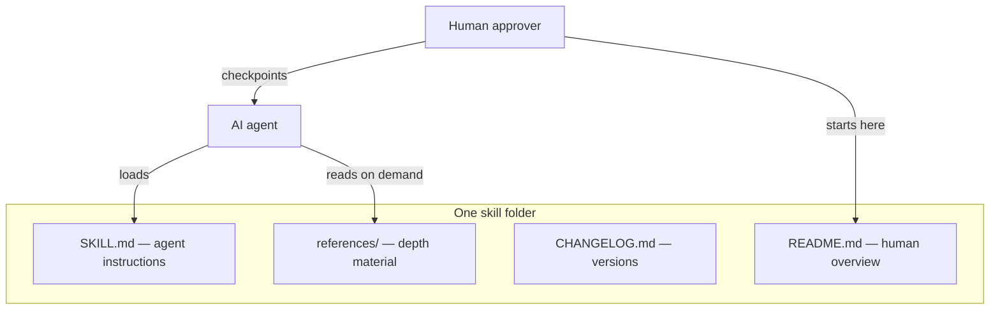

# Skills by Ian Balina

Open playbooks that AI agents can load and run end to end, with human checkpoints.

## About

I'm Ian Balina. I've been on both sides of the table. I founded [Token Metrics](https://www.tokenmetrics.com) and raised about $8M in a seed round from angels and a Reg CF (equity crowdfunding) raise. I later raised nearly $20M from LPs for Token Metrics Ventures, a crypto fund. Fundraising is hard to learn and easy to get wrong, so I'm sharing the playbooks I wish I'd had, built from real raises and credited sources. They're free for anyone to use.

- **X:** [@diaryofamademan](https://x.com/diaryofamademan)
- **GitHub:** [@diaryofamademan](https://github.com/diaryofamademan)

## What is a skill?

A **skill** is a self-contained folder an AI agent can load as operational instructions. Each skill includes:

- **`SKILL.md`** — the main instruction file (YAML frontmatter plus markdown the agent follows step by step).
- **`README.md`** — a human-readable overview, folder map, and how to run the skill with your agent.
- **`CHANGELOG.md`** — version history for the skill.
- **`references/`** — supporting notes, checklists, and paraphrased source digests the agent pulls in when needed.



## Skills

| Skill | What it does | Status |
| --- | --- | --- |
| [fundraising](./fundraising/) | Run a **startup** raise, an **LP fund** raise, or an **M&A** sale end to end (shared pipeline, guardrails, track-specific playbooks). | **v3.1.0** |

## How to use

1. **Download or clone** this repository (or copy a single skill folder into your project).
2. **Point your agent** at the skill’s `SKILL.md` — works with Claude, Cursor, Codex, or any agent that reads markdown skill files (see your product’s skill docs).
3. **Read the skill’s own `README.md`** for track selection, reference map, and human checkpoint rules before you let the agent act externally.

Nothing in this repo sends email, signs documents, or moves money by itself. You (or your designated approver) stay in the loop for consequential steps.

## Repository layout

```
skills/
├── README.md          ← you are here
├── CONTRIBUTING.md
├── LICENSE
└── fundraising/       ← one folder per skill (self-contained)
    ├── SKILL.md
    ├── README.md
    ├── CHANGELOG.md
    └── references/
```

## Principles

- **General and shareable** — skills describe processes anyone can adapt; they are not tied to one company’s private data.
- **Paraphrased, credited sources** — reference files summarize public materials and link to originals. We do not store copyrighted document text or pirated PDFs in the repo.
- **Human checkpoints** — agents draft and research; humans approve outreach, terms, signatures, solicitation, and wires.
- **Not advice** — these skills are operational playbooks, **not** legal, tax, or investment advice. Hire qualified professionals for binding decisions.

## Contributing

Suggestions, source links, and fixes are welcome via [GitHub Issues](https://github.com/diaryofamademan/skills/issues) or pull requests. Please read [CONTRIBUTING.md](./CONTRIBUTING.md) for folder conventions and content rules before opening a PR.

## License

This repository is licensed under the [MIT License](./LICENSE).
