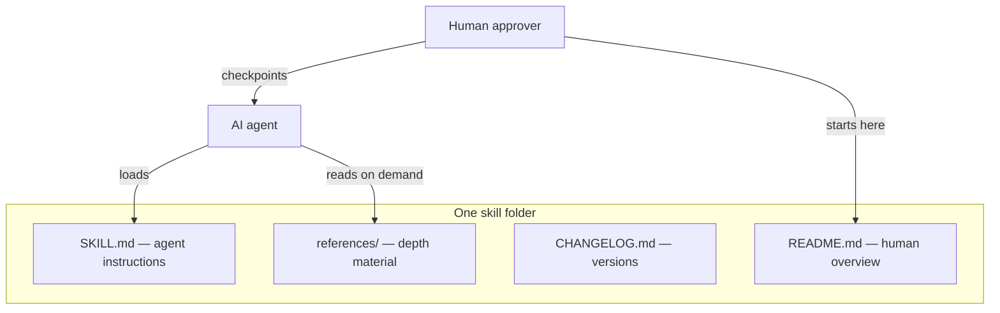

# Made Man Playbooks

What could your agent do with a better method? These are open playbooks by Ian Balina that AI agents can load and run end to end, with human checkpoints.

## About

I'm Ian Balina. I founded [Token Metrics](https://www.tokenmetrics.com) and raised about $8M to build it, then raised nearly $20M for Token Metrics Ventures, a crypto fund. These are the playbooks I wish I'd had, free for anyone to use.

- **X:** [@diaryofamademan](https://x.com/diaryofamademan)
- **GitHub:** [@diaryofamademan](https://github.com/diaryofamademan)

## What is a skill?

A **skill** is a self-contained folder an AI agent can load as operational instructions. Each skill includes:

- **`SKILL.md`** — the main instruction file (YAML frontmatter plus markdown the agent follows step by step).
- **`README.md`** — a human-readable overview, folder map, and how to run the skill with your agent.
- **`CHANGELOG.md`** — version history for the skill.
- **`references/`** — supporting notes, checklists, and paraphrased source digests the agent pulls in when needed.



## Skills

The playbooks run in five groups, in the order the work runs: understand the problem, decide, position, plan, then say it. Every skill is free.

### Understand

| Skill | What it does | Status |
| --- | --- | --- |
| [first-principles-thinking](./first-principles-thinking/) | Take a decision, a design, a cost, or a plan apart. Keep only the claims that have **real evidence**. Price the raw inputs where money is involved. Then build a better option up from the floor, instead of copying what was done before. The method follows Shane Parrish's [first principles essay at Farnam Street](https://fs.blog/first-principles/), and the sources are listed in `references/sources-and-urls.md`. | **v1.5.5** |
| [fix-the-bottleneck](./fix-the-bottleneck/) | Fix the one stage that sets a running system's pace. State the goal as throughput. Measure the chain. Get more from the constraint, and set everything else to its pace, before you spend on more. And when the constraint moves, run it again. | **v0.1.4** |

### Decide

| Skill | What it does | Status |
| --- | --- | --- |
| [game-theory-for-decisions](./game-theory-for-decisions/) | Decide when the result depends on what other people do. **Map who is playing**, what each one gains or loses, who knows what, and who moves when. Work out how they are likely to answer. Then pick your best move, or **change the game** itself. It covers negotiations, competition, enforcement, and cooperation. The method follows Farnam Street's [game theory mental model](https://fs.blog/mental-model-game-theory/), and the sources are listed in `references/sources-and-urls.md`. | **v1.0.4** |
| [fundraising](./fundraising/) | Run a **startup** raise, a fund raise from **LPs**, or the **sale of a company**, from the first list to the close: one shared process, the rules that keep it honest, and a playbook for each kind of raise. It also includes lessons from Travis Kalanick, retold in plain words, from his interview on the [David Senra podcast](https://www.davidsenra.com/episode/travis-kalanick), in `references/interview-lessons.md`. | **v3.3.6** |

### Position

| Skill | What it does | Status |
| --- | --- | --- |
| [positioning](./positioning/) | Decide what a product will be thought of as, before a launch, a repositioning, or a new segment. Work five components in order: what buyers would do instead, what the product uniquely has, what that is worth **with proof**, who cares most, and the **category last**. Then pass it through a strategy gate that demands **named trade-offs** and separates table stakes from real differences. Get back a positioning record: the owned concept, the category, the named alternatives, the best-fit customers, and the trade-offs. | **v0.2.1** |
| [business-model-canvas](./business-model-canvas/) | State how a business makes money on **one sheet**, and test it. A fit test picks the **Lean Canvas** while the model is still being searched for, or the nine-block **Business Model Canvas** once it is found. Fill the sheet from evidence. Then rank the **riskiest assumptions**, each with its next test. | **v0.1.3** |
| [vision-and-manifesto](./vision-and-manifesto/) | Write a **vision, mission, or manifesto** that does work. One core set of beliefs at three lengths: the vision as a **picturable future** with a number on it, the mission as the work now, and a manifesto only when a public job exists for one. It ships only when the statements **change real decisions** about hiring, firing, and money. | **v0.1.3** |

### Plan

| Skill | What it does | Status |
| --- | --- | --- |
| [one-page-marketing-plan](./one-page-marketing-plan/) | Put the whole marketing system on **one page**. Diagnose first. Then fill nine squares in order: target market, message, media; capture, nurture, convert; experience, lifetime value, referrals. Each square stands on **measured evidence** about how buyers actually behave. Finish by stating the split between building future demand and harvesting present demand as a hypothesis your own numbers will judge. | **v0.3.3** |
| [cold-outreach](./cold-outreach/) | Write a **cold email or cold DM** that earns replies. Test the offer first. Build the batch from a **trigger**. Check the warm path and the history. Research **one true observation**. Ask one question about interest. Every rule shows the evidence behind it. The claims that failed the checking are named and kept out. And the draft is judged in a separate pass, with nothing sent until a person approves it. | **v0.1.5** |
| [inbound-sponsorship](./inbound-sponsorship/) | Run the **inbound** sponsorship desk for a media property: triage inquiries against a bar, sort them into **pricing lanes**, negotiate on evidence, structure **hybrid deals with a floor**, and run each placement through its lifecycle to renewal. Includes a **reputation check** and a custody test for sponsors whose business holds their customers' money. | **v0.1.3** |
| [funnel-operator](./funnel-operator/) | Run a **video channel as a system**, not as one-off uploads. Set the channel up once as a **single config file**. Then run the whole funnel: research feeds the topic engine, every episode moves through the **same nine stages** — topic engine, script, storyboard, assets, voice and music, assembly, packaging, publish gate, numbers read — distribution carries each episode to the channel's other platforms, and a **scoreboard** reads the funnel end to end. A second channel costs a new config, not a new method. | **v0.6.0** |

### Say

| Skill | What it does | Status |
| --- | --- | --- |
| [comms](./comms/) | Founder communications run as a **set of steps**: name the moment, decide **who speaks**, work out how the audience already sees you, build a story others can **retell**, say it plainly and **go direct**, then keep your answers disciplined after it lands. It covers announcements, launches, crises, and everyday content. It is built on Lulu Cheng Meservey's [Go Direct manifesto](https://www.getflack.com/p/go-direct-the-manifesto), and it includes a case study that checks the Nvidia CEO's crisis week move by move, in `references/case-study-nvidia-week.md`. | **v1.1.5** |
| [write-in-your-voice](./write-in-your-voice/) | Write in a person's real voice, built from how they actually speak. First build a bank of their own words, from their speech. Draft from their own sentences. Then check the draft's shape, not just its words. | **v1.2.6** |
| [stop-the-scroll](./stop-the-scroll/) | Build content whose hook and call to action each stand out among a hundred pieces, and stand alone with nothing around them. The frame is AIDA, with the ends hardened, over a middle anyone can follow, about impact. | **v0.4.1** |
| [interview-yourself](./interview-yourself/) | An AI interviewer that asks questions a stranger already cares about, with the receipt from your own week and the numbers attached, so your answers out loud become posts. | **v0.1.4** |
| [podcast-yourself](./podcast-yourself/) | Prep a **talking-head video** before the camera rolls. Mine the performer's own posts for the shapes that already worked. Sort every claim by who can say it. Then build a **riff sheet** — one question per beat, the receipt to hit, the line to land — plus the **edit brief** the footage is cut under. | **v0.2.0** |
| [storytelling](./storytelling/) | Design a story that **holds to the end**: the arc, the structure, the hook, the scenes, the ending. Every lesson in its evidence base carries a **label** — measured, practitioner, framing, platform-declared, or observed — so a choice never borrows more authority than it has. It hands off **scene cards** a producer can build from, and closes the loop by reading the published piece's **retention data** against the lessons it used. | **v0.1.0** |
| [cartoon-system](./cartoon-system/) | Keep a **recurring character the same** across every image — a strip, a carousel, a deck, a character-led video. A **character bible** holds the cast. Each image is generated against the approved images before it, and a **drift check** fails anything that wanders before it ships. The skill produces **images only**: headlines, captions, and a signature block are optional text layers, each behind its own flag, all off by default. | **v0.1.0** |

### The router

| Skill | What it does | Status |
| --- | --- | --- |
| [playbook](./playbook/) | The **router** for this collection. Hand it a task with **no skills named**: it classifies the task, selects the playbook skills whose triggers it matches, runs each one **for real and in order** — understand, decide, position, plan, say — and merges the results into **one deliverable** that closes by naming which skills ran and what each one changed. | **v0.1.0** |

## How to use

1. **Download or clone** this repository (or copy a single skill folder into your project).
2. **Point your agent** at the skill’s `SKILL.md` — works with Claude, Cursor, Codex, or any agent that reads markdown skill files (see your product’s skill docs).
3. **Read the skill’s own `README.md`** for track selection, reference map, and human checkpoint rules before you let the agent act externally.

Nothing in this repo sends email, signs documents, or moves money by itself. You (or your designated approver) stay in the loop for consequential steps.

## Repository layout

```
skills/
├── README.md          ← you are here
├── CONTRIBUTING.md
├── LICENSE
└── fundraising/       ← one folder per skill (self-contained)
    ├── SKILL.md
    ├── README.md
    ├── CHANGELOG.md
    ├── assets/icons/  ← Hugeicons free SVGs (MIT)
    ├── scripts/       ← verify-assets.sh
    └── references/
```

## Principles

- **General and shareable** — skills describe processes anyone can adapt; they are not tied to one company’s private data.
- **Paraphrased, credited sources** — reference files summarize public materials and link to originals. We do not store copyrighted document text or pirated PDFs in the repo.
- **Human checkpoints** — agents draft and research; humans approve outreach, terms, signatures, solicitation, and wires.
- **Not advice** — these skills are operational playbooks, **not** legal, tax, or investment advice. Hire qualified professionals for binding decisions.

## Contributing

Suggestions, source links, and fixes are welcome via [GitHub Issues](https://github.com/diaryofamademan/skills/issues) or pull requests. Please read [CONTRIBUTING.md](./CONTRIBUTING.md) for folder conventions and content rules before opening a PR.

## License

This repository is licensed under the [MIT License](./LICENSE).

## Get the playbooks in your inbox

Every skill here is free, and new ones drop as I build them. Leave an email at [ianbalina.com/skills](https://ianbalina.com/skills/) and each new skill arrives the day it drops, with the build notes behind it.
