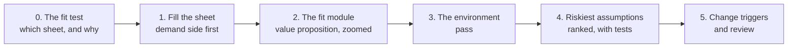

#  business-model-canvas (open skill)

**How to state a business model so its weakest parts show — and get tested first.** Start with a fit test: still searching for the model, you get the Lean Canvas; the model found, you get the nine blocks. Fill the sheet from evidence, with every guess labeled a guess. Zoom on the value proposition until the fit verdict is plain. Read the environment the sheet leaves out. Then finish with the deliverable that matters: the riskiest assumptions, ranked, each carrying the cheapest test that could kill it, an owner, and a date.

##  What this is

An open skill that an AI agent can run, for the page most businesses can produce and few can defend: how the money machine is supposed to work.

Canvas work usually fails in one of two directions. The workshop version fills all nine blocks in an afternoon, in the language of the template, and produces a poster — complete, plausible, and untested in every block that matters. The flattering version chooses the sheet that makes the business look most established, and shows investors a model with the doubts edited out. This skill takes the disciplined middle. The sheet is chosen by the state of the business, not by preference: the Lean Canvas while the model is still being searched for, the nine blocks once it is found. Every entry is labeled evidence or assumption as it lands. And the run is not finished when the sheet is full — it is finished when the assumptions are ranked and each of the riskiest carries a test that could kill it.

The skill is honest about its instrument. The canvas is a practitioner frame, and the one direct test of it in the literature found it moved pitch placing, not profit, with only customer segmentation clearly carrying weight. So the canvas here is a recording and stress-testing device — the shared page a team argues from — and the weight of the method sits where false beliefs can actually be found: the environment the sheet omits, restored as a step; the assumptions the sheet contains, ranked; and the triggers that say when the snapshot has expired.

It answers three questions:

1. Is this business still searching for its model, or executing one it has found — and what do the facts say?
2. On the right sheet, what does the model claim, block by block — and which entries are evidence, and which are guesses?
3. Which assumptions would kill the model if false, in what order — and what is the cheapest test for each?

The skill runs standalone at a founding, a pivot, or before a raise. Its record chains outward: positioning feeds its value proposition block, the vision record informs what model is worth building, the 1-Page Marketing Plan takes its economics as the constraints the plan must respect, and fundraising borrows the finished canvas whole — assumptions visible, or not at all.

##  Who it is for

| Reader | What they get |
| --- | --- |
| Founders before a launch, pivot, or raise | The model stated once, on the sheet their state of business earns, with the doubts ranked instead of hidden |
| Operators and chiefs of staff | One dated record the whole company argues from — disagreement becomes about a specific block, not a vibe |
| Teams whose rooms describe different businesses | A redraw that starts from evidence, labels the guesses, and names what would change the model |
| Agents running strategy work for a human approver | An output contract: the fit verdict first, the filled canvas, the environment, the ranked assumptions with tests, owners, and dates |

##  Process at a glance

##  How to use with an agent

| Step | What to give the agent |
| --- | --- |
| Name the occasion | The founding, pivot, or raise this run serves, and what a defensible model would unblock |
| Hand over the evidence | Sales records, pricing history, channel numbers, customer language — the rawer the better; what cannot be evidenced will be labeled assumption, which is information too |
| Expect the fit test to push back | If the business is still searching, the run will use the Lean sheet and say why; a request for the nine blocks anyway is recorded as the user's call, against the test |
| Sit for the assumptions | The ranking discussion is the work: what dies if this is false, and what is the cheapest way to find out. Nothing ships with those fields empty |
| Take the record, not the poster | The return carries the verdict, the filled sheet, the environment, the ranked tests with owners and dates, and the redraw triggers |

##  Folder map

| Path | What it holds |
| --- | --- |
| `SKILL.md` | The one idea, the evidence in brief, the six-step procedure, guardrails, the output contract, limits, and the verification checklist |
| `references/README.md` | Index of the depth material |
| `references/the-evidence.md` | The sources in full: the frames and their grades, the one direct test of the canvas, and the criticisms stated at full strength |
| `references/the-two-sheets.md` | The nine blocks and the Lean sheet side by side, the fit test worked slowly, and the mixed-state rule |
| `references/riskiest-assumptions.md` | The assumptions method in full: extraction, the ranking, what makes a test a test, and the failure modes |
| `references/worked-example.md` | A de-identified composite worked example: a business still searching, run onto the Lean sheet, with its assumptions ranked and tested on paper |

##  Sources and credits

The nine-block canvas and its process are Alexander Osterwalder and Yves Pigneur's (*Business Model Generation*, 2010) — the canonical practitioner frame, labeled as such. The fit module is the Value Proposition Canvas from the same team (*Value Proposition Design*, 2014). The pre-fit sheet is Ash Maurya's Lean Canvas (*Running Lean*, 2012), a practitioner adaptation whose searching questions this skill's fit test adopts. The one direct empirical test, Timothy Ladd's study of 271 accelerator teams (*Journal of Research in Marketing and Entrepreneurship*, 2018), sits in the skill's limits at full strength: pitch placing moved, profit did not, only customer segmentation clearly correlated. The criticisms — static snapshot, no competition or environment, no prioritization between blocks — are Barbara Coes's (2014) and the wider critical literature's, named in the evidence reference and answered inside the procedure as far as they can be. No source text is reproduced.

##  Contributing

Improvements are welcome. The bar is the same as the method: a proposed change names its evidence — a run where the fit test chose wrong, an assumption the extraction missed that later killed a model, a test that could not fail and so proved nothing — and scored runs (a record, its tests, and what the tests found) are the most valuable contribution there is.

##  License

MIT. See the repository LICENSE file.

##  Version

0.1.2 — the visual deliverables now carry Hugeicons, the house icon library (see `CHANGELOG.md`). First build (0.1.0): the fit test choosing between the Lean Canvas and the nine blocks, the evidence-labeled sheet, the environment pass, and the ranked assumptions list as the output contract's center of weight. See `CHANGELOG.md`.
