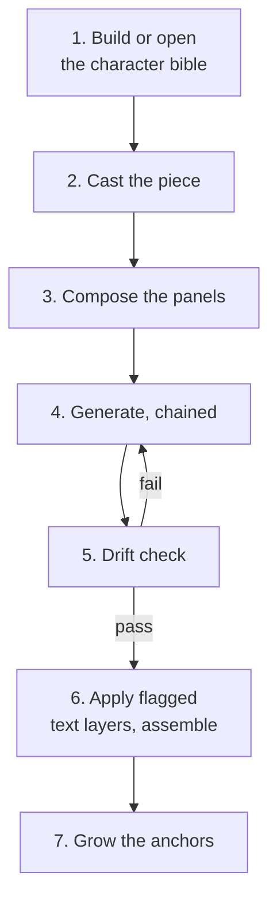

#  Cartoon System (open skill)

**Cartoon System is the image layer for recurring characters: it keeps one character recognisably the same across a whole piece and across a whole series, by generating from a character bible, chaining each image to the approved ones before it, and failing any image that drifts.**

##  How to read this

`SKILL.md` is the method: the one idea, the guardrails, the text-layer flags, and the seven-step core procedure.

`references/character-bible-template.md` is the blank bible: the series rules block, the per-character entry fields, and the rules for the reference set.

`references/panel-grammar.md` is image composition only: the panel box, the padding, character placement and scale, and backgrounds.

`references/text-layers.md` holds the three optional text layers — headline, caption, signature — and the rules each one follows when its flag is on.

`references/drift-check.md` is the per-panel checklist in full, including the continuity block, and the rule for what happens on a fail.

`references/worked-example.md` is one real series taken through the whole procedure, so a first-time reader can see the method working end to end.

`README.md` is the human-facing overview.

##  When to use this skill

Use it when a character has to survive more than one image:

- A cartoon strip or comic series with a standing cast.
- A carousel or deck whose pages are drawn scenes with the same lead.
- A character-led video, where each scene is a panel that has to match the last.
- A single panel that must match an existing series exactly.
- Any image job where "that is not the same character" would be a defect, not a style note.

##  When NOT to use this skill

- One-off illustration with no recurring character. Generate it directly; the bible and the chain only pay back across images.
- Photographic or product imagery. This skill is for drawn characters in a locked drawn style.
- The words. When a piece needs a story, a hook, or headline copy, that is a sibling skill's job — this skill draws. It applies text layers only when a flag tells it to, and it does not write the text.
- Repairing a drifted image. A drifted panel is regenerated, never patched. If the job is to fix one image in an editor, this is the wrong tool.

##  Agent guardrails

1. **No character appears without a bible entry and a reference anchor.** A character with no entry is added to the bible first — species, role, proportions, eyes, palette, line style, reference image — or it does not appear. Improvised characters are drift by definition.

2. **The cast rule is binding.** Every bible carries a cast rule: which kinds of beings may appear in the series. In the worked example's system the rule is animals and robots only, never humans, and counterparties are cast as animals. A generation that breaks the cast rule fails, however good it looks.

3. **Text layers are flags, and all three default to off.** The flags are `headline`, `caption`, and `signature`. The skill delivers clean images unless the caller sets a flag. The skill never turns a layer on by itself, and it never invents headline or caption words to fill a layer — the words come from the caller or from a sibling skill.

4. **A drifted panel is a failed panel.** It is regenerated with the anchor set. It is never repaired in assembly, never cropped into compliance, and never shipped with a note. Two failures on the same panel escalate the prompt's style block — the failing trait gets named explicitly — never the standard.

5. **The chain only points backward at approved, current images.** Within a piece, each new image is generated against the bible's standing anchors plus the piece's approved images. An unapproved image anchors nothing. If an earlier image is regenerated, every later image is re-checked against the new version before the piece ships.

6. **The art itself stays text-free.** Generation prompts forbid letters, numbers, logos, and signage in the image. Any text a model draws into the art fails the panel outright. Real text is set as type at assembly, in the text layers, where it stays crisp and correctable.

7. **Positions never move.** The panel box, the padding, and — when their flags are on — the headline, caption, and signature positions are series constants recorded in the bible. A piece that moves them has broken the series, even if every character is perfect.

8. **Write the output plain.** Every human-facing note this skill returns — drift results, bible updates, delivery notes — is written the way a person says it out loud: short sentences, one idea each, plain words, numbers spoken the way people say them. Exact figures live in specs and tables.

##  The one idea

**The bible holds the character. The chain holds the piece. The drift check enforces both.**

A recurring character is a promise the audience can check at a glance.

The bible keeps that promise across a series: one entry per character, one locked style block, one reference set that every generation anchors to.

The chain keeps it inside one piece: images are generated in sequence, and each approved image joins the working reference set, so the tenth panel is anchored to the nine that passed before it — not just to a description.

Text is not part of the picture. Headlines, captions, and the signature block are layers laid over finished images, each behind its own flag, each off unless the caller asks.

##  Text layers: the flags

Three layers exist. Each is controlled by a flag set per job, by the caller — a channel's style bible, a deck spec, or a one-off request.

| Flag | Layer | Default |
| --- | --- | --- |
| `headline` | One headline line, set as type | off |
| `caption` | One caption line under the headline | off |
| `signature` | The series' signature block: its public handles and the page number | off |

When a flag is off, the skill delivers the image with no trace of that layer, and it does not reserve space for the text. Composition uses the whole frame. The one exception: a caller may also ask for headroom — empty space left in the composition for text a later tool will set. Headroom is a caller option, never a default.

When a flag is on, that layer's rules apply in full. They live in [`references/text-layers.md`](references/text-layers.md).

A run always reports the flags it ran under, so a clean delivery and a layered delivery are never confused downstream.

##  Core procedure

Run the steps in order.

### Step 1: Build or open the character bible

Every series has one bible. Build it before the first piece; open it before every later one.

The bible holds the series rules: the cast rule, the locked style block (the exact prompt text every generation carries), the panel frame spec, the palette, the line style, and the series' own text-layer defaults if it has any.

It holds one entry per character: species and role, proportions, the eyes, palette, line style notes, signature props or wardrobe, and the character's reference set — the standing anchor images every generation of that character uses.

The blank bible is [`references/character-bible-template.md`](references/character-bible-template.md).

### Step 2: Cast the piece

Map every role in the piece to a cast member, under the cast rule.

The lead plays the point of view. The counterparty — the buyer, the rival, the other side of the table — is cast from the standing cast, the way a theatre company casts from its company.

A role with no cast member is a bible job first: the new character gets an entry and a reference anchor before it appears in any panel. Casting never happens inside a generation prompt.

### Step 3: Compose the panels

Lay out the piece as panels: one panel per point, one idea per panel.

Composition is image only: who is in frame, where they stand, how large, what the background holds. The full grammar — the panel box, the padding, placement and scale discipline, backgrounds — is [`references/panel-grammar.md`](references/panel-grammar.md).

If the piece carries a story, the panel list comes from the storytelling skill's scene cards, and each panel inherits its scene's function. This step orders and frames the panels; it does not write them.

### Step 4: Generate, chained

Generate the panels in sequence, in rounds, within the media pipeline's limits for images per round.

Every prompt is built the same way: the bible's locked style block, word for word, then the character descriptions for everyone in frame, then the scene.

Every generation carries its reference set. The set starts as the bible's standing anchors for the characters in frame. Then the chain takes over: within a piece, the reference set for each new panel is the standing anchors **plus the approved images that came before it in the same piece** — at minimum the immediately prior approved panel, and any earlier panel that shares its setting, its props, or its secondary characters.

Each image that passes the drift check joins the working reference set at once, so continuity compounds down the sequence: same character, same setting elements, same light, same palette.

### Step 5: Run the drift check

Check every panel against the full checklist in [`references/drift-check.md`](references/drift-check.md) before it is approved: character identity, the eyes specifically, the cast rule, the box and padding, line style, background, invented text — and the continuity block, which checks the panel against the prior approved panel as well as against the bible.

A panel that passes joins the working reference set and the piece moves on.

A panel that fails is regenerated with its anchor set. On the second failure of the same panel, the prompt's style block is strengthened — the failing trait named explicitly — and the panel is generated again. The standard never drops.

If an early panel is regenerated after later panels exist, the later panels are re-checked against the new version. Any whose continuity breaks are regenerated too. The chain only ever points backward at approved, current images.

### Step 6: Apply the flagged text layers, and assemble

Assemble the approved panels in order, with identical geometry throughout: same box, same padding, same page size.

Then apply the text layers whose flags are on for this job — and only those. The rules for each layer are in [`references/text-layers.md`](references/text-layers.md). Text is set as type at this stage, never drawn into the art at generation.

With all flags off, this step is assembly only, and the delivery is clean images.

### Step 7: Grow the anchors

Close the run by improving the bible.

An approved panel that shows a character cleanly — full face, standard pose, nothing occluding — may be promoted into that character's standing reference set. Consistency gets easier every piece, because the anchor set is built from images that already passed.

Record any bible changes with the delivery: new characters, new anchors, a style block that was strengthened and why.

##  Calls on sibling skills

This skill names its siblings and calls them at set points. It never absorbs their jobs.

- **Storytelling** — before step 3, when the piece carries a story: storytelling owns the narrative — arc, hook, scene function — and hands this skill scene cards. This skill turns cards into panels. A panel that makes no point is a storytelling problem sent back upstream, not a drawing problem.
- **Channel-operator** — the reverse call: a channel's operator skill calls this skill at its assets stage whenever the channel's style bible names a character system. The channel's style bible declares which text layers, if any, this skill applies, by setting the flags. Captions for video are normally the operator's assembly job, not this skill's — the flag stays off unless the style bible says otherwise.
- **Comms** — when a flagged text layer carries public copy: comms owns how a public moment is said. This skill sets the type; it does not choose the words.
- **Stop-the-scroll** — when a headline layer is on and the piece must earn attention in a feed: the hook discipline is stop-the-scroll's. This skill keeps the headline to one line in its fixed place; whether the line earns the stop is the sibling's call.

##  Output contract

A run of this skill returns four things:

1. **The images** — the finished panel set in order, or the single panels requested. Clean images when all flags are off; layered pages when flags are on.
2. **The flags used** — the state of `headline`, `caption`, and `signature` for the run, stated plainly with the delivery.
3. **The drift-check result per panel** — pass, or the failing item and what was regenerated. A panel that needed a strengthened style block says so.
4. **The bible updates** — new characters entered, anchors promoted, style-block changes, each with its reason.

**The writing pass (binding).** Every human-facing output of this skill is written the way you would say it out loud: short plain sentences, one idea each, active voice. Numbers in prose are spoken the way a person says them — the third panel of seven, about forty pixels of padding — and exact figures live only in specs and tables.

##  Limits and boundaries

- The skill holds a character steady; it does not invent one well. A character's design — species, look, eyes — is a human choice made in the bible. The skill enforces the choice across images.
- Consistency is anchored, not guaranteed. Each generation is a fresh draw guided by the reference set, and the drift check exists because some draws will fail it. Budget rounds for regeneration on any piece longer than a few panels.
- The chain helps most inside one piece. Across pieces, only the standing anchors carry over, so a series that promotes its best panels into the bible compounds; one that does not starts each piece colder.
- Text layers are layout, not copy. The skill will set a headline beautifully and has no view on whether the headline is true, compliant, or worth saying. Those calls belong to the caller and the sibling skills.
- The frame spec is mechanical on purpose. Normalising box and padding after generation is part of the method, not a repair of drift: character drift fails a panel, frame drift is corrected by the mount.

##  Verification checklist

Before calling a run done, confirm:

- Every character in every panel has a bible entry and a reference anchor.
- The cast rule held in every panel — no being appears that the rule forbids.
- Every generation prompt carried the locked style block, word for word.
- Each panel was generated against the standing anchors plus the approved panels before it in the piece.
- Every panel passed the drift check, including the eyes and the continuity block — or was regenerated until it did.
- If an early panel changed late, every later panel was re-checked against the new version.
- Box, padding, and page geometry are identical across the set.
- The flags used are stated with the delivery, and no layer appears whose flag was off.
- No text exists anywhere the art itself was supposed to be text-free.
- Bible updates — new entries, promoted anchors, style-block changes — are recorded with the delivery.
