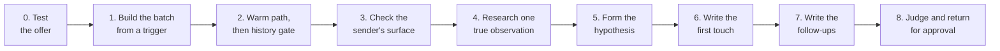

#  cold-outreach (open skill)

**How to write cold email and cold DMs that earn replies, built from evidence that was checked, not advice nobody ever tested.** This skill runs the work in the order that decides the result. Test the offer. Build the batch from a trigger. Check the warm path and the history. Research one true observation. Only then write the short sequence, whose first ask is a question about interest.

##  What this is

An **open, agent-oriented skill** for the first message to someone with no prior relationship, and for the follow-ups that carry most of the replies.

Most cold outreach advice is vendor marketing: the company selling the email coaching publishes the study that proves its own rules. This skill takes a different approach. Every rule carries its evidence with it: whose data, how much of it, what year, and how strong it is. And the claims that failed the checking are named and kept out:

1. What actually decides a reply: the offer, the trigger, the list, or the copy?
2. Which copy rules survive grading, and which are just repeated advice nobody ever tested?
3. How is a sequence built so the follow-ups — where most replies live — each carry something new?

The method was built from the author's own sent outreach across data licensing, advisory, and sponsorship lanes, audited against Lavender's 20 cold email tips, Dimitar Angelov's outbound article, and a graded research pass over the academic literature and the large platform datasets (Gong, Belkins, Smartlead, Smartlead-scale platform data, Boomerang, and the peer-reviewed persuasion literature).

##  Who it is for

| Reader | What they get |
| --- | --- |
| Founders and operators selling to a small, named market | A batch procedure sized for high-value prospects, where research depth beats send count |
| Anyone burned by cold email advice that was never tested | Rules with their evidence shown, contradictions flagged, and the dead claims listed so they stay dead |
| Agents drafting outreach for a human approver | An output contract: offer test, batch definition, gate results, the three emails with word counts and checklist verdicts |
| Senders whose name is the asset | A method that refuses one-shot tricks, because in small markets the game repeats and reputation is spent across prospects |

##  Process at a glance

##  How to use with an agent

| Step | What to give the agent |
| --- | --- |
| Name the lane and the offer | The lane (licensing, advisory, sponsorship, partnership) and the offer in your own words; the agent runs the one-sentence test |
| Point it at the trigger | The event the batch is built from — a launch, a raise, a hire, a public problem — and where to verify it |
| Let the gates run | The agent checks introduction routes, existing connections, and your own mailbox history before anyone is treated as cold |
| Read the batch, not single emails | Each return carries the batch definition, the gate results, and per recipient the research note and all three emails |
| Judge by your own numbers | Batches are scored on positive replies and meetings against your previous batches in the same lane, never against a vendor's headline rate |

##  Folder map

| Path | What it holds |
| --- | --- |
| `SKILL.md` | The nine-step procedure, guardrails, output contract, and limits |
| `references/README.md` | Index of the depth material |
| `references/the-evidence.md` | The graded evidence: what the datasets and studies actually support, and where they contradict each other |
| `references/lavender-audit.md` | Lavender's 20 tips and Angelov's outbound article, audited line by line: adopt, adapt, or reject, with reasons |
| `references/lane-cards.md` | The four lanes — licensing, advisory, sponsorship, partnership — each with its ask and its proof rules |
| `references/worked-example-labs-batch.md` | A full run on a data-licensing batch: gates, research notes, and the three emails with verdicts |
| `references/follow-ups-and-dms.md` | Follow-up construction, proof sequencing, the honest benchmarks with their denominators, and the thin DM evidence |
| `references/sources-and-urls.md` | Every study, dataset, and article behind the skill, credited |

##  Sources and credits

The evidence base is graded in full in `references/the-evidence.md`. The academic anchors: Sahni, Wheeler and Chintagunta's randomized field experiments on email personalization (*Marketing Science*, 2018); O'Keefe and Jensen's meta-analysis of message framing (*Communication Yearbook*, 2006, with the 2007–2012 updates); and the 2024–2025 loss-aversion meta-analyses (Brown, Imai, Vieider and Camerer; Walasek, Mullett and Stewart; Yechiam and Zeif). The large datasets: Gong's cold email analyses (85 million and 304,174 emails), Belkins' sequence and subject-line studies (7.53 million and 5.5 million emails, 2025), Belkins × Expandi's LinkedIn study (15.1 million contacts, 2025), Smartlead's *State of Cold Email* (850 million emails), and Boomerang's general-email study (5.3 million emails, 2016). The practitioner sources audited: Lavender's cold email tips and benchmark posts, and Dimitar Angelov's "Every Cold Outreach Principle I Know in One Article" (2026). Full table: `references/sources-and-urls.md`. These are paraphrases and adaptations, credited; no source text is reproduced.

##  Contributing

Improvements are welcome. The bar is evidence: a proposed rule change names its dataset or study, its size, and its year — or is labeled practice and argued on those terms. Field reports, a batch written up with its gate results and its reply outcomes, are the most valuable contribution there is.

##  License

MIT. See the repository LICENSE file.

##  Version

0.1.2 — See `CHANGELOG.md`.
