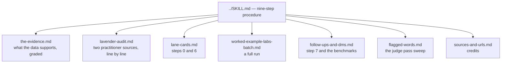

# References index — Cold Outreach

These references support **cold-outreach**, version **0.1.3**. The main `../SKILL.md` holds the nine-step procedure, the guardrails, and the output contract. These files carry the depth: the graded evidence under every rule, the two practitioner audits, the lane cards, one worked run, the follow-up and DM material, and the flagged-words list the judge pass sweeps for.

| File | What it carries |
| --- | --- |
| `the-evidence.md` | Every finding the rules rest on, with its source, dataset size, year, and grade — and the contradictions and dead claims named |
| `lavender-audit.md` | Lavender's 20 tips and Dimitar Angelov's outbound article, each point marked adopt, adapt, or reject against the evidence and the author's record |
| `lane-cards.md` | The four lanes — data and product licensing, advisory and services, sponsorship, partnership — with each lane's ask, proof rules, and failure mode |
| `worked-example-labs-batch.md` | A complete run on a data-licensing batch: offer test, gates, research notes, the three emails with word counts and checklist verdicts (details changed, structure real) |
| `follow-ups-and-dms.md` | How follow-ups are built, how proof is sequenced, the honest benchmark table with denominators, and what is actually known about LinkedIn and X direct messages |
| `flagged-words.md` | The words that fail on sight — the plain-words rule made checkable, swept for in the judge pass |
| `sources-and-urls.md` | Every study, dataset, and article behind the skill, with what was taken from each |
