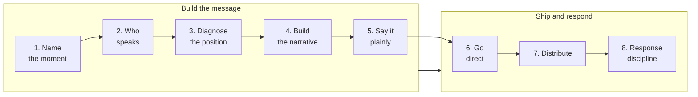

#  comms (open skill)

**A decision procedure for founder communications.** This skill turns "go direct" into a procedure an agent or operator can run, check, and act on — for the announcement you choose to make, the crisis you did not, and the everyday output that decides whether anyone is listening when either one lands.

##  What this is

An **open, agent-oriented skill** for announcements, launches, crises, responses, and everyday founder content.

Most communications advice teaches tactics: post more, polish the release, hire the agency. This skill starts with the moment itself and asks:

1. What kind of moment is this, and what is actually at stake?
2. Who holds the knowledge this enterprise is built on — and is that who is speaking?
3. What position do we already hold in this audience's mind?
4. Which claims can the founder make in their own voice, and which ones need a witness?
5. What happens after we speak — and what will it cost?

Three disciplines make this version different:

1.  **The story is the product** — the founder is the spokesperson because the founder holds the knowledge. Outsourcing the narrative is outsourcing the product in a different department.
2.  **Claims are sorted, not just written** — every material claim is marked "say it yourself" or "needs a witness," and the sort travels with the draft into the response plan.
3.  **The response is part of the message** — confidence is debt, a partial admission schedules the second scandal, and the guardrails govern the days after the statement, not just the statement.

##  Who it is for

| Audience | Use |
| --- | --- |
| **Founders / operators** | Launches, raises, hiring narratives, public failures, regulator and press moments, and the everyday content that builds the audience those moments draw on |
| **Chiefs of staff / comms leads** | Run the procedure with the founder instead of around them: prepare the moment, the claim sort, and the response plan before anything ships |
| **AI agents** | Load `SKILL.md`, run one moment at a time, and return the four-part output — the named moment, the claim sort, the statement, and the response plan — never a committee-voice draft |
| **Maintainers** | Refresh `references/` when sources change, bump `version` in `SKILL.md`, and record the change in `CHANGELOG.md` |

##  Process at a glance

##  How to use with an agent

1. **Load** [`SKILL.md`](./SKILL.md) as the skill.
2. **Name one moment** and its mode — announcement, crisis, response, or everyday. The skill runs on one moment at a time.
3. **Pull references by branch:**

| Need | Read |
| --- | --- |
| The doctrine: what going direct means, and what it does not |  [`references/go-direct.md`](./references/go-direct.md) |
| Build the message: position diagnostic and narrative structure |  [`references/narrative-and-position.md`](./references/narrative-and-position.md) |
| Ship it, and the days after: distribution and response rules |  [`references/distribution-and-response.md`](./references/distribution-and-response.md) |
| A complete graded example (Nvidia, November 2026) |  [`references/case-study-nvidia-week.md`](./references/case-study-nvidia-week.md) |

4. **Hold the guardrails.** In an active legal or regulatory matter, counsel reviews any statement before it ships. The skill drafts, sorts, and grades; it does not publish, send, or speak for the founder on its own.

##  Folder map

| Path | One line |
| --- | --- |
| [`SKILL.md`](./SKILL.md) | Main skill: four modes, output contract, eight-step procedure, guardrails, worked patterns, limits and boundaries |
| [`CHANGELOG.md`](./CHANGELOG.md) | Version history |
| [`references/README.md`](./references/README.md) | Index of the reference files |
| [`references/go-direct.md`](./references/go-direct.md) | The doctrine spine: the founder as spokesperson, what "direct" means and does not mean, resistance is escalation, the ship-to-yap ratio |
| [`references/narrative-and-position.md`](./references/narrative-and-position.md) | The position diagnostic (Ries), the witness rule, and the five-part narrative structure (Raskin) |
| [`references/distribution-and-response.md`](./references/distribution-and-response.md) | The everyday engine (Vaynerchuk), the plain-writing gate (Graham), and the response rules in full |
| [`references/case-study-nvidia-week.md`](./references/case-study-nvidia-week.md) | A real crisis graded move by move against the procedure and guardrails, from public reporting |
| [`assets/icons/`](./assets/icons/) | Hugeicons Free SVG icons used in the documents |

##  Sources and credits

- The doctrine spine is Lulu Cheng Meservey, ["GO DIRECT: THE MANIFESTO"](https://www.getflack.com/p/go-direct-the-manifesto) (Flack, 2024), plus her talks for "resistance is escalation" and the ship-to-yap ratio.
- The narrative structure is Andy Raskin, "The Greatest Sales Deck I've Ever Seen" (2016).
- The position diagnostic is Al Ries and Jack Trout, *Positioning: The Battle for Your Mind* (1981), with Al Ries and Laura Ries, *The Fall of Advertising and the Rise of PR* (2002) — used in scoped form; the rest of the positioning apparatus is marketing, and the first-into-the-mind claim carries known counter-evidence (Golder and Tellis).
- The distribution discipline is Gary Vaynerchuk, *Jab, Jab, Jab, Right Hook* (2013) and the document-don't-create practice.
- The plain-writing gate is Paul Graham, "Write Like You Talk" (2015) and "How to Write Usefully" (2020).
- The case study is graded from public reporting by the Wall Street Journal, CNN, Barron's, and Bloomberg (November 2026).
- Content is **paraphrased**. No copyrighted book or article text is stored in this folder.

##  Contributing

- Open a PR with a better paraphrase, a new public source, or a graded public case study with the reporting cited.
- Keep the folder grep-clean: no personal, company, or live-matter details inside the skill.
- When a source changes, re-read it, re-paraphrase, bump `version` in `SKILL.md`, and add a `CHANGELOG.md` entry.

##  License

MIT — see [`SKILL.md`](./SKILL.md) front matter. Third-party sources remain under their publishers' terms.

##  Version

Current skill version: see `version` in [`SKILL.md`](./SKILL.md) front matter. History: [`CHANGELOG.md`](./CHANGELOG.md).
