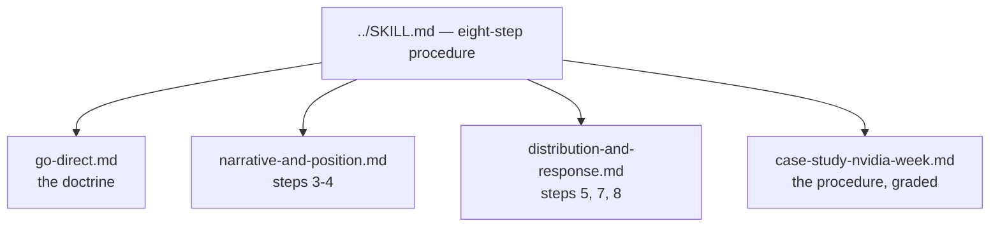

# References index — Comms

These references support **Comms**, version **1.0.1**. The main `../SKILL.md` holds the eight-step procedure, the guardrails, and the output contract. These files carry the depth: the doctrine, the message-building tools, the distribution and response rules, and one fully graded public case.

Read the main skill first. Open a reference when the moment needs depth. Do not load every file by default.

- `go-direct.md` — the doctrine spine: what going direct means, what it does not mean, and the founder-as-spokesperson argument.
- `narrative-and-position.md` — the two message-building tools: Raskin's five-part narrative structure and Ries's position diagnostic, with the say-it-yourself / needs-a-witness sorting rule.
- `case-study-nvidia-week.md` — a full grading of a real crisis (Nvidia, November 2026) against the procedure and guardrails, from public reporting.
- `distribution-and-response.md` — the everyday engine (Gary Vaynerchuk's frameworks, the ship-to-yap check) and the response rules that govern the days after a statement lands.
