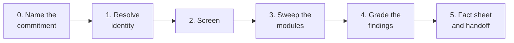

#  due-diligence (open skill)

**How to check what is verifiably true about a person or a company before you commit to them — from public records, with every item's status, source, and date shown.** Before the partnership, the investment, the hire, the contract: resolve who they actually are, sweep the registries, dockets, regulators, and licensing boards, and check their own claims against the primary sources. What comes back is a fact sheet, not a vibe — verified, unverified, contradicted, or not found, with the red flags graded for the decision in front of you.

##  What this is

An open skill that an AI agent can run, for the moment before a commitment, when the facts are still cheap.

Most background checking fails in one of two directions. The people-search sites print inference as fact — a stranger's lawsuit under your subject's name, a "criminal record" that is a traffic ticket, a credit profile that does not lawfully exist. And the informal version — a few searches, a feeling — misses the record that mattered because it never reached the primary source. This skill takes the disciplined middle: public records only, identity resolved before anything is attributed, allegations kept separate from outcomes, and every claim the subject makes about themselves checked against the institution that would know.

It answers three questions:

1. Who is this person or company, verifiably — and how sure are we that the record we found is theirs?
2. What does the public record show — entities, litigation, regulators, licenses, financial distress — and what actually came of each matter?
3. Do their claims match the record, and where they do not, what does that do to the decision?

The fact sheet this skill produces is also the hardest evidence tier for its sibling skill: psychological-profiling reads it as the record, and builds the approach on facts that have already survived checking.

##  Who it is for

| Reader | What they get |
| --- | --- |
| Founders and investors before a partnership or a check | The entity chain, the principals' records, and the claims in the pitch checked against registries and filings |
| Anyone hiring into a seat that matters | A finalist's employers, degrees, and licenses verified at the primary sources, with inconsistencies quoted claim-against-record |
| Operators vetting a vendor or counterparty of consequence | Corporate status, litigation and distress signals, and sanctions screening before the contract, not after the failure |
| Agents building checks for a human approver | An output contract: identity resolution with a namesake log, module findings with statuses and dated sources, graded red flags, and the gaps stated plainly |

##  Process at a glance

##  How to use with an agent

| Step | What to give the agent |
| --- | --- |
| Name the commitment | The partnership, investment, hire, or contract this check serves, and the depth it warrants |
| Anchor the identity | The subject's full name and the anchors you legitimately hold — city, employer, company, role |
| Hand over the claims | The pitch, résumé, or bio as given, so its claims can be pinned into checkable form |
| Read the fact sheet, not a score | The return carries statuses, sources, and dates per item, red flags graded for your commitment, and the gaps |
| Decide, then re-run before signing | Tell the agent what you decided; for a live commitment, the sweep re-runs fresh before signatures |

##  Folder map

| Path | What it holds |
| --- | --- |
| `SKILL.md` | The six-step procedure, guardrails, output contract, and limits |
| `references/README.md` | Index of the depth material |
| `references/the-sources.md` | The source map: registries, dockets, regulators, sanctions lists, and verification primaries — graded, with access notes and the sources that do not exist |
| `references/verification-and-grading.md` | The status taxonomy, the identity rule in full, outcome weighting, the red-flag rubric, and base rates |
| `references/fact-sheet-format-and-example.md` | The fact-sheet template, and a worked example of claim verification catching a fabricated biography |
| `references/shell-company-indicators.md` | The shell-company indicator catalogue: weighted signs across five categories, the cluster rule, and the two counter-errors |
| `reference-checks` (sibling skill) | Reference checks run as their own skill — witness verification, the question bank, the channel forms, and answer grading. This package calls it from Step 3 and keeps no copy of the bank |

##  Sources and credits

The method runs on public records: state corporate registries, PACER and CourtListener's RECAP archive, regulator and enforcement publications (SEC, FTC, FINRA BrokerCheck, state attorneys general and licensing boards), the OFAC sanctions lists, the USPTO, and county property and lien records. The verification discipline — primary sources over aggregators, outcomes over allegations, identity before attribution — adapts standard investigative and OSINT practice to a business check, and the evidence grading follows the sibling skill psychological-profiling's references. The legal boundary is the US Fair Credit Reporting Act and its state counterparts, named in the guardrails: this skill is not a consumer report and does not replace regulated screening where the law requires it. No source text is reproduced; records are cited by source and date.

##  Contributing

Improvements are welcome. The bar is the same as the method: a proposed change names its source or its jurisdiction — a registry that changed access, a list that moved, a status definition that failed in the field — and scored fact sheets (a check, its flags, and what the commitment's outcome showed) are the most valuable contribution there is.

##  License

MIT. See the repository LICENSE file.

##  Version

0.2.9 — twelfth build: procurement records counted as verified-revenue evidence, OFAC's own search named as a primary screening step, and a digital-estate timeline check added to the sweep. See `CHANGELOG.md`.
