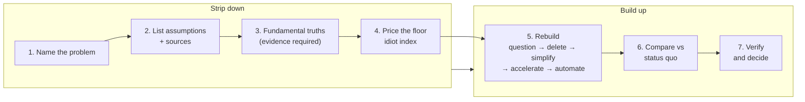

#  first-principles-thinking (open skill)

**A reasoning procedure, not a philosophy essay.** This skill turns "think from first principles" into steps an agent (or a human) can run, check, and hand over — with evidence required at every step.

##  What this is

An **open, agent-oriented skill** for attacking decisions, designs, costs, and strategies that are trapped by convention.

Most reasoning is by **analogy** — doing a thing because it resembles what was done before. That is fast and usually fine. It also caps the answer at what already exists. This skill runs the other mode: strip the problem down to the claims that carry real evidence, price the raw inputs when money is involved, and rebuild a better option from that floor.

Three things make this version different from an essay summary:

1.  **Truths carry receipts** — a "fundamental truth" must name its evidence (physics, a market price, a measurement, a binding document) or it is demoted to an assumption.
2.  **Costs have floors** — decompose any quote to its raw inputs, compute the floor, and read the **idiot index** (actual price ÷ floor). A big gap is process, not physics — and process can be rebuilt.
3.  **Rebuild in order** — the rebuild follows The Algorithm: question requirements, delete, simplify, accelerate, automate last.

##  Who it is for

| Audience | Use |
| --- | --- |
| **Founders / operators** | Test vendor quotes, pricing, build-vs-buy calls, and "industry standard" processes before accepting them |
| **Engineers / designers** | Strip inherited requirements out of a design before optimizing it |
| **AI agents** | Load `SKILL.md`, run the seven steps, and return an assumption table, floor math, and a compared rebuild — never an unsourced opinion |
| **Maintainers** | Refresh `references/` when sources change; bump `version` in `SKILL.md` |

##  Process at a glance

##  How to use with an agent

1. **Load** [`SKILL.md`](./SKILL.md) as the system skill (see your agent's skill docs).
2. **Name one decision** and its unit (one kilowatt-hour, one customer, one process run). The skill runs on one decision at a time.
3. **Pull references when needed** (do not paste entire books or articles into context):

| Phase | Read |
| --- | --- |
| Steps 1–3 — strip to truths |  [`references/techniques.md`](./references/techniques.md) |
| Step 4 — floor math, worked |  [`references/musk-examples.md`](./references/musk-examples.md) |
| Step 5 — rebuild order |  [`references/the-algorithm.md`](./references/the-algorithm.md) |
| Step 5 — recombination patterns |  [`references/worked-examples.md`](./references/worked-examples.md) |
| Steps 2 & 6 — analogy vs first principles |  [`references/cook-and-chef.md`](./references/cook-and-chef.md) |
| Step 7 — failure modes to check |  [`references/anti-patterns.md`](./references/anti-patterns.md) |
| Sources / official URLs |  [`references/sources-and-urls.md`](./references/sources-and-urls.md) |

4. **Hold the guardrails** in `SKILL.md` — regulation, safety limits, and measured domain evidence are inputs to respect, never assumptions to strip away. And mind the price of thinking: this procedure is for expensive, hard-to-reverse, or often-repeated decisions, not for everything.

##  Folder map

| Path | One line |
| --- | --- |
| [`SKILL.md`](./SKILL.md) | Main skill: when to use / not use, guardrails, the seven-step core procedure, output standard, verification checklist |
| [`CHANGELOG.md`](./CHANGELOG.md) | Version history |
| [`references/README.md`](./references/README.md) | Index of all reference files |
|  [`references/musk-examples.md`](./references/musk-examples.md) | The two canonical decompositions — rocket materials and battery cost — worked step by step with the floor math |
|  [`references/the-algorithm.md`](./references/the-algorithm.md) | The five-step rebuild order (question, delete, simplify, accelerate, automate) plus the idiot index |
|  [`references/cook-and-chef.md`](./references/cook-and-chef.md) | Cook vs chef, Want box vs Reality box, the semantic tree, and when analogy is the right tool |
|  [`references/techniques.md`](./references/techniques.md) | Socratic questioning, Five Whys, methodical doubt, the Feynman rebuild/teach test |
|  [`references/worked-examples.md`](./references/worked-examples.md) | Non-rocket worked examples (media distribution, a one-principle business, a recombined machine) plus a fill-in vendor-quote template |
|  [`references/anti-patterns.md`](./references/anti-patterns.md) | Fake first principles, over-decomposition, survivorship bias, and the other ways this method goes wrong |
|  [`references/sources-and-urls.md`](./references/sources-and-urls.md) | Full source credit table with URLs |

##  Sources and credits

- Content is **paraphrased** from public sources (interviews, biographies, essays, and classical philosophy).
- **No copyrighted document text** is stored in the repo; the few short quotes used are attributed and kept brief.
- Each reference file lists its **source URLs** at the end.
- See the full credit table in [`references/sources-and-urls.md`](./references/sources-and-urls.md).

##  Contributing

- Open a PR with updated paraphrases, new public sources, or fixes — keep **grep-clean** (no personal or company-specific strings inside the skill folder).
- When a source changes, re-read, re-paraphrase, bump **`version`** in `SKILL.md`, and add a **`CHANGELOG.md`** entry.
- New worked examples are welcome, especially ones with sourced floor math. Unsourced numbers will be marked as estimates or removed.

##  License

MIT — see [`SKILL.md`](./SKILL.md) front matter. Third-party sources remain under their publishers' terms.

##  Version

Current skill version: see `version` in [`SKILL.md`](./SKILL.md) front matter. History: [`CHANGELOG.md`](./CHANGELOG.md).
