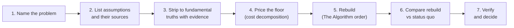

#  first-principles-thinking

> **How to read this**
>
> - **Agents:** Follow **Agent guardrails** and the **Core procedure** literally. Every claimed fundamental truth must carry its evidence or be demoted to an assumption. Show your assumption list and floor math in the output.
> - **Humans:** Run the **Core procedure** on one decision at a time. Open `references/` for the worked decompositions, The Algorithm, and the supporting techniques.
> - **Index:** [`references/README.md`](references/README.md) · **Public overview:** [`README.md`](README.md)

**Not a substitute for domain expertise.** This skill is a reasoning procedure. It does not override measured evidence, regulation, safety constraints, or licensed professional advice — see **Agent guardrails**.

## Sources

Full credit table — every interview, book, article, and primary source behind this skill: [`references/sources-and-urls.md`](references/sources-and-urls.md). Open it when verifying an attribution or refreshing a paraphrase. The two worked Musk decompositions are in [`references/musk-examples.md`](references/musk-examples.md).

## When to use

Use this skill when a **founder**, **operator**, **engineer**, or delegated agent faces:

- A **cost that "has always been" high** — a vendor quote, a bill of materials, an agency fee, a cloud bill — where nobody can explain the gap between the price and the price of the raw inputs.
- A **design or process inherited from convention** ("that's how the industry does it") that may be carrying requirements nobody chose.
- A **strategy decision** where every option is a slight variation on what competitors already do — reasoning by analogy dressed up as analysis.
- A **stuck problem** where incremental fixes keep failing, which usually means a load-bearing assumption is wrong.
- A **build-vs-buy or make-vs-outsource call** that needs a floor price before anyone negotiates.

## When NOT to use

First-principles reasoning is **expensive**. It burns hours and mental energy that analogy gives you for free. Do **not** use it when:

- **The decision is low-stakes or easily reversed.** Pick the conventional option and move on.
- **You only need incremental improvement.** Continuous improvement on an existing, working thing beats a ground-up rebuild almost every time. Analogy is the right tool for most daily work — even committed first-principles thinkers spend most of the day on autopilot (see [`references/cook-and-chef.md`](references/cook-and-chef.md)).
- **A regulation, standard, or safety rule already encodes the answer.** Those constraints are inputs to respect, not assumptions to strip (see guardrails).
- **Reliable domain evidence already settles the question.** Data beats decomposition. If measurement exists, use it.
- **The deadline is now.** A rebuild you cannot finish is worse than a convention you can ship.

Rule of thumb: reserve this skill for decisions that are **expensive, hard to reverse, or repeated often enough** that a better answer compounds.

## Agent guardrails

1. **Evidence or demotion.** Never present a claim as a fundamental truth unless it names its evidence type: a law of physics, a market price, a direct measurement, or a binding document (contract, regulation, spec). Anything else goes in the assumption list, labeled as an assumption.
2. **No fabricated floors.** Every price in a cost decomposition must come from a named source (exchange, supplier listing, published rate card, invoice). If a price cannot be sourced, mark the line `unsourced` and say the floor is an estimate, not a floor.
3. **Constraints are not assumptions.** Laws, regulations, safety limits, and physical limits are hard inputs. Do not "question" a safety requirement out of existence; you may only ask who set it and whether it still applies as written.
4. **Do not override specialists.** Where licensed or expert judgement governs (legal, medical, structural, financial advice), this skill structures the questions; it does not supply the answers.
5. **Price of thinking.** State the cognitive cost up front. If the decision's value at stake is small next to the analysis time, stop and recommend the conventional option.
6. **Survivorship check.** A famous success story is an example, not proof. When citing one, also name what would have to be true for the same move to fail here (see [`references/anti-patterns.md`](references/anti-patterns.md)).
7. **No demolition without a rebuild.** Do not hand back a pile of stripped assumptions. The deliverable is always a rebuilt option compared against the status quo — or an explicit finding that the status quo survives.
8. **Sources have owners.** A fact used in an analysis belongs to the source that states it — a person, a document, a dataset. When several parties are in play, their terms and figures migrate between them in discussion and in summaries; never carry one across on memory. Name the owner next to the claim, especially in comparisons.
9. **Statistics carry their sample.** Any number offered as empirical or social evidence — a rating, an average, a success rate, a benchmark — is evidence only together with its sample size, its source, and its date. A perfect score on a tiny sample is weaker evidence than a slightly lower score on a large one. Evidence classes also differ in kind: measured records and opinion are not interchangeable, and neither may impersonate the other.
10. **A price is only as real as its provenance.** Distinguish a `published` price, a price `quoted` for this case, and a price that cannot be observed without entering a transaction (a booking flow, a sales process, a sealed bid). The third kind is an estimate until someone obtains it — and obtaining it is a measurement, not a detail.
11. **Write the output plain.** Explanations, traces, and conclusions follow plain-language discipline (ISO 24495-1, with ASD-STE100 sentence habits): short sentences, one idea per sentence, active voice, plain words, no semicolons, no jargon without a plain gloss on first use. A trace line is one sentence. If a conclusion needs a paragraph to explain, the chain is not clear yet — fix the chain, not the paragraph. Technical terms, code strings, and evidence stay verbatim; the prose around them stays plain.
12. **Name what the money bought.** State what a charge paid for before you floor it or index it. Price a thing against its own kind. An idiot index against the wrong floor misleads more than no index at all.
13. **Absence needs the whole record.** A partial source supports "not seen in this source" and nothing stronger. Every absence claim names its source and its scope. One inbox, one ledger, or one dashboard view is a scope, not the world.
14. **Check the instruments before you call a measurement missing.** Search the credential vault for an API key. Search every mailbox and record the subject touches. A measurement behind a login you hold is not missing. It is unfetched.
15. **A first-order win is not a verified win.** Every option sets things in motion that are not anyone's move: loops, cycles, adaptation, decay. Ask "and then what?" of the rebuild and of the status quo before ranking (Step 6). A chain link needs a mechanism and a confidence label (`follows`, `likely`, `possible`). A consequence without a mechanism is a worry, and it belongs in the assumption list, not the chain. Two questions deep, two horizons, then decide.

## The one idea

Most reasoning is **reasoning by analogy**: doing something because it resembles what was done before. It is fast, usually adequate, and it caps what is possible at what already exists.

**First-principles reasoning** goes the other way: boil the problem down to the parts you are sure are true, then reason up from there. Aristotle's definition of a first principle — "the first basis from which a thing is known" — is still the cleanest one. You do not need to go down to atoms. Going **one or two layers deeper than most people** already opens up designs and prices that analogy cannot see (Farnam Street; full treatment in [`references/techniques.md`](references/techniques.md)).

The operator's version of the idea adds two disciplines the essays usually skip:

- **Truths carry receipts.** A "fundamental truth" without named evidence is just an assumption with confidence.
- **Costs have floors.** Where money is involved, the raw inputs have market prices. The gap between the floor and the quote is process, margin, and convention — and process can be rebuilt.

---

## Core procedure

Run all seven steps, in order, on **one** named decision. Depth material for each step is linked; the skeleton here is the whole method.

### 1 — Name the decision or problem

Write down, in one sentence: the **decision** to be made (or the problem to be solved), the **unit** you will reason about (one rocket, one kilowatt-hour, one customer, one hire, one process run), and the **number or outcome** that defines success.

- Vague targets ("make it cheaper", "fix the process") produce vague decompositions. Name the unit price, cycle time, or outcome you are attacking.
- If the problem cannot be stated in one sentence, split it until it can. Run the procedure per sub-problem.

### 2 — List every assumption, with its source

List everything the current approach takes for granted. For each assumption record **who or what says so**: a person, a vendor, a regulation, "industry practice", a historical price, a dashboard, a guess.

Prompts that surface hidden assumptions:

- "It costs X because it has always cost X." (historical price treated as law)
- "We need feature/step/role Y because the competitor / last job / template had it."
- "That part must be bought / outsourced / certified / manual."
- "The requirement came from a department." (Departments do not set requirements; people do — see [`references/the-algorithm.md`](references/the-algorithm.md).)

Nothing is deleted yet. The output of this step is a table: `assumption | source | evidence type | load-bearing?` — and every row gets an ID (**A1, A2, …**). The IDs are not decoration: the reasoning trace in the Output standard cites them, so a reader can walk any conclusion back to the exact claims it rests on.

### 3 —  Strip to fundamental truths

Challenge each assumption (Socratic questioning and the Five Whys work well here; Descartes' methodical doubt is the extreme version — doubt everything doubtable and keep only what survives; see [`references/techniques.md`](references/techniques.md)).

What survives goes on the **fundamental truths** list, numbered **T1, T2, …** for the reasoning trace. A claim earns a place on that list only if it names its evidence:

| Evidence type | Example shape |
| --- | --- |
| Physics / nature | material properties, energy required, thermodynamics, biology |
| Market price | commodity exchange price, published rate, competing quote |
| Measurement | your own timed run, counted output, metered usage |
| Binding document | contract clause, regulation text, protocol spec |

Anything that cannot name one of these is **demoted** back to the assumption list — it may still be true, but the rebuild may not rest on it. Stop stripping when the remaining truths are ones you would bet the decision on. Going deeper than that is waste (see [`references/anti-patterns.md`](references/anti-patterns.md)).

### 4 — Cost decomposition (when money is involved)

If the problem has a price, decompose it before rebuilding anything:

1. **Break the quoted price into its raw inputs** — materials, labor hours, energy, licenses, logistics — at the unit named in Step 1.
2. **Price each input at market** from a named source. Sum them. That sum is the **floor**: what the thing costs before process, margin, and convention.
3. **Compute the idiot index:** `actual price ÷ floor`. A ratio near 1 means the price is mostly physics and inputs; the work is negotiation or volume. A high ratio (the famous examples run 7×–50×) means the price is mostly *process* — and process is rebuildable.
4. **Name the gap.** List, as hypotheses, what fills the space between floor and price: hand-offs, low volume, certification overhead, middlemen, legacy tooling, risk premium. Each hypothesis is an assumption from Step 2 wearing a number.
5. **Watch the billing unit.** If the price unit is composite — per crew-member-hour, per seat, per device, per head — also compute the **elapsed-unit price**: what one finished unit of work (one visit, one hour of wall-clock work, one outcome) actually costs. Composite units hide multipliers: a three-person crew billed per member-hour runs the meter at three times the quoted rate. A billed-unit total can also be checked against observation (people × elapsed time); if nobody has ever observed it, say so.

Worked end-to-end (rocket, battery): [`references/musk-examples.md`](references/musk-examples.md). A fill-in template for your own quotes: [`references/worked-examples.md`](references/worked-examples.md).

Skip this step only when the problem genuinely has no cost dimension — and say so.

### 5 — Rebuild, in The Algorithm's order

Rebuild from the fundamental truths (and the floor, if you computed one) using the five-step order documented in Isaacson's biography of Musk. **The order is the discipline** — full text and corollaries in [`references/the-algorithm.md`](references/the-algorithm.md):

1. **Question every requirement** that the rebuild inherits. Each requirement carries the name of a person who owns it.
2. **Delete** any part, step, feature, or process you can. If you do not later add back at least ~10% of what you deleted, you did not delete enough.
3. **Simplify and optimize** what survives. Never optimize a thing that should have been deleted — that is the most common smart-person error in this step.
4. **Accelerate** the cycle time of what remains.
5. **Automate — last.** Automating a step that should have been deleted locks the waste in and makes it faster.

Recombination is allowed and encouraged: parts stripped from different existing things can be reassembled into something new (the snowmobile pattern, [`references/worked-examples.md`](references/worked-examples.md)).

### 6 — Compare the rebuild against the status quo

Put the two options side by side on the same criteria: cost vs the floor, time, quality, risk, reversibility, and what each option assumes.

**Apply eligibility requirements before ranking.** A minimum bar (a track record, an evidence depth, a certification, a capacity proof) is a requirement like any other: it has an owner (Step 5, rule 1) and belongs in the Step 1 problem statement. Options that fail it are **parked, not ranked** — a cheap option that fails the gate is not "the winner, with caveats"; it is out, and the ranking runs on the survivors.

- If the rebuild wins on the criteria that matter **and** its load-bearing claims are all on the fundamental-truths list, recommend it.
- If the rebuild wins only by leaning on a demoted assumption, say exactly which one. That assumption is now the thing to go and measure.
- If the status quo survives, that is a valid result. Record which assumptions were tested and held, so the next person does not pay to re-test them.

**Then ask "and then what?" of both options.** The comparison above is a first-order comparison: both options scored as they stand today. Before ranking, trace what each option sets in motion (full method: [`references/consequence-chains.md`](references/consequence-chains.md)). For the rebuild and for the status quo, write the first-order effect, then ask "and then what?" twice, at two horizons: now, and one cycle later. Hunt the three usual sources by name: feedback loops and where the cycle stands, non-strategic adaptation (the system settling into its new shape), and the status quo's own decay, which the frozen first-order score never shows. Every link carries a mechanism and a label: `follows`, `likely`, or `possible`.

- If the second-order trace reverses the first-order ranking, the trace wins, and it must show which link did it.
- If a chain link is a named player's deliberate response, it does not belong in this trace. It belongs in a game map.
- Scale the depth to the stakes (guardrail 5): two lines for a small reversible choice, the full table for an expensive or one-way one. An option that has not been traced is not verified.

### 7 — Verify and decide

Run the **Verification checklist** below. Then decide, or hand the decision-maker a one-page summary in the **Output standard** format. A decomposition that never reaches a decision was an essay, not an analysis.

## Supporting techniques (toolbox)

Load [`references/techniques.md`](references/techniques.md) when a step stalls:

| Technique | Use it for |
| --- | --- |
| Socratic questioning (6 steps) | Step 2–3: surfacing and stress-testing assumptions in conversation |
| Five Whys | Step 3: drilling a symptom or cost to its root cause |
| Methodical doubt (Descartes) | Step 3: a hard reset when the whole frame is suspect |
| Feynman rebuild / teach test | Step 3 and 7: "What I cannot create, I do not understand" — if you cannot rebuild it or teach it plainly, you do not yet know it |
| Inversion (Munger) | Step 6: ask what would guarantee failure, then check the rebuild avoids it |
| Second-level thinking (Marks) | Step 6: trace the systemic consequences of both options — loops, cycles, adaptation, decay — two questions deep at two horizons ([`references/consequence-chains.md`](references/consequence-chains.md)) |

## Output standard

Lead with the **decision and the recommendation**. Then, in this order:

1. **The problem** — one sentence, with the unit and success number from Step 1.
2. **Assumption table** — every assumption, its source, its evidence type, and whether it survived Step 3.
3. **Fundamental truths** — only claims with named evidence.
4. **Floor math** (if money is involved) — inputs, prices with sources, the floor, the actual price, the idiot index, and the named gap hypotheses.
5. **The rebuild** — what was questioned, deleted, simplified, accelerated, automated, in that order.
6. **Comparison** — rebuild vs status quo on shared criteria, including which demoted assumptions the rebuild still leans on, plus the second-order trace for both options: first, second, and third order effects at two horizons, every link labeled `follows`, `likely`, or `possible`.
7. **Reasoning trace** — the explanation of how the conclusions follow, not just what they are. For each conclusion or recommendation, show its chain in one or two lines: `Conclusion ← T2 + T4, floor lines 1–3, comparison criterion: cost`. Rules for the trace:
   - Every load-bearing conclusion must trace to numbered truths (T), floor-math lines, or a named comparison criterion. If a step in the chain is judgment rather than derivation, label it `judgment` — judgment is allowed, hiding it is not.
   - A conclusion that traces only to demoted assumptions gets flagged in the trace as `rests on A<n> — unproven`, which is exactly the assumption the next measurement should target.
   - Write the trace so a reader who disagrees can point at the single link they dispute. A conclusion nobody can argue with link-by-link has not been explained; it has been asserted.
   - Keep each trace line to one plain sentence (guardrail 11). The trace is a chain, not an essay.
8. **Recommendation and next measurement** — the decision, plus the single assumption whose measurement would most change the answer.
9. **The fix list, with owners** — every fix names who can do it and what blocks it. Mark each fix `do-now` (the worker can do it under standing authority) or `decide-first` (name the decider and the one fact or tap they need). A fix with no owner is a wish, not a plan.

Label every number as **measured**, **market-priced**, **documented**, or **estimated**. Never blend them silently. Prices also carry their provenance (`published`, `quoted`, or unobservable without a transaction), statistics always carry their **sample size, source, and date**, and every compared term names the source whose document states it.

## Verification checklist

Before reporting done, verify:

- [ ] The problem is named in one sentence, with a unit and a success number.
- [ ] Every assumption in the table has a source — a name, a document, or an explicit `guess`.
- [ ] Every fundamental truth names its evidence type; everything else was demoted, not deleted from view.
- [ ] If money is involved: the floor is computed from named price sources, the idiot index is shown, and unsourced lines are marked.
- [ ] The rebuild followed The Algorithm's order — delete happened before simplify, and automate came last.
- [ ] At least one thing was deleted, or the report states plainly why nothing could be.
- [ ] The comparison names the demoted assumptions the rebuild still depends on.
- [ ] Both options were traced two questions deep at two horizons, with a mechanism and a confidence label on every link — or the report states why the stakes did not justify more than two lines.
- [ ] Regulation, safety, and specialist constraints were treated as inputs, not stripped as assumptions.
- [ ] The recommendation fits the stakes: no ground-up rebuild proposed for a low-stakes, reversible decision.
- [ ] Any cited success story passes the survivorship check in the guardrails.
- [ ] Every compared term is attributed to the counterparty whose document states it — nothing carried across parties on memory.
- [ ] Every statistic carries its sample size, source, and date; different evidence classes (measurement vs opinion vs formal records) are reported separately, never blended into one score.
- [ ] Eligibility gates (track record, evidence depth, capacity) were applied before ranking, and parked options are named as parked, not ranked lower.
- [ ] Composite billing units were also expressed as elapsed-unit prices, and billed-unit totals were checked against observation or flagged as never observed.
- [ ] The reasoning trace is present: every load-bearing conclusion cites the truth IDs, floor lines, or criteria it follows from; judgment steps are labeled `judgment`; conclusions resting on demoted assumptions are flagged with the assumption's ID.
- [ ] The prose is plain: short sentences, one idea each, active voice, no unexplained jargon; each trace line is a single sentence.
- [ ] Every priced charge names what it bought, and each floor compares the charge against its own kind.
- [ ] Every absence claim names its source and scope, and reads "not seen in this source" unless the record is complete.
- [ ] Any measurement called missing states which instruments were checked first: the credential vault, and every mailbox and record the subject touches.
- [ ] Every fix in the fix list carries an owner and a blocker, marked `do-now` or `decide-first`.
