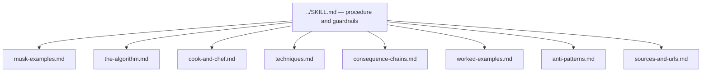

#  References index

Paraphrased source digests for the **first-principles-thinking** skill. Read these for depth; load `../SKILL.md` for the core procedure, guardrails, and output standard.

| File | Purpose |
| --- | --- |
|  [musk-examples.md](./musk-examples.md) | The two canonical decompositions — rocket materials (~2% of price) and battery cost ($600 claim vs ~$80 materials floor) — worked step by step with floor math and idiot index |
|  [the-algorithm.md](./the-algorithm.md) | The five-step rebuild order in detail: question requirements (named owner), delete (add back ≥10% or you did not delete enough), simplify, accelerate, automate last; idiot index; corollaries |
|  [cook-and-chef.md](./cook-and-chef.md) | Cook (analogy, recipe) vs chef (first principles, raw ingredients); Want box vs Reality box; knowledge as a semantic tree; when analogy is the right tool |
|  [techniques.md](./techniques.md) | The stripping toolbox: Socratic questioning (6 steps), Five Whys, Descartes' methodical doubt, Feynman's rebuild/teach test, Munger's inversion |
|  [consequence-chains.md](./consequence-chains.md) | Second-level thinking (Marks): the two-questions-two-horizons procedure, the three hunts (loops and cycles, non-strategic adaptation, status-quo decay), and how the step fails |
|  [worked-examples.md](./worked-examples.md) | Full-procedure worked examples beyond rockets: media distribution, a one-principle business, a recombined machine — plus a fill-in vendor-quote decomposition template |
|  [anti-patterns.md](./anti-patterns.md) | How the method fails: contrarianism dressed as first principles, decomposing to atoms, low-stakes misuse, survivorship bias, optimizing what should be deleted |
|  [sources-and-urls.md](./sources-and-urls.md) | Full source credit table: primary interviews and books, syntheses, and supporting techniques, with URLs |

Official URLs are listed in each file and in [`sources-and-urls.md`](./sources-and-urls.md). Source texts are **not** stored in the repo; everything here is paraphrase plus brief attributed quotes.
