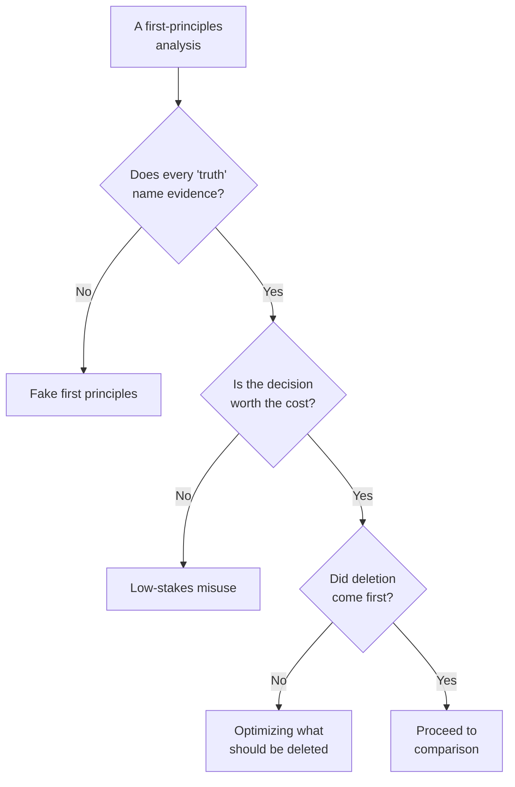

#  Anti-patterns — how first principles goes wrong

This method fails in predictable ways. Run this file as the Step 7 check whenever a decomposition feels exciting — excitement is when these are most likely to be in the room.

## 1. Fake first principles (contrarianism in a lab coat)

**Shape:** rejecting the conventional answer *because* it is conventional, then rebuilding on claims that feel fundamental but name no evidence. Disagreement is not decomposition. A teenager doubting everything and a physicist doubting everything look identical for the first five minutes; the difference is receipts.

**Test:** every row on the fundamental-truths list names its evidence type (physics, market price, measurement, binding document). Any row that cannot gets demoted, however beautiful it is. If the whole list demotes, the analysis is an opinion — label it as one.

## 2. Ignoring domain evidence because it arrived by analogy

**Shape:** "the experts just copy each other" used to wave away measured results, field data, or a regulation's hard-won basis. Some conventions are scar tissue: they encode accidents, failures, and measurements the decomposer has not seen.

**Test:** before stripping any constraint that comes from a standard, a regulation, or a practitioner consensus, ask what evidence created it. If you cannot find out, treat it as a hard input (guardrail 3 in `../SKILL.md`) and decompose around it. First principles is a way to *find* evidence, not a license to skip it.

## 3. Decomposing too far (the atomic-level waste)

**Shape:** boiling a pricing question down to the philosophy of value, a process question down to human nature, a product question down to physics that constrains nothing in the decision. Each layer down costs time and buys precision the decision cannot use.

**Test:** stop when the remaining truths are ones you would bet the decision on, and one or two layers deeper than the conventional analysis went (the Farnam Street guidance). Ask of each further layer: *what decision would this change?* No answer, no layer.

## 4. Using it on low-stakes decisions

**Shape:** a two-day ground-up re-derivation of a reversible, fifty-dollar choice. First-principles reasoning is the most expensive thinking mode there is — that is precisely why it wins where it wins, and why it loses as a default.

**Test:** stakes × irreversibility × repetition. If the decision is cheap, reversible, or one-off, analogy plus a quick check is the *correct* output of this skill — say so and stop (see "When NOT to use" in `../SKILL.md`). Chefs are cooks most of the day; see [`cook-and-chef.md`](./cook-and-chef.md).

## 5. Survivorship bias in the famous examples

**Shape:** "Musk decomposed rocket costs and won, therefore decomposition wins." The examples in [`musk-examples.md`](./musk-examples.md) are real and instructive — and they are the survivors, retold because they worked. For every celebrated decomposition there are uncounted rebuilds that found the gap was real cost, or spent the company into the ground closing it.

**Test:** alongside every cited success, write the failure version: what would have to be true for the same move to fail here (guardrail 6), and what the decomposition costs if the status quo turns out to be right. Note also that closing a 7.5× gap took a gigafactory-scale bet and years — the decomposition is the cheap part; the rebuild is where the risk lives. High idiot index means "investigate," never "victory."

## 6. Optimizing (or automating) what should be deleted

**Shape:** skipping straight from decomposition to polishing the existing thing — faster workflows for a report nobody reads, a robot for a part nobody needs. The flufferbot story in [`the-algorithm.md`](./the-algorithm.md) is this pattern with a serial number.

**Test:** in the output, point to the delete step's results. Nothing deleted and nothing justified-as-undeletable means Step 5 of the procedure was not run — it was admired.

## 7. A floor built on fantasy prices

**Shape:** floor math assembled from unsourced, stale, or best-case input prices, producing a theatrical idiot index and a pointless fight with a vendor whose quote was mostly real. The mirror image of the original sin: the decomposer's numbers are now the ones with no evidence.

**Test:** every floor line carries a named, dated source; spot prices get a date; `unsourced` lines are marked and the result is labeled an estimate. If the index comes out above ~10×, re-check the unit definition and the floor before believing it (see the template in [`worked-examples.md`](./worked-examples.md)).

## 8. Demolition without a rebuild

**Shape:** the analysis ends at "everything you believed is an assumption" — no compared rebuild, no decision, just rubble and a feeling of rigor. Deconstruction is half the method; Clear's cycle is deconstruct → reconstruct, and Urban's chef *cooks something*.

**Test:** the deliverable always contains a rebuilt option compared against the status quo on shared criteria — or an explicit finding that the status quo survived testing, with the tested assumptions recorded for the next person.

## 9. Field cases — the v1.1.0 test runs

Worked illustrations of the general rules above, from this skill's first live test runs. Anonymized: the settings are generic and the figures are rounded archetypes, because the lessons are the method's, not the cases'. The rules live in `../SKILL.md`; these are the stories that earned them.

- **The perfect rating on a handful of reviews (guardrail 9, Step 6 gates).** In a vendor comparison, the cheapest option carried a perfect rating — on a very small number of reviews — and initially outranked an incumbent's slightly lower rating on several hundred. Putting the sample sizes next to the scores reversed the read, and the decision-maker's own minimum bar (an established track record) parked the new option entirely. Lesson: a rating without its count is not evidence, and eligibility bars are requirements, applied before ranking.
- **The migrating term (guardrail 8).** In a multi-party negotiation, a term from one party's email — an exclusivity period — was discussed for a day as if it belonged to another party. Only the documents separated them. Lesson: in comparisons, every term names its owner, from its own document.
- **The price inside the flow (guardrail 10).** Marketplace prices for a service could not be verified from any public page — they exist only inside the booking flow, after a location and date are entered. Presenting platform *ranges* as prices overstated what was known. Lesson: an unobservable price is an estimate; getting the quote is the measurement.
- **The composite meter (Step 4, billing units).** A vendor quoted an hourly rate that was billed *per worker*: a multi-person crew ran the meter at several times the headline rate per elapsed hour, invisible in the quote. Lesson: restate composite units (per member-hour, per seat, per device) as elapsed-unit prices before computing any index.
- **Two evidence classes, one company (guardrail 9).** An incumbent was loved in opinion — high ratings whose main complaint theme was its billing — and clean in formal complaint records, while a rival showed the reverse pattern (strong ratings, a poor formal-dispute grade). Lesson: opinion and dispute records measure different things; report both, never blend them into one "reputation."

## Sources

- Farnam Street, "What is First Principles Thinking?" — the one-or-two-layers guidance and the limiting-beliefs discussion: https://fs.blog/first-principles/
- Tim Urban, "The Cook and the Chef: Musk's Secret Sauce", Wait But Why (2015) — humility before confidence; chefs as cooks most of the day: https://waitbutwhy.com/2015/11/the-cook-and-the-chef-musks-secret-sauce.html
- Walter Isaacson, *Elon Musk* (2023) — the flufferbot episode and The Algorithm's order. (Book; paraphrased.)
- James Clear, "First Principles: Elon Musk on the Power of Thinking for Yourself" — deconstruct → reconstruct, and continuous improvement as the right tool for incremental goals: https://jamesclear.com/first-principles
