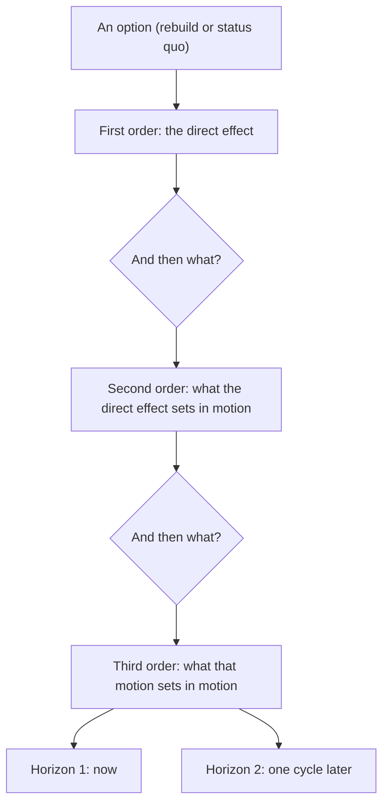

#  Consequence chains — running the echo

A comparison can be correct at first order and wrong in total. Every
option sets things in motion. Some of those motions are other players'
responses, and those belong to game theory. The rest are not anyone's
move: prices drift, habits form, capacity fills, quality decays, a
cycle turns. This file covers that second class, the **systemic
consequences**, and the discipline for tracing them before a decision
is called verified.

The framing source is Howard Marks, the investor who runs Oaktree
Capital. His name for the discipline is **second-level thinking**.

---

## First-level and second-level thinking

Marks draws the line this way, paraphrased from *The Most Important
Thing* (2011):

- **First-level thinking** is simple and superficial, and everyone
  reaches the same conclusion. A good company is found, so its stock
  should be bought.
- **Second-level thinking** is deep and convoluted. The company is
  good, but everyone knows it, so the stock is overpriced and should
  be sold. The outlook is poor, but the price already assumes worse,
  so the stock should be bought.

The point is not cleverness. The point is that the first-order reading
of a situation is usually already shared by everyone, already priced
in, or already counted. The advantage and the danger both live one
level down.

Apply the same habit outside investing. A price cut is the first-order
event. What the cut does to margin structure, to what customers learn
to expect, and to what the budget can no longer fund are the
second-order events. A decision is not understood until its second
order is written down.

---

## The echo procedure

Run this inside Step 6 of the core procedure, on **both** options:
the rebuild and the status quo. The status quo has an echo too, and
it is often the deciding one.

1. **Write the first-order effect.** One line. The direct result of
   choosing this option, in the unit Step 1 named.
2. **Ask "and then what?" twice.** Follow the chain two levels past
   the direct effect. Stop at two. A third level is speculation about
   speculation, and the chain stops being evidence-shaped.
3. **Do it at two horizons.** Now, and one cycle later. A cycle is the
   natural rhythm of the system under study: a contract term, a
   season, a budget year, a replacement cycle, a market cycle. Name
   the cycle you are using.
4. **Label every link.** Each consequence carries one of three labels:
   `follows` (a mechanism makes it near-certain), `likely` (the
   mechanism is clear, the size is not), `possible` (a real mechanism,
   an unknown trigger). A link with no mechanism is not a consequence.
   It is a worry, and it goes in the assumption list, not the chain.
5. **Price what can be priced.** Where a link has a number, put the
   number in, with its label (measured, market-priced, documented,
   estimated). Where it cannot be priced, say which direction it
   pushes and roughly how hard.

The output is a short table:

| Option | First order | Second order | Third order | Horizon |
| --- | --- | --- | --- | --- |
| Rebuild | the direct effect | what it sets in motion | what that sets in motion | now / one cycle |
| Status quo | the direct effect | what it sets in motion | what that sets in motion | now / one cycle |

---

## The three hunts

Most damaging echoes come from three places. Hunt them by name.

### Feedback loops and cycles

A loop is a chain that returns to its start and pushes it further in
the same direction. Success that makes success more expensive is a
loop. Volume that lowers unit cost and funds more volume is a loop.
Marks adds the cycle question: where in the swing are we? A move that
works at the bottom of a cycle can fail at the top on the same facts,
because the environment the chain runs through is different. When a
chain depends on conditions holding (prices, demand, rates), name the
condition and ask which way the cycle is moving.

### Non-strategic adaptation

People and systems adapt to a new option without playing a game
against you. Staff route around a rule. Customers change what they
buy. A team measured on a new number optimizes the number. Suppliers
reprice at renewal. None of this is an opponent's response; it is the
system settling into its new shape. Ask: once everyone has adjusted
to this option being normal, what does the steady state look like,
and is it the state the first-order math assumed?

### The status quo's own decay

Doing nothing is also an option with a chain. Assets wear. Prices
creep. A skill not used fades. A small annual cost with no cap
compounds into a large one. The first-order comparison almost always
scores the status quo at today's values, frozen. Its echo is rarely
frozen. Write the status quo's chain with the same two questions and
the same two horizons, or the comparison is rigged in its favor.

---

## Two classic chains (public examples)

**Rent control.** First order: rents fall for current tenants, the
goal achieved. Second order: owners convert or under-maintain,
builders build elsewhere, supply shrinks. Third order: the shortage
raises prices for everyone not already housed, and the protected
tenants cannot move without losing the protection. The textbook case
of a policy whose echo reverses its first order over one cycle.

**The good company.** First order: the company is excellent, buy.
Second order: excellence is obvious, so the price already contains
it; the buyer pays for quality twice, once in the business and once
in the price. Marks's point is not that the company is bad. It is
that the first-order fact was never the decision. The price of the
fact was the decision.

---

## Worked mini-example (fictional numbers)

A subscription product, 1,000 customers at $50 a month. Proposal: cut
price to $40 to grow volume.

- **First order.** Assume volume rises 30 percent: 1,300 × $40 =
  $52,000 against $50,000 today. The rebuild wins by $2,000 a month.
- **Second order.** The cost to serve rises with volume, say $8 per
  customer: margin goes from (50 − 8) × 1,000 = $42,000 to
  (40 − 8) × 1,300 = $41,600. The win is already gone (`follows`,
  arithmetic). Customers also learn the price is negotiable in time:
  renewals begin to wait for cuts (`likely`).
- **Third order, one cycle later.** The support load of 300 extra
  low-price customers crowds out the service quality the original
  1,000 were paying for; churn among them rises (`possible`, priced
  only as a direction).
- **Status quo echo.** Hold $50: volume flat, margin intact, and the
  chain is short. Nothing compounds against it this cycle.

First order said cut. The echo says hold, and names the assumption
that would flip it back: if serving cost were near zero, the second
order reverses. That assumption is now the thing to measure.

---

## Failure modes of the echo itself

- **Echo theater.** A long, vivid chain built to defeat an option the
  analyst already disliked. Test: the chain's labels. Theater runs on
  `possible` links stacked three deep. The procedure caps the chain at
  two questions for this reason.
- **Asymmetric echo.** Running the echo on the new option and scoring
  the status quo frozen at today's values. The procedure runs both,
  always.
- **Strategic spillover.** A link in the chain is actually a named
  player's deliberate response (a competitor matching a price, a
  counterparty walking). That link leaves this file and goes to a game
  map, where responses are solved, not narrated.
- **Infinite regress.** Every answer breeds another question. Two
  questions, two horizons, then decide. A chain that cannot change
  the ranking is documentation, not analysis, and gets one line.

---

## When to skip the depth

The echo scales with the stakes and the irreversibility, the same
rule as the whole skill (guardrail 5). For a small, reversible choice,
the echo is two lines in the comparison and nothing more. For an
expensive or one-way choice, an option whose echo has not been run is
not verified, whatever its first-order score says.
