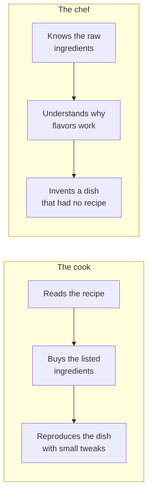

#  Cook and chef — the analogy frame

Tim Urban's 2015 Wait But Why essay on how Musk thinks is still the best teaching frame for first-principles reasoning, because it explains — honestly — why almost nobody reasons this way most of the time, including the people who can. This file paraphrases that frame and adds the two companion tools from the same body of work: the Want box / Reality box and the semantic tree.

## Cook vs chef

A **cook** follows recipes. Shown a kitchen, the cook asks what dish to reproduce and works from instructions created by someone else. The results can be excellent — most good meals are cooked this way — but the cook's ceiling is the best recipe they can find, and a problem with no recipe stops them cold.

A **chef** (the inventing kind) works from the raw ingredients and an understanding of what each one does. Shown the same kitchen, the chef can produce a dish that has never existed, because the reasoning runs from the ingredients up rather than from a prior dish sideways.

Urban's mapping: the cook's method is **reasoning by analogy**, the chef's method is **reasoning from first principles**. His sharper point is that copying an answer and calling it analogy-based reasoning are the same move with better branding — both outsource the thinking to whoever went first.

Three honest complications, all in the original essay and all worth keeping:

1. **Chefs are cooks most of the day.** First-principles reasoning is mentally expensive. Nobody — including Musk, in Urban's account — runs it on everything. The skill is not using it always; it is noticing the few moments when the recipe book is the actual problem.
2. **The difference shows under novelty.** On a routine day, cook and chef are indistinguishable. The gap appears when the situation has no recipe: a new market, a price that makes the mission impossible, a process everyone inherited and nobody chose.
3. **Becoming a chef is uncomfortable before it is useful.** Urban describes the path as three epiphanies, roughly: humility about how little of your "knowledge" you could actually re-derive; confidence that since nobody else derived theirs either, a clear-eyed rebuild can genuinely beat the field; and not fearing the social cost of reasoning differently. The order matters — confidence without the humility is just contrarianism (see [`anti-patterns.md`](./anti-patterns.md)).

## The Want box and the Reality box

Urban's model of goal-setting, useful at Step 1 of the core procedure:

- The **Want box** holds what you actually want, filled in from your own values and aims — not what people like you are supposed to want.
- The **Reality box** holds what is actually true about the world and your abilities — filled in from evidence, not from convention or flattery.

Most people fill both boxes by analogy: wants copied from peers, reality copied from consensus. The first-principles version fills the Want box honestly and the Reality box from measurement, then picks goals where the two boxes genuinely intersect, and forms strategy from what is known rather than from what is typically done. When you run the core procedure, Step 1 is the Want box stated precisely, and Steps 2–3 are the Reality box being cleaned.

## The semantic tree

From Musk's 2015 Reddit AMA, the learning rule that underlies the whole method: view knowledge as a semantic tree. Get the **trunk and the big branches** — the fundamental principles — solid before touching the leaves, because details with no principle to hang on to are the first thing forgotten and the last thing that should drive a decision.

Applied to the procedure: in Step 3, prefer the truth that explains ten details over the ten details. A decomposition that ends in a long list of facts has not finished; one that ends in a short list of principles that regenerate the facts has.

## When analogy is the right tool

This skill is not an argument against analogy. Analogy is the right tool when:

- The situation is a **known repeat** of a solved problem, and the cost of a wrong call is low.
- You need **speed** more than optimality — most operations, most days.
- The existing recipe encodes **hard-won safety or compliance knowledge** you cannot re-derive responsibly (see the guardrails in `../SKILL.md`).
- You are **learning the domain**: copying good recipes is how cooks build the ingredient knowledge that later makes them chefs.

The failure mode is not using analogy. It is using analogy **without noticing** on a decision that is expensive, novel, or load-bearing — and mistaking the resulting answer for analysis.

## Sources

- Tim Urban, "The Cook and the Chef: Musk's Secret Sauce", Wait But Why (November 2015): https://waitbutwhy.com/2015/11/the-cook-and-the-chef-musks-secret-sauce.html
- Elon Musk, Reddit AMA (2015) — the semantic-tree remark; cited in the Farnam Street source list: https://fs.blog/first-principles/
- James Clear, "First Principles: Elon Musk on the Power of Thinking for Yourself" — the same fork stated as continuous improvement vs thinking for yourself: https://jamesclear.com/first-principles
