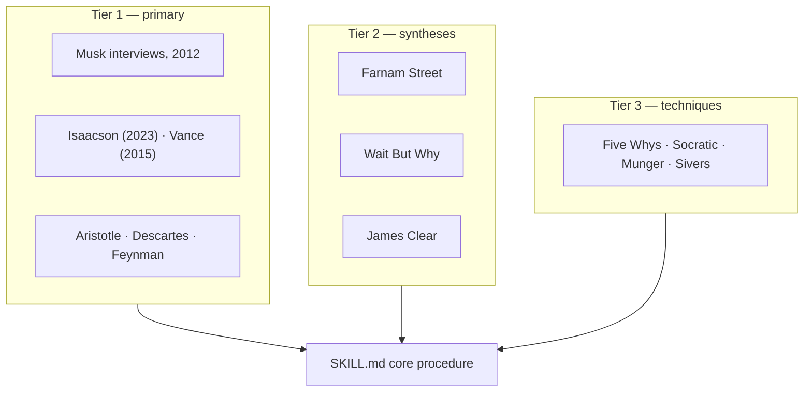

#  Sources and URLs

Full credit table for the **first-principles-thinking** skill. Everything in this skill is **paraphrased** from the sources below; the only quotations are short, attributed lines (each under 25 words). No source text, book chapters, or transcripts are stored in the repo. Open this file when verifying an attribution or refreshing a paraphrase.

##  Tier 1 — Primary sources (the spine)

| Source | What the skill takes from it | Used in | URL / citation |
| --- | --- | --- | --- |
| Elon Musk, interview with Kevin Rose, *Foundation* (Sep 2012) | The canonical statement of reasoning from first principles vs by analogy; the battery decomposition ($600/kWh claim vs ~$80/kWh in materials at London Metal Exchange prices) | `musk-examples.md`, `SKILL.md` §4 | https://www.youtube.com/watch?v=L-s_3b5fRd8 |
| Elon Musk, Q&A with Chris Anderson, *Wired* (Oct 2012) | The rocket decomposition: what a rocket is made of, and materials at ~2% of the typical price | `musk-examples.md` | https://www.wired.com/2012/10/ff-elon-musk-qa/all/ |
| Walter Isaacson, *Elon Musk* (Simon & Schuster, 2023) | "The Algorithm" chapter: the five rebuild steps in strict order, the add-back-10% deletion rule, the idiot index, the flufferbot episode | `the-algorithm.md`, `SKILL.md` §5 | Book — no URL; paraphrased, no text reproduced |
| Ashlee Vance, *Elon Musk: Tesla, SpaceX, and the Quest for a Fantastic Future* (2015) | Contemporary reporting on the rocket-cost investigation; Larry Page's summary of the method (the physics, the time, the cost, how much cheaper) | `musk-examples.md` background | Book — no URL; paraphrased |
| Elon Musk, Reddit AMA (2015) | Knowledge as a semantic tree: trunk and big branches before leaves | `cook-and-chef.md`, `techniques.md` background | Cited via the Farnam Street source list: https://fs.blog/first-principles/ |
| Aristotle, *Physics* 184a10–21; *Metaphysics* 1013a14–15 | The definition: a first principle is "the first basis from which a thing is known"; knowledge as acquaintance with primary causes down to the elements | `SKILL.md`, `techniques.md` | Public-domain classical texts (Bekker pagination as shown) |
| René Descartes, *Meditations on First Philosophy* (1641); *Principles of Philosophy* (1644) | Methodical doubt: doubt everything doubtable, build only on what survives | `techniques.md` | Public-domain classical texts |
| Richard Feynman (via Caltech archives) | "What I cannot create, I do not understand" — from his blackboard at his death; the rebuild/teach standard | `techniques.md`, `SKILL.md` toolbox | Caltech Archives blackboard photograph; the rote-learning critique is quoted in the Farnam Street piece below |

##  Tier 2 — Syntheses (structure and teaching frames)

| Source | What the skill takes from it | Used in | URL / citation |
| --- | --- | --- | --- |
| Farnam Street (Shane Parrish), "What is First Principles Thinking?" (2018, updated) | The working definition; going one or two layers deeper; Socratic questioning in six steps; the Five Whys; the Lego decomposition picture; the BuzzFeed and CD Baby examples; the limiting-beliefs list | `techniques.md`, `worked-examples.md`, `anti-patterns.md` | https://fs.blog/first-principles/ |
| Shane Parrish & Rhiannon Beaubien, *The Great Mental Models*, Vol. 1 (2019) | The first-principles chapter the article draws on; first principles paired with inversion among general thinking tools | `techniques.md` | Book — no URL; paraphrased |
| Tim Urban, "The Cook and the Chef: Musk's Secret Sauce", Wait But Why (Nov 2015) | Cook (analogy) vs chef (first principles); the Want box and Reality box; the three epiphanies; the cognitive-cost honesty | `cook-and-chef.md` | https://waitbutwhy.com/2015/11/the-cook-and-the-chef-musks-secret-sauce.html |
| James Clear, "First Principles: Elon Musk on the Power of Thinking for Yourself" (2017) | Deconstruct → reconstruct; "optimize the function, ignore the form"; John Boyd's snowmobile recombination; first principles vs continuous improvement as the fork | `worked-examples.md`, `cook-and-chef.md`, `anti-patterns.md` | https://jamesclear.com/first-principles |

## Tier 3 — Supporting techniques and examples

| Source | What the skill takes from it | Used in | URL / citation |
| --- | --- | --- | --- |
| Taiichi Ohno / Toyota production tradition | The Five Whys root-cause technique | `techniques.md`, `SKILL.md` §3 | General knowledge, via the Farnam Street treatment above |
| Socratic questioning (classical, via Farnam Street) | The six-step disciplined questioning sequence | `techniques.md`, `SKILL.md` §3 | https://fs.blog/first-principles/ |
| Charlie Munger (speeches; via Farnam Street's mental-models work) | Inversion as the companion check; the latticework idea that no single model suffices | `techniques.md` | Speeches and *Poor Charlie's Almanack* — no single URL; paraphrased |
| Derek Sivers, *Anything You Want* (2011) | CD Baby reduced to one principle — happy customers — and constraint as an advantage | `worked-examples.md` | Book — no URL; paraphrased, via the Farnam Street treatment |
| Jonah Peretti / BuzzFeed (via Farnam Street and Wired reporting) | Distribution as the measured first principle of online media | `worked-examples.md` | https://fs.blog/first-principles/ |
| John Boyd (via James Clear) | The snowmobile: recombination of stripped parts across categories | `worked-examples.md`, `SKILL.md` §5 | https://jamesclear.com/first-principles |

## Maintainer notes

- **Paraphrase policy.** Refresh a reference by re-reading the source at its URL and re-paraphrasing; never paste source text into the repo. Short attributed quotes (under 25 words) are the only exception, matching how the sources above quote each other.
- **Numbers policy.** The figures in `musk-examples.md` are the ones stated publicly in 2012 and are labeled as such. When refreshing, keep historical numbers historical — do not silently update them to current prices; add a dated note instead.
- **Diagrams and icons.** Every file in this skill carries a mermaid diagram near the top and Hugeicons free icons per `assets/icons/README.md`. Keep both in step when editing.
