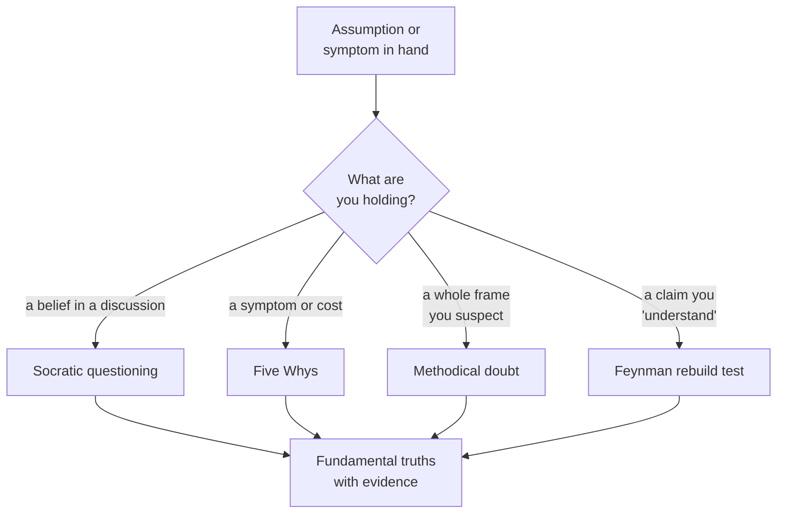

#  Techniques — the stripping toolbox

Four classical techniques do the actual work in Steps 2–3 of the core procedure, plus one companion check for Step 6. Each is old, public-domain in concept, and paraphrased here from the sources credited at the end. Pick by situation; do not run all four on everything (see the cognitive-cost guardrail in `../SKILL.md`).

## Socratic questioning

A disciplined question sequence for pulling a belief apart in conversation — with a colleague, a vendor, or yourself — until what remains is either evidence or an admitted guess. The six moves, as laid out in the Farnam Street treatment:

1. **Clarify the claim.** What exactly do I think, and where did the idea come from? ("Why do I think this?")
2. **Challenge the assumptions inside it.** How do I know this is true? What would I think if I started from the opposite position?
3. **Demand evidence.** What backs this up? What are the sources, and have they been wrong before?
4. **Take alternative perspectives.** What would a smart skeptic say? How would I know if they were right?
5. **Trace consequences.** If I am wrong, what breaks? What does this belief commit me to?
6. **Question the original question.** Was I even asking the right thing? What did the process itself reveal?

Run it on the load-bearing rows of the Step 2 assumption table first. A belief that survives all six moves, with evidence produced at move 3, is a candidate fundamental truth. One that collapses at move 2 or 3 was never a truth — it was furniture.

## The Five Whys

From the Toyota production tradition (Taiichi Ohno): state the problem, ask why it happens, then ask why *that* happens, five times or until the chain reaches something you can act on — a process, a missing step, a wrong requirement — instead of a symptom or a person.

- Symptom: "The vendor quote went up 30%." Why? … keep going until the chain ends at a rebuildable cause ("we single-source a part whose material cost fell") rather than a verdict ("vendors are expensive").
- Stop rules: stop when the answer names a **process or requirement** (fixable), when answers start repeating, or when the chain leaves your ability to verify. Never let it end at a person's character; that is blame wearing a method's clothes.
- Pair it with measurement: each "why" answer is an assumption until someone checks it. The technique finds candidate root causes; evidence confirms them.

## Methodical doubt (Descartes)

The hard reset. Descartes' move, in the *Meditations* (1641) and *Principles of Philosophy* (1644): systematically doubt everything that *can* be doubted — senses, received opinion, authority, habit — and keep only what survives the attempt. What survived for him became the foundation he rebuilt on.

Use the diluted, operational version: for one working session, treat **every** Step 2 assumption as false until it re-earns its place with evidence. This is too expensive for routine work and exactly right when the whole frame is suspect — when three incremental fixes in a row have failed, or when the team's shared story about the problem has never once been checked. It is Step 3 with the default flipped from "keep unless disproven" to "demote unless proven."

## The Feynman rebuild / teach test

Physicist Richard Feynman's standard for understanding is the bluntest of the four: "What I cannot create, I do not understand." (The line was on his blackboard when he died; Caltech keeps the photograph.) His related complaint about rote learning — people who memorize the name of a thing and mistake it for knowing the thing — is quoted in the Farnam Street piece: knowledge held that way is fragile.

Run it two ways:

- **Rebuild test (Step 3).** Take any component of the status quo — a price, a process, a design — and rebuild it from your fundamental-truths list without looking at the original. Where the rebuild stalls or silently imports a piece of the original, you found an assumption you did not know you were making.
- **Teach test (Step 7).** Explain the final analysis in plain words, as if teaching it, without jargon. Every sentence where you reach for a label instead of a mechanism marks a gap — yours, not the listener's. Fix the gap or flag the claim as not-yet-understood in the output.

## Inversion — the companion check (Munger)

Charlie Munger's habit, borrowed from the mathematician Jacobi: **invert, always invert.** At Step 6, instead of asking "why will this rebuild succeed?", ask "what would guarantee this fails?" — then check the rebuild against that list. Inversion catches failure modes that forward reasoning flatters away, and it pairs naturally with first principles inside Munger's broader latticework-of-mental-models approach: no single model, including this one, deserves sole custody of a decision.

## Sources

- Farnam Street, "What is First Principles Thinking?" — Socratic questioning (six steps), the Five Whys, and the Feynman rote-learning passage: https://fs.blog/first-principles/
- Shane Parrish and Rhiannon Beaubien, *The Great Mental Models*, Vol. 1 (2019) — first principles and inversion as paired general thinking tools. (Book; paraphrased.)
- René Descartes, *Meditations on First Philosophy* (1641) and *Principles of Philosophy* (1644) — methodical doubt. (Public-domain texts; paraphrased.)
- Aristotle, *Physics* 184a10–21 and *Metaphysics* 1013a14–15 — a first principle as "the first basis from which a thing is known". (Public-domain texts; paraphrased.)
- Taiichi Ohno and the Toyota production tradition — the Five Whys root-cause practice (general knowledge, via the Farnam Street treatment above).
