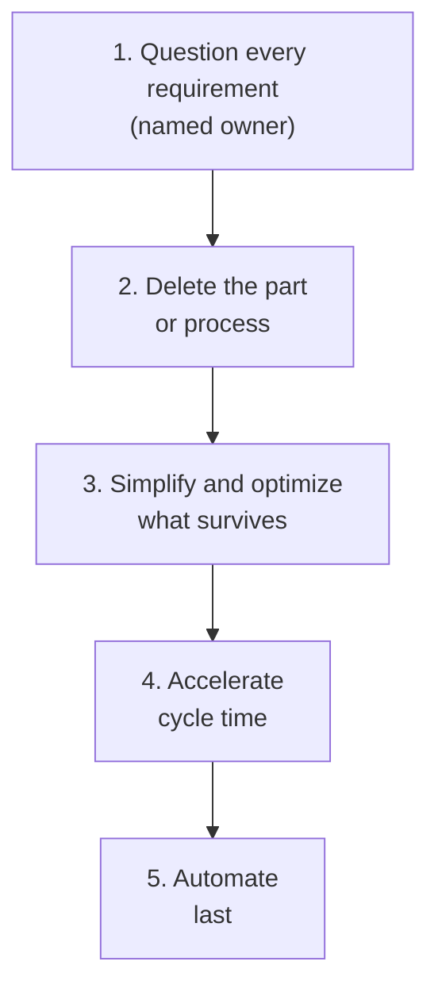

#  The Algorithm — the rebuild order

Decomposition tells you what is true. It does not tell you how to build. The rebuild procedure in this skill is the five-step method Musk drilled into his engineering teams, documented in Walter Isaacson's 2023 biography and walked through on camera in a 2021 factory tour. He called it The Algorithm. Its power is the **order**: each step protects you from a specific, expensive mistake, and running the steps out of order reintroduces it.

## The five steps

### 1. Question every requirement — and make it less dumb

Every requirement in the design or process gets challenged, especially your own. Two disciplines make this step work:

- **Every requirement has a name on it.** Not a department, not "legal", not "the spec" — a person. A requirement from a department cannot be argued with, renegotiated, or retired; a requirement from a person can. In the core procedure, this is why Step 2 records the *source* of every assumption.
- **Requirements from smart people are the most dangerous kind**, because nobody questions them. Seniority is not evidence.

Output of this step: each surviving requirement is owned, current, and defensible in one sentence.

### 2. Delete any part or process you can

Try very hard to remove the part, step, feature, approval, or report entirely. The calibration rule: **if you do not end up adding back at least 10% of what you deleted, you did not delete enough.**

Deletion feels risky because keeping a thing has invisible costs while deleting it has visible ones. That asymmetry is exactly why the default must be delete. A part that does not exist cannot break, cannot be stocked, cannot need approval, and cannot be optimized by mistake in Step 3.

### 3. Simplify and optimize — only what survived

Now, and only now, improve what is left. The warning attached to this step is the most quoted line in the method: the most common mistake of a smart engineer is to optimize a thing that should not exist. Steps 1–2 exist to make sure Step 3's considerable talent is spent on things that earned their place.

### 4. Accelerate cycle time

Speed up the loop: build faster, decide faster, ship faster, get feedback faster. Speed applied before deletion and simplification just produces waste at a higher rate, which is why this step is fourth and not first.

### 5. Automate — last

Automate the process only after it has been questioned, deleted down, simplified, and sped up by hand. Automation is a force multiplier: it multiplies whatever it touches, including the dumb parts.

## The cautionary tale: automating what should have been deleted

During the Model 3 production ramp, Tesla automated a step in which a robot placed fiberglass mats ("fluff") onto battery packs — a task the so-called flufferbot performed badly and slowly, holding up the line. When the step was examined, the mats turned out to be unnecessary for the pack to meet its requirements at all: two teams each believed the other needed them. The fix was not a better robot. It was deleting the part — and with it the robot, the step, and the delay.

The general form of the failure: a requirement nobody owned (Step 1 skipped), a part nobody deleted (Step 2 skipped), then real money spent optimizing and automating it (Steps 3 and 5). Most process bloat in most organizations has this exact shape. When you find an expensive, fragile automated process, do not ask how to fix the automation. Ask which step of The Algorithm was skipped.

## The idiot index

The companion metric, used at SpaceX on parts: **idiot index = cost of the finished part ÷ cost of its raw materials.** A part whose materials cost $10 and whose finished cost is $1,000 has an index of 100, which flags that the design or the manufacturing process — not the physics — is producing the price. High-index items go to the front of the queue for Steps 1–2: question why the part is designed this way at all, then try to delete it.

In the core procedure's Step 4, the same ratio is computed for whole quotes and processes. See [`musk-examples.md`](./musk-examples.md) for the rocket (~50×) and battery (~7.5×) versions.

## Corollaries worth keeping

- **All designs are wrong; the question is how wrong.** A design review that finds nothing to delete has not looked.
- **If a rule fights physics, physics wins.** Requirements that contradict measured evidence lose, whoever set them. (Safety and legal requirements are not "rules" in this sense — see the guardrails in `../SKILL.md`.)
- **Comradery is not a reason to keep a requirement.** Questioning a colleague's requirement is respect for the outcome, in this method — the named-owner rule exists so the conversation is with a person, about the work.
- **Work the problem in order, every time.** The method degrades gracefully when steps are skipped only in the sense that you get a faster, more automated version of the wrong thing.

## Sources

- Walter Isaacson, *Elon Musk* (Simon & Schuster, 2023) — "The Algorithm" chapter: the five steps in order, the add-back-10% rule, the idiot index, and the flufferbot episode. (Book; paraphrased, no text reproduced.)
- Elon Musk, Starbase tour interview with Tim Dodd (Everyday Astronaut, July 2021) — the five steps walked through on camera, in his own words. (Video series on the Everyday Astronaut channel; paraphrased.)
