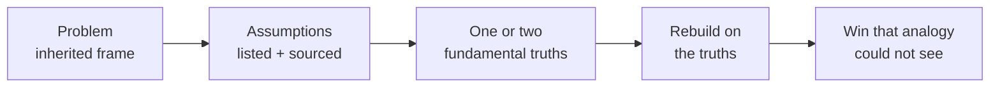

#  Worked examples beyond rockets

The full core procedure, run on problems with no aerospace anywhere in them — plus a template for the most common business use: taking apart a vendor quote. The Musk decompositions live in [`musk-examples.md`](./musk-examples.md); read those first if you have not.

## Example 1 — A media business rebuilt on distribution (BuzzFeed)

**Problem.** Build an online media company in a market where the conventional playbook — prestige content, search optimization, destination readership — is owned by incumbents.

**Assumptions listed.** Content succeeds by being what people *should* read; traffic comes mainly from search and homepages; editorial judgement is the core skill; growth is a content problem.

**Strip to truths.** Founder Jonah Peretti studied how ideas actually spread and landed on one load-bearing truth with evidence behind it (measurement: sharing behavior across the early social web): **online, distribution is the constraint** — people encounter and pass along what they *want* to share, and sharing, not search, is the growth engine. The rest of the conventional list demoted to assumptions.

**Rebuild.** Optimize the function — getting content in front of people via their own sharing — and ignore the inherited form: headlines and formats engineered to be shared, a human angle in every piece, short and easy to react to, and an operation built on obsessive measurement (A/B tests and analytics) rather than editorial intuition. In James Clear's framing: optimize the function, ignore the form.

**Result / lesson.** The company grew to hundreds of employees and major revenue on that single principle while better-funded rivals optimized the analogy version. Note the shape: the "first principle" here is not physics — it is a *measured* truth about the system, which qualifies under the evidence rule (Step 3: measurement).

## Example 2 — A business reduced to one principle (CD Baby)

**Problem.** Grow a small online music store with no funding, against funded competitors, in the dot-com boom.

**Assumptions listed.** Success needs investors, serious offices, enterprise systems, and a large staff — the standard startup furniture of the era, which founder Derek Sivers watched funded friends buy at great expense.

**Strip to truths.** Ask what a business actually needs to survive and the list collapses to one item: **customers who are happy enough to come back and tell other people.** Everything else is a hypothesis about how to get there, not a requirement.

**Rebuild.** Spend only where it touches the customer: famously warm, human order-confirmation emails; desks made from planks and cinder blocks; computers assembled from parts for a fraction of what funded peers paid for equivalent setups. Constraint treated as an advantage — with no money to waste, every dollar had to pass the one-principle test.

**Result / lesson.** The store grew to millions in monthly revenue on word of mouth. The procedural lesson: a rebuild can be *subtractive*. Sivers ran The Algorithm's delete step on an entire company's cost structure, using one fundamental truth as the deletion criterion — if it does not thrill an existing customer, it goes.

## Example 3 — Recombination: the snowmobile (John Boyd)

**Problem.** Military strategist John Boyd's classic teaching example: you need a vehicle that crosses snow — a thing that, in the frame of the existing categories, does not yet exist on your shelf.

**The analogy trap.** Reasoning by category says: improve a car, improve a sled, wait for a supplier. Each existing thing drags its whole form with it.

**Decompose to parts.** Break three existing machines down to functional pieces: a motorboat contributes its **motor**; a tank contributes its **continuous tread**; a bicycle contributes its **handlebars and skis-like steering** idea (in the usual telling: motor, treads, and handlebars/skis).

**Rebuild.** Recombine the parts across category lines and you get a **snowmobile** — a new thing that no amount of polishing any single parent machine would have produced.

**Lesson.** Decomposition has two payoffs, not one: it finds the floor (cost examples) and it frees the parts for recombination (this example). When you finish Step 3, ask the Step 5 question both ways: what can be deleted — and what stripped part from somewhere else belongs in the rebuild?

## Template — vendor-quote cost decomposition

Copy this for Step 4 whenever a supplier, agency, or contractor quote is the problem. Fill every cell; mark unknowns honestly.

| # | Line | Your entry |
| --- | --- | --- |
| 1 | Unit (Step 1) | One ____ (part / hour / seat / campaign / process run) |
| 2 | Quoted price per unit | $____ (source: the quote, dated ____) |
| 3 | Raw input A | ____ — $____ per unit (source: ____) |
| 4 | Raw input B | ____ — $____ per unit (source: ____) |
| 5 | Raw input C | ____ — $____ per unit (source: ____) |
| 6 | Direct labor at market rate | ____ hrs × $____ (source: ____) |
| 7 | Other inputs (energy, licenses, logistics) | $____ (source: ____; mark `unsourced` lines) |
| 8 | **Floor** (sum of 3–7) | **$____** |
| 9 | **Idiot index** (line 2 ÷ line 8) | **____×** |
| 10 | Gap hypotheses | List what plausibly fills the gap: low volume, hand-offs, margin stacking, certification, rush, legacy process — each is a Step 2 assumption to test |
| 11 | Rebuild options | In-house / recombine / renegotiate scope / delete the need — in The Algorithm's order |
| 12 | Decision | Accept, rebuild, or re-quote — and the one measurement that would change the call |

Reading the index: **~1–2×** — the price is mostly inputs; negotiate volume or terms. **~3–10×** — process and margin dominate; the gap hypotheses in line 10 are the work list. **>10×** — stop and check the unit definition and the floor for errors first (see [`anti-patterns.md`](./anti-patterns.md)); if both hold, you have found the rare case where a rebuild can change the economics outright.

## Sources

- Farnam Street, "What is First Principles Thinking?" — the BuzzFeed/Peretti distribution example and the Sivers/CD Baby example: https://fs.blog/first-principles/
- Derek Sivers, *Anything You Want* — CD Baby's constraint-as-advantage account in his own book. (Book; paraphrased, via the Farnam Street treatment.)
- James Clear, "First Principles: Elon Musk on the Power of Thinking for Yourself" — John Boyd's snowmobile, and "optimize the function, ignore the form": https://jamesclear.com/first-principles
