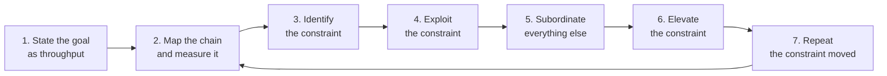

#  fix-the-bottleneck (open skill)

**A procedure for fixing bottlenecks in a running system.** This skill turns Goldratt's Theory of Constraints into a run an agent or operator can execute and check: state the goal as throughput, measure the chain, find the one constraint the queues point at, and fix the losses in the order that moves total output.

##  What this is

An **open, agent-oriented skill** for any chain that produces finished output below its target: delivery pipelines, CI/CD, support operations, production lines, agent fleets.

Most improvement effort spreads evenly across a system, or follows whoever complains loudest. The system's rate, though, is set by one stage. This skill exists to find that stage from measurements and concentrate the work there:

1. What is the finished unit, and what is its rate against target?
2. Where does work pile up, and where does it starve?
3. What do we squeeze, align, and only then spend on, to move the rate?

The method is Eliyahu M. Goldratt's, from *The Goal* (1984). The flow math comes from Donald Reinertsen's work on product development flow, the software translation from *The Phoenix Project* and *Accelerate*, and the redesign step runs Musk's Algorithm, in its fixed order.

##  Who it is for

| Reader | What they get |
| --- | --- |
| Operators and founders running a system below target | A verdict on the one constraint, with the evidence, instead of a list of everything that could be better |
| Engineers fixing CI/CD or delivery flow | An order of operations: exploit and subordinate before spending on capacity |
| Agent fleets and their supervisors | A done-rule: a fix counts only when system throughput moves over a sustained window |
| Anyone tired of whack-a-mole | A loop that re-finds the constraint after every fix, and audits the old rules that become the new one |

##  Process at a glance

##  How to use with an agent

| Step | What to give the agent |
| --- | --- |
| Point it at one chain | The finished unit, the target rate, and where the stage measurements live |
| Let it instrument first | If the rates do not exist, the first deliverable is the measurement plan, not a verdict |
| Read the constraint verdict | One constraint, its kind, and the queue and starvation evidence behind it |
| Hold the order | Exploit and subordinate lists land before any elevate spend is approved |
| Judge by the re-measure | The run closes when throughput is re-read against its done rule, not when fixes ship |

##  Folder map

| Path | What it holds |
| --- | --- |
| `SKILL.md` | The seven-step procedure, guardrails, output contract, and limits |
| `references/README.md` | Index of the depth material |
| `references/five-focusing-steps.md` | Goldratt's five steps: what each requires and how each is botched |
| `references/flow-math.md` | Little's Law, the utilization curve, batch size, and the stage equation |
| `references/throughput-accounting.md` | Throughput, inventory, and operating expense, adapted to knowledge work |
| `references/constraint-kinds.md` | Resource, policy, hero, and external constraints, and how each is treated |
| `references/case-study-agent-fleet.md` | A worked run on an AI agent fleet producing code changes |
| `references/sources-and-urls.md` | The books and papers behind the skill, credited |

##  Sources and credits

The method is Eliyahu M. Goldratt's Theory of Constraints (*The Goal*, with Jeff Cox, 1984; *Theory of Constraints*, 1990; *Critical Chain*, 1997). The flow mathematics is Donald G. Reinertsen's (*The Principles of Product Development Flow*, 2009), resting on Little's Law (John D. C. Little, 1961). The software translation is Gene Kim, Kevin Behr, and George Spafford's *The Phoenix Project* (2013) and Nicole Forsgren, Jez Humble, and Gene Kim's *Accelerate* (2018). The elevate step runs the Algorithm from Walter Isaacson's *Elon Musk* (2023). Full table: `references/sources-and-urls.md`. These are paraphrases and adaptations, credited; no source text is reproduced.

##  Contributing

Improvements are welcome. Keep the procedure's order intact: a contribution that elevates before exploiting has the method backwards. Field reports, a run written up with its measurements and its re-measure verdict, are the most valuable contribution there is.

##  License

MIT. See the repository LICENSE file.

##  Version

0.1.0 — first build. See `CHANGELOG.md`.
