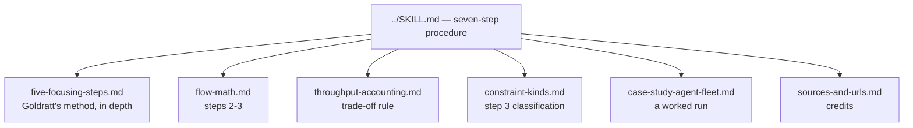

# References index — Fix the Bottleneck

These references support **fix-the-bottleneck**, version **0.1.0**. The main `../SKILL.md` holds the seven-step procedure, the guardrails, and the output contract. These files carry the depth: the original method, the math under the map, the accounting that governs trade-offs, the kinds of constraint and their treatments, and one worked case.

| File | What it carries |
| --- | --- |
| `five-focusing-steps.md` | Goldratt's five focusing steps: what each step actually requires, how each is usually botched, and the knowledge-work translation |
| `flow-math.md` | Little's Law, the utilization curve, batch size, cost of delay, and the stage equation that must reproduce measured output |
| `throughput-accounting.md` | Throughput, inventory, and operating expense defined for knowledge work, and the decision order they impose |
| `constraint-kinds.md` | The four kinds of constraint — resource, policy, hero, external — with the treatment each kind calls for |
| `case-study-agent-fleet.md` | A full run on a fleet of AI coding agents: the equation, the verdict, the fix order, and the target math |
| `sources-and-urls.md` | Every book and paper behind the skill, with what was taken from each |
