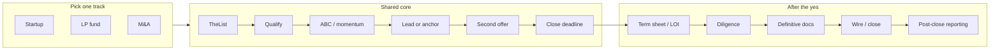

#  fundraising (open skill)

**Not legal, tax, or investment advice.** This repository contains operational playbooks for humans and AI agents. Binding terms, securities offerings, tax, and wires require **lawyer review** and **CPA review** where applicable.

##  What this is

An **open, agent-oriented skill** for running a capital process end to end—with explicit **human checkpoints** before outreach, terms, signatures, or money move.

It covers three tracks:

1.  **Startup** seed/venture (SAFEs and priced rounds)
2.  **GP fund** raises from **LPs**
3.  **Company M&A** / strategic exit

Each track shares the same competitive core: build a large target list, qualify fast, create real momentum, secure a lead or anchor, race for a second offer, and close on a deadline—then execute **after the yes** (diligence → docs → close → post-close).

##  Who it is for

| Audience | Use |
| --- | --- |
| **Founders / GPs** | Run TheList, prep materials, approve every external action |
| **AI agents** | Load `SKILL.md`, draft research and checklists, never bind the company without approver sign-off |
| **Operators / chiefs of staff** | Weekly pipeline reports, data room and DDQ prep |
| **Maintainers** | Refresh `references/` when official forms change; bump `version` in `SKILL.md` |

##  Process at a glance

##  How to use with an agent

1. **Load** [`SKILL.md`](./SKILL.md) as the system skill (see your agent’s skill docs).
2. **Pick a track** (startup, LP fund, or M&A) and confirm approver + guardrails.
3. **Pull references when needed** (do not paste entire PDFs into context):

| Phase | Read |
| --- | --- |
| Term sheet / SAFE / LOI economics |  [`references/deal-terms.md`](./references/deal-terms.md) |
| Cap table / dilution |  [`references/cap-table-math.md`](./references/cap-table-math.md) |
| Data room / DDQ / seller DD |  [`references/due-diligence-checklists.md`](./references/due-diligence-checklists.md) |
| M&A timeline / auction |  [`references/ma-process.md`](./references/ma-process.md) |
| Fund closes / Reg D / QP |  [`references/fund-closing-and-compliance.md`](./references/fund-closing-and-compliance.md) |
| Updates / LP reporting |  [`references/post-close.md`](./references/post-close.md) |
| Jargon |  [`references/glossary.md`](./references/glossary.md) |

4. **Stop at guardrails** in `SKILL.md` (outreach, terms, docs, wires, solicitation, eligibility)—human approves every binding step.

##  Folder map

| Path | One line |
| --- | --- |
| [`SKILL.md`](./SKILL.md) | Main skill: shared core, tracks, guardrails, agent procedure, sources |
| [`CHANGELOG.md`](./CHANGELOG.md) | Version history |
| [`references/README.md`](./references/README.md) | Index of all reference files |
|  [`references/deal-terms.md`](./references/deal-terms.md) | Official-form paraphrases: SAFE, NVCA TS, Series Seed, ILPA LPA, M&A LOI |
|  [`references/due-diligence-checklists.md`](./references/due-diligence-checklists.md) | Startup VDR, ILPA DDQ 2.0, M&A seller DD |
|  [`references/cap-table-math.md`](./references/cap-table-math.md) | Dilution math + worked SAFE → Series A |
|  [`references/ma-process.md`](./references/ma-process.md) | Sell-side stages and banker/auction choices |
|  [`references/fund-closing-and-compliance.md`](./references/fund-closing-and-compliance.md) | Closes, 506(b)/(c), QP, placement agents |
|  [`references/post-close.md`](./references/post-close.md) | Investor updates, ILPA reporting fields |
|  [`references/glossary.md`](./references/glossary.md) | Term definitions |
|  [`references/book-lessons.md`](./references/book-lessons.md) | Book paraphrases woven into `SKILL.md` |
|  [`references/article-lessons.md`](./references/article-lessons.md) | Kim / Vessel / Voss paraphrases |
|  [`references/pitching-vcs-x-bookmarks.md`](./references/pitching-vcs-x-bookmarks.md) | Curated X compilation |
|  [`references/startup-seed-raising-skillzzz-summary.md`](./references/startup-seed-raising-skillzzz-summary.md) | Skilzzz (2009) digest |
|  [`references/youtube-fundraising-playlist/`](./references/youtube-fundraising-playlist/) | M&A video summaries |

##  Sources and credits

- Content is **paraphrased** from public sources (YC, NVCA, ILPA, SEC, practitioner blogs, books, articles, X posts, YouTube summaries).
- **No copyrighted document text** or pirated PDFs are stored in the repo.
- Each reference file lists **exact official URLs**; some older blog posts are marked **search excerpt only**.
- See the **Sources** table in [`SKILL.md`](./SKILL.md) for the full credit list.

##  Contributing

- Open a PR with updated paraphrases, new public sources, or fixes—keep **grep-clean** (no personal/company-specific strings listed in `SKILL.md` verification).
- When official forms change, re-download, re-paraphrase, bump **`version`** in `SKILL.md`, and add a **`CHANGELOG.md`** entry.
- Suggest sources via issue/PR; do not commit downloaded `.docx` / `.xlsx` / `.pdf` binaries.

##  License

MIT — see [`SKILL.md`](./SKILL.md) front matter. Third-party sources remain under their publishers’ terms.

##  Version

Current skill version: see `version` in [`SKILL.md`](./SKILL.md) front matter. History: [`CHANGELOG.md`](./CHANGELOG.md).
