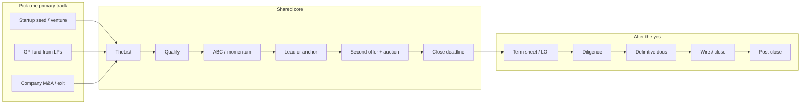

#  fundraising

> **How to read this**
>
> - **Agents:** Follow **Authorization**, **Agent guardrails**, and **Agent procedure** literally. Draft only until the approver signs off.
> - **Humans:** Use **Shared core** + one **Track** module. Open `references/` for term-sheet, DDQ, cap-table, and compliance detail.
> - **Jargon:** [`references/glossary.md`](references/glossary.md)
> - **Index:** [`references/README.md`](references/README.md) · **Public overview:** [`README.md`](README.md)

**Not legal, tax, or investment advice.** This skill is operational guidance for founders and agents. Binding terms, offerings, tax, and wires require **lawyer review** and **CPA review** where noted in references.

##  Table of contents

- [End-to-end references](#end-to-end-references)
- [Sources](#sources)
- [When to use](#when-to-use)
- [Agent guardrails: stop and ask the human](#agent-guardrails-stop-and-ask-the-human)
- [Authorization and boundaries](#authorization-and-boundaries)
- [Shared core process (all tracks)](#shared-core-process-all-tracks)
- [TheList — pipeline tracking](#thelist--pipeline-tracking)
- [Outreach cadence (defaults)](#outreach-cadence-defaults)
- [Reporting (all tracks)](#reporting-all-tracks)
- [Track — Startup seed / venture](#track--startup-seed--venture)
- [Track — Fund raising from LPs](#track--fund-raising-from-lps)
- [Track — Selling the company / M&A](#track--selling-the-company--m-a)
- [Output standard](#output-standard)
- [Verification checklist](#verification-checklist)

##  End-to-end references

| Topic | File |
| --- | --- |
|  Term sheets & deal economics | `references/deal-terms.md` |
|  Due diligence & data rooms | `references/due-diligence-checklists.md` |
|  Cap table & dilution math | `references/cap-table-math.md` |
|  M&A process & timelines | `references/ma-process.md` |
|  Fund closes & Reg D / marketing | `references/fund-closing-and-compliance.md` |
|  Post-close reporting & board | `references/post-close.md` |
|  Podcast / interview lessons | `references/interview-lessons.md` |

##  Sources

| Layer | Credit | Local |
| --- | --- | --- |
| Core process (seed) | [Startup Seed Raising Skilzzz](https://swooshing.wordpress.com/2009/03/19/startup-seed-raising-skillzzz/) (Travis Kalanick, 2009) | `references/startup-seed-raising-skillzzz-summary.md` |
| X — pitching VCs & funds | 14 curated posts (2026-11-04); per-post authors linked below | `references/pitching-vcs-x-bookmarks.md` |
| YouTube — M&A | [Fundraising playlist](https://www.youtube.com/playlist?list=PLJaB9gz_nmkEZhl3oov2PZHmYUOCqFzvP); POTOMAC M&A (Paul Giannamore) | `references/youtube-fundraising-playlist/` |
| Qualifying dialogue | *Straight Line Persuasion*, Module 7 — The Art of Qualifying (paid sales training course); paraphrased only in this file | — |
| Books | *Winning Through Intimidation* (Robert J. Ringer) | `references/book-lessons.md` |
| *Positioning* | Al Ries & Jack Trout — [BestWriting summary](https://bestwriting.com/positioning-summary) | `references/book-lessons.md` |
| *Breakthrough Advertising* | Eugene M. Schwartz — [Valchanova book notes](https://valchanova.me/breakthrough-advertising-copywriting-book-review/) | `references/book-lessons.md` |
| *Angel* | Jason Calacanis — [Max Mednik notes](https://www.maxmednik.com/blog/notes-on-angel-by-jason-calacanis), [Haley Bryant summary](https://www.haleymbryant.com/blog/angel-by-jason-calacanis-summary) | `references/book-lessons.md` |
| *Zero to One* | Peter Thiel & Blake Masters — [Medium commentary summary](https://xdev200200.medium.com/zero-to-one-commentary-summary-3695704017f9) | `references/book-lessons.md` |
| Five Laws of Fundraising | John Kim — [Vessel recap](https://vessel.co/resources/blog/the-five-laws-of-fundraising-a-70-billion-masterclass-in-persuasion-pipeline-and-process-with-john-kim) | `references/article-lessons.md` |
| GTM Engine of Fundraising | JD St-Martin & Jonathan Alden — [Vessel guide](https://vessel.co/resources/blog/the-go-to-market-engine-of-fundraising-complete-2026-guide-to-applying-b2b-saas-model-to-lp-relationships) (vendor content) | `references/article-lessons.md` |
| *Never Split the Difference* | Chris Voss — [Runn summary](https://www.runn.io/blog/never-split-the-difference-summary) | `references/article-lessons.md` |
| *Pitch Anything* | Oren Klaff — [Deven Davis summary](https://www.devendavis.com/book-summaries/pitch-anything); [blas.com notes](https://blas.com/pitch-anything/) | `references/book-lessons.md` |
| Fundraising process & IR (2026) | Travis Kalanick — [David Senra podcast, 2026-08-16](https://www.davidsenra.com/episode/travis-kalanick) | `references/interview-lessons.md` |
| End-to-end process (terms, DD, math, M&A, fund compliance, post-close) | Paraphrased references below | `references/deal-terms.md`, `due-diligence-checklists.md`, `cap-table-math.md`, `ma-process.md`, `fund-closing-and-compliance.md`, `post-close.md` |
| Official forms (v3.1.0 parse) | YC SAFE docx; NVCA 2020 term sheet; Series Seed GitHub; ILPA Model LPA/DDQ/reporting defs; 15 U.S.C. 80a-2/80a-3 | See `references/` headers and URLs below |
| Glossary | In-skill jargon | `references/glossary.md` |

### End-to-end process source URLs (paraphrase only; copied exactly)

- https://www.ycombinator.com/documents
- https://bookface-static.ycombinator.com/assets/ycdc/SAFE%20User%20Guide-a47c6588327d73aa2799e61ed7c2cae9f1a0ee9acfa9c43b62039dc06e715832.pdf
- https://nvca.org/model-legal-documents/
- https://feld.com/archives/2005/01/term-sheet-liquidation-preference/
- https://feld.com/archives/2005/01/term-sheet-protective-provisions/
- https://feld.com/archives/2005/01/term-sheet-board-of-directors/
- https://feld.com/archives/2005/02/term-sheet-drag-along/
- https://feld.com/archives/2005/08/term-sheet-series-wrap-up/ (search excerpt only)
- https://fullratchet.net/episode-10-the-term-sheet-feat-brad-feld/ (search excerpt only)
- https://ilpa.org/wp-content/uploads/2019/06/ILPA-Principles-3.0_2019.pdf
- https://ilpa.org/industry-guidance/principles-best-practices/ilpa-principles/
- https://www.fundlaunch.com/solutions/lpa-drafting
- https://www.mintz.com/insights-center/viewpoints/2871/2025-03-31-seller-considerations-when-negotiating-letter-intent
- https://morganandwestfield.com/books-online/chapter-19-the-letter-of-intent/major-clauses/ (search excerpt only)
- https://www.casneredwards.com/representation-and-warranty-insurance-managing-risk-in-your-next-ma-deal/ (search excerpt only)
- https://fasthofflawfirm.com/blog/escrows-and-holdbacks (search excerpt only)
- https://www.crv.com/content/series-a-funding
- https://ilpa.org/wp-content/uploads/2021/11/ILPA-DDQ-2.0.pdf
- https://ilpa.org/wp-content/uploads/2024/10/ILPA-Institute-Operational-Due-Diligence-for-the-Limited-Partner.pdf (search excerpt only)
- https://www.breakwaterma.com/blog/seller-due-diligence-checklist
- https://praxisrock.com/insights/sell-side-m-a-process
- https://windsordrake.com/process/sell-side-process/
- https://auxocapitaladvisors.com/sell-side-m-a-process/ (search excerpt only)
- https://auxocapitaladvisors.com/sell-side-mna-timeline/ (search excerpt only)
- https://www.alehar.com/resources/articles/navigating-the-sell-side-manda-process (search excerpt only)
- https://www.sec.gov/resources-small-businesses/exempt-offerings/private-placements-rule-506b
- https://www.sec.gov/resources-small-businesses/exempt-offerings/general-solicitation-rule-506c
- https://www.investor.gov/introduction-investing/general-resources/news-alerts/alerts-bulletins/investor-bulletins/updated-3
- https://www.investor.gov/introduction-investing/general-resources/news-alerts/alerts-bulletins/investor-alerts/investor-50
- https://www.sec.gov/resources-small-businesses/small-business-compliance-guides/investment-adviser-marketing
- https://www.eisneramper.com/insights/private-equity/subsequent-closings-finds-pe-0623/
- https://www.sec.gov/resources-small-businesses/glossary (search excerpt only — qualified purchaser)
- https://yonder.vc/resources/investor-update-template/
- https://ilpa.org/industry-guidance/templates-standards-model-documents/reporting-template/
- https://www.ic3.gov/PSA/2023/PSA230609
- https://www.devendavis.com/book-summaries/pitch-anything
- https://blas.com/pitch-anything/
- https://www.neurosciencemarketing.com/blog/articles/pitch-anything-by-oren-klaff.htm (search excerpt only)
- https://nvca.org/wp-content/uploads/2020/08/NVCA-2020-Term-Sheet.docx
- https://github.com/seriesseed/equity
- https://ilpa.org/wp-content/uploads/2020/07/ILPA-Model-Limited-Partnership-Agreement-WOF.docx
- https://ilpa.org/wp-content/uploads/2020/07/ILPA-Model-Limited-Parnership-Agreement-Deal-By-Deal.docx
- https://ilpa.org/wp-content/uploads/2020/07/2020.07.29-ILPA-Model-LPA-Overview-WOF-Version.docx
- https://ilpa.org/industry-guidance/templates-standards-model-documents/model-limited-partnership-agreement/
- https://ilpa.org/wp-content/uploads/2025/02/Reporting-Template-Definitions.pdf
- https://ilpa.org/wp-content/uploads/2025/04/ILPA-Performance-Template-Definitions-Granular-Methodology-v1.1.pdf
- https://ilpa.org/wp-content/uploads/2025/09/Combined-Overview-ILPA-Templates.pdf
- https://www.law.cornell.edu/uscode/text/15/80a-2
- https://www.law.cornell.edu/uscode/text/15/80a-3

**Living sources:** Periodically refresh (1) the curated X post compilation, (2) YouTube **Fundraising** playlist **summaries**, (3) `references/book-lessons.md`, (4) `references/article-lessons.md`, and (5) `references/interview-lessons.md`; update attributed tables here and bump `version` (see `CHANGELOG.md`).

**Diagrams and icons (maintainers and agents):** Every skill file, sub-skill, and reference under this folder must include at least one GitHub-renderable `mermaid` diagram near the top that explains that file’s content, plus inline **Hugeicons free** (MIT) SVG icons from `assets/icons/` per [`assets/icons/README.md`](assets/icons/README.md). Never use Hugeicons Pro (`@hugeicons-pro/*`). When a doc is added or substantially changed, update its diagram and icons in the same change. Validate diagrams with `@mermaid-js/mermaid-cli` (`mmdc`) and verify every `` resolves to a committed file before opening a PR. Applies to any human or agent editor, in any tooling.

**Optional — Web3:** Token warrants, SAFT, and crypto-native investor vetting—skip for purely equity processes.

##  When to use

Use this skill when a **founder**, **GP**, **founding team**, or delegated agent should:

| | |
| --- | --- |
|    | Run any **capital process**: startup seed/angel/venture, **first-time or follow-on fund** LP fundraising, or **company sale / recap / strategic exit**. |
|  | Build **TheList**, qualify fast, create **honest momentum**, secure **lead/anchor**, race for a **second term sheet / LOI / anchor LP**, **close on a deadline**. |
|   | Prepare pitches, FAQs, decks, teasers/CIMs, data rooms, and **pipeline reports** (decisions flagged for approver). |

Do **not** use for: generic sponsorship or partnership sales, or strategy reviews with no active raise or exit.

Pick **one primary track** ( startup,  LP fund, or  M&A) per engagement; apply the **shared core** to all three.

##  Agent guardrails: stop and ask the human

The agent **stops** and gets **explicit human approval** before any of the following (derived from end-to-end references and [FBI IC3 BEC PSA](https://www.ic3.gov/PSA/2023/PSA230609)):

1. **Outreach** — sending, scheduling, or posting email, DM, LinkedIn/X, intro requests, or follow-ups to investors, LPs, buyers, bankers, or agents (draft only until approved).
2. **Numbers and terms** — stating or changing valuation, cap, discount, price per share, round size, allocation, fee/carry, earnout, escrow, working-capital peg, or performance figures (IRR, TVPI, MOIC) outside the company.
3. **Documents** — signing, e-signing, accepting, countersigning, or sending term sheets, SAFEs, side letters, LOIs, NDAs, subscription docs, LPAs, purchase agreements, capital call notices, board consents, or DocuSign envelopes.
4. **Money and wires** — creating, changing, sending, or confirming wire/ACH instructions or funds-flow memos. Confirm bank details **by phone** using a number from an independent source (never from the email). Treat changed instructions, urgency, secrecy, or look-alike domains as fraud until a human verifies; misdirected funds → bank recall immediately and report at ic3.gov.
5. **General solicitation** — public posts, website, press, podcast, social, newsletter, or event remarks about a live raise (506(b) taint risk; 506(c) requires verified accredited buyers — **lawyer review** decides).
6. **Investor eligibility** — admitting investors or accepting money before human + counsel confirm accredited/qualified-purchaser status, KYC/AML, and bad-actor checks.
7. **Marketing Rule** — fund performance, testimonials, endorsements, ratings, or hypotheticals in LP-facing materials need compliance review.
8. **Confidentiality** — opening or sharing data-room access, CIM, cap table, customer names, or NDA-covered materials; granting new parties access.
9. **Exclusivity** — agreeing to or extending no-shop; telling bidders where they stand in a process.
10. **Filings** — remind humans of Form D (15 days after first sale) and state notices; the agent does **not** file.
11. **Legal or tax interpretation** — non-routine questions go to **lawyer review** or **CPA review**.
12. **Uncertainty** — when counterparty identity or request legitimacy is unclear, stop.

##  Authorization and boundaries

- **Draft and research only** until the founder or GP approves a specific outbound (email, DM, deck, data-room grant, term acceptance, or signature).
- Never commit to valuation, allocation, side letters, token economics, fund terms, or material deal terms without explicit approval of that exact document.
- Never share another party’s terms, cap table, or diligence notes without permission.
- Keep external narrative consistent with **approved** positioning; do not volunteer unverified distress or “sunset” storylines without approver and **lawyer review**.
- Align major investors on **liquidity path** (IPO, secondary, timeline)—proactively, in writing when counsel approves (Kalanick, Senra podcast, 2026-08-16; `references/post-close.md`).

---

##  Shared core process (all tracks)

Distilled from Skilzzz (2009) and aligned with competitive M&A process design. Loop back when the pipeline stalls.

###  1 — Build a large target list (TheList)

1. Map **where capital or buyers concentrate** for your track (see track modules for universe types).
2. **Short first contact:** goal is a meeting or NDA, not the full deck on cold outreach.
3. Log every contact in **TheList** the same day; dedupe against CRM.
4. Size top-of-funnel to the track (startup: volume benchmarks in **Track — Startup**; M&A: curated 30–50+ when scale warrants; fund: anchor LP list + long tail).
5. Prioritize **logical fits** over a long tail of long shots (after Ringer, *Winning Through Intimidation*). For startup rounds, mine **co-investor lists** from existing angels and leads (after Calacanis, *Angel*).
6. **Concentrate** on a narrow investor or LP segment you can saturate before spraying broadly (Ries & Trout, *Positioning*). Avoid the **everybody trap**—positioning requires sacrifice (Positioning).

### 2 — Qualify fast

Qualifying is still **closing**: every question should earn the next minute of attention (*Straight Line Persuasion*, Module 7 (sales training course)). Adapt consumer-sales qualifying to **investor, LP, and buyer** conversations.

1. First meetings: lead with a **short** core narrative only after permission to qualify—or open with questions when the slot is tight. Default **5–10 minute** story (fund thesis / teaser summary) once fit is plausible, then conversation.
2. **Two parts to every question:** the words and the **tone**. Prep **track-specific** qualifying questions (startup: stage, check size, decision process, timeline; LP: fund size, pacing, co-invest, Fund I vs emerging; M&A: strategic rationale, process, financing). **Memorize** the set, then **adapt live** so you never sound like you are reading a script; skip questions already answered.
3. **Permission to qualify:** transition with something like “just a couple of quick questions so I don’t waste your time”—helpful, matter-of-fact tone. Avoid a weak add-on such as “is that okay?” that undercuts authority (Module 7).
4. Discover the counterparty’s **logical and emotional why** (mandate, career risk, legacy, synergy, return hurdle)—not a blunt “why are you doing this?” Use big-picture prompts: ultimate objective, biggest headache, what matters most, ideal outcome for *their* side.
5. **Money and capacity** early, casually: indicative **check size**, **fund remaining capacity**, **buyer financing source**, decision-makers—**“no big deal”** / suitability tone, not inquisitor tone. For M&A/strategics, clarify **liquid** availability and who must approve (Module 7).
6. **Rapport while qualifying:** implicit **care**, **trust**, and **expertise**; find **common ground**; **match energy** when mirroring answers (slightly elevate only when appropriate). Do **not** pitch the round, deck, or deal while qualifying—**keep powder dry**; let them talk without narrating how perfect the fit is (Module 7).
7. **Qualify out:** if fit or capacity is wrong, **do not pitch**—biggest time waste and it poisons funnel intelligence (after Ringer, *Winning Through Intimidation*). Confirm **principal vs intermediary** and real decision authority before deep materials. Balance: do not **over-qualify** into only “perfect” names; calibrate to your track’s volume needs. Deal in **facts that move the process**, not wishful narratives (Ringer).
8. **Transition when true only:** e.g. “Based on what you’ve told me, this looks like a fit”—then deeper materials or partner meeting. If not true, pass cleanly and ask for a referral.
9. Maintain a tight **FAQ** for when you move to presentation (market, traction or track record, team, use of proceeds, competition, risks, timeline).
10. **Pass early** when fit is wrong; ask **“Who else should we meet?”** on every qualified touch.
11. Pipeline hygiene: if a counterparty **no-shows twice**, one reschedule then a direct “cancel or prioritize?” message (approver approves tone) ([@dunkhippo33](https://x.com/dunkhippo33/status/1785895882174668834)).
12. **Calibrated how/what questions** surface real constraints without debate—e.g. what matters most, how approval works, who else must agree (after Voss, *Never Split the Difference*). **Label** stated fears (dilution, key-person risk) to build trust (Voss). Treat early **yes** as provisional until confirmed; a safe **no** often hides the real issue (Voss).

### 3 — Always Be Closing (ABC)

Before leaving any substantive conversation, establish:

| Output | Requirement |
| --- | --- |
| Interest band | pass / soft / interested / ready to dig in |
| Indicative size | Rough check, commit, bid range, or LP ticket—silence is failure |
| Next step | Dated follow-up, partner meeting, data room, or process round |
| Hypothetical | “If we lock a lead at \[range\], how much would you want in?” (adapt wording per track) |

Reject vague “circle back” without date and owner.

Use the same **disarming tone** when locking **indicative size** in ABC as when qualifying (Module 7). Treat the first **“no”**, **“not now”**, or **“need to think”** as normal—not failure. Do not argue the objection head-on; clarify **certainty and fit** (“does the idea make sense?”) before pushing terms or a deck send (Module 7). A pass is routine—move to the **next qualified** counterparty without stalling (after Ringer, *Winning Through Intimidation*).

**Close means funded:** log **wires and signed closes**, not soft verbal interest alone (Ringer). **Verify** commitments: align words, tone, and next steps; confirm critical points more than once (Voss, *Never Split the Difference*).

### 4 — Credibility and passion

**Credibility:** Do not fight the truth. Acknowledge weaknesses; state **mitigation** (what you are doing about risk). Never fake certainty. Align **deck, data room, and live metrics**—polish without substance fails (Ringer). Show **capital efficiency** and how prior money was spent (after Calacanis, *Angel*). Present a **concrete plan** with milestones, not only “we will iterate” (after Thiel, *Zero to One*). Open as a **peer with options**, not a supplicant (Ringer). **Frame control** and **local status:** lead with domain expertise; avoid beta traps and supplicant rituals; if you are explaining your authority, you already lost the frame (Klaff, *Pitch Anything*).

**Passion:** Genuine energy and conviction without hype that contradicts facts.

**Persuasion (Kim):** **Emotion decides; logic justifies**—lead with credible desire or risk reduction, then data for their internal story (*Five Laws*, John Kim, Vessel recap). Stay calm; righteousness kills influence (Kim).

**Positioning (Ries & Trout):** narrative lives in the **listener’s mind**—start from their category beliefs, not your feature list ([summary](https://bestwriting.com/positioning-summary)). **Own one concept** per company or fund name; oversimplify the deck to the single idea they repeat in IC or partner meeting. **Be first** in a narrow category (or create one with a clear “not the old way” reference); do **not** attack the category leader head-on—reframe or flank. **Same core story** across rounds and fund vintages; new strategies may need a **new name/vehicle** (no line extension). **LP fund strategy** and **M&A story** use the same rules: one position, consistent for re-ups and buyer conversations.

**Outreach and deck copy (Schwartz, *Breakthrough Advertising*):** **channel existing desire**—research what the counterparty already wants, then point your offer at it ([notes](https://valchanova.me/breakthrough-advertising-copywriting-book-review/)). **Match awareness:** cold → problem/desire first; warm but hesitant → new proof or mechanism; ready to commit → terms plus real deadline. Slide titles and **subject lines** lead with outcome/desire; features and data prove below. In crowded markets, show a **new mechanism**; in jaded ones (e.g. generic funds), lead with **who you serve**. **Editorial, candid updates**—state limits and who the round is not for—boost credibility (Schwartz).

### 5 — Real momentum and competition

Counterparties delay without urgency. Every update reflects **verified** motion:

- Real meeting density and **parallel** processes (never fabricate term sheets, LOIs, or commits).
- Explicit timeline to decision; **time is the enemy** of every process.
- Back urgency with hustle so it becomes self-fulfilling.
- While building parallel interest, continue **qualifying** new names; do not skip straight to pitch for counterparties still below fit/capacity threshold (Module 7).
- **Delay kills deals:** answer diligence quickly and push toward decision dates (after Ringer, *Winning Through Intimidation*).
- **Manufactured scarcity** often fails with angels; anchor urgency in **verified** meetings, term sheets, and commits (Calacanis, *Angel*). Apparent “heat” is usually **built deliberately** through outreach and narrative work (Thiel, *Zero to One*).
- **Consensus + scarcity (ethical):** credible peer commits and a **real** hard cap or limited allocation compound momentum—use only when true (Kim, *Five Laws*).
- **Prize frame:** you qualify counterparties; they are not doing you a favor—neediness and validation-seeking kill deals (Klaff). Pair with a full pipeline so walk-away is credible (Klaff; Ringer).
- **Process over price (Kalanick, Senra podcast, 2026-08-16):** commit to a **competitive process**, not a target pre-money. Accepting the **first term sheet** without alternatives often **extends** the round and invites endless re-trades; verified parallel paths usually **close faster** even in scary markets.

### 6 — Get the lead / anchor

Until a **lead investor**, **anchor LP**, or **preferred bidder path** is clear, there is no deal.

1. Prioritize largest / most engaged candidates.
2. Ask what it takes to reach an offer: size, governance, timeline, key terms.
3. Run **parallel** lead conversations; polite pressure to move without burning bridges.
4. Keep follower / secondary LP / alternate bidder details **confidential** from lead candidates until lead is locked (Skilzzz comment-thread guidance).
5. **Startup:** explain **valuation with metrics**; once a credible **lead** sets price, followers often decide on company quality (Calacanis, *Angel*).

**Advisors (optional, startup-heavy):** Few excellent advisors ≈ **10×** average advisor value (source article); expect advisors to **invest** when advising a company round.

### 7 — Second offer (term sheet / LOI / anchor)

When the **first** term sheet, LOI, or soft anchor arrives:

1. Move **immediately** for a **second** from the next-best candidates.
2. Single offer without competition → weak terms, re-trades, or deal death.
3. **Late serious interest** can appear when a deal is nearly done—use real competition ethically; do not drop signed progress to chase an unverified better rumor (Ringer, *Winning Through Intimidation*).
4. Short credible urgency (adapt; approver approves before send):

> Hey \[Name\] — checking in on \[Entity\]. Things are heating up with a couple of other parties and we could move quickly from here. Wanted to see where your head is at. Call me back when you can.

5. On terms, **do not split the difference** by default—middle outcomes often satisfy neither side. Prefer **anchoring**, **precise figures**, and **loss aversion** framing over meeting halfway on valuation or price (Voss, *Never Split the Difference*).
6. **Low clearing anchor:** open with a **pre-money you believe clears** the market (“at least here”), confirm bidder lean-in, then let competition discover the ceiling—avoid negotiating down from an aspirational anchor you have not cleared (Kalanick, Senra podcast, 2026-08-16).

### 7b — Auction mechanics (priced startup rounds; parallel for M&A)

Use when raise size and team bandwidth justify a formal close (Kalanick, Senra podcast, 2026-08-16; detail in `references/interview-lessons.md`; M&A parallel in `references/ma-process.md`):

| Format | When | Mechanics (agent tracks in TheList; human approves all numbers) |
| --- | --- | --- |
| **Winner-takes-all** | Single lead owns the round | After low anchor bid, each next bidder gets **prior high bid + fixed increment**; update earlier bidders; **going once / twice** at plateau; one winner takes full allocation. |
| **Syndicated / demand curve** | Large rounds, many checks | Each bidder submits **$ at several price points**; **sum demand per price** → curve; set clearing price where **demand = raise size**; cut-out names get a **second sheet**; rerun curve **1–2** times; finalize syndicate. |
| **Parallel rooms** | High meeting volume | Group meetings by **check-size band**; founder in largest-check room; same **core story** everywhere; scale rooms/week to **pitch + deal-team** capacity—not default for seed. |

**Do not** fabricate bids or room counts in external updates; log only **verified** indications and term sheets.

### 8 — Herd, anti-collusion, sprint to close

**Herd:** Signal to interested parties that timing is near; nail **follower** amounts early so lead sees aggregate demand.

**Anti-collusion:** After lead is locked, hold the line on **material economics**; do not let doc delay become a terms auction.

**Sprint:** Until cash wired (or signed docs + funds): treat close as **fragile** (~50/50 mindset, source article); **never stop selling** through signing and wire. Set and honor a **close deadline** where the track allows—a **time frame** only when true (Klaff). Use **intrigue** (short tension story) before cold data dumps in final meetings (Klaff). Expect **legal markups and late diligence surprises**; stay cooperative and warn all parties in advance (Ringer). **One team** should run buyer/investor messaging—avoid uncontrolled side channels (Ringer). Map **people behind the table** (IC, partners, legal, co-founders) and win them before celebrating (Voss). Treat deals as **hypotheses** until signed and funded—no false “done” signals (Voss).

### 9 — After the yes (all tracks)

Once a term sheet, SAFE sign, anchor commit, or LOI is in motion, shift from selling to **execution**—still with human approval at every binding step (see guardrails).

| Phase | Startup | LP fund | M&A |
| --- | --- | --- | --- |
| **Term sheet / LOI** | Compare sheets; model cap table (`references/cap-table-math.md`, `deal-terms.md`) | Soft circle → term sheet / side letters (`deal-terms.md`) | LOI economics before exclusivity (`deal-terms.md`; Mintz) |
| **Diligence** | Data room (`due-diligence-checklists.md`) | ILPA DDQ + ODD (`due-diligence-checklists.md`) | Confirmatory DD + QoE (`due-diligence-checklists.md`; `ma-process.md`) |
| **Definitive docs** | NVCA set / charter (`deal-terms.md`) | LPA + subs (`deal-terms.md`; closes in `fund-closing-and-compliance.md`) | Purchase agreement + schedules (`deal-terms.md`) |
| **Close** | Wire + 409A refresh flags; Form D reminder | First/subsequent close + equalization (`fund-closing-and-compliance.md`) | Funds-flow memo + wire verification (guardrails) |
|  **Post-close** | Investor updates + board (`post-close.md`) | LP reporting + capital calls (`post-close.md`) | Integration handoff; earnout tracking |

---

##  TheList — pipeline tracking

One authoritative pipeline (sheet, CRM, or file—name it in reports).

| Field | Purpose |
| --- | --- |
| `counterparty_id` | Name + firm |
| `source` | Intro chain / event |
| `track` | startup / lp_fund / m_and_a |
| `stage` | See track-specific stages below |
| `interest` | pass / watch / interested / lead-candidate / lead / follower / committed |
| `indicative_amount_usd` | Range or commit |
| `last_touch` | Date + channel |
| `next_action` | Owner + date |
| `referrals_out` | Intros promised or made |
| `confidential_notes` | Terms discussed; not forwarded |
| `blockers` | Diligence, legal, fit |

**Default stages (adapt labels):** `target` → `intro_scheduled` → `first_meeting` → `diligence` → `term_sheet_or_loi` → `docs_in_progress` → `committed` → `closed` → `post_close` → `pass`.

**Weekly hygiene:** No row without `next_action` within 14 days unless `pass` or `parked_until`.

##  Outreach cadence (defaults)

Tailor **length and lead** to awareness (Schwartz): short note when warm and ready; longer narrative when cold or skeptical.

| Situation | Cadence |
| --- | --- |
| After first meeting, warm interest | **48 hours**—thanks, one data point, next step |
| Soft / “thinking” | **5–7 business days** with a **new momentum fact** |
| Lead candidate post-diligence | **Daily** during term-sheet / LOI window |
| After first term sheet / LOI | **Same day** second-offer outreach (phone when approver okays) |
| Pass | Log reason; ask for **one referral** |

All outbound requires **approver** sign-off unless a pre-approved template exists for that process.

##  Reporting (all tracks)

**Fundraising status** (weekly or on request; immediate on term sheet / LOI / anchor):

1. **Bottom line:** Track, phase, lead/anchor status, $ committed vs target, close confidence + one reason.
2. **Funnel:** Counts by stage vs track benchmarks (startup funnel math in track module).
3. **Pipeline top 10:** Name, stage, amount, next action, date.
4. **Verified momentum only**—no fabrication.
5. **Decisions for approver:** Term comparisons, allocation, data-room release, travel, cap table / fund terms.
6. **Referrals** owed / received; **red flags**; **next 7 days** calendar and drafts awaiting approval.
7. **Startup / angel rounds:** **monthly investor updates**—cash, burn, runway, wins, losses, specific asks (after Calacanis, *Angel*).

Use authoritative finance sources for runway, revenue, and fund metrics.

##  Agent procedure

1. Confirm **track**, entity, instrument, target size, timeline, thought partner.
2. Load or create TheList; dedupe.
3. Gap analysis vs **shared core** + active **track module**; name bottleneck (usually lead, second offer, or single-buyer risk).
4. Weekly target list and intro asks (**drafts only**).
5. Execute **approved** outreach; log touches; ABC after every meeting within 24h.
6. Term-sheet / LOI / anchor events → second-offer sprint + same-day approver brief.
7. **After the yes:** term sheet/LOI review checklist → diligence plan + data room (`references/due-diligence-checklists.md`) → doc timeline with **lawyer review** / **CPA review** flags → close checklist (wires per guardrails; fund: `references/fund-closing-and-compliance.md`) → post-close cadence (`references/post-close.md`). For startup rounds, run pro forma math against `references/cap-table-math.md` before sharing any external cap table.
8. Report per template above.

##  Red flags (cross-track)

| Flag | Action |
| --- | --- |
| No lead after many first meetings | Revisit narrative, universe fit, geography/hub plan |
| Single offer, slow second | Emergency second-offer sprint; approver decides walk |
| Attached to price before process | Reset to low clearing anchor + §7b or second-offer sprint (Kalanick, Senra 2026-08-16) |
| Investor liquidity surprise / activist tone | Proactive liquidity plan + board alignment (`post-close.md`; interview-lessons) |
| Terms drifting during docs | Anti-collusion line; counsel |
| Side terms via back channel | Document; no oral side deals |
| Endless diligence without offer | Deadline; deprioritize |
| **Optional — Web3:** Wallet wire / token guarantees | Stop; legal |

---

##  Track — Startup seed / venture

**Scope:** Angels, pre-seed/seed, SAFEs and priced rounds, lead + followers. Growth-stage VC process design only when explicitly requested.

### Funnel math and outreach mix

| Lesson | Use | Source |
| --- | --- | --- |
|  ~**150** touches → ~**50** first meetings → ~**20** second → ~**2** term sheets | Size TheList and weekly targets | [@twistartups](https://x.com/twistartups/status/2062293805303582751) |
| **120+** serious investor conversations before oversubscription (pre-seed example) | Effort expectations | [@andrew__rea](https://x.com/andrew__rea/status/1787883910652993578) |
| Parallel **warm intros** and **approved cold** outbound | Top of funnel | [@adcock_brett](https://x.com/adcock_brett/status/1812672042564776073) |
| Study high-converting cold email (one cited **70.8%** meeting rate—anecdotal) | Email drafts | [@adcock_brett](https://x.com/adcock_brett/status/1812673093086986358) |

### Narrative, traction, onion theory

| Lesson | Use | Source |
| --- | --- | --- |
| Seed answers: **team works together**, **can build**, **will anyone use it** | Pitch + FAQ | [@rdominguezibar](https://x.com/rdominguezibar/status/2095600466415825160) |
| Weak **mid** traction harder than **zero** (vision) or **strong** (proof)—reposition honestly | Deck emphasis | [@colorkevin](https://x.com/colorkevin/status/2050606246148137422) |
| **Onion Theory of Risk:** each round funds removal of specific risks for the *next* round—past milestones, risks peeled, this $ , next milestones, risks ahead | Round size, deck | [@StartupArchive_](https://x.com/StartupArchive_/status/1971904952210493778) |
| Large raise + **capital discipline:** S&M payback **<1.5y**, milestone hiring, **Rule of 40**, burn multiple **<2**, quarterly reporting | Diligence updates | [@immad](https://x.com/immad/status/2091749711095226814) |
| PG **How to Raise Money** (essay link in bookmark) | Deep read | [@benln](https://x.com/benln/status/1832803400582377547) |
| Skilzzz pointer | Primary source | [@travisk](https://x.com/travisk/status/2118001818227642520) |
| **Normal market:** long **QED** pitch—story with metrics woven through until “how we win” feels proven | Deck length & depth | Kalanick, [Senra podcast 2026-08-16](https://www.davidsenra.com/episode/travis-kalanick); `references/interview-lessons.md` |
| **Very bullish cycle:** shorten (~45 min), emphasize **theory of the case**; deep multi-year models can invite doubt | Deck length & depth | Same |
| **Parallel rooms** by check size; founder in largest-check room | Oversubscribed priced rounds | Same |
| **Do-no-harm** investor bar (~10% meet; ~1% truly helpful); weakness draws pressure | Partner selection | Same |

### Priced-round process & partner selection (Kalanick, Senra 2026-08-16)

1. Run **shared core §7b** when team can support QED pitches plus auction ops; otherwise stay on Skilzzz second-offer sprint.
2. **Select for do-no-harm**, not highest price—operators live in the business daily; most capital partners check in quarterly and still want influence.
3. **Qualify out** investors whose liquidity timeline or governance needs conflict with the plan; document in `confidential_notes`.
4. Assign **investor-relations owner** (may be exec, not only CEO) for ongoing objection-handling while the CEO runs the process.
5. After close, maintain **liquidity alignment** cadence (`references/post-close.md`).

### Instruments

Detail: `references/deal-terms.md`; pro forma: `references/cap-table-math.md`.

| Instrument | Agent should |
| --- | --- |
| **SAFE** | Track cap, discount, MFN, pro rata side letter; flag side letters; **lawyer review** before signature. |
| **Priced seed** | Pre-money, option pool shuffle, board, protective provisions; compare second term sheet; **CPA review** for 409A. |

### After the yes — startup

1. **Term sheet** — compare economics and control; model dilution (`cap-table-math.md`); human approves before sign.
2. **Diligence** — stage the data room (`due-diligence-checklists.md`); log access.
3. **Docs** — NVCA-style set (`deal-terms.md`); counsel markups; no oral side deals.
4. **Close** — charter amendments, wire instructions verified per guardrails; Form D reminder.
5. **Post-close** — monthly/quarterly updates; board rhythm (`post-close.md`).

### Startup pitch & data-room checklist

- [ ] 5–10 min narrative; top-20 FAQ; **three seed answers** ([@rdominguezibar](https://x.com/rdominguezibar/status/2095600466415825160))
- [ ] **Angel four pillars:** what you build, why you, why now, unfair advantage (Calacanis, *Angel*); **Thiel seven screens:** engineering, timing, monopoly path, people, distribution, durability, secret (*Zero to One*)
- [ ] **One owned concept** + oversimplified headline; category creation or flank vs leader—not head-on “we’re better” (Positioning); contrarian/small-market story aligned with Thiel where both apply
- [ ] **Schwartz copy:** desire-led titles; awareness-matched cold vs warm emails; mechanism or identification if market is crowded/jaded
- [ ] **Onion slide** ([@StartupArchive_](https://x.com/StartupArchive_/status/1971904952210493778)); traction framing ([@colorkevin](https://x.com/colorkevin/status/2050606246148137422)); prefer **product and traction before** heavy fundraising (Calacanis)
- [ ] Short answers on competition, revenue, pricing, CAC, top failure modes (Calacanis); **distribution** and unit economics (Thiel)
- [ ] Clear ask (size, instrument, timeline); deck **after** interest
- [ ] Data room: cap table pro forma, corp docs, contracts, IP, financials, metrics; access log
- [ ] **Market-aware pitch:** QED depth (normal) vs **theory of the case** (~45 min in very hot cycles) (Kalanick, Senra 2026-08-16)
- [ ] **Priced round:** low clearing anchor + **§7b** auction path if bandwidth; else second-offer sprint
- [ ] **Partner screen:** do-no-harm bar; liquidity expectations documented pre-close
- [ ] **Optional — Web3:** token cap table / warrant summary only with legal blessing

### Optional — Web3 (startup track)

| Topic | Agent should |
| --- | --- |
| **Token warrant / side letter** | Separate equity terms from token economics; log triggers and lockups; legal review. |
| **SAFT / token sale** | Securities-sensitive; counsel only. |
| **Investor scam vetting** | Verify identity and track record; red-flag guaranteed returns, personal-wallet wires, pressure; pause before data room. |

---

##  Track — Fund raising from LPs

**Scope:** GP fundraising (Fund I through n)—anchors, institutional and individual LPs, fund deck, LP diligence, closing a fund. *General knowledge* fund-structure notes below are labeled as such; operational numbers come from sources. Deeper paraphrases: `references/article-lessons.md` (Kim; St-Martin & Alden on Vessel—**vendor content**, use funnel ideas only).

### Pipeline math and GTM funnel

**Size the top of funnel (Kim):** target fund size ≈ **pipeline × conversion × average check**. Example at ~10–20% conversion: a **$300M** fund with **~$10M** average checks implies on the order of **300–400** first meetings—back into weekly meeting targets and TheList size.

**Bow-tie stages (St-Martin & Alden):** awareness → education → selection → onboarding → support → grow → retain → delight. Log **volume, conversion, and time** per stage in CRM. **Diagnose:** many meetings / few commits → wrong **Ideal LP Profile (ILP)** or weak thesis; good closes / weak re-ups → LP servicing; long cycles → segment vs timeline mismatch.

**ILP:** define who fits (type, check, decision speed) and who is **explicitly out**. **CRM discipline:** every ILP-fit LP loaded, every touch logged—knowledge only in partners’ heads is operational risk (St-Martin & Alden).

**Always-on pipeline:** start **1–3+ years** before a large institutional close; do not rely on episodic raise campaigns alone (St-Martin & Alden). **Re-up and delight existing LPs first**—easiest capital; ask satisfied LPs for **2–3 intros** to the next fund before cold top-of-funnel (St-Martin & Alden; Kim on marginal cost of the last dollar).

**Kim — size, speed, terms:** pick **two** of three; simplify story complexity (track record + differentiation ÷ tangled narrative).

### Anchor and first-close LPs

Most LPs avoid **Fund I**; target specialists who anchor emerging managers ([@uselegion](https://x.com/uselegion/status/2102060851620458860)). The bookmark lists **12 anchor-oriented LPs** (names and handles in compilation—use full post for detail):

1. @CendanaCapital · 2. @screendoorvc · 3. @IndustryVC · 4. @close_first · 5. @RecastCapital · 6. @lo_toney (Plexo) · 7. @Beezer232 · 8. @cdouvos · 9. @Samirkaji · 10. @isomercapital · 11. @TrueBridgeCP · 12. @FairviewCapital

**Process (general knowledge, minimal):** First **legal close** often requires one or more **anchors** at meaningful ticket size; subsequent closes add LPs until final close or hard cap. Track each LP’s **subscription doc** status, capital call schedule, and side-letter requests separately in TheList (`track: lp_fund`).

**Sequence (Kim):** many **family offices** and agile allocators can back a contrarian emerging manager early; **committee-driven institutions** need consensus. Win **one respected institutional anchor** to turn a contrarian bet into a committee-safe story. First-meeting qualify: decider, influencers, intermediation, IC packet, approval duration (St-Martin & Alden).

### Thesis, track record, and fund deck

- **Investment thesis:** strategy, stage, geography, portfolio construction, differentiation—what the GP will *not* do matters as much as what they will. **One position** for the fund brand; do not line-extend unrelated strategies under one name (Ries & Trout, *Positioning*).
- **Track record:** prior deals, realized/unrealized marks, attribution, team bios; be precise about what is **GP** vs **prior employer** experience.
- **Example fund deck:** [@NWischoff](https://x.com/NWischoff/status/1840037435675234677) shares a **$50M Fund III** deck—inspiration for **structure and sections**, not copy-paste content.

### Building a VC firm (deep read)

[@hosseeb](https://x.com/hosseeb/status/2026747999939080217) — X Article on **Dragonfly / building a VC firm**. **Not summarized in this skill** (body not in compilation). **Fetch the article** before citing operational detail: [Article link](https://x.com/i/article/2026744472567189504).

### LP diligence and fund terms basics

**LP diligence (typical asks—general knowledge):** AML/KYC, accredited or qualified investor status, references, back-channel on GP, legal structure, conflicts, fee/offering memo, portfolio company cap tables for GP stakes.

**Fund terms (general knowledge—confirm with counsel and market):**

| Term | Agent should |
| --- | --- |
| **Management fee** | Usually % of committed or invested capital during investment period; step-down post-investment period—log proposed basis. |
| **Carried interest** | GP share of profits above hurdle; note catch-up and clawback language flags for counsel. |
| **GP commit** | Minimum GP co-invest—track % of fund. |
| **Fund size / hard cap** | Target raise vs maximum; pacing to final close. |
| **LPAC / reporting** | Cadence of LP reports and audit requirements—track in checklist. |

Apply **shared core** ABC with LPs (ticket size, timeline to sub docs, reference calls). **Second anchor / second institutional** parallel to second term sheet.

**Power law:** most portfolio outcomes are zeros; a few names return the fund—present **concentrated** strategy and outcome scale LPs expect (after Thiel, *Zero to One*; Calacanis, *Angel*).

### LP track checklist

- [ ] **ILP** written; TheList sized from **pipeline × conversion × check** (Kim)
- [ ] CRM: all ILP names, all touches; funnel metrics by stage (St-Martin & Alden)
- [ ] **Re-ups** and LP servicing before heavy cold outreach; intro asks to happy LPs
- [ ] **Evergreen** outreach to long-cycle institutions; segment high-touch vs light-touch
- [ ] Fund deck v1 + data room (PPM/offering memo only with legal); story complexity minimized (Kim)
- [ ] FAQ: thesis, team, Fund I vs prior funds, conflicts, fees, portfolio examples
- [ ] **Family-office / agile allocator** path + **institutional anchor** plan (Kim)
- [ ] Subscription pipeline: soft circle → sub docs → capital call calendar; stop when marginal dollar cost exceeds benefit (Kim)

### After the yes — LP fund

1. **Term sheet / side letters** — fees, carry, key person, GP commit (`deal-terms.md`); **lawyer review**.
2. **Diligence** — pre-fill ILPA DDQ; ODD prep (`due-diligence-checklists.md`).
3. **Docs** — LPA, PPM, subscription agreements (`deal-terms.md`).
4. **Close** — first/subsequent closes, equalization, 506(b) vs 506(c), Form D (`fund-closing-and-compliance.md`); verify accredited/QP.
5. **Post-close** — ILPA reporting template, capital call notices, LPAC (`post-close.md`).

---

##  Track — Selling the company / M&A

**Scope:** Lessons from **Fundraising** YouTube playlist (POTOMAC M&A); paraphrased summaries in `references/youtube-fundraising-playlist/`. Company sale, majority recap, strategic or PE exit—not legal/financial execution without sell-side counsel and M&A advisor.

Apply **shared core** phases 5–8 (momentum, lead bidder, second LOI, deadline close) at scale. Strong exits are often **bought, not sold**—run a process so multiple acquirers compete (Calacanis, *Angel*). **Sell from strength** with a credible forward plan; exhausted sellers get mispriced (Thiel, *Zero to One*). **M&A narrative:** one consistent strategic position for management story and CIM—buyer desire (growth, gap fill) first, then proof (Schwartz); avoid attacking the obvious strategic leader head-on (Positioning).

### Sell-side process design

| Lesson | Action | Source |
| --- | --- | --- |
| **No price tag** — value negotiated | Realistic vs aspirational range before outreach; no single-buyer price discovery | [Sell-side, ~02:03](https://www.youtube.com/watch?v=8jBQ3jZnNvY&t=123s) |
| **Leverage stack** | Conceal forced-sale pressure; surface verified buyer urgency | [~03:05](https://www.youtube.com/watch?v=8jBQ3jZnNvY&t=185s), [~05:09](https://www.youtube.com/watch?v=8jBQ3jZnNvY&t=309s) |
| **Information war** | Learn buyer motivations; mgmt meetings = listen | [~07:13](https://www.youtube.com/watch?v=8jBQ3jZnNvY&t=433s), [~44:58](https://www.youtube.com/watch?v=8jBQ3jZnNvY&t=2698s) |
| **Emotional detachment** | Advisor negotiates process; founder credible in mgmt sessions | [~09:15](https://www.youtube.com/watch?v=8jBQ3jZnNvY&t=555s) |
| **Credibility / competition from day one** | Multi-party process upfront | [~11:19](https://www.youtube.com/watch?v=8jBQ3jZnNvY&t=679s), [~19:28](https://www.youtube.com/watch?v=8jBQ3jZnNvY&t=1168s) |
| **Negotiate process + substance** | NDA → CIM/teaser → IOI → mgmt → LOI → exclusivity calendar | [~15:24](https://www.youtube.com/watch?v=8jBQ3jZnNvY&t=924s) |
| **Avoid one-buyer trap** | Parallel serious parties | [~27:41](https://www.youtube.com/watch?v=8jBQ3jZnNvY&t=1661s), [~1:18:38](https://www.youtube.com/watch?v=8jBQ3jZnNvY&t=4718s) |
| **Modified auction** | Curated buyer universe; tier A/B | [~29:42](https://www.youtube.com/watch?v=8jBQ3jZnNvY&t=1782s) |
| **CIM + process letter** | One data set; parallel IOI deadline | [~31:43](https://www.youtube.com/watch?v=8jBQ3jZnNvY&t=1903s), [~33:45](https://www.youtube.com/watch?v=8jBQ3jZnNvY&t=2025s) |
| **Serial bids hurt sellers** | Process letter beats reactive serial negotiation | [~35:47](https://www.youtube.com/watch?v=8jBQ3jZnNvY&t=2147s) |
| **Iterative rounds** | IOI → pay-to-play mgmt → batched Q&A → revised LOIs | [~39:52](https://www.youtube.com/watch?v=8jBQ3jZnNvY&t=2392s), [~55:13](https://www.youtube.com/watch?v=8jBQ3jZnNvY&t=3313s) |
| **Management meetings** | Charm + damage mitigation; extract synergy data | [~51:06](https://www.youtube.com/watch?v=8jBQ3jZnNvY&t=3066s) |
| **Don’t fall in love** with one acquirer | Compare money and terms until LOI | [~59:17](https://www.youtube.com/watch?v=8jBQ3jZnNvY&t=3557s) |
| **LOI / exclusivity** | Negotiate escrow, reps, caps, no-shop **before** exclusivity | [~1:02:21](https://www.youtube.com/watch?v=8jBQ3jZnNvY&t=3741s) |
| **Acceptance time** | Slow re-trades post-LOI; finite exclusivity | [~1:11:31](https://www.youtube.com/watch?v=8jBQ3jZnNvY&t=4291s), [~1:17:37](https://www.youtube.com/watch?v=8jBQ3jZnNvY&t=4657s) |

### Buy-side lens (defensive)

| Lesson | Implication | Source |
| --- | --- | --- |
| FMV vs strategic value | Independent valuation range; reject first anchor as “market” | [Buy-side, ~07:04](https://www.youtube.com/watch?v=IG7LanmQny4&t=424s) |
| Buyer anchors low; rarely asks seller price first | Redirect to **process** | [~23:22](https://www.youtube.com/watch?v=IG7LanmQny4&t=1402s), [~39:41](https://www.youtube.com/watch?v=IG7LanmQny4&t=2381s) |
| Conservative standalone model | Normalized financials; add-back disputes | [~09:07](https://www.youtube.com/watch?v=IG7LanmQny4&t=547s) |
| Synergy narrative | Standalone strength; compete on synergy in bids | [~17:16](https://www.youtube.com/watch?v=IG7LanmQny4&t=1036s) |
| Fast teaser / slow deep diligence; **60-day exclusivity** common | Competitive LOIs before exclusivity | [~28:29](https://www.youtube.com/watch?v=IG7LanmQny4&t=1709s), [~35:38](https://www.youtube.com/watch?v=IG7LanmQny4&t=2138s) |
| Contingencies / clawbacks | Negotiate at LOI | [~25:25](https://www.youtube.com/watch?v=IG7LanmQny4&t=1525s) |

### M&A checklist

- [ ] Advisor + legal; valuation memo (realistic vs aspirational)
- [ ] Buyer universe 30–50+ when scale warrants; teaser/CIM/NDA
- [ ] Process letter with parallel IOI/LOI deadlines
- [ ] Tracker: IOI → mgmt → LOI → exclusivity → diligence → close
- [ ] No single-buyer dependency; second LOI sprint when first LOI lands

### After the yes — M&A

1. **LOI** — price structure, WC peg, escrow, reps, RWI, earnout before exclusivity (`deal-terms.md`; `ma-process.md`).
2. **Diligence** — confirmatory workstreams; sell-side QoE if not done (`due-diligence-checklists.md`).
3. **Docs** — purchase agreement, disclosure schedules, funds flow (`deal-terms.md`); **lawyer review**.
4. **Close** — wire verification (guardrails); signing vs closing timeline (`ma-process.md`).
5. **Post-close** — earnout metrics tracking; integration comms (`post-close.md`).

---

##  Output standard

- Lead with **bottom line** and **decisions for approver**.
- Label **track** and separate **shared core**, **source attributions**, **book** (`references/book-lessons.md`), **article** (`references/article-lessons.md`), **interview** (`references/interview-lessons.md`) paraphrases, **Straight Line Persuasion Module 7 (paraphrase)**, **general knowledge**, and **Optional — Web3**.
- Cite URLs for philosophy; cite pipeline rows for operational facts.

##  Verification checklist

| | Check |
| --- | --- |
|  | Active track identified; TheList has stages, amounts, next actions |
|  | ABC captured from last meeting on non-pass rows |
|  | Urgency claims verified; second-offer plan explicit once first offer exists |
|  | No outbound without approval (unless pre-authorized template) |
|  | @hosseeb article not cited beyond link unless fetched in full |
|  | M&A rows cite YouTube links and ~timestamps |
|  | Official-form paraphrases match current URLs in `references/` (refresh after YC/NVCA/ILPA updates) |
