#  References index

Paraphrased source digests for the **fundraising** skill. Read these for depth; load `../SKILL.md` for the agent procedure and track modules.

```mermaid
flowchart TB
  SKILL["../SKILL.md — procedure and tracks"]
  SKILL --> TERMS["deal-terms.md"]
  SKILL --> DD["due-diligence-checklists.md"]
  SKILL --> CAP["cap-table-math.md"]
  SKILL --> MA["ma-process.md"]
  SKILL --> FUND["fund-closing-and-compliance.md"]
  SKILL --> POST["post-close.md"]
  SKILL --> GLO["glossary.md"]
  SKILL --> BOOK["book-lessons.md"]
  SKILL --> ART["article-lessons.md"]
  SKILL --> INT["interview-lessons.md"]
  SKILL --> X["pitching-vcs-x-bookmarks.md"]
  SKILL --> SKZ["startup-seed-raising-skillzzz-summary.md"]
  SKILL --> YT["youtube-fundraising-playlist/"]
  SKILL --> SRC["sources-and-urls.md"]
  SKILL --> QC["qualifying-and-closing.md"]
  SKILL --> CP["credibility-and-persuasion.md"]
  SKILL --> AUC["auction-mechanics.md"]
  SKILL --> PIPE["pipeline-operations.md"]
  SKILL --> ST["startup-track.md"]
  SKILL --> LPT["lp-track.md"]
  SKILL --> MAL["ma-track-lessons.md"]
```

| File | Purpose |
| --- | --- |
|  [deal-terms.md](./deal-terms.md) | YC SAFE clause guide, NVCA term sheet map, Series Seed vs NVCA, ILPA Model LPA themes, priced-round and M&A economics |
|  [due-diligence-checklists.md](./due-diligence-checklists.md) | Startup data room, ILPA DDQ 2.0 sections + appendix docs, M&A seller diligence |
|  [cap-table-math.md](./cap-table-math.md) | Pre/post money, pool shuffle, worked SAFE → Series A example |
|  [ma-process.md](./ma-process.md) | Sell-side stages, timelines, banker vs none, auction vs negotiated |
|  [fund-closing-and-compliance.md](./fund-closing-and-compliance.md) | Fund closes/equalization, Reg D, QP & 3(c)(1)/3(c)(7), placement agents, Marketing Rule |
|  [post-close.md](./post-close.md) | Investor updates, ILPA reporting/performance field groups, capital calls, board basics |
|  [glossary.md](./glossary.md) | Jargon definitions used across the skill |
|  [book-lessons.md](./book-lessons.md) | Paraphrased lessons from cited books |
|  [article-lessons.md](./article-lessons.md) | Kim, Vessel GTM, Voss article paraphrases |
|  [interview-lessons.md](./interview-lessons.md) | Podcast / interview paraphrases (Kalanick on Senra, 2026-08-16) |
|  [pitching-vcs-x-bookmarks.md](./pitching-vcs-x-bookmarks.md) | Curated X posts compilation |
|  [startup-seed-raising-skillzzz-summary.md](./startup-seed-raising-skillzzz-summary.md) | Skilzzz (2009) core process digest |
|  [youtube-fundraising-playlist/](./youtube-fundraising-playlist/) | M&A video summaries (POTOMAC) |
|  [sources-and-urls.md](./sources-and-urls.md) | Full source credit table, end-to-end process source URLs, maintainer notes (moved from SKILL.md in v3.3.1) |
|  [qualifying-and-closing.md](./qualifying-and-closing.md) | Full text: §2 Qualify fast, §3 ABC closing notes, §6 Get the lead / anchor, §8 Herd / sprint |
|  [credibility-and-persuasion.md](./credibility-and-persuasion.md) | Full text: §4 Credibility and passion, §5 Real momentum, §7 Second offer steps + negotiation notes |
|  [auction-mechanics.md](./auction-mechanics.md) | Full text: §7b auction mechanics (winner-takes-all, syndicated / demand curve, parallel rooms) |
|  [pipeline-operations.md](./pipeline-operations.md) | §1 TheList building, §9 after-the-yes phase map, TheList schema, outreach cadence, reporting template, red flags, verification checklist |
|  [startup-track.md](./startup-track.md) | Startup track detail: funnel benchmarks, narrative / onion theory, priced-round process, instruments, after-the-yes steps, pitch & data-room checklist, Web3 table |
|  [lp-track.md](./lp-track.md) | LP fund track detail: scope, pipeline math, anchor LPs, thesis / deck, LP diligence and fund terms, LP checklist, after-the-yes steps |
|  [ma-track-lessons.md](./ma-track-lessons.md) | M&A track detail: intro and process stance, POTOMAC sell-side and buy-side lesson tables, M&A checklist, after-the-yes steps |

Official URLs are listed in each file and in [`sources-and-urls.md`](./sources-and-urls.md). Downloaded forms are **not** stored in the repo.
