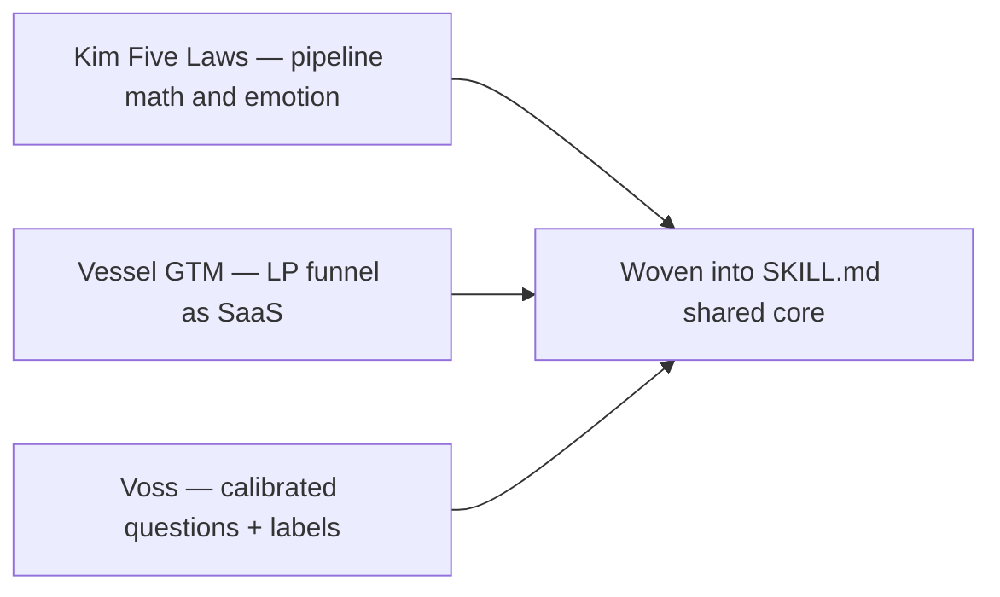

#  Article lessons (paraphrased)

Public articles only—paraphrased for the **`fundraising`** skill. Not a substitute for the originals.

---

##  The Five Laws of Fundraising — John Kim (*The Tao of Fundraising*)

Source: [Vessel — Five Laws recap (GP Operator Circle)](https://vessel.co/resources/blog/the-five-laws-of-fundraising-a-70-billion-masterclass-in-persuasion-pipeline-and-process-with-john-kim)

1. **Fundraising potential ≈ (track record + differentiation) ÷ story complexity.** Key-person exits, muddy attribution, bad headlines, or tangled structures erode trust. *(credibility; pitch; LP, startup)*
2. **Differentiation can offset a thin record.** A portfolio gap or contrarian thesis can attract LPs when history is short. *(pitch; LP)*
3. **Size, speed, terms: pick two.** Bigger raise → longer timeline or softer terms; fast close → smaller fund or friendlier terms. Do not benchmark blindly to another manager. *(negotiation; all tracks)*
4. **Pipeline math:** fund size ≈ pipeline × conversion × average check. At ~10–20% conversion, a $300M fund at ~$10M checks implies on the order of **300–400** first meetings—work backward to size TheList. *(target list; LP; analog for startup)*
5. **Leverage amplifies quality both ways.** Strong IR scales a good product; pushing a weak product fails faster. *(LP)*
6. **Match targets to decision style.** Family offices and some endowments can move on contrarian theses; pensions and committee institutions need consensus. Emerging managers often start with the former, then win one **respected institutional anchor** to turn contrarian into consensus. *(qualify; lead/anchor; LP)*
7. **The last dollar costs the most.** Re-ups convert easily; cold names convert poorly. Stop when marginal time exceeds marginal capital. *(close; LP)*
8. **Six-step cycle:** prospect (actively allocating) → contact (warm intro) → qualify (fund fit, allocating now, timing) → pitch → objections → close (often the next meeting). *(qualify; ABC)*
9. **Meeting as audition:** rapport, attention, interest, credibility—then needs discovery and tailored story. Closing begins in minute one. *(pitch; ABC)*
10. **Emotion decides; logic justifies.** Desire and fear move investors; data helps them defend the decision. Anger or righteousness ends persuasion. *(pitch; negotiation)*
11. **Consensus and scarcity (ethical).** Credible peer commitments plus a real hard cap or limited allocation compound momentum. *(momentum; lead/anchor)*
12. **Map dominant LP fears:** safety (data, references), approval (peer commits), control (reporting, governance), special access (co-invest), mission (oneness)—tailor responses. *(negotiation; LP)*

---

##  The Go-To-Market Engine of Fundraising — JD St-Martin & Jonathan Alden

Source: [Vessel — GTM engine guide (2026)](https://vessel.co/resources/blog/the-go-to-market-engine-of-fundraising-complete-2026-guide-to-applying-b2b-saas-model-to-lp-relationships)

**Note:** Vendor content (Vessel sells IR software); use funnel ideas, not product pitches.

1. **LP fundraising as B2B funnel** with bow-tie stages: awareness → education → selection → onboarding → support → grow → retain → delight. Track volume, conversion, and time per stage. *(LP; target list)*
2. **Ideal LP Profile (ILP)**—explicit who is *not* a fit. Dry powder alone is insufficient; segment by type, check, and decision timeline. *(target list; qualify)*
3. **CRM as the asset:** every ILP-fit name loaded, every touch logged; partners must model the habit—relationship knowledge only in heads is risk. *(LP; startup CRM)*
4. **First-meeting qualify:** who decides, who influences, intermediation, IC requirements, approval duration. *(qualify)*
5. **Trust = time × frequency × quality** of useful contact—be present when allocation windows open. *(credibility; ABC)*
6. **Retention before top-of-funnel:** delight and re-up existing LPs first; ask happy LPs for **2–3 intros** to the next fund. *(lead/anchor; LP; prior investors in startup rounds)*
7. **Evergreen pipeline:** large institutions may need **1–3+ years**—start before the formal raise, not episodic blitzes only. *(target list; LP)*
8. **Segment engagement:** institutions = high-touch with partners; HNW / small family offices = faster, lighter process. *(LP)*
9. **Funnel diagnostics:** many meetings, few commits → wrong ILP or weak proposition; good closes, weak re-ups → servicing; long cycles → segment/timeline mismatch. *(qualify; LP)*
10. **Co-invest** deepens commitment when LPs get context *before* the deal—not two-day surprises. *(LP)*
11. **Experience differentiates** when performance clusters—speed, transparency, inclusion. *(credibility; LP)*

---

##  Never Split the Difference — Chris Voss

Source: [Runn — chapter summary (Natalia Rossingol, 2022)](https://www.runn.io/blog/never-split-the-difference-summary). Book not reproduced; summary only.

1. **Negotiation is emotional first.** Listen and empathize before term combat. *(all tracks)*
2. **Mirror and pause:** repeat their last few words, stay quiet—surfaces real objections (valuation, clauses). Calm, slow tone. *(negotiation)*
3. **Hypotheses, not done deals** until signed and funded—do not leak false certainty to team, co-investors, or press. *(close; M&A)*
4. **Label fears aloud** (e.g. dilution, key-person risk) to defuse and build trust. *(objections)*
5. **Safe “no”; skeptical early “yes.”** No may mean time or hidden concern; polite yes can be fake. *(qualify; negotiation)*
6. **Aim for “that’s right,” not “you’re right.”** Summarize their view until they own it. *(negotiation)*
7. **Do not split the difference**—middle outcomes often satisfy neither side. Prefer **anchoring**, **precise odd numbers**, and **loss aversion** framing; splitting valuation can be worse than restructuring. *(negotiation; startup; M&A)*
8. **Calibrated how/what questions** (“How am I supposed to do that?” “What matters most here?”) invite them to solve your constraint. *(qualify; close)*
9. **People behind the table:** IC, partners, corp dev, legal, co-founders—map and win them or the deal dies in the hallway. *(close; LP; M&A)*
10. **Verify commitments:** tone and words align; **Rule of Three** (confirm key points multiple ways); verbosity can signal evasion. *(qualify; ABC)*
11. **Styles:** analysts want data and reciprocity; accommodators hide objections; assertives want to be heard—mirror and summarize first. *(negotiation; pitch)*
12. **Black Swans:** hidden deadlines, internal politics, true buyer motive—hunt unknown unknowns. *(negotiation; second offer; M&A)*
