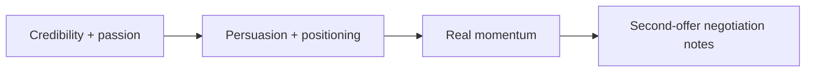

#  Credibility, persuasion, and momentum (full text)

Full text behind shared core **§4 Credibility and passion**, **§5 Real momentum and competition**, and the negotiation notes of **§7 Second offer** in `../SKILL.md` — Ringer, Calacanis, Thiel, Klaff, Kim (*Five Laws*), Ries & Trout (*Positioning*), Schwartz (*Breakthrough Advertising*), Voss, Kalanick. SKILL.md keeps the compressed rules; this file keeps the complete reasoning. Moved from `../SKILL.md` in v3.3.1.

### 4 — Credibility and passion

**Credibility:** Do not fight the truth. Acknowledge weaknesses; state **mitigation** (what you are doing about risk). Never fake certainty. Align **deck, data room, and live metrics**—polish without substance fails (Ringer). Show **capital efficiency** and how prior money was spent (after Calacanis, *Angel*). Present a **concrete plan** with milestones, not only “we will iterate” (after Thiel, *Zero to One*). Open as a **peer with options**, not a supplicant (Ringer). **Frame control** and **local status:** lead with domain expertise; avoid beta traps and supplicant rituals; if you are explaining your authority, you already lost the frame (Klaff, *Pitch Anything*).

**Passion:** Genuine energy and conviction without hype that contradicts facts.

**Persuasion (Kim):** **Emotion decides; logic justifies**—lead with credible desire or risk reduction, then data for their internal story (*Five Laws*, John Kim, Vessel recap). Stay calm; righteousness kills influence (Kim).

**Positioning (Ries & Trout):** narrative lives in the **listener’s mind**—start from their category beliefs, not your feature list ([summary](https://bestwriting.com/positioning-summary)). **Own one concept** per company or fund name; oversimplify the deck to the single idea they repeat in IC or partner meeting. **Be first** in a narrow category (or create one with a clear “not the old way” reference); do **not** attack the category leader head-on—reframe or flank. **Same core story** across rounds and fund vintages; new strategies may need a **new name/vehicle** (no line extension). **LP fund strategy** and **M&A story** use the same rules: one position, consistent for re-ups and buyer conversations.

**Outreach and deck copy (Schwartz, *Breakthrough Advertising*):** **channel existing desire**—research what the counterparty already wants, then point your offer at it ([notes](https://valchanova.me/breakthrough-advertising-copywriting-book-review/)). **Match awareness:** cold → problem/desire first; warm but hesitant → new proof or mechanism; ready to commit → terms plus real deadline. Slide titles and **subject lines** lead with outcome/desire; features and data prove below. In crowded markets, show a **new mechanism**; in jaded ones (e.g. generic funds), lead with **who you serve**. **Editorial, candid updates**—state limits and who the round is not for—boost credibility (Schwartz).

### 5 — Real momentum and competition

Counterparties delay without urgency. Every update reflects **verified** motion:

- Real meeting density and **parallel** processes (never fabricate term sheets, LOIs, or commits).
- Explicit timeline to decision; **time is the enemy** of every process.
- Back urgency with hustle so it becomes self-fulfilling.
- While building parallel interest, continue **qualifying** new names; do not skip straight to pitch for counterparties still below fit/capacity threshold (Module 7).
- **Delay kills deals:** answer diligence quickly and push toward decision dates (after Ringer, *Winning Through Intimidation*).
- **Manufactured scarcity** often fails with angels; anchor urgency in **verified** meetings, term sheets, and commits (Calacanis, *Angel*). Apparent “heat” is usually **built deliberately** through outreach and narrative work (Thiel, *Zero to One*).
- **Consensus + scarcity (ethical):** credible peer commits and a **real** hard cap or limited allocation compound momentum—use only when true (Kim, *Five Laws*).
- **Prize frame:** you qualify counterparties; they are not doing you a favor—neediness and validation-seeking kill deals (Klaff). Pair with a full pipeline so walk-away is credible (Klaff; Ringer).
- **Process over price (Kalanick, Senra podcast, 2026-08-16):** commit to a **competitive process**, not a target pre-money. Accepting the **first term sheet** without alternatives often **extends** the round and invites endless re-trades; verified parallel paths usually **close faster** even in scary markets.

### 7 — Second offer — negotiation notes (from SKILL.md)

5. On terms, **do not split the difference** by default—middle outcomes often satisfy neither side. Prefer **anchoring**, **precise figures**, and **loss aversion** framing over meeting halfway on valuation or price (Voss, *Never Split the Difference*).
6. **Low clearing anchor:** open with a **pre-money you believe clears** the market (“at least here”), confirm bidder lean-in, then let competition discover the ceiling—avoid negotiating down from an aspirational anchor you have not cleared (Kalanick, Senra podcast, 2026-08-16).

### 7 — Second offer — steps and urgency template (from SKILL.md)

When the **first** term sheet, LOI, or soft anchor arrives:

1. Move **immediately** for a **second** from the next-best candidates.
2. Single offer without competition → weak terms, re-trades, or deal death.
3. **Late serious interest** can appear when a deal is nearly done—use real competition ethically; do not drop signed progress to chase an unverified better rumor (Ringer, *Winning Through Intimidation*).
4. Short credible urgency (adapt; approver approves before send):

> Hey \[Name\] — checking in on \[Entity\]. Things are heating up with a couple of other parties and we could move quickly from here. Wanted to see where your head is at. Call me back when you can.

Negotiation notes — anchoring, precise figures, loss aversion; do not split the difference by default (Voss; Kalanick): [`references/credibility-and-persuasion.md`](references/credibility-and-persuasion.md).
