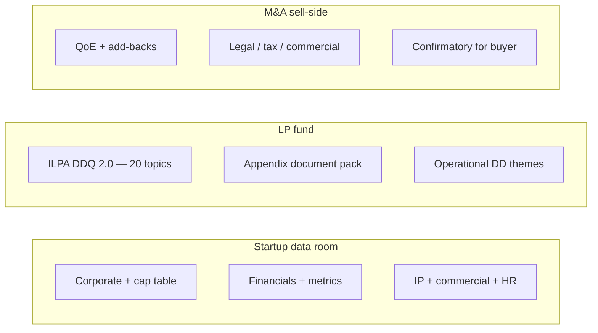

#  Due diligence checklists (paraphrased)

Checklists for startup data rooms, LP fund DDQ/ODD, and sell-side M&A diligence.

**Not legal or tax advice.** **Lawyer review** on legal/IP/employment; **CPA review** on financials, tax, QoE.

**Parsed for v3.1.0:** [ILPA DDQ 2.0 PDF](https://ilpa.org/wp-content/uploads/2021/11/ILPA-DDQ-2.0.pdf) (section list, appendix document pack, representative question themes).

Sources: [CRV — Series A data room](https://www.crv.com/content/series-a-funding); [ILPA DDQ 2.0 PDF](https://ilpa.org/wp-content/uploads/2021/11/ILPA-DDQ-2.0.pdf); [ILPA DDQ hub](https://ilpa.org/industry-guidance/templates-standards-model-documents/due-diligence-questionnaire-and-diversity-metrics-template/); [ILPA ODD course listing](https://ilpa.org/wp-content/uploads/2024/10/ILPA-Institute-Operational-Due-Diligence-for-the-Limited-Partner.pdf) (search excerpt only for ODD themes); [Breakwater — seller diligence](https://www.breakwaterma.com/blog/seller-due-diligence-checklist).

---

##  Startup data room (Series A–style)

Build **1–2 quarters** before raising. Numbered folders, dated filenames, master index. **Stage access:** deck early; cap table detail, customer contracts, HR files only for serious diligence.

1. **Corporate:** charter/amendments, bylaws, minutes/consents, stockholder agreements, good standing, indemnification.
2. **Cap table & equity:** fully diluted table, option plan, all SAFEs/notes/financing docs, **409A**, Form D/state notices, **83(b)** elections, each line tied to signed docs.
3. **Financials:** 2–3 years + YTD monthly with variance notes; model; unit economics (LTV, CAC, payback); revenue recognition policy.
4. **Metrics:** ARR waterfall, NRR/GRR, burn multiple, gross margin bridge.
5. **IP:** assignments from every founder, employee, contractor—gaps are deal-stoppers.
6. **Commercial & HR:** material contracts (flag change-of-control), employment/contractor files, litigation/compliance.

##  LP fund — ILPA DDQ 2.0 (November 2021 questionnaire)

Pre-fill before LP outreach. Twenty core **topics** (each mixes yes/no and narrative questions):

| # | Section | What LPs are probing |
| --- | --- | --- |
| 1 | **Firm** | Legal structure, ownership changes, org chart, budgets, regulatory filings (e.g. Form ADV), compliance manuals, conflicts policies, code of ethics. |
| 2 | **Fund** | Legal/tax structure chart, target size, term, investment period, geography/sector limits, fee/expense budget for fund life. |
| 3 | **Succession / key persons** | Who drives returns, succession plan, key-person triggers, recent departures. |
| 4 | **Strategy** | Thesis, portfolio construction, differentiation, pipeline, pacing vs prior funds. |
| 5 | **Co-investments** | Allocation policy, fees/carry on co-invest, conflicts with main fund. |
| 6 | **GP-led secondaries / continuation funds** | History, LP consent, pricing, conflicts (see Appendix G templates). |
| 7 | **Credit facilities** | Subscription line size, use, cost, impact on IRR reporting. |
| 8 | **Investment process** | Sourcing, diligence, IC cadence, documentation of decisions. |
| 9 | **Team** | Bios, hiring plan, diversity of investment committee, compensation. |
| 10 | **Alignment of interests** | GP commit, fee offsets, personal investments, coinvest with LPs. |
| 11 | **Market environment** | How strategy fits current market; differentiation vs peers. |
| 12 | **Fund terms** | Fees, carry, hurdle, catch-up, clawback, MFN/side letters, LPAC rights. |
| 13 | **Governance / risk / compliance** | Compliance program, regulatory exams, violations, valuation policy, cyber. |
| 14 | **Track record** | Fund-level and deal-level performance, write-offs, public vs private marks, benchmarks. |
| 15 | **Accounting / valuation** | Auditor, valuation committee, third-party appraisers, GIPS if claimed. |
| 16 | **Reporting** | LP reporting cadence, templates (ILPA alignment), capital call notice content. |
| 17 | **Legal** | Litigation, regulatory actions, use of placement agents, offering exemptions. |
| 18 | **Data security / technology / third parties** | Admin, IT vendors, SOC reports, business continuity. |
| 19 | **ESG** | Policies, DEI within ESG module, responsible investment integration. |
| 20 | **Diversity, equity & inclusion** | Firm and portfolio metrics, policies, family leave, misconduct investigations. |

**Appendix A — requested documents (checklist):** current **LPA** (+ blackline vs predecessor), **PPM** (+ prior fund LPA/PPM), AGM materials (2 years), Form ADV, GP partnership agreement, audited/quarterly LP reports (5 years on predecessors), firm audited financials (3 years), sample **capital call/distribution** notices, investment advisory agreement, **LPAC** materials, **side letters**, compliance/conflicts manuals, valuation policy, and other items cross-referenced in the questionnaire body.

**Appendices B–H:** spreadsheet templates for team roster, references, third-party vendors, fund terms, portfolio investments, GP-led transactions, and credit facilities.

**Operational due diligence (ODD) themes** (ILPA ODD course excerpt): governance, key-person/succession, compliance, fund admin & auditor, valuation independence, cash controls, cybersecurity, business continuity.

##  M&A seller-side diligence

Post-LOI diligence often **30–90 days**; a material share of LOIs fail—**financial inconsistencies** are a top cause. Disclose early.

| Pillar | Items |
| --- | --- |
| **Financial** | 3y + YTD monthly; tax returns reconciled to books; **add-back schedule** with evidence; WC trend; revenue recognition; **QoE** (often at ~$1M+ EBITDA) before buyer QoE |
| **Legal** | formation; contract inventory (change-of-control); litigation; permits |
| **IP/tech** | chain of title, OSS, privacy |
| **HR** | roster, comp, agreements, benefits, turnover, key-person risk |
| **Commercial/ops** | customer concentration, retention, top contracts, org/SOPs |
| **Tax** | filings and exposures (**CPA review**) |

**90-day prep (Breakwater-style):** days 1–30 financials/add-backs/concentration/contracts; 31–60 QoE/CPA; then legal/HR/IP and VDR load.
