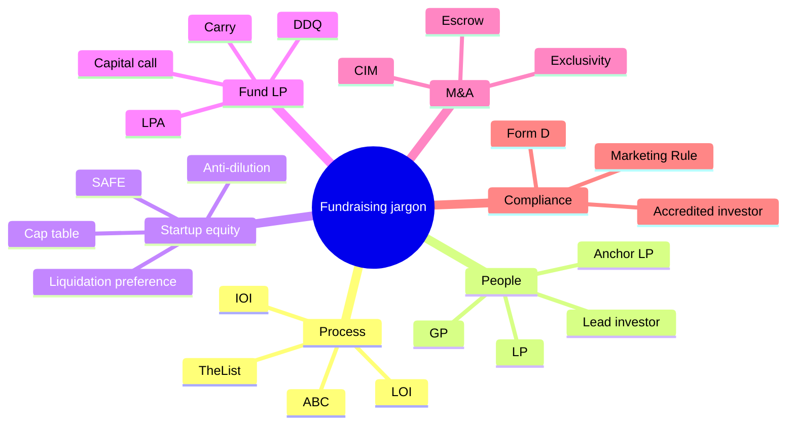

#  Glossary

Short definitions for jargon used across this skill. Not legal or tax advice — **lawyer review** / **CPA review** for binding meanings.

| Term | Meaning |
| --- | --- |
| **ABC** | Always Be Closing — lock interest, size, and next step every meeting. |
| **Accredited investor** | SEC Reg D category (income, net worth, or professional license tests). |
| **Anchor LP** | First institutional or large LP that legitimizes a fund raise. |
| **Anti-dilution** | Preferred adjustment when a later round prices lower (weighted average vs full ratchet). |
| **As-converted** | Preferred shares counted as if converted to common (for ownership and votes). |
|  **Cap table** | Ownership table (fully diluted includes options, SAFEs, warrants). |
| **Capital call** | GP notice requiring LPs to fund part of their commitment. |
| **Carry (carried interest)** | GP share of fund profits after hurdle/catch-up. |
| **CIM** | Confidential Information Memorandum — sell-side company book for buyers. |
| **Conversion (SAFE)** | SAFE becomes preferred stock on priced round under its formula. |
| **DDQ** | Due Diligence Questionnaire — ILPA standard LP fund diligence form. |
| **DPI / RVPI / TVPI** | LP performance multiples (distributions / paid-in; residual / paid-in; total value / paid-in). |
| **Drag-along** | Forced sale vote — holders must join an approved exit. |
| **Effective pre-money** | Headline pre minus dilution from pool shuffle or similar. |
| **Equity financing (SAFE)** | Bona fide priced preferred round triggering SAFE conversion. |
| **Escrow / holdback** | Portion of M&A price held for indemnity claims. |
| **Exclusivity / no-shop** | Seller agrees not to run parallel sale processes for a period. |
| **Form D** | SEC notice of Reg D offering (due after first sale). |
| **Fully diluted** | Cap table including all converting instruments and reserved pool. |
| **GP** | General Partner — manages the fund. |
| **GP commit** | GP/co-invest capital in the fund. |
| **Hurdle (preferred return)** | Minimum LP return before carry. |
| **IOI** | Indication of Interest — non-binding M&A bid range. |
| **IRR** | Internal rate of return on cash flows. |
| **Lead investor** | Investor who sets priced-round terms and anchors the round. |
| **Liquidation preference** | Preferred payout order on exit (multiple, participating or not). |
| **Liquidity event (SAFE)** | Change of control, direct listing, or IPO before priced round. |
| **LOI** | Letter of Intent — M&A term outline (often partly binding). |
| **LP** | Limited Partner — passive fund investor. |
| **LPAC** | LP Advisory Committee — LP representatives for conflicts and terms. |
| **LPA** | Limited Partnership Agreement — fund governing document. |
| **MFN (Most Favored Nation)** | Right to adopt better terms offered to later investors (SAFE or side letters). |
| **Marketing Rule** | SEC rules on adviser advertising (performance, testimonials). |
| **NDA** | Non-disclosure agreement before sharing CIM/data room. |
| **Non-participating preferred** | Takes preference **or** converts — not both. |
| **ODD** | Operational due diligence on fund manager (beyond DDQ paper). |
| **Option pool shuffle** | New pool shares counted in pre-money — dilutes founders only. |
| **Participating preferred** | Takes preference **and** share of remainder. |
| **Pay-to-play** | Must invest in future round to keep preferred rights. |
| **PPM** | Private Placement Memorandum — fund offering disclosure. |
| **Post-money (SAFE)** | Valuation cap basis counting prior SAFEs and existing pool. |
| **Pro rata** | Right to invest in future rounds to maintain ownership %. |
| **Protective provisions** | Preferred veto rights on major corporate actions. |
| **QP (qualified purchaser)** | Investment Company Act investor test for 3(c)(7) funds ($5M / $25M thresholds). |
| **QoE** | Quality of earnings — sell-side/buy-side financial diligence report. |
| **Reg D 506(b)** | Private offering — no general solicitation. |
| **Reg D 506(c)** | Private offering with advertising — verify all buyers accredited. |
| **RWI** | Representation & warranty insurance in M&A. |
| **SAFE** | Simple Agreement for Future Equity — converts on priced round. |
| **Second offer** | Parallel term sheet / LOI / anchor to improve terms. |
| **Side letter** | LP-specific LPA terms (MFN may spread certain terms). |
| **Subscription line** | Fund-level credit facility ahead of capital calls. |
| **Term sheet** | Summary of priced-round economics and control (non-binding except no-shop). |
| **TheList** | Pipeline tracker for investors, LPs, or buyers. |
| **Waterfall (fund)** | Order of distributions: return of capital → pref → catch-up → carry split. |
| **Whole-of-fund waterfall** | Carry based on aggregate fund performance (European). |
| **Deal-by-deal waterfall** | Carry can accrue per investment (American; escrow/clawback critical). |
| **Working-capital peg** | M&A price adjustment vs target net working capital at close. |

See also: `deal-terms.md`, `fund-closing-and-compliance.md`, `SKILL.md`.
