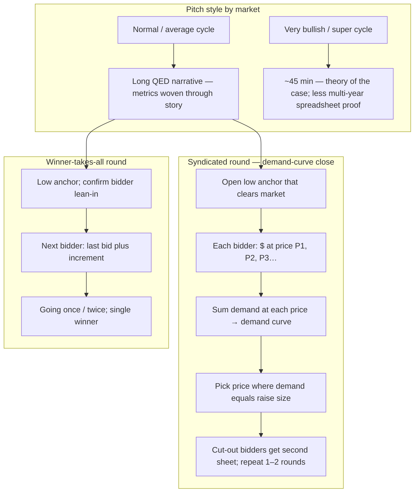

#  Interview lessons (paraphrased)

Podcast and long-form interview takeaways for the **`fundraising`** skill. Paraphrase only—do not treat as legal or investment advice.

---

##  Travis Kalanick — David Senra podcast (2026-08-16)

**Source:** [David Senra — Travis Kalanick](https://www.davidsenra.com/episode/travis-kalanick) (interview by David Senra). Lessons below are paraphrased from that conversation.

### Process beats price

1. **Attach to a process, not a headline valuation.** Taking the first term sheet often **slows** the round and raises blow-up risk: without competing paths, one investor can keep pushing terms. Kalanick cites a **mid-2014** round where an insider urged accepting a ~$6B pre-money offer nine months after a ~$3.5B round; running a full process instead closed about **two months later** at a **~$17.5B pre-money** (his figures, paraphrased).
2. **Alternatives speed closure.** Even when markets feel fragile, parallel interest tends to finish faster than a single-negotiator dynamic.
3. **Do not marry a price before clearing the market.** Early signals can anchor you above what the market will bear; starting negotiation from a stale high anchor is worse than discovering price through process.

### Low anchor and auction mechanics

4. **Start with a low price you believe clears**, then let competitive bidding discover the ceiling—not a public “price going up” gimmick, but structured competition after bidders lean in.
5. **Winner-takes-all format:** sequential bids at **last bid plus a fixed increment**; update earlier bidders as the ladder rises; when bids plateau, use a short **“going once, going twice”** close and award the whole round to one winner.
6. **Syndicated / large-round format:** each investor submits **how much they would invest at each of several price points** on a sheet; **aggregate demand at each price** (demand curve); set the clearing price where **total demand equals the raise**; notify investors priced out and offer a **second sheet** to improve; rerun the curve once or twice, then finalize allocations.
7. **Parallel rooms by check size:** run simultaneous meetings (e.g. founder in the largest-check room; trusted lieutenants in smaller-check rooms) with the **same core story**. Scale room count and duration to **QED pitch capacity** and **deal-team bandwidth** (he describes peak-scale examples as multi-room, multi-day sprints—not a default for every company).

### Pitch style vs market temperature

8. **Normal markets:** aim for a long, rigorous **QED** deck—an entertaining story with **metrics woven through**, ending with “how we win” feeling **proven**, not speculative.
9. **Very bullish cycles:** the same depth can read as over-defensive; **shorten** (e.g. ~2 hours toward ~45 minutes) and emphasize **theory of the case**—why the inflection is plausible—because **multi-year, high-multiple spreadsheets** are harder to justify and can invite doubt.
10. **Both regimes:** competitive **multi-bid process** stays mandatory when resources allow; storytelling style flexes, auction discipline does not.

### Investor selection

11. **Bar: “do no harm.”** Kalanick guesses only ~**10%** of investors reliably meet that bar and ~**1%** are materially **helpful**—help is hardest when you need deep operating support because VCs are not in the business full time.
12. **Operators vs investors:** compare a full-time founder to a **chess grandmaster** playing daily; many VCs are **enthusiasts** who check in quarterly yet still want to “make a mark” with opinions.
13. **Weakness attracts pressure:** when the company **limps**, capital providers may pounce—behavior he likens to predators on a injured animal—not always from malice, but from incentive and lack of control.
14. **Partner fit beats top bid.** Selection weighs harm avoidance and alignment, not highest price alone.

### Investor relations and governance

15. **Align on liquidity early.** Misaligned expectations on **IPO or liquidity timing** contributed to an **activist-style** conflict in his Uber account (Benchmark / Bill Gurley thread—paraphrased); he regrets not sharing IPO planning sooner and not probing what investors wanted him to do differently.
16. **Avoid victim mentality; own your side of the dynamic.** Ask what you could have communicated or done to reduce investor catastrophism (e.g. “world is ending—take the first sheet”).
17. **At scale, margin for behavior shrinks.** Large, scrutinized companies face **higher expectations**—running “close to the line” that was survivable at a starving startup can be read as foul even when intentions were good. Widen compliance and communications buffer as importance grows.
18. **Delegate IR when needed:** a dedicated executive can handle investor objections authentically while the CEO focuses on the raise process—without abandoning ultimate accountability.

### Cross-links in this skill

| Topic | Where woven |
| --- | --- |
| Process, auctions, QED pitch | `../SKILL.md` shared core; startup track |
| Demand curve / syndicated close | This file diagram; `ma-process.md` (sell-side auction parallel) |
| Do-no-harm selection, liquidity IR | `../SKILL.md` startup track; `post-close.md` |

**Living source:** Refresh when new Senra/Kalanick interviews ship; bump skill `version` in `CHANGELOG.md`.
