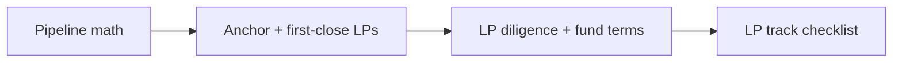

#  LP fund track — detail (scope, pipeline, anchors, thesis, diligence, checklist)

Execution detail behind the **Fund raising from LPs** track in `../SKILL.md`: scope and sources, pipeline math and GTM funnel (Kim; St-Martin & Alden), anchor and first-close LPs, thesis/track record/deck, LP diligence and fund-terms basics, the full LP track checklist, and after-the-yes steps. SKILL.md keeps the summaries. Moved from `../SKILL.md` in v3.3.1. Passages labeled **general knowledge** are starting points only — confirm with counsel and market.

### Scope and sources (from the SKILL.md track intro)

**Scope:** GP fundraising (Fund I through n)—anchors, institutional and individual LPs, fund deck, LP diligence, closing a fund. *General knowledge* fund-structure notes below are labeled as such; operational numbers come from sources. Deeper paraphrases: `references/article-lessons.md` (Kim; St-Martin & Alden on Vessel—**vendor content**, use funnel ideas only).

### Pipeline math and GTM funnel

**Size the top of funnel (Kim):** target fund size ≈ **pipeline × conversion × average check**. Example at ~10–20% conversion: a **$300M** fund with **~$10M** average checks implies on the order of **300–400** first meetings—back into weekly meeting targets and TheList size.

**Bow-tie stages (St-Martin & Alden):** awareness → education → selection → onboarding → support → grow → retain → delight. Log **volume, conversion, and time** per stage in CRM. **Diagnose:** many meetings / few commits → wrong **Ideal LP Profile (ILP)** or weak thesis; good closes / weak re-ups → LP servicing; long cycles → segment vs timeline mismatch.

**ILP:** define who fits (type, check, decision speed) and who is **explicitly out**. **CRM discipline:** every ILP-fit LP loaded, every touch logged—knowledge only in partners’ heads is operational risk (St-Martin & Alden).

**Always-on pipeline:** start **1–3+ years** before a large institutional close; do not rely on episodic raise campaigns alone (St-Martin & Alden). **Re-up and delight existing LPs first**—easiest capital; ask satisfied LPs for **2–3 intros** to the next fund before cold top-of-funnel (St-Martin & Alden; Kim on marginal cost of the last dollar).

**Kim — size, speed, terms:** pick **two** of three; simplify story complexity (track record + differentiation ÷ tangled narrative).

### Anchor and first-close LPs

Most LPs avoid **Fund I**; target specialists who anchor emerging managers ([@uselegion](https://x.com/uselegion/status/2102060851620458860)). The bookmark lists **12 anchor-oriented LPs** (names and handles in compilation—use full post for detail):

1. @CendanaCapital · 2. @screendoorvc · 3. @IndustryVC · 4. @close_first · 5. @RecastCapital · 6. @lo_toney (Plexo) · 7. @Beezer232 · 8. @cdouvos · 9. @Samirkaji · 10. @isomercapital · 11. @TrueBridgeCP · 12. @FairviewCapital

**Process (general knowledge, minimal):** First **legal close** often requires one or more **anchors** at meaningful ticket size; subsequent closes add LPs until final close or hard cap. Track each LP’s **subscription doc** status, capital call schedule, and side-letter requests separately in TheList (`track: lp_fund`).

**Sequence (Kim):** many **family offices** and agile allocators can back a contrarian emerging manager early; **committee-driven institutions** need consensus. Win **one respected institutional anchor** to turn a contrarian bet into a committee-safe story. First-meeting qualify: decider, influencers, intermediation, IC packet, approval duration (St-Martin & Alden).

### Thesis, track record, and fund deck

- **Investment thesis:** strategy, stage, geography, portfolio construction, differentiation—what the GP will *not* do matters as much as what they will. **One position** for the fund brand; do not line-extend unrelated strategies under one name (Ries & Trout, *Positioning*).
- **Track record:** prior deals, realized/unrealized marks, attribution, team bios; be precise about what is **GP** vs **prior employer** experience.
- **Example fund deck:** [@NWischoff](https://x.com/NWischoff/status/1840037435675234677) shares a **$50M Fund III** deck—inspiration for **structure and sections**, not copy-paste content.

### LP diligence and fund terms basics

**LP diligence (typical asks—general knowledge):** AML/KYC, accredited or qualified investor status, references, back-channel on GP, legal structure, conflicts, fee/offering memo, portfolio company cap tables for GP stakes.

**Fund terms (general knowledge—confirm with counsel and market):**

| Term | Agent should |
| --- | --- |
| **Management fee** | Usually % of committed or invested capital during investment period; step-down post-investment period—log proposed basis. |
| **Carried interest** | GP share of profits above hurdle; note catch-up and clawback language flags for counsel. |
| **GP commit** | Minimum GP co-invest—track % of fund. |
| **Fund size / hard cap** | Target raise vs maximum; pacing to final close. |
| **LPAC / reporting** | Cadence of LP reports and audit requirements—track in checklist. |

Apply **shared core** ABC with LPs (ticket size, timeline to sub docs, reference calls). **Second anchor / second institutional** parallel to second term sheet.

**Power law:** most portfolio outcomes are zeros; a few names return the fund—present **concentrated** strategy and outcome scale LPs expect (after Thiel, *Zero to One*; Calacanis, *Angel*).

### LP track checklist

- [ ] **ILP** written; TheList sized from **pipeline × conversion × check** (Kim)
- [ ] CRM: all ILP names, all touches; funnel metrics by stage (St-Martin & Alden)
- [ ] **Re-ups** and LP servicing before heavy cold outreach; intro asks to happy LPs
- [ ] **Evergreen** outreach to long-cycle institutions; segment high-touch vs light-touch
- [ ] Fund deck v1 + data room (PPM/offering memo only with legal); story complexity minimized (Kim)
- [ ] FAQ: thesis, team, Fund I vs prior funds, conflicts, fees, portfolio examples
- [ ] **Family-office / agile allocator** path + **institutional anchor** plan (Kim)
- [ ] Subscription pipeline: soft circle → sub docs → capital call calendar; stop when marginal dollar cost exceeds benefit (Kim)

### After the yes — LP fund

1. **Term sheet / side letters** — fees, carry, key person, GP commit (`deal-terms.md`); **lawyer review**.
2. **Diligence** — pre-fill ILPA DDQ; ODD prep (`due-diligence-checklists.md`).
3. **Docs** — LPA, PPM, subscription agreements (`deal-terms.md`).
4. **Close** — first/subsequent closes, equalization, 506(b) vs 506(c), Form D (`fund-closing-and-compliance.md`); verify accredited/QP.
5. **Post-close** — ILPA reporting template, capital call notices, LPAC (`post-close.md`).

---
