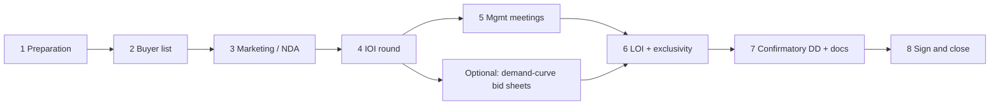

#  M&A sell-side process (paraphrased)

Stages, timelines, and process design (banker vs none; auction vs negotiated).

**Not legal or tax advice.** **Lawyer review** from LOI; **CPA review** for QoE and tax structure.

**Parallel (startup priced rounds):** Travis Kalanick’s syndicated **demand-curve** auction—collect each investor’s **$ at multiple price points**, sum into a curve, clear at the price where demand equals the raise, then offer **second sheets** to cut-out bidders—is the same *shape* as a disciplined **IOI round with explicit price–size grids** on the sell side. See [`interview-lessons.md`](./interview-lessons.md) (Kalanick, Senra podcast, 2026-08-16) and the startup track in `SKILL.md`. M&A still uses **process letters and parallel IOI/LOI deadlines** (POTOMAC lessons), not founder-led VC room splits.

Sources: [Praxis Rock — sell-side process](https://praxisrock.com/insights/sell-side-m-a-process); [Windsor Drake — sell-side process](https://windsordrake.com/process/sell-side-process/); [Mintz — LOI seller considerations](https://www.mintz.com/insights-center/viewpoints/2871/2025-03-31-seller-considerations-when-negotiating-letter-intent); [Auxo — sell-side M&A process](https://auxocapitaladvisors.com/sell-side-m-a-process/) (search excerpt only); [Auxo — sell-side timeline](https://auxocapitaladvisors.com/sell-side-mna-timeline/) (search excerpt only); [Alehar — navigating sell-side M&A](https://www.alehar.com/resources/articles/navigating-the-sell-side-manda-process) (search excerpt only).

**Typical total timeline:** about **6–12 months** (sources vary).

| Stage | Timing (indicative) | Outcomes |
| --- | --- | --- |
| 1. Preparation | 8–12 weeks | Clean financials, add-backs, valuation range, teaser, CIM, model, mgmt deck, VDR; consider sell-side QoE |
| 2. Buyer list | 2–4 weeks (parallel) | Screen **200+** → **40–80** targets; flag competitors |
| 3. Marketing / NDA | 3–6 weeks | Teaser → NDA → CIM + process letter + bid deadline; e.g. 60–150 contacts → 15–40 NDAs |
| 4. IOI round | 2–6 weeks | Non-binding ranges; strong processes often **5–12 IOIs**; <3 signals price/list/materials issue |
| 5. Management meetings | 3–6 weeks | Rehearsed 2–3h sessions; site visits; CIM must match reality |
| 6. LOI round | 1–3 weeks | Compare price, structure, financing, escrow, WC, earnout; keep multiple bidders live; exclusivity often **30–45 days** |
| 7. Confirmatory diligence + definitive docs | ~60–90 days | QoE, legal, tax, commercial, financing, regulatory; purchase agreement + schedules |
| 8. Sign & close | Variable | Simultaneous or delayed; wire per funds-flow memo (see wire guardrails in `SKILL.md`) |

##  Banker vs no banker

- **Advisor:** outreach, process discipline, competition, timeline (Praxis, Windsor).
- **Inbound offer + parallel process** can move faster.
- **No banker:** founder still runs stages 1–8; do not negotiate alone.

##  Auction vs negotiated sale

- **Auction / modified auction:** deadlines + multiple bidders → leverage (aligns with YouTube/POTOMAC lessons in skill).
- **Demand-curve / grid bids (conceptual parallel):** Like Kalanick’s syndicated VC close, strong sell-side processes can ask each bidder **how much at each valuation band**, aggregate into a **demand curve**, and set a clearing price where **total bid size matches the seller’s objectives**—then run a **second round** for bidders who missed the cut (see [`interview-lessons.md`](./interview-lessons.md)). In M&A this maps to structured **IOI templates** and **tiered process letters**, not ad-hoc one-off counters.
- **Winner-takes-all (conceptual parallel):** Some strategic sales behave like a **single-buyer** endgame after sequential improvement of offers; the VC **last bid plus increment** ladder is the startup analog—usually inappropriate for M&A unless the seller explicitly runs a single-asset competitive award.
- **Negotiated (1–2 buyers):** faster, confidential; mitigate by locking key LOI terms and avoiding premature exclusivity.

Cross-reference: M&A track tables in `SKILL.md`; `references/deal-terms.md` for LOI economics.
