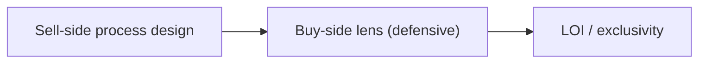

#  M&A track — lesson tables, checklist, after the yes (POTOMAC)

Detail behind the **Selling the company / M&A** track in `../SKILL.md`: process stance, the POTOMAC sell-side and buy-side lesson tables (with ~timestamps), the M&A checklist, and after-the-yes steps. SKILL.md keeps the scope and summaries; process stages and timelines live in [`ma-process.md`](./ma-process.md). Moved from `../SKILL.md` in v3.3.1.

### Track intro and process stance (from SKILL.md)

**Scope:** Lessons from **Fundraising** YouTube playlist (POTOMAC M&A); paraphrased summaries in `references/youtube-fundraising-playlist/`. Company sale, majority recap, strategic or PE exit—not legal/financial execution without sell-side counsel and M&A advisor.

Apply **shared core** phases 5–8 (momentum, lead bidder, second LOI, deadline close) at scale. Strong exits are often **bought, not sold**—run a process so multiple acquirers compete (Calacanis, *Angel*). **Sell from strength** with a credible forward plan; exhausted sellers get mispriced (Thiel, *Zero to One*). **M&A narrative:** one consistent strategic position for management story and CIM—buyer desire (growth, gap fill) first, then proof (Schwartz); avoid attacking the obvious strategic leader head-on (Positioning).

### Sell-side process design

| Lesson | Action | Source |
| --- | --- | --- |
| **No price tag** — value negotiated | Realistic vs aspirational range before outreach; no single-buyer price discovery | [Sell-side, ~02:03](https://www.youtube.com/watch?v=8jBQ3jZnNvY&t=123s) |
| **Leverage stack** | Conceal forced-sale pressure; surface verified buyer urgency | [~03:05](https://www.youtube.com/watch?v=8jBQ3jZnNvY&t=185s), [~05:09](https://www.youtube.com/watch?v=8jBQ3jZnNvY&t=309s) |
| **Information war** | Learn buyer motivations; mgmt meetings = listen | [~07:13](https://www.youtube.com/watch?v=8jBQ3jZnNvY&t=433s), [~44:58](https://www.youtube.com/watch?v=8jBQ3jZnNvY&t=2698s) |
| **Emotional detachment** | Advisor negotiates process; founder credible in mgmt sessions | [~09:15](https://www.youtube.com/watch?v=8jBQ3jZnNvY&t=555s) |
| **Credibility / competition from day one** | Multi-party process upfront | [~11:19](https://www.youtube.com/watch?v=8jBQ3jZnNvY&t=679s), [~19:28](https://www.youtube.com/watch?v=8jBQ3jZnNvY&t=1168s) |
| **Negotiate process + substance** | NDA → CIM/teaser → IOI → mgmt → LOI → exclusivity calendar | [~15:24](https://www.youtube.com/watch?v=8jBQ3jZnNvY&t=924s) |
| **Avoid one-buyer trap** | Parallel serious parties | [~27:41](https://www.youtube.com/watch?v=8jBQ3jZnNvY&t=1661s), [~1:18:38](https://www.youtube.com/watch?v=8jBQ3jZnNvY&t=4718s) |
| **Modified auction** | Curated buyer universe; tier A/B | [~29:42](https://www.youtube.com/watch?v=8jBQ3jZnNvY&t=1782s) |
| **CIM + process letter** | One data set; parallel IOI deadline | [~31:43](https://www.youtube.com/watch?v=8jBQ3jZnNvY&t=1903s), [~33:45](https://www.youtube.com/watch?v=8jBQ3jZnNvY&t=2025s) |
| **Serial bids hurt sellers** | Process letter beats reactive serial negotiation | [~35:47](https://www.youtube.com/watch?v=8jBQ3jZnNvY&t=2147s) |
| **Iterative rounds** | IOI → pay-to-play mgmt → batched Q&A → revised LOIs | [~39:52](https://www.youtube.com/watch?v=8jBQ3jZnNvY&t=2392s), [~55:13](https://www.youtube.com/watch?v=8jBQ3jZnNvY&t=3313s) |
| **Management meetings** | Charm + damage mitigation; extract synergy data | [~51:06](https://www.youtube.com/watch?v=8jBQ3jZnNvY&t=3066s) |
| **Don’t fall in love** with one acquirer | Compare money and terms until LOI | [~59:17](https://www.youtube.com/watch?v=8jBQ3jZnNvY&t=3557s) |
| **LOI / exclusivity** | Negotiate escrow, reps, caps, no-shop **before** exclusivity | [~1:02:21](https://www.youtube.com/watch?v=8jBQ3jZnNvY&t=3741s) |
| **Acceptance time** | Slow re-trades post-LOI; finite exclusivity | [~1:11:31](https://www.youtube.com/watch?v=8jBQ3jZnNvY&t=4291s), [~1:17:37](https://www.youtube.com/watch?v=8jBQ3jZnNvY&t=4657s) |

### Buy-side lens (defensive)

| Lesson | Implication | Source |
| --- | --- | --- |
| FMV vs strategic value | Independent valuation range; reject first anchor as “market” | [Buy-side, ~07:04](https://www.youtube.com/watch?v=IG7LanmQny4&t=424s) |
| Buyer anchors low; rarely asks seller price first | Redirect to **process** | [~23:22](https://www.youtube.com/watch?v=IG7LanmQny4&t=1402s), [~39:41](https://www.youtube.com/watch?v=IG7LanmQny4&t=2381s) |
| Conservative standalone model | Normalized financials; add-back disputes | [~09:07](https://www.youtube.com/watch?v=IG7LanmQny4&t=547s) |
| Synergy narrative | Standalone strength; compete on synergy in bids | [~17:16](https://www.youtube.com/watch?v=IG7LanmQny4&t=1036s) |
| Fast teaser / slow deep diligence; **60-day exclusivity** common | Competitive LOIs before exclusivity | [~28:29](https://www.youtube.com/watch?v=IG7LanmQny4&t=1709s), [~35:38](https://www.youtube.com/watch?v=IG7LanmQny4&t=2138s) |
| Contingencies / clawbacks | Negotiate at LOI | [~25:25](https://www.youtube.com/watch?v=IG7LanmQny4&t=1525s) |

### M&A checklist

- [ ] Advisor + legal; valuation memo (realistic vs aspirational)
- [ ] Buyer universe 30–50+ when scale warrants; teaser/CIM/NDA
- [ ] Process letter with parallel IOI/LOI deadlines
- [ ] Tracker: IOI → mgmt → LOI → exclusivity → diligence → close
- [ ] No single-buyer dependency; second LOI sprint when first LOI lands

### After the yes — M&A

1. **LOI** — price structure, WC peg, escrow, reps, RWI, earnout before exclusivity (`deal-terms.md`; `ma-process.md`).
2. **Diligence** — confirmatory workstreams; sell-side QoE if not done (`due-diligence-checklists.md`).
3. **Docs** — purchase agreement, disclosure schedules, funds flow (`deal-terms.md`); **lawyer review**.
4. **Close** — wire verification (guardrails); signing vs closing timeline (`ma-process.md`).
5. **Post-close** — earnout metrics tracking; integration comms (`post-close.md`).

---
