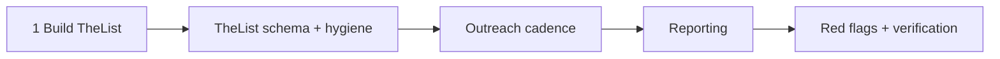

#  Pipeline operations (TheList, cadence, reporting, red flags, verification)

Operational detail behind the shared core in `../SKILL.md`: building TheList (§1), the after-the-yes phase map (§9), TheList field schema, outreach cadence defaults, the reporting template, cross-track red flags, and the verification checklist. SKILL.md keeps the summaries; this file keeps the full tables and lists. Moved from `../SKILL.md` in v3.3.1.

###  1 — Build a large target list (TheList)

1. Map **where capital or buyers concentrate** for your track (see track modules for universe types).
2. **Short first contact:** goal is a meeting or NDA, not the full deck on cold outreach.
3. Log every contact in **TheList** the same day; dedupe against CRM.
4. Size top-of-funnel to the track (startup: volume benchmarks in **Track — Startup**; M&A: curated 30–50+ when scale warrants; fund: anchor LP list + long tail).
5. Prioritize **logical fits** over a long tail of long shots (after Ringer, *Winning Through Intimidation*). For startup rounds, mine **co-investor lists** from existing angels and leads (after Calacanis, *Angel*).
6. **Concentrate** on a narrow investor or LP segment you can saturate before spraying broadly (Ries & Trout, *Positioning*). Avoid the **everybody trap**—positioning requires sacrifice (Positioning).

### 9 — After the yes (all tracks)

Once a term sheet, SAFE sign, anchor commit, or LOI is in motion, shift from selling to **execution**—still with human approval at every binding step (see guardrails).

| Phase | Startup | LP fund | M&A |
| --- | --- | --- | --- |
| **Term sheet / LOI** | Compare sheets; model cap table (`./cap-table-math.md`, `deal-terms.md`) | Soft circle → term sheet / side letters (`deal-terms.md`) | LOI economics before exclusivity (`deal-terms.md`; Mintz) |
| **Diligence** | Data room (`due-diligence-checklists.md`) | ILPA DDQ + ODD (`due-diligence-checklists.md`) | Confirmatory DD + QoE (`due-diligence-checklists.md`; `ma-process.md`) |
| **Definitive docs** | NVCA set / charter (`deal-terms.md`) | LPA + subs (`deal-terms.md`; closes in `fund-closing-and-compliance.md`) | Purchase agreement + schedules (`deal-terms.md`) |
| **Close** | Wire + 409A refresh flags; Form D reminder | First/subsequent close + equalization (`fund-closing-and-compliance.md`) | Funds-flow memo + wire verification (guardrails) |
|  **Post-close** | Investor updates + board (`post-close.md`) | LP reporting + capital calls (`post-close.md`) | Integration handoff; earnout tracking |

---

##  TheList — pipeline tracking

One authoritative pipeline (sheet, CRM, or file—name it in reports).

| Field | Purpose |
| --- | --- |
| `counterparty_id` | Name + firm |
| `source` | Intro chain / event |
| `track` | startup / lp_fund / m_and_a |
| `stage` | See track-specific stages below |
| `interest` | pass / watch / interested / lead-candidate / lead / follower / committed |
| `indicative_amount_usd` | Range or commit |
| `last_touch` | Date + channel |
| `next_action` | Owner + date |
| `referrals_out` | Intros promised or made |
| `confidential_notes` | Terms discussed; not forwarded |
| `blockers` | Diligence, legal, fit |

**Default stages (adapt labels):** `target` → `intro_scheduled` → `first_meeting` → `diligence` → `term_sheet_or_loi` → `docs_in_progress` → `committed` → `closed` → `post_close` → `pass`.

**Weekly hygiene:** No row without `next_action` within 14 days unless `pass` or `parked_until`.

##  Outreach cadence (defaults)

Tailor **length and lead** to awareness (Schwartz): short note when warm and ready; longer narrative when cold or skeptical.

| Situation | Cadence |
| --- | --- |
| After first meeting, warm interest | **48 hours**—thanks, one data point, next step |
| Soft / “thinking” | **5–7 business days** with a **new momentum fact** |
| Lead candidate post-diligence | **Daily** during term-sheet / LOI window |
| After first term sheet / LOI | **Same day** second-offer outreach (phone when approver okays) |
| Pass | Log reason; ask for **one referral** |

All outbound requires **approver** sign-off unless a pre-approved template exists for that process.

##  Reporting (all tracks)

**Fundraising status** (weekly or on request; immediate on term sheet / LOI / anchor):

1. **Bottom line:** Track, phase, lead/anchor status, $ committed vs target, close confidence + one reason.
2. **Funnel:** Counts by stage vs track benchmarks (startup funnel math in track module).
3. **Pipeline top 10:** Name, stage, amount, next action, date.
4. **Verified momentum only**—no fabrication.
5. **Decisions for approver:** Term comparisons, allocation, data-room release, travel, cap table / fund terms.
6. **Referrals** owed / received; **red flags**; **next 7 days** calendar and drafts awaiting approval.
7. **Startup / angel rounds:** **monthly investor updates**—cash, burn, runway, wins, losses, specific asks (after Calacanis, *Angel*).

Use authoritative finance sources for runway, revenue, and fund metrics.

##  Red flags (cross-track)

| Flag | Action |
| --- | --- |
| No lead after many first meetings | Revisit narrative, universe fit, geography/hub plan |
| Single offer, slow second | Emergency second-offer sprint; approver decides walk |
| Attached to price before process | Reset to low clearing anchor + §7b or second-offer sprint (Kalanick, Senra 2026-08-16) |
| Investor liquidity surprise / activist tone | Proactive liquidity plan + board alignment (`post-close.md`; interview-lessons) |
| Terms drifting during docs | Anti-collusion line; counsel |
| Side terms via back channel | Document; no oral side deals |
| Endless diligence without offer | Deadline; deprioritize |
| **Optional — Web3:** Wallet wire / token guarantees | Stop; legal |

---

##  Verification checklist

| | Check |
| --- | --- |
|  | Active track identified; TheList has stages, amounts, next actions |
|  | ABC captured from last meeting on non-pass rows |
|  | Urgency claims verified; second-offer plan explicit once first offer exists |
|  | No outbound without approval (unless pre-authorized template) |
|  | @hosseeb article not cited beyond link unless fetched in full |
|  | M&A rows cite YouTube links and ~timestamps |
|  | Official-form paraphrases match current URLs in this folder (refresh after YC/NVCA/ILPA updates) |
