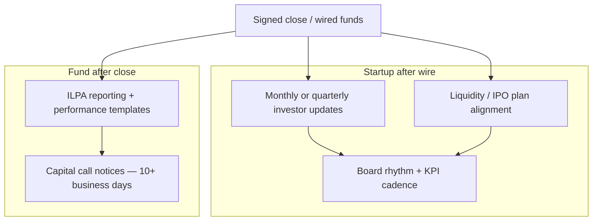

#  Post-close operations (paraphrased)

Investor updates, LP reporting, capital calls, and board rhythm after a close.

**Not legal or tax advice.**

**Parsed for v3.1.0:** [Reporting Template Definitions PDF (Jan 2025)](https://ilpa.org/wp-content/uploads/2025/02/Reporting-Template-Definitions.pdf); [Performance Template Definitions — granular v1.1 PDF](https://ilpa.org/wp-content/uploads/2025/04/ILPA-Performance-Template-Definitions-Granular-Methodology-v1.1.pdf); [Combined ILPA templates overview PDF](https://ilpa.org/wp-content/uploads/2025/09/Combined-Overview-ILPA-Templates.pdf). **Not parsed:** Excel workbook files (ILPA distributes via template hub; definitions PDFs used for field meanings).

Sources: [Yonder — investor update template](https://yonder.vc/resources/investor-update-template/); [ILPA Reporting Template hub](https://ilpa.org/industry-guidance/templates-standards-model-documents/ilpa-templates-hub/ilpa-reporting-template/); [ILPA Performance Template hub](https://ilpa.org/industry-guidance/templates-standards-model-documents/ilpa-templates-hub/ilpa-performance-template/); [Reporting Template Definitions PDF](https://ilpa.org/wp-content/uploads/2025/02/Reporting-Template-Definitions.pdf); [Performance Template Definitions PDF](https://ilpa.org/wp-content/uploads/2025/04/ILPA-Performance-Template-Definitions-Granular-Methodology-v1.1.pdf); [ILPA Principles 3.0 PDF](https://ilpa.org/wp-content/uploads/2019/06/ILPA-Principles-3.0_2019.pdf); [Feld — board of directors term sheet post](https://feld.com/archives/2005/01/term-sheet-board-of-directors/); [FBI IC3 — BEC PSA](https://www.ic3.gov/PSA/2023/PSA230609); update cadence (Visible / Founders' Stack — search excerpt only); Calacanis *Angel* notes in `book-lessons.md`.

---

##  Startup investor updates

**Cadence:** **monthly** (same day) pre–Series A; **quarterly** often post–Series A. ~**one page**. Silence reads as distress.

**Liquidity alignment (Kalanick, Senra podcast, 2026-08-16):** Proactively share **realistic IPO, secondary, or exit timing** with major investors and board members—misaligned liquidity expectations can turn passive capital into **activist pressure**. Ask what they need from you (reporting rhythm, risk reduction, path to liquidity) instead of assuming silence means agreement. See [`interview-lessons.md`](./interview-lessons.md).

**Template**

1. TL;DR (2–3 lines).
2. KPIs vs prior period (same 3–5 every time): revenue/MRR/ARR, growth, retention/churn, **cash, burn, runway (months)**, plus 1–2 business metrics.
3. Highlights.
4. Lowlights + actions (candid).
5. Next priorities.
6. **Asks** (specific); close loop next month.
7. Thanks / shout-outs.

Editorial, frank tone (see Schwartz in `SKILL.md`) improves trust.

##  LP reporting and capital calls (ILPA)

- **Quarterly reporting:** [ILPA Reporting Template v2.0](https://ilpa.org/industry-guidance/templates-standards-model-documents/ilpa-templates-hub/ilpa-reporting-template/) (fees, expenses, carry)—funds launching on/after **2026-01-01** or still in investment period in Q1 2026 use v2.0; older vintages may use the 2016 template. Companion **Performance** and **Capital Call & Distribution** templates live on the [ILPA Templates Hub](https://ilpa.org/industry-guidance/templates-standards-model-documents/ilpa-templates-hub/).
- **Capital call notices:** each LP amount/%, purpose, fee calculation (with offsets), carry build-up, projected calls/distributions.
- ILPA: **≥10 business days** to fund a call. Disclose subscription line size/cost/use; report IRR/TVPI **with and without** the line.

Agent drafts only; **human approval** before send (see guardrails).

###  ILPA Reporting Template — field groups (Definitions PDF, paraphrased)

Report in three lenses where applicable: **single LP**, **total fund (incl. GP)**, and **GP share of fund**.

| Group | Fields (representative) | Purpose |
| --- | --- | --- |
| **NAV reconciliation** | Beginning NAV (net of accrued carry); contributions/distributions (cash and non-cash); offering/syndication costs; placement fees; partner transfers; management fees (gross, offsets, rebates, net); expenses paid to adviser/related persons; organizational costs; other income/expense; ending NAV. | Tie LP capital accounts to fund financials each quarter. |
| **Fees & expenses detail** | Management fee rate bases; offsets from portfolio company fees; broken-deal and transaction expenses; monitoring/board fees; fund expenses by category. | Transparency on fee load and offsets (ILPA Principles). |
| **Carried interest** | Accrued/earned/paid carry; escrow balances; clawback reserves; catch-up status. | Show LP/GP split of profit mechanics. |
| **Fund status** | Committed capital, unfunded, paid-in, distributed, recallable distributions, subscription line drawn/undrawn. | Cash and commitment picture for LPAC and audits. |

Full definitions: [Reporting-Template-Definitions.pdf](https://ilpa.org/wp-content/uploads/2025/02/Reporting-Template-Definitions.pdf).

###  ILPA Performance Template — field groups (Granular v1.1 definitions, paraphrased)

Two methodologies (**granular** vs **gross-up**); most funds pick one consistently.

| Group | Fields (representative) | Purpose |
| --- | --- | --- |
| **Cash flows** | LP contributions and distributions (by type); fund-level subscription facility draws/repayments; equalization and catch-up flows. | Inputs to IRR/TVPI/DPI/RVPI. |
| **Net portfolio performance** | Realized/unrealized at portfolio level; quarter-end adjustments for facility interest; net fund-level performance roll-forward. | Show investment-level value creation net of fees/expenses where required. |
| **Gross performance** | Separate **fund-to-LP** and **fund-to-investment** gross streams when Marketing Rule disclosures need both. | Support gross vs net marketing disclosures. |
| **Metrics** | IRR, TVPI, DPI, RVPI (fund and LP share); optional public benchmark comparison fields. | Standardize LP reporting across managers. |

Definitions and mapping rules: [ILPA-Performance-Template-Definitions-Granular-Methodology-v1.1.pdf](https://ilpa.org/wp-content/uploads/2025/04/ILPA-Performance-Template-Definitions-Granular-Methodology-v1.1.pdf). Update summary: [Summary of Updates (Apr 2025)](https://ilpa.org/wp-content/uploads/2025/04/Summary-of-Updates-to-the-ILPA-Performance-Templates-and-Associated-Materials.pdf).

## Board basics (priced rounds)

- Size/composition set in term sheet; stay **small** early (~3), add **independent** at venture round.
- Observers OK—control attendance.
- Outside directors often paid in **equity**.
- **Protective provisions** remain with stockholders; minutes/consents in data room.
- **Lawyer review** on fiduciary duties and consents.
