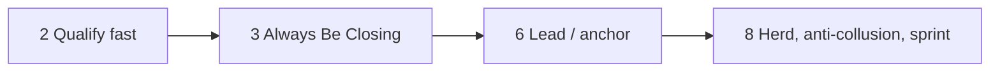

#  Qualifying, closing, and the lead (full text)

Deep walkthroughs behind shared core **§2 Qualify fast**, **§3 Always Be Closing**, **§6 Get the lead / anchor**, and **§8 Herd, anti-collusion, sprint to close** in `../SKILL.md`. SKILL.md keeps the playbook skeleton; read this file before first meetings and again once a lead is locked. Moved from `../SKILL.md` in v3.3.1.

### 2 — Qualify fast

Qualifying is still **closing**: every question should earn the next minute of attention (*Straight Line Persuasion*, Module 7 (sales training course)). Adapt consumer-sales qualifying to **investor, LP, and buyer** conversations.

1. First meetings: lead with a **short** core narrative only after permission to qualify—or open with questions when the slot is tight. Default **5–10 minute** story (fund thesis / teaser summary) once fit is plausible, then conversation.
2. **Two parts to every question:** the words and the **tone**. Prep **track-specific** qualifying questions (startup: stage, check size, decision process, timeline; LP: fund size, pacing, co-invest, Fund I vs emerging; M&A: strategic rationale, process, financing). **Memorize** the set, then **adapt live** so you never sound like you are reading a script; skip questions already answered.
3. **Permission to qualify:** transition with something like “just a couple of quick questions so I don’t waste your time”—helpful, matter-of-fact tone. Avoid a weak add-on such as “is that okay?” that undercuts authority (Module 7).
4. Discover the counterparty’s **logical and emotional why** (mandate, career risk, legacy, synergy, return hurdle)—not a blunt “why are you doing this?” Use big-picture prompts: ultimate objective, biggest headache, what matters most, ideal outcome for *their* side.
5. **Money and capacity** early, casually: indicative **check size**, **fund remaining capacity**, **buyer financing source**, decision-makers—**“no big deal”** / suitability tone, not inquisitor tone. For M&A/strategics, clarify **liquid** availability and who must approve (Module 7).
6. **Rapport while qualifying:** implicit **care**, **trust**, and **expertise**; find **common ground**; **match energy** when mirroring answers (slightly elevate only when appropriate). Do **not** pitch the round, deck, or deal while qualifying—**keep powder dry**; let them talk without narrating how perfect the fit is (Module 7).
7. **Qualify out:** if fit or capacity is wrong, **do not pitch**—biggest time waste and it poisons funnel intelligence (after Ringer, *Winning Through Intimidation*). Confirm **principal vs intermediary** and real decision authority before deep materials. Balance: do not **over-qualify** into only “perfect” names; calibrate to your track’s volume needs. Deal in **facts that move the process**, not wishful narratives (Ringer).
8. **Transition when true only:** e.g. “Based on what you’ve told me, this looks like a fit”—then deeper materials or partner meeting. If not true, pass cleanly and ask for a referral.
9. Maintain a tight **FAQ** for when you move to presentation (market, traction or track record, team, use of proceeds, competition, risks, timeline).
10. **Pass early** when fit is wrong; ask **“Who else should we meet?”** on every qualified touch.
11. Pipeline hygiene: if a counterparty **no-shows twice**, one reschedule then a direct “cancel or prioritize?” message (approver approves tone) ([@dunkhippo33](https://x.com/dunkhippo33/status/1785895882174668834)).
12. **Calibrated how/what questions** surface real constraints without debate—e.g. what matters most, how approval works, who else must agree (after Voss, *Never Split the Difference*). **Label** stated fears (dilution, key-person risk) to build trust (Voss). Treat early **yes** as provisional until confirmed; a safe **no** often hides the real issue (Voss).

### 3 — Always Be Closing (ABC) — closing notes (from SKILL.md)

Use the same **disarming tone** when locking **indicative size** in ABC as when qualifying (Module 7). Treat the first **“no”**, **“not now”**, or **“need to think”** as normal—not failure. Do not argue the objection head-on; clarify **certainty and fit** (“does the idea make sense?”) before pushing terms or a deck send (Module 7). A pass is routine—move to the **next qualified** counterparty without stalling (after Ringer, *Winning Through Intimidation*).

**Close means funded:** log **wires and signed closes**, not soft verbal interest alone (Ringer). **Verify** commitments: align words, tone, and next steps; confirm critical points more than once (Voss, *Never Split the Difference*).

### 6 — Get the lead / anchor

Until a **lead investor**, **anchor LP**, or **preferred bidder path** is clear, there is no deal.

1. Prioritize largest / most engaged candidates.
2. Ask what it takes to reach an offer: size, governance, timeline, key terms.
3. Run **parallel** lead conversations; polite pressure to move without burning bridges.
4. Keep follower / secondary LP / alternate bidder details **confidential** from lead candidates until lead is locked (Skilzzz comment-thread guidance).
5. **Startup:** explain **valuation with metrics**; once a credible **lead** sets price, followers often decide on company quality (Calacanis, *Angel*).

**Advisors (optional, startup-heavy):** Few excellent advisors ≈ **10×** average advisor value (source article); expect advisors to **invest** when advising a company round.

### 8 — Herd, anti-collusion, sprint to close

**Herd:** Signal to interested parties that timing is near; nail **follower** amounts early so lead sees aggregate demand.

**Anti-collusion:** After lead is locked, hold the line on **material economics**; do not let doc delay become a terms auction.

**Sprint:** Until cash wired (or signed docs + funds): treat close as **fragile** (~50/50 mindset, source article); **never stop selling** through signing and wire. Set and honor a **close deadline** where the track allows—a **time frame** only when true (Klaff). Use **intrigue** (short tension story) before cold data dumps in final meetings (Klaff). Expect **legal markups and late diligence surprises**; stay cooperative and warn all parties in advance (Ringer). **One team** should run buyer/investor messaging—avoid uncontrolled side channels (Ringer). Map **people behind the table** (IC, partners, legal, co-founders) and win them before celebrating (Voss). Treat deals as **hypotheses** until signed and funded—no false “done” signals (Voss).
