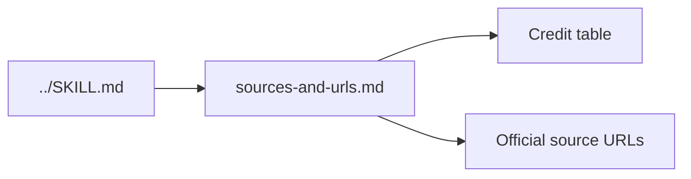

#  Sources and source URLs (full credits)

Full credit table and end-to-end process source URLs for the **fundraising** skill. `../SKILL.md` keeps only the pointer — open this file when verifying an attribution, refreshing an official-form paraphrase, or checking a source URL. File paths in the table's **Local** column are relative to the **skill root** (one level up from this file). Moved from `../SKILL.md` (**Sources**) in v3.3.1.

## Sources — credit table (from SKILL.md)

| Layer | Credit | Local |
| --- | --- | --- |
| Core process (seed) | [Startup Seed Raising Skilzzz](https://swooshing.wordpress.com/2009/03/19/startup-seed-raising-skillzzz/) (Travis Kalanick, 2009) | `references/startup-seed-raising-skillzzz-summary.md` |
| X — pitching VCs & funds | 14 curated posts (2026-11-04); per-post authors linked below | `references/pitching-vcs-x-bookmarks.md` |
| YouTube — M&A | [Fundraising playlist](https://www.youtube.com/playlist?list=PLJaB9gz_nmkEZhl3oov2PZHmYUOCqFzvP); POTOMAC M&A (Paul Giannamore) | `references/youtube-fundraising-playlist/` |
| Qualifying dialogue | *Straight Line Persuasion*, Module 7 — The Art of Qualifying (paid sales training course); paraphrased only in this file | — |
| Books | *Winning Through Intimidation* (Robert J. Ringer) | `references/book-lessons.md` |
| *Positioning* | Al Ries & Jack Trout — [BestWriting summary](https://bestwriting.com/positioning-summary) | `references/book-lessons.md` |
| *Breakthrough Advertising* | Eugene M. Schwartz — [Valchanova book notes](https://valchanova.me/breakthrough-advertising-copywriting-book-review/) | `references/book-lessons.md` |
| *Angel* | Jason Calacanis — [Max Mednik notes](https://www.maxmednik.com/blog/notes-on-angel-by-jason-calacanis), [Haley Bryant summary](https://www.haleymbryant.com/blog/angel-by-jason-calacanis-summary) | `references/book-lessons.md` |
| *Zero to One* | Peter Thiel & Blake Masters — [Medium commentary summary](https://xdev200200.medium.com/zero-to-one-commentary-summary-3695704017f9) | `references/book-lessons.md` |
| Five Laws of Fundraising | John Kim — [Vessel recap](https://vessel.co/resources/blog/the-five-laws-of-fundraising-a-70-billion-masterclass-in-persuasion-pipeline-and-process-with-john-kim) | `references/article-lessons.md` |
| GTM Engine of Fundraising | JD St-Martin & Jonathan Alden — [Vessel guide](https://vessel.co/resources/blog/the-go-to-market-engine-of-fundraising-complete-2026-guide-to-applying-b2b-saas-model-to-lp-relationships) (vendor content) | `references/article-lessons.md` |
| *Never Split the Difference* | Chris Voss — [Runn summary](https://www.runn.io/blog/never-split-the-difference-summary) | `references/article-lessons.md` |
| *Pitch Anything* | Oren Klaff — [Deven Davis summary](https://www.devendavis.com/book-summaries/pitch-anything); [blas.com notes](https://blas.com/pitch-anything/) | `references/book-lessons.md` |
| Fundraising process & IR (2026) | Travis Kalanick — [David Senra podcast, 2026-08-16](https://www.davidsenra.com/episode/travis-kalanick) | `references/interview-lessons.md` |
| End-to-end process (terms, DD, math, M&A, fund compliance, post-close) | Paraphrased references below | `references/deal-terms.md`, `due-diligence-checklists.md`, `cap-table-math.md`, `ma-process.md`, `fund-closing-and-compliance.md`, `post-close.md` |
| Official forms (v3.1.0 parse) | YC SAFE docx; NVCA 2020 term sheet; Series Seed GitHub; ILPA Model LPA/DDQ/reporting defs; 15 U.S.C. 80a-2/80a-3 | See `references/` headers and URLs below |
| Glossary | In-skill jargon | `references/glossary.md` |

### End-to-end process source URLs (paraphrase only; copied exactly)

- https://www.ycombinator.com/documents
- https://bookface-static.ycombinator.com/assets/ycdc/SAFE%20User%20Guide-a47c6588327d73aa2799e61ed7c2cae9f1a0ee9acfa9c43b62039dc06e715832.pdf
- https://nvca.org/model-legal-documents/
- https://feld.com/archives/2005/01/term-sheet-liquidation-preference/
- https://feld.com/archives/2005/01/term-sheet-protective-provisions/
- https://feld.com/archives/2005/01/term-sheet-board-of-directors/
- https://feld.com/archives/2005/02/term-sheet-drag-along/
- https://feld.com/archives/2005/08/term-sheet-series-wrap-up/ (search excerpt only)
- https://fullratchet.net/episode-10-the-term-sheet-feat-brad-feld/ (search excerpt only)
- https://ilpa.org/wp-content/uploads/2019/06/ILPA-Principles-3.0_2019.pdf
- https://ilpa.org/industry-guidance/principles-best-practices/ilpa-principles/
- https://www.fundlaunch.com/solutions/lpa-drafting
- https://www.mintz.com/insights-center/viewpoints/2871/2025-03-31-seller-considerations-when-negotiating-letter-intent
- https://morganandwestfield.com/books-online/chapter-19-the-letter-of-intent/major-clauses/ (search excerpt only)
- https://www.casneredwards.com/representation-and-warranty-insurance-managing-risk-in-your-next-ma-deal/ (search excerpt only)
- https://fasthofflawfirm.com/blog/escrows-and-holdbacks (search excerpt only)
- https://www.crv.com/content/series-a-funding
- https://ilpa.org/wp-content/uploads/2021/11/ILPA-DDQ-2.0.pdf
- https://ilpa.org/wp-content/uploads/2024/10/ILPA-Institute-Operational-Due-Diligence-for-the-Limited-Partner.pdf (search excerpt only)
- https://www.breakwaterma.com/blog/seller-due-diligence-checklist
- https://praxisrock.com/insights/sell-side-m-a-process
- https://windsordrake.com/process/sell-side-process/
- https://auxocapitaladvisors.com/sell-side-m-a-process/ (search excerpt only)
- https://auxocapitaladvisors.com/sell-side-mna-timeline/ (search excerpt only)
- https://www.alehar.com/resources/articles/navigating-the-sell-side-manda-process (search excerpt only)
- https://www.sec.gov/resources-small-businesses/exempt-offerings/private-placements-rule-506b
- https://www.sec.gov/resources-small-businesses/exempt-offerings/general-solicitation-rule-506c
- https://www.investor.gov/introduction-investing/general-resources/news-alerts/alerts-bulletins/investor-bulletins/updated-3
- https://www.investor.gov/introduction-investing/general-resources/news-alerts/alerts-bulletins/investor-alerts/investor-50
- https://www.sec.gov/resources-small-businesses/small-business-compliance-guides/investment-adviser-marketing
- https://www.eisneramper.com/insights/private-equity/subsequent-closings-finds-pe-0623/
- https://www.sec.gov/resources-small-businesses/glossary (search excerpt only — qualified purchaser)
- https://yonder.vc/resources/investor-update-template/
- https://ilpa.org/industry-guidance/templates-standards-model-documents/reporting-template/
- https://www.ic3.gov/PSA/2023/PSA230609
- https://www.devendavis.com/book-summaries/pitch-anything
- https://blas.com/pitch-anything/
- https://www.neurosciencemarketing.com/blog/articles/pitch-anything-by-oren-klaff.htm (search excerpt only)
- https://nvca.org/wp-content/uploads/2020/08/NVCA-2020-Term-Sheet.docx
- https://github.com/seriesseed/equity
- https://ilpa.org/wp-content/uploads/2020/07/ILPA-Model-Limited-Partnership-Agreement-WOF.docx
- https://ilpa.org/wp-content/uploads/2020/07/ILPA-Model-Limited-Parnership-Agreement-Deal-By-Deal.docx
- https://ilpa.org/wp-content/uploads/2020/07/2020.07.29-ILPA-Model-LPA-Overview-WOF-Version.docx
- https://ilpa.org/industry-guidance/templates-standards-model-documents/model-limited-partnership-agreement/
- https://ilpa.org/wp-content/uploads/2025/02/Reporting-Template-Definitions.pdf
- https://ilpa.org/wp-content/uploads/2025/04/ILPA-Performance-Template-Definitions-Granular-Methodology-v1.1.pdf
- https://ilpa.org/wp-content/uploads/2025/09/Combined-Overview-ILPA-Templates.pdf
- https://www.law.cornell.edu/uscode/text/15/80a-2
- https://www.law.cornell.edu/uscode/text/15/80a-3

## Maintainer notes (from SKILL.md)

**Living sources:** Periodically refresh (1) the curated X post compilation, (2) YouTube **Fundraising** playlist **summaries**, (3) `references/book-lessons.md`, (4) `references/article-lessons.md`, and (5) `references/interview-lessons.md`; update attributed tables in this file and bump `version` (see `CHANGELOG.md`).

**Diagrams and icons (maintainers and agents):** Every skill file, sub-skill, and reference under this folder must include at least one GitHub-renderable `mermaid` diagram near the top that explains that file’s content, plus inline **Hugeicons free** (MIT) SVG icons from `assets/icons/` per [`../assets/icons/README.md`](../assets/icons/README.md). Never use Hugeicons Pro (`@hugeicons-pro/*`). When a doc is added or substantially changed, update its diagram and icons in the same change. Validate diagrams with `@mermaid-js/mermaid-cli` (`mmdc`) and verify every `` resolves to a committed file before opening a PR. Applies to any human or agent editor, in any tooling.

**Optional — Web3:** Token warrants, SAFT, and crypto-native investor vetting—skip for purely equity processes.
