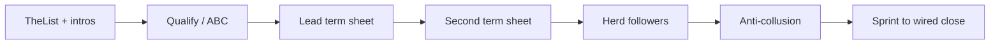

#  Article summary: Startup Seed Raising Skilzzz

**Source:** Travis Kalanick (posted as “swooshdude”), March 19, 2009  
**URL:** https://swooshing.wordpress.com/2009/03/19/startup-seed-raising-skillzzz/

##  One-line thesis

Seed fundraising is a sales process: build a pipeline, create real urgency and competition, land a lead investor with a term sheet, race for a second term sheet, herd followers, block collusion on terms, and sprint through close—while staying credible and never letting momentum die.

##  Section digest

| Topic | Core lesson |
| --- | --- |
| **Priming the pump** | Meet angels and connectors at gatherings and conferences; short elevator pitch; book intro meetings. If not in a startup hub, spend ~a month in Silicon Valley meeting someone new every day. |
| **Intro meetings** | Informal lunch/coffee; 5–10 minute pitch; mental FAQ for top ~20 questions; let the investor pay; be proud of scrappiness. |
| **Always Be Closing (ABC)** | End every meeting with clarity: interest level, plausible check size, and explicit next steps—no vague “we’ll stay in touch.” Use hypotheticals (“When I lock my lead, how much would you invest?”). |
| **Referrals** | Always ask who else to meet; strong pitches earn warm intros—still ask even when they don’t offer. |
| **Advisors** | Convert select angels to advisors; quality >> quantity (average advisor ≈ 1/10 of a great one); advisors must invest in the round or their help matters less. |
| **Thought partner** | One advisor/co-founder/mentor to think through chaos, personalities, valuation, ego, and messaging through term sheet → close. |
| **TheList (pipeline)** | Track every contact, referral, and interest level; follow up professionally and fast. |
| **Passion / charisma** | Show founder energy and conviction; prepare mentally; bring positivity into the investor’s day. |
| **Credibility** | Do not spin weaknesses or fake certainty; acknowledge risk and uncertainty with smart mitigation plans; pivot negatives toward strengths honestly. |
| **Momentum & urgency** | Investors delay without fear/greed signals; every touch should convey motion (“packed schedule,” “multiple parties,” “could close quickly”) backed by real hustle—time kills deals. |
| **Getting the lead** | Until a lead sets terms (term sheet), there is no deal; push largest/most interested investors toward an offer; compare parallel conversations politely but firmly. |
| **Competitive deal / second term sheet** | After first term sheet, move *very* fast for a second; one sheet = weak negotiating position and terms can worsen or vanish; example voicemail emphasizes heat and callback urgency. |
| **Herding the cattle** | Broadcast heat to all interested parties; followers commit to amounts when big names and follow-on capital are visible; nail follower amounts. |
| **Anti-collusion** | After lead is locked, resist investor collusion to re-trade terms during doc phase; hold firm that material terms are set. |
| **Sprint through close** | Until money is in, treat odds as ~50/50; keep selling, keep pipeline warm, pursue oversubscription through the finish line. |

##  Comment thread additions (same URL, not in main post)

- **Ming Yeow:** Stack credible entrepreneur/advisor references *before* fundraising; network broadly—don’t over-index on VCs who ignore non–VC-ready deals.
- **Author reply:** VCs rarely do true seed unless hot follower momentum or they wait until traction fits VC stage.
- **Nathan Beckord (anti-collusion Q):** Keep lead status close; don’t disclose follower angels to potential leads until lead is locked; followers may know each other; communicate momentum without showing all cards—strategic transparency.

##  How this repo skill uses the article

The skill `fundraising` turns the above into an agent-run playbook (pipeline fields, cadences, checklists, founder reporting). Sections labeled **Optional — Web3** in `SKILL.md` add token and crypto-native investor context—SAFEs, token warrants, scam-aware vetting—not Travis Kalanick’s 2009 post.
