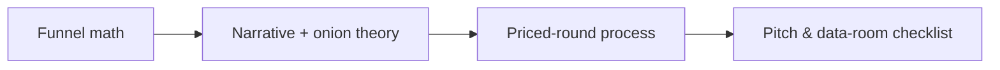

#  Startup track — detail (funnel, narrative, priced rounds, instruments, checklist)

Execution detail behind the **Startup seed / venture** track in `../SKILL.md`: funnel benchmarks, narrative lessons, priced-round partner selection, instruments, after-the-yes steps, the full pitch & data-room checklist, and the optional Web3 table. SKILL.md keeps the summaries and scope. Moved from `../SKILL.md` in v3.3.1.

### Funnel math and outreach mix

| Lesson | Use | Source |
| --- | --- | --- |
|  ~**150** touches → ~**50** first meetings → ~**20** second → ~**2** term sheets | Size TheList and weekly targets | [@twistartups](https://x.com/twistartups/status/2062293805303582751) |
| **120+** serious investor conversations before oversubscription (pre-seed example) | Effort expectations | [@andrew__rea](https://x.com/andrew__rea/status/1787883910652993578) |
| Parallel **warm intros** and **approved cold** outbound | Top of funnel | [@adcock_brett](https://x.com/adcock_brett/status/1812672042564776073) |
| Study high-converting cold email (one cited **70.8%** meeting rate—anecdotal) | Email drafts | [@adcock_brett](https://x.com/adcock_brett/status/1812673093086986358) |

### Narrative, traction, onion theory

| Lesson | Use | Source |
| --- | --- | --- |
| Seed answers: **team works together**, **can build**, **will anyone use it** | Pitch + FAQ | [@rdominguezibar](https://x.com/rdominguezibar/status/2095600466415825160) |
| Weak **mid** traction harder than **zero** (vision) or **strong** (proof)—reposition honestly | Deck emphasis | [@colorkevin](https://x.com/colorkevin/status/2050606246148137422) |
| **Onion Theory of Risk:** each round funds removal of specific risks for the *next* round—past milestones, risks peeled, this $ , next milestones, risks ahead | Round size, deck | [@StartupArchive_](https://x.com/StartupArchive_/status/1971904952210493778) |
| Large raise + **capital discipline:** S&M payback **<1.5y**, milestone hiring, **Rule of 40**, burn multiple **<2**, quarterly reporting | Diligence updates | [@immad](https://x.com/immad/status/2091749711095226814) |
| PG **How to Raise Money** (essay link in bookmark) | Deep read | [@benln](https://x.com/benln/status/1832803400582377547) |
| Skilzzz pointer | Primary source | [@travisk](https://x.com/travisk/status/2118001818227642520) |
| **Normal market:** long **QED** pitch—story with metrics woven through until “how we win” feels proven | Deck length & depth | Kalanick, [Senra podcast 2026-08-16](https://www.davidsenra.com/episode/travis-kalanick); `./interview-lessons.md` |
| **Very bullish cycle:** shorten (~45 min), emphasize **theory of the case**; deep multi-year models can invite doubt | Deck length & depth | Same |
| **Parallel rooms** by check size; founder in largest-check room | Oversubscribed priced rounds | Same |
| **Do-no-harm** investor bar (~10% meet; ~1% truly helpful); weakness draws pressure | Partner selection | Same |

### Priced-round process & partner selection (Kalanick, Senra 2026-08-16)

1. Run **shared core §7b** when team can support QED pitches plus auction ops; otherwise stay on Skilzzz second-offer sprint.
2. **Select for do-no-harm**, not highest price—operators live in the business daily; most capital partners check in quarterly and still want influence.
3. **Qualify out** investors whose liquidity timeline or governance needs conflict with the plan; document in `confidential_notes`.
4. Assign **investor-relations owner** (may be exec, not only CEO) for ongoing objection-handling while the CEO runs the process.
5. After close, maintain **liquidity alignment** cadence (`./post-close.md`).

### Instruments

Detail: `references/deal-terms.md`; pro forma: `references/cap-table-math.md`.

| Instrument | Agent should |
| --- | --- |
| **SAFE** | Track cap, discount, MFN, pro rata side letter; flag side letters; **lawyer review** before signature. |
| **Priced seed** | Pre-money, option pool shuffle, board, protective provisions; compare second term sheet; **CPA review** for 409A. |

### After the yes — startup

1. **Term sheet** — compare economics and control; model dilution (`cap-table-math.md`); human approves before sign.
2. **Diligence** — stage the data room (`due-diligence-checklists.md`); log access.
3. **Docs** — NVCA-style set (`deal-terms.md`); counsel markups; no oral side deals.
4. **Close** — charter amendments, wire instructions verified per guardrails; Form D reminder.
5. **Post-close** — monthly/quarterly updates; board rhythm (`post-close.md`).

### Startup pitch & data-room checklist

- [ ] 5–10 min narrative; top-20 FAQ; **three seed answers** ([@rdominguezibar](https://x.com/rdominguezibar/status/2095600466415825160))
- [ ] **Angel four pillars:** what you build, why you, why now, unfair advantage (Calacanis, *Angel*); **Thiel seven screens:** engineering, timing, monopoly path, people, distribution, durability, secret (*Zero to One*)
- [ ] **One owned concept** + oversimplified headline; category creation or flank vs leader—not head-on “we’re better” (Positioning); contrarian/small-market story aligned with Thiel where both apply
- [ ] **Schwartz copy:** desire-led titles; awareness-matched cold vs warm emails; mechanism or identification if market is crowded/jaded
- [ ] **Onion slide** ([@StartupArchive_](https://x.com/StartupArchive_/status/1971904952210493778)); traction framing ([@colorkevin](https://x.com/colorkevin/status/2050606246148137422)); prefer **product and traction before** heavy fundraising (Calacanis)
- [ ] Short answers on competition, revenue, pricing, CAC, top failure modes (Calacanis); **distribution** and unit economics (Thiel)
- [ ] Clear ask (size, instrument, timeline); deck **after** interest
- [ ] Data room: cap table pro forma, corp docs, contracts, IP, financials, metrics; access log
- [ ] **Market-aware pitch:** QED depth (normal) vs **theory of the case** (~45 min in very hot cycles) (Kalanick, Senra 2026-08-16)
- [ ] **Priced round:** low clearing anchor + **§7b** auction path if bandwidth; else second-offer sprint
- [ ] **Partner screen:** do-no-harm bar; liquidity expectations documented pre-close
- [ ] **Optional — Web3:** token cap table / warrant summary only with legal blessing

### Optional — Web3 (startup track) — table (from SKILL.md)

| Topic | Agent should |
| --- | --- |
| **Token warrant / side letter** | Separate equity terms from token economics; log triggers and lockups; legal review. |
| **SAFT / token sale** | Securities-sensitive; counsel only. |
| **Investor scam vetting** | Verify identity and track record; red-flag guaranteed returns, personal-wallet wires, pressure; pause before data room. |

---
