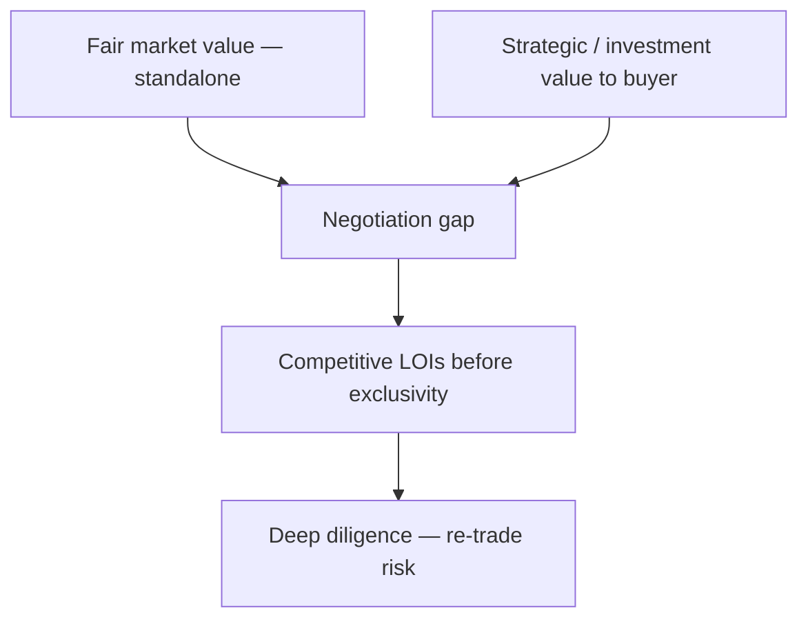

#  Buy Side M&A MasterClass | The Breakdown, with Paul Giannamore

- **Channel:** POTOMAC M&A  
- **Speaker:** Paul Giannamore  
- **Length:** 43:01  
- **URL:** https://www.youtube.com/watch?v=IG7LanmQny4  
- **Upload:** 2022-09-14  

##  Summary (paraphrased)

This session explains how **acquirers** think when buying a lower-middle-market business (examples use pest control, but the logic generalizes). Giannamore separates **opportunistic** calls (retirement, distress, inbound tip) from a **formal acquisition program** tied to strategy, sourcing, and execution capability.

Before price, buyers should assess **strategic fit**: service mix, customer type, route density, culture, and whether they are buying a standalone operating business versus a bundle of accounts. **Valuation** should start from **fair market value** (standalone cash flows to current owners) versus **investment or strategic value** (what the asset is worth to this specific buyer). Sellers naturally push toward investment value; buyers anchor toward FMV—the negotiation lives in the gap.

Buyers are advised to be **conservative** in framing, normalize owner compensation and add-backs skeptically, and build a standalone model with realistic hurdles. **Synergies** (cost takeout, cross-sell) justify the buyer’s price internally but the seller should document **standalone strength** and force buyers to compete on how much synergy they share in bid rounds.

**Process asymmetry:** buyers often run fast initial diligence to secure an **LOI** with **exclusivity** (often on the order of ~60 days), then slower deep diligence where re-trades appear. Sellers should seek **competitive LOIs before exclusivity** and negotiate contingencies, retention, and clawbacks at LOI, not only in the purchase agreement.

**Anchoring:** sophisticated buyers lead with a written offer and avoid asking the seller for a number first. Sellers who hear “what do you want?” should redirect to **process** and prepared materials. **Tax and financial verification** (returns, normalization, sometimes third-party transcripts in U.S. contexts) can surface gaps between reported and economic reality—sellers should prepare clean financials early.

For founders on the **sell side**, the talk is a defensive playbook: expect low anchors, FMV versus strategic framing, synergy narratives, exclusivity pressure, and late contingencies—and design a parallel process accordingly.
