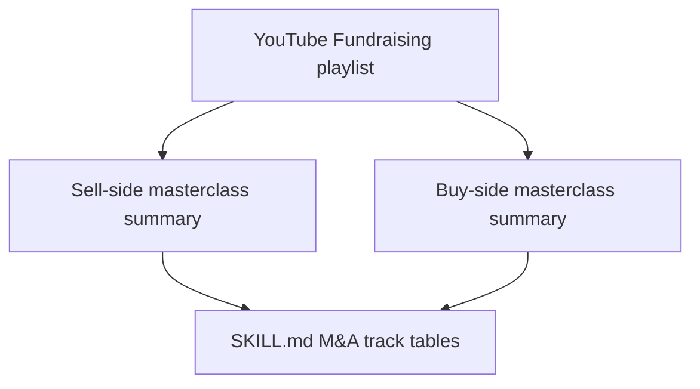

#  YouTube playlist: Fundraising

**Playlist:** https://www.youtube.com/playlist?list=PLJaB9gz_nmkEZhl3oov2PZHmYUOCqFzvP  
**Maintained for skill:** `fundraising`  
**Note:** Repo holds **paraphrased summaries** only (no full transcripts). Timestamped lesson tables live in `SKILL.md` (M&A track).

| # | Title | Channel | Length | Video | Summary |
| --- | --- | --- | --- | --- | --- |
| 1 | Sell-Side M&A Masterclass \| Structuring a Formal Sale Process for Maximum Value | POTOMAC M&A | 1:24:08 | https://www.youtube.com/watch?v=8jBQ3jZnNvY | [sell-side-ma-masterclass-8jBQ3jZnNvY-summary.md](./sell-side-ma-masterclass-8jBQ3jZnNvY-summary.md) |
| 2 | Buy Side M&A MasterClass \| The Breakdown, with Paul Giannamore | POTOMAC M&A | 43:01 | https://www.youtube.com/watch?v=IG7LanmQny4 | [buy-side-ma-masterclass-IG7LanmQny4-summary.md](./buy-side-ma-masterclass-IG7LanmQny4-summary.md) |

Additional playlist entries may be added when the playlist is refreshed; add a summary file, update this index, and distill new lessons into `SKILL.md` with attribution.
