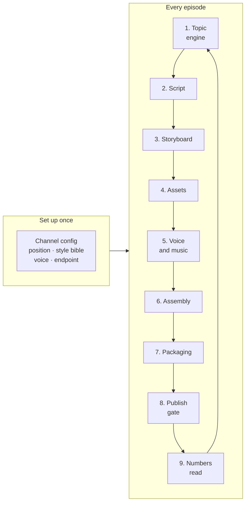

#  funnel-operator (open skill)

**Starting a channel is easy. Running one the same way every week is the part that dies.** This skill turns a video channel into a system an agent, or a person, can run cold: the channel is set up once as a single config file, and every episode moves through the same nine stages, with the look, the voice, and the numbers held steady by procedure instead of memory.

*Formerly Channel Operator — renamed on 2026-11-25, because the skill operates the whole funnel, not just a channel: research decides what gets made, distribution carries each episode to the channel's other platforms, and the scoreboard reads the funnel end to end. Older references to channel-operator point here.*

##  What this is

An open skill that runs a video channel end to end — topics, scripts, storyboards, generated scenes, narration, assembly, packaging, a human publish gate, and a weekly numbers read.

Most channels are run from whoever's head the last episode lived in. The result is drift: the look changes, the voice changes, topics follow the week, and nothing is measured, so nothing compounds. This skill works the other way. The method lives in the skill and never changes per channel. Everything that makes one channel different — its position, audience, style, voice, and the one action every video drives to — lives in one config file in the channel's own folder.

Three things make this version different from a production checklist:

1.  **One skill, any channel** — a second channel costs a new config file, a new style bible, and a three-episode pilot. Not a new system, and not a new pile of chats.

2.  **A gate, not a hope** — nothing publishes without the channel owner's approval of the exact final video, title, and thumbnail. Uploads go up unlisted first. Every number in a script traces to a named source, and the AI-content disclosure is set on every upload.

3.  **Consistency by procedure** — every generation prompt opens with the channel's locked style block, word for word, and one locked narrator voice reads every episode. The look and the sound hold because the procedure holds them, not because anyone remembered.

##  Who it is for

| Audience | Use |
| --- | --- |
| **Founders / operators** | Run a channel that sells something behind the video — a service, a product, a list — where one converted viewer can be worth more than a year of ad revenue |
| **Creators** | Turn an ad hoc upload habit into a cadence with a backlog, a locked style, and a numbers read that says what to make next |
| **AI agents** | Load `SKILL.md`, open a channel folder, and produce an episode package a human can approve — script with sources, storyboard, final cut, titles, thumbnail — with the state written back every run |
| **Maintainers** | Refresh `references/` when formats or platform rules change; bump `version` in `SKILL.md` |

##  Process at a glance

##  How to use with an agent

1. **Load** [`SKILL.md`](./SKILL.md) as the system skill (see your agent's skill docs).
2. **Set the channel up**: fill a `CHANNEL.md` from the template, lock the style bible and the voice, seed a ten-topic backlog. If the business has no positioning record, run the positioning skill first — the config consumes it whole.
3. **Run episodes** through the nine stages. **Pull references when needed** (do not paste entire files into context):

| Phase | Read |
| --- | --- |
| Setup — the channel config |  [`references/channel-config-template.md`](./references/channel-config-template.md) |
| Stages 2–3 — script and storyboard in a format |  [`references/formats.md`](./references/formats.md) |
| Any stage — what good looks like, end to end |  [`references/worked-example.md`](./references/worked-example.md) |

4. **Hold the guardrails** in `SKILL.md` — above all the publish gate. The pipeline produces; the channel owner publishes.

##  Folder map

| Path | One line |
| --- | --- |
| [`SKILL.md`](./SKILL.md) | Main skill: when to use / not use, guardrails, the channel config, the four formats in summary, the nine-stage core procedure, sibling calls, output contract, limits, verification checklist |
| [`CHANGELOG.md`](./CHANGELOG.md) | Version history |
| [`references/README.md`](./references/README.md) | Index of all reference files |
|  [`references/formats.md`](./references/formats.md) | The four format templates in full — structure, chapter rhythm, word budgets, music rule, title formulas, failure modes — each with the reference video it came from |
|  [`references/channel-config-template.md`](./references/channel-config-template.md) | The blank `CHANNEL.md` template, with a note on how to fill each field |
|  [`references/worked-example.md`](./references/worked-example.md) | One episode through all nine stages at summary depth — the Hidden Worth pilot's first Story A |
| [`references/research-module.md`](./references/research-module.md) | The research module: market and content research feeding the topic scores as evidence — platform performance, search terms, the other platforms, buyer demand — refreshed at every weekly read, with the backlog re-rank and refill rules |
| [`references/linkedin-module.md`](./references/linkedin-module.md) | The LinkedIn distribution module: posts and document carousels, the browser route by default, gated exactly with the episode and read back live |
| [`references/x-module.md`](./references/x-module.md) | The X distribution module: posts, threads, and long-form — API on a paid tier or browser — gated exactly with the episode and read back live |
| [`references/instagram-module.md`](./references/instagram-module.md) | The Instagram distribution module: posts, reels, and carousels — Meta's Content Publishing API or browser — gated exactly with the episode and read back live |
| [`scripts/verify.sh`](./scripts/verify.sh) | Package check: required files, frontmatter, README sections, references index — prints PASS/FAIL and exits non-zero on failure |

##  Sources and credits

- The four formats are **reverse-engineered from public reference videos**, studied frame by frame and transcript by transcript: a second-person story channel, a dialogue story channel, a long-form explainer channel, and a complete-retelling channel, plus a production-method tutorial on prompt-driven generation. The analysis is paraphrased; no creator's script text is stored in this repo.

- The channel-config pattern — method in the skill, instance in one config file — follows the playbook's own discipline: skills call sibling skills by name, and a channel's position comes from the positioning skill's record, consumed whole.

- Each reference file names its sources where they matter.

##  Contributing

- Open a PR with new format templates, sharper stage rules, or fixes — keep **grep-clean** (no personal or company-specific strings inside the skill folder; channels live in their own folders, outside the package).

- When a format's evidence changes — a reference channel's numbers, a platform rule — re-read, re-paraphrase, bump **`version`** in `SKILL.md`, and add a **`CHANGELOG.md`** entry.

- New worked examples are welcome, especially ones with measured cost and funnel results. Unmeasured claims will be marked as estimates or removed.

##  License

MIT — see [`SKILL.md`](./SKILL.md) front matter. Third-party sources remain under their publishers' terms.

##  Version

Current skill version: see `version` in [`SKILL.md`](./SKILL.md) front matter. History: [`CHANGELOG.md`](./CHANGELOG.md).
