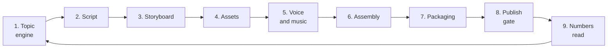

#  funnel-operator

> **How to read this**
>
> - **Agents:** Follow **Agent guardrails** and the **Core procedure** literally. The publish gate is a hard stop, not a step to optimise around. Every number in a script traces to a named source or it does not ship.
> - **Humans:** Set a channel up once with the config template in `references/`, then run the nine stages per episode. Open `references/formats.md` when choosing or writing a format.
> - **Index:** [`references/README.md`](references/README.md) · **Public overview:** [`README.md`](README.md)

**Not a substitute for platform policy or legal advice.** This skill is a production procedure. Platform rules, disclosure law, and rights questions are constraints it respects, not problems it reasons around — see **Agent guardrails**.

## What this skill is

A video channel run from chat memory dies the way most channels die: every episode starts from a blank page, the look drifts, the voice changes, the topics follow whatever felt urgent that week, and nothing is measured, so nothing compounds.

This skill runs a channel the other way. The method lives here, in the skill, and it never changes per channel. Everything that makes one channel different from another — its position, its audience, its look, its voice, the one action every video drives to — lives in one config file in the channel's own folder. Produce episodes through the same nine stages every time. Read the numbers on a fixed rhythm. Write the state back to the folder, so the next session, human or agent, opens the folder and knows what the channel is, what has shipped, what is next, and what the numbers say.

The payoff is the clone. A second channel is a new config file, a new style bible, and a short pilot — not a new system, not a new pile of chats.

Three habits do the work. Topics come from the channel's own well — the questions its audience actually asks — never from trend-chasing. Consistency comes from a locked style block reused word for word in every generation prompt, never re-invented per episode. And nothing publishes on the strength of the pipeline: the channel owner approves the exact final video, title, and thumbnail before anything goes public.

The unit the skill operates is the whole funnel, not the channel alone: research measures what the market is asking and paying for before anything is made, the nine stages make it, distribution carries each episode to every other platform the channel runs, and the numbers read prices the chain end to end. The skill was renamed Funnel Operator on 2026-11-25 for exactly that reason — the channel is one surface of the funnel it runs.

## When to use

Use this skill when:

- **A channel is starting** and its owner wants a system, not a burst of uploads that fades by week three.

- **A channel exists but runs on memory** — episodes made ad hoc, no backlog, no style lock, no record of what anything cost or earned.

- **A second or third channel is wanted** and the first channel's way of working needs to transfer without being rebuilt.

- **Episodes are produced by an agent** and the work must be checkable: a script whose numbers trace to sources, a package a human can approve, a log that shows what shipped and what it did.

## When NOT to use

- **Not for a single video.** A one-off video is a project, not a channel. Make it directly; this procedure's setup cost only pays back across episodes.

- **Not to decide what a business is.** A channel's position — what it will be thought of as, by whom, against what — is the positioning skill's work. This skill consumes a finished position into the channel config; it does not set one.

- **Not to plan the business's marketing.** The channel is one surface inside a marketing system. The one-page-marketing-plan skill plans that system; this skill runs the channel inside it.

- **Not when the channel has nothing behind it.** A channel whose every video points at an offer that does not exist converts nothing, however good the videos are. Build the thing the videos point at, or record plainly in the config that the channel is audience-building only, with no conversion expected yet.

- **Not to publish autonomously.** If a workflow wants uploads with no human approval of the final cut, this is the wrong skill. The gate is the point.

## Agent guardrails

1. **The publish gate is hard.** Nothing publishes without the channel owner's approval of the exact final video, the exact title, and the exact thumbnail. Uploads go up unlisted first. Approval of a script, a storyboard, or an earlier cut is not approval of the final video. If the final cut changes after approval in any way, it goes back through the gate.

2. **Every number traces, or it is cut.** Every figure in a script, a card, a title, or a description must trace to a source named in the channel folder — a source file, a published record, a measured log. No traced source, no number. Story-internal details that make no factual claim about the real world (a character's coffee, a character's rent) are colour, and the production notes mark them as colour so nobody later mistakes them for claims.

3. **Disclosure is set on every upload.** The platform's AI-generated or altered-content disclosure is set for every episode whose audio or visuals were generated or materially altered. No exceptions, no "this one looks real enough."

4. **The channel's own guardrails bind.** Each channel config carries its own never-list: claims it may not make, material it may not publish, topics it stays off. Those rules bind every stage, and a conflict between a good story and the never-list resolves for the never-list. When a channel's never-list is silent on a case, ask the channel owner; do not improvise permission.

5. **A format gets five videos before it is judged.** Formats are adopted from a small reference set, and early numbers are noise. No format is killed, crowned, or redesigned on fewer than five published episodes, unless it breaks a guardrail.

6. **The style block is pasted, never paraphrased.** Every image and clip prompt begins with the channel's style bible block, word for word. A scene that breaks the look is regenerated, not shipped. Consistency is a procedure, not a taste judgment made per scene.

7. **Topics come from the well.** Every episode's topic is drawn from the channel folder's backlog, which is fed from the channel's own sources: audience questions, the business's records in anonymised shape, published buyer or reader criteria, the owner's inbox objections. A topic with no fit to the channel's funnel endpoint does not get made, however strong the story is.

8. **State is written back, every run.** A run that produces an episode updates the published log. A numbers read updates the performance ledger and the topic scores. Work that lives only in a chat transcript does not count as done.

9. **Costs are measured, not assumed.** Every episode's cash cost and production time go in the published log. When the measured cost crosses the cap in the channel config, the cadence drops and the owner hears about it from the log review — not after a month of overruns.

10. **Write the output plain.** Scripts, titles, descriptions, and every human-facing note are written the way a person says them out loud: short sentences, one idea per sentence, plain words, numbers spoken the way people say them ("more than eighteen million dollars"), never raw counts or decimal abbreviations in prose. Exact figures live in tables, logs, and config fields. Evidence, quotes, and source names stay verbatim; the prose around them stays plain.

11. **Proof needs a witness.** A claim about the business behind the channel — its results, its customers, its history — enters a script only with a checkable witness named in the channel folder: a published page, a record, a document. The channel never invents a client story, a testimonial, or a result, and anonymised patterns are told as patterns, never dressed as named cases.

12. **Platform rules are constraints, not obstacles.** The platform's policies on the channel's topics — health, finance, children, elections, whatever the channel touches — are inputs the pipeline respects. A format that only works by bending a policy does not run.

13. **Mass auto-clipping is banned.** No tool or pass turns an episode into a large set of derivative clips. An episode yields two or three Shorts, hand-picked at the script stage and rebuilt natively in vertical; anything more needs the channel owner's explicit word for that episode. The precedent is the owner's own: a channel of his had 193 auto-derived Shorts deleted in a platform Partner Program cleanup, because bulk derivative clipping reads as low-effort, repetitive content. The full rule is the Shorts stage, below.

## The one idea

**The skill holds the method. The channel holds a config. Episodes are what the two produce together.**

Everything else in this file is that sentence made operational: the config's fields, the nine stages, the state files, and the gate.

## The channel config

Each channel lives in its own folder and carries one `CHANNEL.md`. It is the only thing that changes from channel to channel. Its fields:

- **Identity** — channel name, handle, platform account, the one-line promise.

- **Position** — the channel's positioning record: owned concept, market category, competitive frame, best-fit audience, trade-offs. Written once, before the first video, by a light run of the positioning skill.

- **Audience and entry points** — who the channel is for, and the moments that make them search: the question they type, the event that just happened, the thing a peer sends them.

- **Format menu** — which of the four formats in `references/formats.md` this channel runs, and in what mix.

- **Style bible** — a separate file in the channel folder holding the locked visual block: art direction, palette, scene rules, caption treatment, card templates, and the exact style block text pasted into every generation prompt.

- **Voice spec** — one locked narrator voice per channel, its pace and tone, and the music rule per format.

- **Funnel endpoint** — the one action every video drives to, and the exact words of the call to action, placed once mid-video and once at the end.

- **Cadence and budget** — episodes per week, the cash cap per episode, and the review date or trigger.

- **Channel guardrails** — this channel's never-list, on top of the skill-wide guardrails above.

- **Podcast block (optional)** — present only when the channel runs the podcast module: the feed's title, description, author, category, artwork, and host, plus the feed address and directory listings recorded at feed setup. See `references/podcast-module.md`.

- **Shorts block (optional)** — present only when the channel runs the Shorts stage: that it runs it, and any channel-specific note on cut count or release spacing. See `references/shorts-module.md`.

- **Blog block (optional)** — present only when the channel runs the blog module: the site the posts publish on, the address pattern for a post, and any channel-specific note on the definition terms. The block also records the newsletter decision — a public newsletter is a separate move, decided on its own evidence, never a default of this module. See `references/blog-module.md`.

- **Distribution block (optional)** — present only when the channel publishes beyond its video platform: for each platform (LinkedIn, X, Instagram) whether it is active, the account and posting identity on it, and the posting route it uses — an API route only where the channel legitimately holds one, the browser route otherwise. The routes differ per platform and are stated honestly in each platform's module. See `references/linkedin-module.md`, `references/x-module.md`, and `references/instagram-module.md`.

The blank template, with a note on filling each field, is [`references/channel-config-template.md`](references/channel-config-template.md).

## The four formats

The formats are templates, each reverse-engineered from a reference video that proved the shape works. Full templates — structure, chapter rhythm, word budgets, music rule, title formulas — live in [`references/formats.md`](references/formats.md). The summary:

| Format | Shape | Length | Narration runs |
| --- | --- | --- | --- |
| **Story A** — second person, one narrator | "Your life as a…" — the viewer is the character; stakes escalate; a reversal about every ninety seconds | about 8 to 12 minutes | about 1,160 to 1,740 words |
| **Story B** — dialogue, several voices | A recurring character plays scenes as dialogue over stills; music near-constant | about 12 to 18 minutes | about 1,740 to 2,610 words |
| **Explainer** — reframe, mechanism, walk, application | One topic: what people get wrong, the one mechanism, the evidence step by step, what it means for the viewer | about 15 to 25 minutes | about 2,175 to 3,625 words |
| **Retelling** — the complete story | The whole subject, first page to last; chapters inherited from the subject's own structure; completeness is the hook | about 30 to 60 minutes | about 4,350 to 8,700 words |

Word budgets assume narration at about one hundred and forty-five words a minute. A channel's format menu picks its mix; most channels lead with one format, run a second for range, keep the Retelling as a rare flagship, and hold Story B in reserve unless the brand can carry a meme register.

## Core procedure

### Before the stages — set the channel up

A channel starts with four pieces of work, in this order:

1. **Write the config.** Fill `CHANNEL.md` from the template. The position fields come from a positioning record; if none exists, run the positioning skill first — a channel without a position is a topic list.

2. **Lock the style bible and the voice.** Write the style block, generate test scenes until the look holds across subjects, and pick the one narrator voice. Record both in the channel folder. This is the most expensive hour in the channel's life and the one that saves every later hour.

3. **Seed the backlog — on research, not judgment.** Run the research module's first pass first ([`references/research-module.md`](references/research-module.md)): what is performing on the platform in the channel's niche, the search terms the audience actually uses, what is performing on the channel's other platforms, and what the channel's buyers are paying for, the channel's own deal flow read first. Then ten topics from the channel's well, each scored for search demand, story strength, and funnel fit, with each score's one-line reason citing the research finding it rests on. A score with no finding behind it is marked a judgment score until research replaces it. The backlog is a file, not a memory — and its scores are evidence, not opinion.

4. **Dress the channel.** Build the channel's public surfaces from the config and the style bible. Dressing assets are generated like any other asset: the style block pasted word for word into every generation prompt. The dressing carries:

- **Profile mark** — the channel's mark from the style bible, legible at the smallest size the platform shows it.

- **Banner** — channel art built from the style bible: its palette, its type, the channel's one-line promise, and nothing else competing. It must survive the platform's safe-area cropping on TV, desktop, and phone, with the promise and the mark inside the safe area on every surface.

- **About text** — the promise, who the channel is for, what it publishes and how often, and the funnel endpoint named with its link.

- **Links** — the funnel endpoint first, then the business's other public surfaces the config names.

- **Channel keywords** — the owned concept and the category terms from the config's position fields.

- **Upload defaults** — description boilerplate that carries the funnel call to action and its link, so no episode starts from a blank description.

- **Branding watermark** — set if the style bible calls for one.

Dressing is part of setup. It is done once, and it is revisited only when the config or the style bible changes. Every word on a public surface follows the plain-writing guardrail (guardrail 10) and the channel's own guardrails, the same as any script or description. Record the dressing in the config's channel dressing block.

**Confirm the funnel endpoint is live before the pilot starts.** The pilot does not start until the channel's funnel endpoint is confirmed live on the channel's site: the screen itself, its lead capture, and the owner's notification, proven by a real test submission that arrived where leads go. The site is built by the channel-site-builder skill or by hand — the gate is the live endpoint, not the tool that built it. A channel whose config records it as audience-building only, with no endpoint and no conversion expected, is exempt, and the config says so in those words; every other channel carries the confirmation and its date in its Site block before episode one is produced.

Then run a three-episode pilot — one episode per lead format where the menu has more than one — measure the real cost and time per episode, and only then set the standing cadence the config promises.

### Stage 1 — Topic engine

Pick the next episode from the backlog. The backlog is fed continuously from the channel's well: questions the audience asks the business, objections in the owner's inbox, criteria the channel's buyers or readers publish, and the business's own patterns in anonymised shape. Each candidate carries three scores — search demand, story strength, funnel fit — each low, medium, or high, each with a one-line reason. Funnel fit is a veto, not a weight: a topic that cannot end at the channel's funnel endpoint is not made, whatever its other scores. When the numbers read (stage 9) shows a topic family producing funnel actions, that family gets more slots. When a family produces views and no actions after five episodes, it is re-scored honestly, not defended.

**The scores rest on research, not judgment.** The research module ([`references/research-module.md`](references/research-module.md)) is this stage's evidence base: before a topic is scored, re-scored, or picked, the current findings — platform performance in the niche, search terms in the audience's own phrasing, the other platforms' performing formats, and buyer demand signals — are read, and each score's reason cites the finding it rests on. A topic whose scores predate the last research pass is re-scored against the current findings before it is picked. Scoring topics on judgment alone is the named failure the module exists to prevent.

### Stage 2 — Script

**Call storytelling at this stage** — narrative structure, the hook, and the shape of the turn belong to it; this stage owns the words-per-minute budget, the source discipline, and the call to action. Write from the format template in `references/formats.md`. The shared rules: the hook lands inside thirty seconds; a chapter turns every ninety to one hundred and fifty seconds; specific numbers appear wherever the evidence allows, and every one of them traces to a named source (guardrail 2); the call to action appears once mid-video and once at the end, in the config's exact words. The script is written to be heard, not read — short sentences, spoken numbers, no sentence that needs a second pass. The script file names its sources at the top: every source the script's claims rest on, listed before the first line of narration.

**Name the episode's Shorts picks before production starts.** When the channel runs the Shorts stage, pick the episode's two or three Shorts cuts at this stage, while the script's beats are in view. Each pick must stand alone — one claim, one turn, no setup from earlier in the story — and the picks are named in the production notes before production starts. A moment that needs the story before it to land stays in the long video, however strong it is in place. The stage's full rules are [`references/shorts-module.md`](references/shorts-module.md).

**Before the script leaves this stage, run the pronunciation pass.** A synthesis voice reads exactly what is on the page, including the wrong half of any word that carries two pronunciations with two meanings — record, read, live, close, minute, lead, and their kin. Scan the finished script for every such word. For each one, record the intended reading, and whether the line's grammar makes the wrong reading plausible for a synthesis voice. Where the wrong reading is plausible, rewrite the line to remove the ambiguity: the smallest change that takes the word out or makes its reading unavoidable. Rewriting beats respelling — a respelled render input is the fallback, used only when a line cannot be rewritten without losing its meaning, and the captions still carry the true spelling. The scan, its verdicts, and every change it caused go in the production notes, where the owner can see them.

### Stage 3 — Storyboard

**Call storytelling at this stage** — scene function belongs to it: every scene must advance, reveal, or reverse, and a scene that does none of the three is cut or merged here, before it costs an asset round. Break the script into scenes: one scene per ten to twenty seconds of narration. A scene is a narration unit, not a picture hold — the picture inside a scene changes on the beat standard at the assets and assembly stages (a new still roughly every five seconds), so scene length never sets how long one image sits on screen. Each scene's prompt is built the same way every time — the style bible block first, word for word, then the scene itself. Quote cards and fact cards are built from the style bible's card templates, with the words set as type, never drawn freehand by an image model. The storyboard lists, per scene: the narration lines it covers, the visual, and any card. A scene with no clear single idea is split; the style bible's rule is one idea per scene.

### Stage 4 — Assets

Generate the scenes in rounds, within the media pipeline's limits for clips per round. Check every scene against the style bible before it passes: palette, register, character or scene consistency, no stray text an image model invented. A scene that breaks the look is regenerated, not repaired in assembly and not shipped. Note the cash cost of each round in the production notes; stage 9's cost discipline starts here.

**Picture pacing is a settled standard, not a per-episode taste call.** The picture changes roughly every five seconds. A scene longer than one beat carries mid-scene stills — generated in the same rounds, from the same style bible, checked the same way — cut at sentence boundaries snapped to real pauses in the rendered narration, so no still holds while the narration has already turned. A long scene is not an excuse for a long hold. The standard was set by an owner ruling made after two complete cuts of the same episode, one with motion and one without, were watched and compared (changelog 0.2.0); a channel that runs a different pace records the ruling and its reason in its config, the way this one was recorded. The style register itself is settled the same way: once the owner has seen finished work in the locked style and confirmed it against an offered alternative, the confirmation and its date go in the config, and the register is not re-litigated per episode.

**When the style bible names a character system, the scenes are produced through the cartoon-system skill.** The cartoon system owns character consistency: the characters come from its character bible, never from a per-episode description, and the scenes are generated chained — each new scene anchored to the bible plus the approved scenes before it in the episode — and every scene passes its drift check (character identity, the eyes, continuity against the prior scene) before it counts as an asset here. A scene that fails the drift check is regenerated inside the cartoon system, not repaired in assembly. The caller sets the flags: the channel's style bible declares which text layers, if any, the cartoon system applies (`headline`, `caption`, `signature`, all off by default). Captions for video are this pipeline's sidecar file, built at stage 5 and uploaded as the platform's subtitle track — never the image skill's layer and never burned in — so the caption flag stays off unless the style bible says otherwise.

### Stage 5 — Voice and music

**Choosing the voice — once, at setup or on the first episode.** The narrator comes from the same voice catalog the podcast pipeline uses: more than twelve hundred synthesis voices, each carrying metadata — gender, accent, tone, a description with age feel, and quality scores. The channel config holds a voice brief, not a name: the gender, age feel, accent, tone, and register the channel's formats need. Filter the catalog on that metadata, shortlist the strongest matches by description and score, test-render the same short passage in each finalist, and lock the winner's voice ID into the config. The pick is made on the metadata and the test renders — never random, and never re-picked per episode. If the catalog holds no good match, fall back in order to the podcast's preferred-voices shortlist, then to a saved custom voice.

The channel's locked voice reads the script — the same voice, pace, and tone settings as every prior episode, as recorded in the voice spec. A new voice is a config change, not an episode choice. The render inputs carry the script stage's pronunciation decisions: a rewritten line is rendered in its rewritten form, and a respelled input keeps the scan's recorded spelling. A scene whose line changed after it was rendered is re-rendered whole, never patched — a splice inside a scene hears like one. The music follows the format's rule: a constant low bed, or swells at story beats, never silence under narration and never loud enough to fight the words. Captions are prepared at this stage as a sidecar file (SRT) built from the verified narration and checked against the script line by line — they are never burned into the picture (see stage 6).

**Verify the render by ear before assembly.** Text review cannot hear a misread word; a synthesis voice's mistakes are audible, not visible — the pilot's owner caught one by listening that every text check had passed. Transcribe the rendered narration with a speech-to-text model (Whisper or its equivalent) and diff the transcript against the script word by word, ignoring punctuation and case. Classify every mismatch before acting on it: a number written two ways, a compound word split in two, a homophone spelled the other way — those are transcription artefacts, not errors. A substantive mismatch — a wrong word, a wrong reading of a two-reading word, a dropped or added phrase — stops the episode at this stage: it is a re-render decision for the channel owner, reported with the line and what was actually read, never silently patched, spliced over, or normalised away. The transcript, the diff, and the classification of every mismatch go in the production notes.

### Stage 6 — Assembly

Stitch scenes, voice, and music programmatically. **Captions are never burned in.** A burned-in caption cannot be turned off, and the platforms already caption: the episode ships with its caption sidecar file (built at stage 5 from the verified narration) uploaded as the platform's own subtitle track, so every viewer chooses for themselves. **Hard cuts are the only transition.** No drift or zoom on a still, no generated motion clips, no animated chapter chips, no staged reveals: motion spent dressing up a still reads as decoration, and the owner who judged both complete versions of the same episode ruled the moving one worse and the still one right (changelog 0.2.0). Chapter markers are set from the storyboard's chapter list as metadata; they are never animated on screen. Loudness is normalised to the channel's standing level, so episodes sound like one channel when played back to back. The assembled file is the episode's final cut candidate — the exact file the gate will judge.

**Sound design is a per-scene pass over the storyboard.** Walk every scene and record a sound decision for it in the production notes: the scene, what it is doing — its physical action and its emotional beat — the decision (a designed effect, a texture or bed change, a swell, or deliberately nothing), and the reason. Place a designed effect wherever the scene has a motivated sound moment: a message arriving, an approval given, an archive deleting, a cup set down. "Deliberately nothing" is a decision with a reason, never the blanket default — a pass that places one effect and waves at the rest has not run. Restraint still binds: a sound must be motivated by its scene, never wallpaper under every line, and nothing is placed where it fights the narration.

**Mix and master to numbers, not to offsets.** The mix is dialogue-first, and every level in it is measured: (1) measure every stem before mixing — the narration, the bed, the effects — and write the figures down; (2) set the bed by a stated ratio to the dialogue, in decibels under the voice, at base and at swells, and record the ratio and why it was chosen — a fixed offset copied from the last episode is not a ratio; (3) duck the bed under speech, by sidechain compression or gain automation, so a swell blooms in the pauses and never raises the level while a word is being spoken; (4) master the finished mix to the channel's standing integrated loudness with a true-peak ceiling, and verify the master against both. The production notes carry the per-stem loudness figures, the bed-to-dialogue ratio before and after ducking, and the master's integrated loudness, true peak, and loudness range. A single loudness reading of the finished file is a check, not a mastering pass.

**Follow the settled narration practice; do not re-derive it per episode.** The standing method is the broadcast one, named so it can be followed rather than reinvented: ducking by sidechain compression keyed on the narration — a fast attack, a release that breathes between sentences, a few decibels of reduction while speech is active — not gain automation alone; frequency slotting, so the bed is high-passed clear of sub-rumble and carved out of the speech band, occupying different territory from the voice; the voice chain checked the standard way (a high-pass around 80 Hz, gentle compression, de-essing where the render needs it), processed only where the check shows a need, and the finding recorded either way; loudness mastered to the platform's target — the channel's standing integrated loudness and true-peak ceiling, with spoken-word loudness range kept in its usual band (the podcast cut, where the module runs, takes the podcast standard instead); and a small-speaker check as the reference listening condition — a mono, band-limited fold-down of the mix, produced and measured, because that is how much of the audience hears the episode.

**Judge the bed by masking, not by broadband ratio.** A bed is cleared by its measured level inside the speech band (roughly 300 Hz to 3.5 kHz) against the voice in the same band, in bed windows and at swells, not by its broadband distance under the dialogue alone. Broadband ratios flatter a bad bed twice over: tonal content in the voice's own register masks and draws the ear out of proportion to its level, and a bed that blooms in the narration's pauses is heard at its pause level, not its median. A bed whose energy lives in the speech register is carved out of the band with EQ or replaced with a design that lives below it. The production notes record the bed's speech-band level alongside the broadband ratio, and the small-speaker fold-down is the condition the figures must satisfy.

**Judge presence in the phone band, on the fold-down — never on broadband meters.** A bed or an effect whose energy sits outside the phone-speaker band (roughly 300 Hz to 3.4 kHz) is inaudible at any fader level. This is measured fact from the pilot's final mix, not theory: the bed read present on broadband meters while sitting at digital silence in the fold-down's pauses, and four placed effects were band-dark the same way — no level change could have made any of them heard on a phone. So the fold-down render is the artefact that clears each sound: the bed must register in-band in the pauses, at its stated distance under the voice, and every placed effect must peak in-band at its moment. A sound that fails in-band is re-voiced into the band (the pilot's fix: a presence layer built from the sound's own upper harmonics, band-limited to the phone range) or cut from the design — raising its fader changes nothing. And the owner's ear is the final instrument: on the pilot it overruled the meters three times and was right each time, so a mix the owner calls wrong goes back for measurement against the fold-down, never back with an argument from the broadband numbers.

### Stage 7 — Packaging

**Call stop-the-scroll at this stage, alongside comms.** The title, the subtitle, and the thumbnail words are the episode's ends, and ends are built the way stop-the-scroll builds them: a variation round, judged by its two tests. Generate ten candidate titles from the format's title formulas. Score every candidate against the stop-the-scroll criteria — the sea-of-100 test (would this line stop a scroll among a hundred competing pieces?) and the stand-alone test (does the line, seen alone, carry the full context a stranger needs?). Pick the best. Guardrail 2 runs before scoring: a candidate whose number does not trace to a named source is cut before it is scored, however strong it tests. Run the same round for the subtitle — the description's opening hook line, the line that sits under the title in search and suggested surfaces — and again for the thumbnail words. Record one line on why each winner won; where counted results from earlier episodes exist, they outrank taste, and a winner picked against the counts carries its recorded reason (stop-the-scroll's testing backbone). Build the thumbnail candidates from the style bible, under the thumbnail standard below. Write the description: the winning subtitle as its opening line, then the summary in plain words, the chapter list with timestamps, the call to action with its link, and the sources the script used. Packaging is a public moment: the comms rules apply, and the words are written the way the channel's audience talks.

**The thumbnail is designed and judged at feed size, never at full size.** Build at least four candidates for the winning words: one built on a still from the episode itself, one on a single object at large scale, one words-only, and one contrast treatment — the brightest or darkest field the style bible allows. A still from the video is a legitimate candidate base, not a shortcut: in the field test that set this standard (changelog 0.4.3), the platform's auto-picked frame was a stronger starting point than the designed composition it replaced, so every round includes at least one still-based candidate. Render every candidate at feed size — about 360 pixels wide — on a feed-like background among other thumbnails, and judge them there. No candidate is approved from a full-size view alone: a composition that reads clearly on a monitor can collapse in the feed, and the gate package presents the candidates at feed size so the owner judges what a viewer actually sees.

**One idea per thumbnail.** One object or none. The winning words at maximum size — three or four words, no more — and nothing else competing. Named failure patterns, each of which reads as composed at full size and as nothing at feed size: a vague mid-tone panel or shape, one tone laid on a near-identical tone; a mock interface or settings-screen composition; and any multi-element arrangement where the words sit small in a corner while a shape eats the frame. A candidate carrying any of these is cut before scoring. The channel's mark is not required on the thumbnail — the channel header carries the mark beside the title on every surface that shows one.

**Feed contrast is a scored criterion.** A thumbnail is judged against what surrounds it in a feed, not in isolation: how far its brightness and contrast stand from the typical neighbouring thumbnail is scored alongside the stop-the-scroll tests. A treatment that breaks the channel's usual register — a bright field on a dark channel, say — is allowed when it wins on this criterion. The break is a decision: it is recorded in the production notes with its reason, never shipped as an accident, and never ruled out as off-brand by default.

**The stage recommends and names its pick.** The candidates are scored on the criteria above, and the gate package names the pick — the one thumbnail the stage recommends — with its reason, the way the title package names its winner. The owner still approves or overrides at the gate; what the stage does not do is present a neutral pile of candidates and wait. Recommend and pick accordingly: the recommendation is the stage's job, and the decision stays the owner's.

### Stage 8 — The publish gate

Upload the final cut unlisted, with the AI-content disclosure set. Send the channel owner one package: the unlisted link, the winning title with its top runners-up and one line on why the winner won, the thumbnail candidates shown at feed size with the stage's named pick, its reason, and its winning wording, the description text, and — when the channel runs the Shorts stage — the episode's named Shorts cuts, built in the same production pass and held with the package. The owner approves the exact video, the title, and the thumbnail — or sends it back with notes. Only then does the episode go public, on the channel's schedule. An approval is never carried over to a re-cut, a retitled version, or the next episode.

Going public is not the end of the stage. Once the episode is public:

- **Post the pinned comment immediately.** The funnel call to action, in the config's exact words, with the endpoint link — posted from the channel account and pinned. One comment. No thread of follow-ups under it.

- **Set the end screen** — the funnel endpoint or the next episode, per the config.

- **File the episode in its playlist** — the playlist the config names for its format, if it names one.

- **Run the first-hour check.** Within the first hour, confirm the pinned comment is pinned, the end screen is live, the captions read correctly on the public copy, and the AI disclosure shows. Log the check in the production notes.

- **Publish the podcast episode, if the channel runs the podcast module.** The episode's audio version goes to the channel's feed in this same pass — never before the gate, never on its own. The module's full procedure is [`references/podcast-module.md`](references/podcast-module.md).

- **Publish the blog post, if the channel runs the blog module.** The episode's post — drafted at the packaging stage from the script, the stills, and the transcript, and approved in the gate package — goes live on the business's site in this same pass, embedding the now-public episode, and its URL is recorded on the episode's line in the published log. Never before the episode is public. Publishing runs the module's static route: the approved draft rendered into the site's post layout, the blog index and the sitemap updated in the same pass, deployed with the site on its Pages project, and the live post verified. The module's full procedure is [`references/blog-module.md`](references/blog-module.md).

- **Publish the distribution posts, if the channel's Distribution block marks platforms active.** Each active platform's approved artefacts — the LinkedIn post and carousel, the X post, thread, or long-form post, the Instagram post, reel, and carousel — go out in this same pass, through the route the block records for that platform, and each live post is read back and its URL recorded on the episode's line in the published log. Never before the episode is public: a post pointing at an episode nobody can watch is a dead end. The modules' full procedures are [`references/linkedin-module.md`](references/linkedin-module.md), [`references/x-module.md`](references/x-module.md), and [`references/instagram-module.md`](references/instagram-module.md).

- **Set the Shorts release schedule, if the channel runs the Shorts stage.** The episode's Shorts go out staggered between episodes — never all on one day, and never before this episode is public — each with its related-video link set to this episode. The dates are set in this pass and logged in the production notes. The stage's full procedure is [`references/shorts-module.md`](references/shorts-module.md).

### The Shorts stage

Shorts are the channel's discovery surface, and the stage is optional per channel: a channel runs it when its config carries a Shorts block. A Short is not a smaller episode, and it is not a clip torn out of one. Its whole job is to put one sharp claim in front of a viewer who would never click the long video, and route him to the full episode. The metric that counts is that movement — related-video clicks into the episode, profile visits, funnel starts downstream — never the Short's own view count.

The stage runs inside the episode's own pass, in four moves. The cuts are picked at the script stage (stage 2): two or three per episode, never a batch, each standing alone — one claim, one turn, no setup from earlier in the story — and named in the production notes before production starts. They are built in the same production pass as the episode: a native vertical (9:16) rebuild from the same stills and the same narration segment, never a centre-crop or letterbox of the horizontal picture; thirty to sixty seconds; the claim spoken inside the first two seconds, with no title card, no logo sting, and no warm-up line; the picture on the channel's pacing standard — a new still roughly every five seconds, hard cuts; and a shortened spoken call to action at the end that points to the full episode. Captions follow the standing rule: a sidecar SRT for the segment, uploaded as the subtitle track, never burned in. The Shorts ride the episode's publish gate (stage 8): they are listed in the same approval package the owner reviews, so there is no separate gate, and nothing uploads before the owner's word. Release is staggered between episodes — never all of an episode's Shorts on one day, never a Short before its long episode is live — and in YouTube Studio each Short's related-video link is set to the long episode. That link is the funnel, and setting it is a required step, not an option.

**Mass auto-clipping is banned (guardrail 13).** No tool or pass may turn an episode into a large set of derivative clips. The precedent is the owner's own channel history: 193 auto-derived Shorts were deleted in a Partner Program cleanup, because the platform reads bulk derivative clipping as low-effort, repetitive content. Two or three hand-picked, natively rebuilt Shorts per episode is the model; anything more needs the owner's explicit word for that episode.

The full stage — the purpose rule, the stand-alone selection test, the build rules, the release discipline, and its verification items — is [`references/shorts-module.md`](references/shorts-module.md).

### The blog module

The blog is the channel's owned search surface, and the module is optional per channel: a channel runs it when its config carries a Blog block. Every episode becomes a post on the business's own site, built from assets the pipeline already made — the script re-cut for reading under its chapter headings, the episode's stills and cards as the pictures, the winning title as the headline and the winning subtitle as the opening, the video and the podcast episode embedded, the full transcript below the article, and one plain-language definition box per post, so search and AI search have a clean text source for the channel's category. The post carries one call to action and only one — the config's exact words, with the endpoint link, mid-post and at the end. No newsletter signup or second offer rides on it; a public newsletter is a separate product, decided on its own evidence, and nurture belongs to email sent to people who already took the funnel action.

The post is drafted at the packaging stage (stage 7) and rides the episode's publish gate (stage 8): it is listed in the same approval package, and it goes live in the same post-publish pass as the episode going public and the podcast episode publishing — never before the episode is public, since a post that embeds an episode nobody can watch is a dead end. Its URL is recorded on the episode's line in the published log. The numbers read (stage 9) reads the post the way it reads a Short — on funnel actions first: the searches it was found through, the funnel starts and completions its link produces, with traffic as context and never the verdict — and on the channel's review rhythm, because search compounds over months, not days.

The full module — the purpose rule, the post's build from the episode's materials, the definition box, the one-call-to-action rule, the static publishing route, the newsletter rule, and its verification items — is [`references/blog-module.md`](references/blog-module.md).

### The research module

Nothing in the pipeline is created blind. The research module is the channel's standing market and content research: what is performing on the video platform in the channel's niche, the search terms the audience actually uses in its own phrasing, what is performing on the channel's other platforms, and what the buyers in the channel's market are paying for — the channel's own deal flow and market sources read first, public reporting second, and every demand claim carrying a named source. It runs at setup before the backlog is seeded, again whenever stage 1 scores or picks a topic, and again at every weekly numbers read, where its refreshed findings re-rank the backlog and its refill rule tops the backlog up before it runs dry. Its findings are the evidence the topic scores cite; a score with no finding behind it is marked a judgment score, plainly, until research replaces it. Research widens the well's evidence — it never imports a topic the well cannot support, and funnel fit stays a veto over everything it finds. The full module — the four passes, the dated research note it writes to the channel folder, the re-rank and refill rules, and its verification items — is [`references/research-module.md`](references/research-module.md).

### The distribution modules

An episode's public life does not end on its video platform. A channel whose config carries a Distribution block also publishes each episode on the platforms that block marks active — one module per platform, each stating what gets published there, the posting routes as they honestly are, and the same gate and verification discipline as every other surface:

- **LinkedIn** — text posts and document carousels built from the episode's cards and chapter points. The member-posting API is partner-gated, so the browser route through the signed-in profile or Page is the default; the API route runs only where a channel legitimately holds approved posting access. [`references/linkedin-module.md`](references/linkedin-module.md)

- **X** — a single post, a thread re-cut from the episode's chapter arc, or a long-form post, one shape per episode chosen at packaging. Posting runs through the API on a paid tier via the account's own developer app, or through the browser on the signed-in account. [`references/x-module.md`](references/x-module.md)

- **Instagram** — feed posts, reels (the episode's Shorts cuts are the natural reels), and carousels built from the episode's cards. Posting runs through Meta's Content Publishing API for Business and Creator accounts connected to a Facebook Page, or through the browser on the signed-in account; a personal account cannot use the publishing API at all. [`references/instagram-module.md`](references/instagram-module.md)

The shared rules bind all three. Distribution artefacts are prepared at the packaging stage (stage 7) and ride the episode's publish gate (stage 8): the owner approves the exact copy and the exact media — every post of a thread, every page of a carousel — before anything posts, and nothing publishes silently. They go out in stage 8's post-publish pass, after the episode is public, through the route the channel's Distribution block records for that platform. Each live post is read back — text, media, order, and the pointer's link landing where it should — and its URL is recorded on the episode's line in the published log. Stage 9 reads each platform the way it reads Shorts and blog posts: on movement and funnel actions, beside the episode's numbers, never blended into them.

### Stage 9 — The numbers read

On the rhythm the config sets (weekly is the default), read per episode and per channel: views, click-through rate, average view duration, subscribers gained, and funnel actions — starts and completions at the channel's endpoint. Write the read into the performance ledger. Then act on the rules set in advance: a format is judged only after five episodes (guardrail 5); a topic family that produces funnel actions gets doubled; a family that produces none after five episodes is re-scored; two missed cadence weeks in a row is a flag to the channel owner, not a silent slip. The read also re-prices the channel: measured cost per episode and measured funnel actions per episode, against the config's cap and the business's value per action. That comparison is the channel's whole economic case, kept current. Shorts, where the channel runs the stage, are read on movement, not applause: related-video clicks into the long episode, profile visits, and the funnel starts that follow them, reported beside the episode's numbers and never blended into them — a Short's own view count is context, never the verdict. Blog posts, where the channel runs the module, are read the same way: the searches each post was found through and the funnel starts and completions its link produces, reported beside the episode's numbers, judged at the channel's review trigger rather than in the first week, because search compounds slowly. Distribution platforms, where the channel's Distribution block marks them active, are read the same way again: profile visits, clicks through to the episode, and the funnel actions that follow, beside the episode's numbers and never blended into them. The weekly read also runs the research module's refresh: the four passes re-run, the findings written as a new dated note in the channel folder, the backlog re-ranked against them with each change's reason recorded, and the refill rule checked — unused topics against the next two weeks of the channel's cadence, with a refill pass run in the same read when the count falls short, so the topic engine never reaches for an empty backlog.

**The scoreboard module** stands this read up as a system, for a channel whose config carries a Scoreboard block: two scheduled briefings — a short daily and a fuller weekly — that gather the numbers from their verified sources (platform analytics, the podcast dashboard, the site's beacon and zone traffic, the endpoint's completions), write them into the performance ledger, and think about them in the open. Every run carries the playbook pass: the funnel decomposed into its measured steps, the binding constraint named from the ratios, the other actors' moves weighed where they gate the outcome, and a recommendation the evidence supports. The weekly closes the loop with at most three optimizations — each with its evidence, its expected effect, and the measure the next weekly will judge it by — and opens by revisiting the last set. A briefing with numbers and no playbook pass is a failed run. The full module — sources and their setup verification, the two briefings' shapes, the pass, the loop, and its verification items — is [`references/scoreboard-module.md`](references/scoreboard-module.md).

## Calls on sibling skills

This skill does not run alone. The calls are steps, not suggestions:

- **At setup, and whenever the pipeline itself is redesigned, call first-principles-thinking** — the pipeline is decomposed to what an episode actually needs before stages are added, merged, or automated. Automating a stage that should not exist locks the waste in.

- **At setup, and when the platform shifts, call game-theory-for-decisions** — the platform is a player: it sets the rules, rewards some shapes, and sanctions others, and competitors respond to whatever works. The format menu and the topic well are chosen against that map, not against hope.

- **At the script and packaging stages, call comms** — a title, a description, and an opening line are public moments. They are written to be retold by the audience in one breath, in the audience's own words.

- **At the packaging stage, call stop-the-scroll** — the title, the subtitle, and the thumbnail words are ends, and ends are built by variation round: ten complete candidates each, judged against the sea-of-100 and stand-alone tests, with untraceable numbers cut before scoring and counted results from earlier episodes outranking taste where counts exist. Comms settles what the packaging must say; stop-the-scroll decides which wording earns the click.

- **At the script and storyboard stages, call storytelling** — it owns narrative structure, the hook, and scene function: every scene must advance, reveal, or reverse. Funnel Operator owns the production mechanics around the story — the budgets, the prompts, the assembly, the gate. A script that is mechanically sound and narratively flat goes back to storytelling, not to the storyboard.

- **At the assets stage, when the style bible names a character system, call cartoon-system** — it owns the recurring characters: their character bible, their chained generation against the approved scenes before them, and the drift check every scene must pass. Funnel Operator owns the episode the scenes belong to; the cartoon system owns the cast. The style bible sets its text-layer flags for the channel, and its captions stay off by default — captions here are a sidecar subtitle file, never an image layer.

- **Before the config is written, call positioning** — the config's position fields consume a positioning record whole. If the position is missing, vague, or borrowed, positioning runs first and this skill waits.

- **When the channel takes its place in the business's marketing, call one-page-marketing-plan** — the plan's media and capture squares say what the channel is for, what it points at, and how its leads are handled. The channel config's funnel endpoint must match the plan's capture square; a mismatch is resolved in the plan, not improvised in an episode.

## Output contract

A production run returns an **episode package**:

- The script, with its source list at the top and its chapter list.

- The storyboard, with every scene's prompt and card text.

- The assembled final cut, uploaded unlisted, with the AI-content disclosure set.

- The winning title, its top runners-up, and one line on why the winner won; the thumbnail with its winning wording; and the description text, opened by the winning subtitle.

- The production notes: cash cost, production time, asset rounds used, and any guardrail calls made on the way.

- The episode's Shorts cuts, when the channel runs the Shorts stage: the named picks, each built as a native vertical cut with its segment caption sidecar, held for the same gate and listed in the same package.

- The episode's blog post draft, when the channel runs the blog module: the post built from the script, stills, and transcript, with its definition box, its search fields (slug, meta description, share title and image), and its one call to action — held for the same gate and listed in the same package.

- The episode's distribution artefacts, when the channel's Distribution block marks platforms active: for each active platform, the exact copy and media as they will post — the LinkedIn post and carousel document, the X post, thread, or long-form post, the Instagram post, reel, and carousel — held for the same gate and listed in the same package.

And the **channel state updates** that close the run:

- A new line in the channel's published log (written at the gate, completed when the episode goes public).

- The backlog updated: the used topic marked, new candidates added with scores.

A numbers-read run returns the ledger update, the topic re-scores it caused, the research refresh and the backlog re-rank or refill it caused, and any flags the rules raise — a format reaching its five-episode judgment, a cost crossing the cap, a cadence slip.

**Then run the writing pass over everything the audience or the owner will read.** Human-facing output — scripts, titles, descriptions, gate notes — is written the way a person says it out loud: short plain sentences, one idea each, numbers in spoken form. The pass never changes a figure, a source name, or a quoted line; it changes the register. A run is not done until the pass has run on the exact text being delivered.

## Limits and boundaries

- **Boundary — positioning.** Positioning owns what the channel means. This skill owns how the channel runs. If an episode needs a different position to work, that finding goes back to a positioning run; episodes do not quietly reposition the channel.

- **Boundary — the marketing plan.** The one-page-marketing-plan skill owns the system the channel lives in: the target, the message, the capture standard, the split between brand building and activation. This skill runs the channel the plan describes. It does not set the split and does not redesign the funnel an episode points at.

- **Boundary — the funnel itself.** The skill drives viewers to the channel's endpoint and counts what happens there. What happens after the click — the screening, the follow-up, the sale — belongs to the business's own systems. A channel that exposes a broken endpoint has produced a finding, not a fix; the finding goes to the owner in the numbers read.

- **The evidence base is small, and the skill says so.** The four formats rest on a handful of reference videos, watched once, in a few categories. They are proved shapes, not laws. The five-episode rule, the pilot, and the numbers read exist because the formats must earn their place on each channel's own data.

- **The pipeline produces; it does not originate taste.** The style bible and the voice are human choices, locked at setup. The skill keeps them consistent. It does not pretend consistency is the same as quality, and the gate exists partly so a human judges quality on every episode.

- **No channel outruns its offer.** Views are not the unit of success unless the channel's business is advertising. The unit is the funnel action the config names, priced by the business. A channel with rising views and flat actions is failing at its job, and the numbers read says so in those words.

## Verification checklist

Before a run is called done, confirm:

- [ ] The channel is dressed per the style bible: profile mark, banner, about text, links, channel keywords, and upload defaults all in place.

- [ ] The channel's funnel endpoint is confirmed live on its site — a real test submission reached the lead store or the owner's inbox, with the confirmation and its date recorded in the config's Site block — before the pilot's first episode is produced. (A channel whose config records audience-building only, with no endpoint, is exempt.)

- [ ] The episode's topic came from the channel backlog, with its three scores and reasons on file.

- [ ] The topic's scores rest on the research module's current findings: a research pass ran before the scores were written (at setup, at stage 1, or at the last weekly read), each score's reason cites the finding behind it, and any score still resting on judgment is marked as a judgment score.

- [ ] Every number in the script, cards, title, and description traces to a source named in the channel folder, and story colour is marked as colour in the production notes.

- [ ] The pronunciation pass ran on the script: every heteronym is listed with its intended reading, every line where the wrong reading was plausible was rewritten (or its render input respelled, as the recorded fallback), and the scan is in the production notes.

- [ ] Every generation prompt began with the style bible block, word for word.

- [ ] Every scene passed the style check, or was regenerated until it did.

- [ ] The narrator voice, pace, and music rule match the channel's voice spec.

- [ ] The rendered narration was transcribed and diffed against the script before assembly; every mismatch is classified in the production notes, and any substantive mismatch went to the owner as a re-render decision — none was patched silently.

- [ ] Sound design ran as a per-scene pass over the storyboard: every scene carries a recorded decision and reason in the production notes, placed effects are motivated by their scenes, and the "deliberately nothing" scenes name their reasons.

- [ ] The mix was built to numbers: stems measured before mixing, the bed set by a stated ratio to the dialogue and ducked under speech by sidechain compression, the bed's speech-band level measured and recorded beside the broadband ratio (a register-bound bed carved out of the band or replaced), the voice chain checked with its finding recorded, a small-speaker fold-down produced and measured, with the bed and every placed effect confirmed present inside the phone band on that fold-down (a sound with no in-band energy is inaudible at any level), and the production notes record the per-stem figures, the ratios, and the master's integrated loudness, true peak, and loudness range.

- [ ] Captions exist as a sidecar file (SRT) built from the verified narration, matching the script line by line, ready to upload as the platform's subtitle track — and no captions are burned into the picture.

- [ ] The picture follows the pacing standard: a new still roughly every five seconds (mid-scene stills at sentence turns on longer scenes), joined by hard cuts only — no drift or zoom, no generated motion clips, no animated chapter chips, no staged reveals.

- [ ] Every delivered video file was verified by looking at it: frames extracted and viewed across the full runtime — the start, the middle, the end, and around every transition — never by file metadata alone. A file whose probe reads clean can still be black from end to end; one shipped that way before this item existed.

- [ ] The packaging round ran: ten candidate titles, ten subtitles, and ten thumbnail wordings from the format's formulas, each scored against the stop-the-scroll tests, untraceable numbers cut before scoring, and one line recorded on why each winner won.

- [ ] The thumbnail round built at least four candidates — one still-based, one single-object, one words-only, one contrast treatment — and every candidate was rendered and judged at feed size (about 360 pixels wide) on a feed-like background among other thumbnails; none was approved from a full-size view alone, and no candidate carries a named failure pattern (a vague mid-tone panel, a mock interface, a multi-element composition with the words small in a corner).

- [ ] The gate package presents the thumbnail candidates at feed size and names the stage's pick with its reason; if the pick breaks the channel's usual register on feed contrast, the break is recorded in the production notes as a decision, with its reason.

- [ ] The video sits unlisted with the AI-content disclosure set, and the gate package went to the channel owner as one package.

- [ ] Nothing published without the owner's approval of the exact final video, title, and thumbnail.

- [ ] After publishing: the pinned comment is posted and pinned with the config's exact call-to-action words and the endpoint link; the end screen is set; the episode sits in its format's playlist, if the config names one.

- [ ] The first-hour check is logged in the production notes: pinned comment, end screen, the uploaded caption track reading correctly, and disclosure all confirmed on the public copy.

- [ ] If the channel runs the podcast module: the podcast episode is on the feed, published in the same post-publish pass, with show notes that open with the winning subtitle and carry the working endpoint link.

- [ ] If the channel runs the Shorts stage: the episode's two or three cuts were named in the production notes before production and each stands alone; each Short was verified by viewing frames extracted from the vertical cut itself, across its runtime — real imagery, the channel's pacing standard, no caption text in the picture; each carries its segment SRT uploaded as the subtitle track; each has its related-video link set to the long episode; and the release is staggered — none published before the episode was live, never all on one day.

- [ ] If the channel runs the blog module: the post was drafted at the packaging stage from the episode's script, stills, and transcript, with the winning title as its headline, the winning subtitle as its opening, the episode embedded, one definition box in the wording earlier posts used, the config's exact call to action mid-post and at the end, and no second capture offer on the page; its search fields were in the gate package; it went live in the same pass as the episode going public over the static publishing route (rendered into the site's layout, index and sitemap updated, deployed with the site, verified live); and its URL is recorded on the episode's line in the published log.

- [ ] If the channel's Distribution block marks platforms active: each platform's artefacts were in the gate package exactly as they would post (every post of a thread, every page or card of a carousel, every caption word for word) and approved there; they went out in the post-publish pass, after the episode was public, through the route the block records for that platform; each live post was read back — text, media, order, and the pointer's link landing where it should — and its URL is recorded on the episode's line in the published log.

- [ ] The published log carries the episode's cost and production time; the backlog was updated.

- [ ] For a numbers read: the ledger is updated, topic re-scores are written down, the research refresh ran and the backlog was re-ranked against it (the refill rule checked, and run when the unused count fell short of the next two weeks of cadence), and every flag the rules raise was sent to the channel owner.
