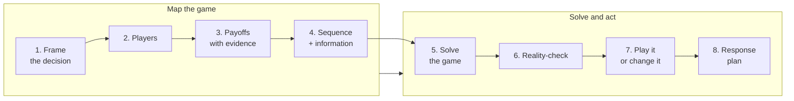

#  game-theory-for-decisions (open skill)

**A decision procedure for situations where other people get a move.** This skill turns game theory into a map an agent or operator can build, check, and act on — without inventing payoffs or treating an equilibrium as a prophecy.

##  What this is

An **open, agent-oriented skill** for negotiations, competition, partnerships, incentives, auctions, and other interdependent decisions.

Most summaries teach labels: Nash equilibrium, Prisoner's Dilemma, zero-sum game. This skill starts with the real decision and asks:

1. Who else can change the outcome?
2. What does each player gain, lose, and fear?
3. Who moves when, and who knows what?
4. Which threats and promises are credible?
5. Should we play this game — or change it?

Three disciplines make this version different:

1.  **Evidence labels travel with the map** — player facts are marked observed, declared, inferred, or unknown. Payoffs are marked measured, declared, inferred, or unknown.
2.  **No fake precision** — exact numbers need a source. When the evidence supports only a ranking, the skill uses a ranking.
3.  **Change the game is a first-class answer** — Players, Added values, Rules, Tactics, and Scope (PARTS) sit beside best-response analysis, not after it as an afterthought.

##  Who it is for

| Audience | Use |
| --- | --- |
| **Founders / operators** | Negotiations, competitor responses, partnerships, pricing, hiring, and incentive design |
| **Investors / deal teams** | Bid processes, coalition value, outside options, information discipline, and walk-away choices |
| **Managers** | Compensation, quotas, internal contests, decision rights, and rules that shape behavior |
| **AI agents** | Load `SKILL.md`, map one decision, and return a checked recommendation with a response plan — never an unsourced read of another person's mind |
| **Maintainers** | Refresh `references/` when sources change, bump `version` in `SKILL.md`, and record the change in `CHANGELOG.md` |

##  Process at a glance

##  How to use with an agent

1. **Load** [`SKILL.md`](./SKILL.md) as the skill.
2. **Name one decision** and its success measure. The skill runs on one game at a time.
3. **Pull references by branch:**

| Need | Read |
| --- | --- |
| Concepts in plain words |  [`references/core-concepts.md`](./references/core-concepts.md) |
| Build the map |  [`references/game-mapping.md`](./references/game-mapping.md) |
| Solve a matrix or tree |  [`references/solution-methods.md`](./references/solution-methods.md) |
| Commitments, signals, hidden information |  [`references/commitments-signals-and-information.md`](./references/commitments-signals-and-information.md) |
| Ongoing relationships |  [`references/repeated-games-and-cooperation.md`](./references/repeated-games-and-cooperation.md) |
| Reshape a bad game |  [`references/changing-the-game.md`](./references/changing-the-game.md) |
| Auctions and rule design |  [`references/mechanisms-and-auctions.md`](./references/mechanisms-and-auctions.md) |
| Human behavior check |  [`references/behavioral-reality-check.md`](./references/behavioral-reality-check.md) |
| Complete examples |  [`references/worked-examples.md`](./references/worked-examples.md) |
| Failure modes |  [`references/anti-patterns.md`](./references/anti-patterns.md) |
| Sources and URLs |  [`references/sources-and-urls.md`](./references/sources-and-urls.md) |

4. **Hold the guardrails.** Private reservation values, deadlines, alternatives, and process standing stay private unless the user approves disclosure. The skill recommends; it does not send, sign, pay, threaten, or commit on its own.

##  Folder map

| Path | One line |
| --- | --- |
| [`SKILL.md`](./SKILL.md) | Main skill: triggers, guardrails, eight-step procedure, fast mode, output standard, verification checklist |
| [`CHANGELOG.md`](./CHANGELOG.md) | Version history |
| [`references/README.md`](./references/README.md) | Index of the reference files |
| [`references/core-concepts.md`](./references/core-concepts.md) | The minimum concept set, defined by the decision each concept changes |
| [`references/game-mapping.md`](./references/game-mapping.md) | Fill-in canvases for the decision, players, payoffs, sequence, and information |
| [`references/solution-methods.md`](./references/solution-methods.md) | Dominance, best response, equilibrium, backward induction, credibility, mixed strategies, focal points |
| [`references/commitments-signals-and-information.md`](./references/commitments-signals-and-information.md) | Strategic moves, commitments, costly signals, screening, adverse selection, moral hazard |
| [`references/repeated-games-and-cooperation.md`](./references/repeated-games-and-cooperation.md) | Repetition, reciprocity, reputation, end-game effects, stable cooperation |
| [`references/changing-the-game.md`](./references/changing-the-game.md) | Value Net and PARTS: reshape players, added values, rules, tactics, and scope |
| [`references/mechanisms-and-auctions.md`](./references/mechanisms-and-auctions.md) | Mechanism design, auction formats, incentive compatibility, winner's curse |
| [`references/behavioral-reality-check.md`](./references/behavioral-reality-check.md) | Experimental corrections to the rational-actor model |
| [`references/worked-examples.md`](./references/worked-examples.md) | Eight complete fictional examples with reasoning traces |
| [`references/anti-patterns.md`](./references/anti-patterns.md) | The ways game-theory analysis goes wrong, and the correction for each |
| [`references/sources-and-urls.md`](./references/sources-and-urls.md) | Tiered source credits and URLs |
| [`assets/icons/`](./assets/icons/) | Hugeicons Free SVG icons used in the documents |

##  Sources and credits

- The public anchor is Farnam Street's [“Mental Model: Game Theory”](https://fs.blog/mental-model-game-theory/).
- The main book is Dixit and Nalebuff, *Thinking Strategically*.
- The teaching spine is Ben Polak's Yale ECON 159, *Game Theory*.
- Foundations come from von Neumann and Morgenstern, Nash, Harsanyi, Selten, and Schelling.
- Applied branches draw on Brandenburger and Nalebuff, Axelrod, the Stanford game-theory courses, and Milgrom.
- The reality check draws on Camerer's behavioral game theory.
- Content is **paraphrased**. No copyrighted book or lecture text is stored in this folder.
- Full credits: [`references/sources-and-urls.md`](./references/sources-and-urls.md).

##  Contributing

- Open a PR with a better paraphrase, a new public source, or a worked example with honest payoff evidence.
- Keep the folder grep-clean: no personal, company, or live-deal details inside the skill.
- When a source changes, re-read it, re-paraphrase, bump `version` in `SKILL.md`, and add a `CHANGELOG.md` entry.

## License

MIT — see [`SKILL.md`](./SKILL.md) front matter. Third-party sources remain under their publishers' terms.

## Version

Current skill version: see `version` in [`SKILL.md`](./SKILL.md) front matter. History: [`CHANGELOG.md`](./CHANGELOG.md).
