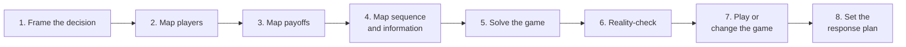

#  game-theory-for-decisions

> **How to read this**
>
> - **Agents:** Follow **Agent guardrails** and the **Core procedure** literally. Label the evidence behind every player, payoff, and belief. Do not invent precision to complete a table.
> - **Humans:** Run the procedure on one decision at a time. Open `references/` when a branch needs depth: hidden information, repeated play, auctions, or changing the game.
> - **Index:** [`references/README.md`](references/README.md) · **Public overview:** [`README.md`](README.md)

**Not a substitute for domain expertise.** This skill structures strategic decisions. It does not replace legal, financial, tax, medical, or other licensed advice. It must not be used to design collusion, deception, coercion, bid rigging, or market manipulation.

## Sources

The public anchor is Farnam Street's [“Mental Model: Game Theory”](https://fs.blog/mental-model-game-theory/). The main book is Avinash K. Dixit and Barry J. Nalebuff, *Thinking Strategically*. The teaching spine is Ben Polak's Yale ECON 159 course. Full credits and source tiers are in [`references/sources-and-urls.md`](references/sources-and-urls.md).

## When to use

Use this skill when a **founder**, **operator**, **negotiator**, **manager**, **investor**, or delegated agent faces a decision whose result depends on another actor's response:

- A negotiation, bid, offer, counteroffer, deadline, or walk-away choice.
- A fundraising, sale, licensing, or partnership process with several parties.
- A competitor's price move, launch, hire, partnership, or market entry.
- A relationship where one party is a customer, supplier, competitor, and complementor at the same time.
- A hiring offer, compensation plan, sales quota, or other incentive design.
- A procurement process, auction, tender, or marketplace rule set.
- A contract, enforcement, or dispute decision where the other side will react.
- A platform or policy change where users will adapt to the new rules.
- A coalition problem: who must agree, who can block, and who adds the most value.
- A repeated relationship where today's move changes tomorrow's trust, reputation, or retaliation.

## When NOT to use

Game theory is the wrong tool when no strategic response matters.

Do **not** use this skill when:

- **One actor decides alone.** If no other actor's choice changes the result, use normal decision analysis or `first-principles-thinking`.
- **Chance matters, but no actor responds.** A weather risk or equipment failure is probability, not a game.
- **The decision is small, urgent, and easy to reverse.** Give the short answer. Do not spend an hour modeling a five-minute choice.
- **The user asks for manipulation.** Do not design collusion, deception, bribery, coercive threats, bid rigging, hidden conflicts, or market manipulation.
- **A person's motive is the real question.** This skill models incentives and observed behavior. It does not prove what a person secretly thinks.
- **A binding rule already decides the matter.** Law, regulation, contract, and safety rules are constraints. Model choices inside them, not ways around them.

Rule of thumb: use the full procedure when the decision is expensive, hard to reverse, repeated, or likely to trigger a strong response.

## Agent guardrails

1. **No mind reading.** State a player's objective only from evidence: what they did, what they said, what their role rewards, or what their constraints force. Label a motive claim `inferred` when it is not directly supported.
2. **Evidence has four labels.** Mark player facts as `observed`, `declared`, `inferred`, or `unknown`. Mark payoffs as `measured`, `declared`, `inferred`, or `unknown`. Use the label every time the fact matters.
3. **No fake precision.** Use exact numbers only when a source gives them. Use ranges when the evidence supports a range. Use ranked outcomes when numbers would mislead: best, acceptable, bad, worst.
4. **Payoffs are wider than money.** Include time, risk, status, control, learning, option value, and reputation when they affect a choice. Keep unlike payoffs visible. Do not hide them inside an invented total score.
5. **Equilibrium is not prophecy.** A Nash equilibrium — a set of choices where no player gains by changing alone — is a result inside the model. It holds only while the players, payoffs, information, and rules in the model hold.
6. **Test credibility at execution time.** A threat or promise counts only if the player would still choose to carry it out when the time comes, or has made a real commitment that changes that choice. This check removes empty threats and promises.
7. **Always check the repeated game.** If the parties will meet again, include retaliation, learning, trust, and reputation in the payoff. Do not give one-shot advice for a repeated relationship.
8. **Look for the non-zero-sum move first.** Many business games are mixed-motive: part conflict, part shared gain. Before escalating, test whether a rule, sequence, or scope change can grow the total value or reduce needless loss.
9. **Protect private information.** Do not reveal the user's reservation value, real deadline, alternatives, internal disagreement, financial pressure, or standing in a process unless the user approves that disclosure. When this skill supports a negotiation draft, run the `fundraising` guardrails as well.
10. **Sources have owners.** A price, deadline, claim, or term belongs to the player or document that supplied it. Do not move one player's figure onto another player from memory.
11. **Law and ethics are hard constraints.** Do not help coordinate prices with competitors, rig a bid, deceive a counterparty about a material fact, threaten unlawful harm, or hide a conflict that the user has a duty to disclose. Name the constraint and stop that branch.
12. **Write plain.** Use short sentences. Use one idea per sentence. Gloss each technical term in plain words on first use. A reasoning trace line is one sentence.
13. **Name what would change the answer.** Every recommendation names the two or three assumptions that matter most and the evidence that would flip it.
14. **Recommend, do not commit.** The skill may draft a move, offer, or reply. Only the user can approve an external commitment, message, signature, payment, or disclosure.
15. **Count the threats already spent.** A threat's value is its track record. Before issuing a deadline or warning, count how many times it has already been issued and not executed. After two unexecuted rounds, the next message is not a stronger threat. It is evidence the threat is empty. Either execute, change the consequence, or stop threatening.
16. **Run the cheapest-compliance test.** Price the cheapest way the other side could comply or settle. If that cost is trivial next to the dispute and they still refuse, the payoff map is wrong. They are protecting something the map has not named — an admission, a precedent, an asset that is not there. Find it before recommending.

## The one idea

A **game** is a decision where each actor's best choice depends on what the others choose.

Ordinary planning often asks, “What should we do?” Game theory asks four harder questions:

1. Who else gets a move?
2. What does each player gain or lose from each path?
3. Who knows what, and who moves when?
4. Can we change the game instead of only playing it?

The skill has two disciplines that summaries often skip:

- **Claims carry evidence.** A payoff table built on guesses is a guess with grid lines.
- **The game can be changed.** Players, added values, rules, tactics, and scope are design choices in many business settings. This is the PARTS frame from Brandenburger and Nalebuff: **Players, Added values, Rules, Tactics, Scope**.

---

## Core procedure

Run all eight steps, in order, on **one** named decision. Use the short form in **Fast mode** only when the stakes are low or time is short.

### 1 — Frame the decision

Write down:

- The decision to make.
- The decision owner.
- The number or outcome that defines success.
- The deadline.
- What happens if nobody acts.
- Whether the decision is one-shot or repeated.
- Whether the move can be reversed.
- The other live games that share a player, a deadline, cash, or reputation with this one. Credibility, cash, and reputation are spent across games, not inside one game. A deadline enforced in one negotiation buys belief in the others. A deadline that slips in one taxes all of them.

Give the decision one sentence. “Choose whether to accept Supplier A's renewal by Friday” is usable. “Handle the supplier issue” is not.

**Stop gate:** If no other actor's choice can change the result, stop. Say that this is not a game-theory problem and name the better tool.

Deep reference: [`references/game-mapping.md`](references/game-mapping.md).

### 2 — Map the players

List every actor who can change the outcome. Give each one an ID: **P1, P2, …**.

Look past the obvious counterparty:

- The person across the table.
- The person who must approve their choice.
- A person who can veto, delay, or leak the decision.
- Customers, suppliers, competitors, and complementors — parties whose product or service makes the user's offer worth more.
- A regulator, platform, court, marketplace, or other rule maker.
- A future entrant who arrives after the first move.
- An internal team whose metric rewards a different outcome.

Group players only when they share objectives, information, and constraints. A “sales team” is not one player if its manager is paid on revenue and its representatives are paid on margin.

An observer counts as a player only if they can change a payoff. An audience that will merely *know* — a neighboring negotiation's counterparty, a trade press reader, a community watching from outside — is context, not a player. Name real observers and their actual lever, or leave them off the map. A dramatic audience inflates the analysis and taxes moves that were never really taxed.

For each player record:

| Field | What to write |
| --- | --- |
| Objective | The outcome the player is trying to reach |
| Options | Moves the player can actually make |
| Constraints | Money, time, authority, rules, capacity, reputation |
| Outside option | What the player gets if this game ends — their BATNA, or best alternative to a negotiated agreement |
| Evidence | `observed`, `declared`, `inferred`, or `unknown` |

Deep reference: [`references/game-mapping.md`](references/game-mapping.md).

### 3 — Map the payoffs

Build the outcome table before choosing a move.

A payoff is everything a player values in an outcome, not only cash. Include money, time, risk, status, control, learning, option value, and reputation when they matter.

Rules:

- Separate **stated goals** from **revealed incentives**. A buyer may say “partnership” and still be rewarded only for a lower price.
- Keep each player's payoff in that player's terms. Do not assume both sides value the same thing.
- Use exact values only when they are `measured` or `declared`.
- Use ranges for supported uncertainty.
- Use ordinal ranks when the honest answer is “better or worse, amount unknown.”
- Mark every material payoff `measured`, `declared`, `inferred`, or `unknown`.
- Name the payoff assumption that would flip the recommendation.
- Mark each player's outside-option trend: rising, flat, or decaying while the game is played — and who controls the rate. A BATNA is not a snapshot. A seller whose cash runs down has a decaying outside option, and every week of delay is a move by the other side.

Do not force a result by filling empty cells with plausible numbers. An incomplete map with honest gaps is better than a complete map built on invention.

Deep references: [`references/core-concepts.md`](references/core-concepts.md) and [`references/game-mapping.md`](references/game-mapping.md).

### 4 — Map sequence and information

Write the order of play:

- Who moves first?
- Who sees that move before responding?
- Who moves last?
- Which choices happen at the same time?
- What does each player know at each point?
- What is hidden?
- What can be signaled — shown through an action that carries information?
- What can be screened — learned by offering choices that lead different types of players to reveal themselves?
- Can a player commit in a costly or hard-to-reverse way?
- Does the game repeat? Will the players remember?

Choose the smallest model that fits:

| Structure | Use |
| --- | --- |
| Few players, simultaneous moves | Payoff matrix |
| Moves in sequence | Game tree |
| Hidden type or hidden facts | Bayesian game, signaling, or screening |
| Ongoing relationship | Repeated-game analysis |
| Rules are yours to design | Mechanism design or auction analysis |
| Several parties must agree | Coalition and added-value analysis |
| Business setting can be reshaped | Value Net and PARTS |

A **Bayesian game** is a game where at least one player does not know another player's type — for example, whether a buyer has a strong or weak outside option. Model the plausible types and beliefs. Do not pretend the hidden type is known.

Deep references: [`references/game-mapping.md`](references/game-mapping.md), [`references/commitments-signals-and-information.md`](references/commitments-signals-and-information.md), and [`references/mechanisms-and-auctions.md`](references/mechanisms-and-auctions.md).

### 5 — Solve the game as written

Use only the tools the structure needs.

1. **Remove dominated options.** A dominated option is worse than another option no matter what the other players do. Remove strictly dominated options first.
2. **Find best responses.** A best response is a player's best move against a stated move by the others.
3. **Find Nash equilibria.** Mark each outcome where every player is already playing a best response.
4. **Work backward in sequence.** In a game tree, start at the last choice. Ask what that player will choose. Roll that answer back to the earlier choice. This is backward induction.
5. **Remove non-credible branches.** If an outcome rests on a threat or promise the player would not carry out at that point, remove it. The result is a subgame-perfect outcome: an outcome that stays rational at every later point in the game.
6. **Use mixed strategies only when randomness has value.** A mixed strategy means choosing moves with stated probabilities so the other side cannot exploit a pattern. Use it for audits, inspections, security checks, and some pricing or sports cases. Do not use it to avoid making a clear business choice.
7. **Handle multiple equilibria.** If more than one stable outcome remains, compare risk, precedent, fairness, and focal points. A focal point is an outcome both sides notice for a shared reason, such as an equal split, a round number, a deadline, or an existing standard.
8. **Run the cheapest-compliance test.** Price the cheapest action that would settle the matter for the other side. If it is trivial and they still refuse, stop solving. The map is missing their real payoff. Name candidates — avoiding an admission, avoiding a precedent, an asset that does not exist, an internal career cost — and state what evidence would separate them.

State the likely outcome and the path that leads to it. Name the assumptions under the result.

Deep reference: [`references/solution-methods.md`](references/solution-methods.md).

### 6 — Reality-check the solution

The formal answer assumes that players understand the game and choose their best payoff. Real players often do not.

Check:

- **Limited reasoning depth.** Many people reason one or two steps ahead, not ten.
- **Social payoffs.** Fairness, reciprocity, pride, anger, and trust can change a choice.
- **Loss and risk.** A player may protect a small certain loss more strongly than they chase a larger uncertain gain.
- **Bad information.** A player may act on a false belief, a rumor, or a metric that does not match the real goal.
- **Internal agency.** An employee may optimize the metric they are paid on, not the employer's stated objective.
- **Learning.** Players update after each round. A move that works once may teach the other side how to beat it.
- **Reputation.** A win gained by surprise or pressure may cost more in later games than it earns now.
- **Changing payoffs.** Prices, authority, outside options, and deadlines may move during the game.
- **Preconditions exist.** For every move the run may recommend, name what must already be true for that move to be possible: a product live, a document signed, cash in hand, a right actually held, revenue that exists. If the precondition does not exist today, the move is not a recommendation. It is a scheduled step. The plan must say what creates the precondition and when. A buyback funded by fees from a product that has not launched is not a move. It is a date, and the analysis must treat it as one.

Run a sensitivity check. List the two or three assumptions that carry the recommendation. State what evidence would change each one.

Deep reference: [`references/behavioral-reality-check.md`](references/behavioral-reality-check.md).

### 7 — Choose: play the game or change it

First name the **best response** if the game stays fixed.

Then test the five PARTS levers:

- **Players.** Add a bidder, approver, partner, or referee. Remove a needless veto. Split a coalition. Sequence players so the right one moves first.
- **Added values.** Added value is the total value with a player in the game minus the total value without that player. Raise the user's added value. Build a better outside option. Reduce dependence on a player whose added value gives them too much bargaining power.
- **Rules.** Change the deadline, bid format, decision right, default, evidence standard, enforcement step, or information release — when the user has the right to change it.
- **Tactics.** Change what other players believe with truthful evidence: a working product, a reference, a public standard, a transparent criterion, or a real commitment. Tactics change perception. They do not license false claims.
- **Scope.** Link two issues into one bargain. Split one hard bargain into smaller parts. Extend the time horizon to support cooperation. Shorten it to limit exposure. Exit a game whose best available outcome is still bad.

Return three answers:

1. The best move if the game stays fixed.
2. The best move that changes the game, if one exists.
3. The move not to make, with the reason.

Deep reference: [`references/changing-the-game.md`](references/changing-the-game.md).

### 8 — Set the response plan

A recommendation is not complete until the next round is planned.

Write:

- The first move.
- The **information calendar**: dated future events that would change this table — a reply deadline, a decision date, money arriving or running out, a contract expiry. Price the wait to the next event. When the next event is near and decisive, the best move is often a dated decision to decide after it. Waiting is a move. Treat it as one, with a date and a trigger, not as drift.
- The response the user expects.
- The reply to the two most likely countermoves.
- The signal that shows the model is wrong.
- The trigger to pause, gather evidence, or change the game.
- The walk-away point.
- The information that must stay private.
- The owner and the next action.

If the other side does something outside the model, stop and remap the game. Do not defend the old map.

---

## Fast mode

Use fast mode for a small decision or a live exchange. Answer five questions:

1. Who else gets a move?
2. What does each side gain, lose, and fear?
3. Who moves next, and what do they know?
4. Is any threat or promise here not credible?
5. What is our best reply, and what reply will it trigger?

Fast mode still requires evidence labels and the privacy guardrail. It does not permit invented payoffs.

## Output standard

A full run returns these sections, in this order:

0. **Verdict** — three lines only: the decision, the recommendation, and the next physical action with its owner. The decision owner can act on the verdict alone. The sections below are the audit trail.
1. **Decision** — the choice, success measure, deadline, type of game, and the shared accounts it draws on: credibility, cash, reputation.
2. **Game in one sentence** — the players, the conflict, and the shared gain, if any.
3. **Player map** — P1, P2, … with objectives, options, constraints, outside options, and evidence labels.
4. **Sequence and information map** — order of moves, knowledge, hidden facts, signals, and repeat structure.
5. **Payoff map** — a matrix, tree, or ranked outcome list. Every material payoff carries its provenance label.
6. **Solution** — best responses, likely outcome, equilibrium or branch result, and credibility checks.
7. **Reality check** — behavior risks, model limits, and sensitivity.
8. **Recommendation** — best response, game-changing move, and no-go move.
9. **Response plan** — the information calendar, countermoves, triggers, walk-away point, private information, owner, and next action.
10. **Reasoning trace** — one short sentence per conclusion. Cite the player ID, payoff label, or sequence fact behind it. Mark judgment calls with `judgment`.
11. **Unknowns that matter** — the smallest evidence that would change the decision.

## Verification checklist

Before delivering a full run, check:

- [ ] Another actor can change the outcome. If not, the run stopped at Step 1.
- [ ] Every direct, veto, and future player was considered.
- [ ] Stated goals and revealed incentives are separate.
- [ ] No payoff number lacks a source or an `inferred` label.
- [ ] The order of moves and the information at each move are explicit.
- [ ] Every threat and promise passed the execution-time credibility test.
- [ ] Prior unexecuted threats and deadlines were counted before a new one was recommended.
- [ ] The cheapest-compliance test was run, or the run says why it does not apply.
- [ ] Shared games drawing on the same credibility, cash, or reputation were named.
- [ ] Every outside option carries a trend: rising, flat, or decaying.
- [ ] The information calendar was priced before the recommendation was made.
- [ ] Every named observer can actually change a payoff, or was removed from the player map.
- [ ] Every recommended move's preconditions exist today, or the move is scheduled with the step that creates them.
- [ ] A repeated relationship was treated as a repeated game.
- [ ] At least one non-zero-sum or game-changing option was tested when the rules were not fixed.
- [ ] The recommendation names its key assumptions and flip evidence.
- [ ] Private values, deadlines, alternatives, and process standing were not disclosed.
- [ ] No branch requires an illegal, deceptive, or coercive act.
- [ ] The final answer is plain enough for the decision owner to act on.

## Worked examples and failure modes

- Worked examples: [`references/worked-examples.md`](references/worked-examples.md)
- Failure modes: [`references/anti-patterns.md`](references/anti-patterns.md)
- Concept depth: [`references/core-concepts.md`](references/core-concepts.md)
