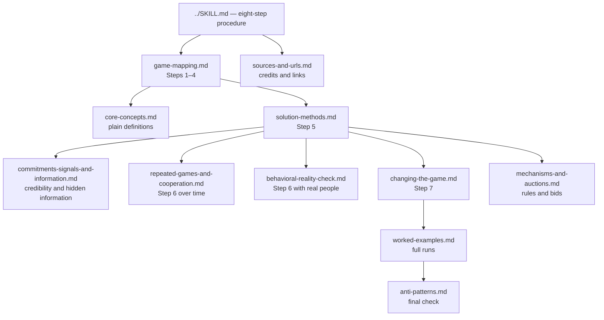

# References index — Game Theory for Decisions

These references support **Game Theory for Decisions**, version **1.0.0**. The main `../SKILL.md` holds the eight-step procedure. These files
hold the concepts, canvases, methods, and checks needed to run it well.

Read the main skill first. Open a reference when the decision needs depth.
Do not load every file by default. A small decision may need only the mapping
canvas and one solution method.

## Reference map

| File | Use it for | Main steps |
| --- | --- | --- |
| [`core-concepts.md`](./core-concepts.md) | The minimum vocabulary. Each term is defined by the decision it changes. | 2–6 |
| [`game-mapping.md`](./game-mapping.md) | Fill-in canvases for the decision, players, payoffs, sequence, information, and unknowns. | 1–4, 8 |
| [`solution-methods.md`](./solution-methods.md) | Dominance, best response, Nash equilibrium, backward induction, credibility, mixed strategies, and multiple equilibria. | 5 |
| [`commitments-signals-and-information.md`](./commitments-signals-and-information.md) | Promises, threats, commitment devices, signals, screening, adverse selection, and moral hazard. | 4–7 |
| [`repeated-games-and-cooperation.md`](./repeated-games-and-cooperation.md) | Reputation, reciprocity, retaliation, trust, end-game effects, and stable cooperation. | 4–8 |
| [`changing-the-game.md`](./changing-the-game.md) | The Value Net and PARTS. Change players, added values, rules, tactics, or scope. | 7 |
| [`mechanisms-and-auctions.md`](./mechanisms-and-auctions.md) | Design rules, incentives, bids, allocations, and safeguards before people act. | 4, 5, 7 |
| [`behavioral-reality-check.md`](./behavioral-reality-check.md) | Fairness, emotion, limited reasoning, learning, social preferences, and other departures from perfect rationality. | 6 |
| [`worked-examples.md`](./worked-examples.md) | Complete generic examples with maps, solutions, traces, and response plans. | 1–8 |
| [`anti-patterns.md`](./anti-patterns.md) | The final failure check. It catches fake precision, mind reading, bad threats, and one-shot advice in repeated games. | 5–8 |
| [`sources-and-urls.md`](./sources-and-urls.md) | The source table. It credits the books, papers, courses, and articles behind the skill. | All |

## Choose a reading path

### A basic negotiation or offer

Read [`game-mapping.md`](./game-mapping.md), then the dominance, best
response, and credibility sections of
[`solution-methods.md`](./solution-methods.md). Add
[`commitments-signals-and-information.md`](./commitments-signals-and-information.md)
when a deadline, promise, or threat matters. Add
[`repeated-games-and-cooperation.md`](./repeated-games-and-cooperation.md)
when the relationship will continue.

### A sequential decision

Map the order of moves in [`game-mapping.md`](./game-mapping.md). Solve the
tree with backward induction in
[`solution-methods.md`](./solution-methods.md). Test every later threat or
promise at the time it would have to be carried out.

### A decision with hidden information

Start with the information canvas in
[`game-mapping.md`](./game-mapping.md). Then read
[`commitments-signals-and-information.md`](./commitments-signals-and-information.md).
Separate what is known, what is claimed, what is signaled, and what remains
unknown. Do not convert a suspicion into a player type without evidence.

### A continuing relationship

Use [`repeated-games-and-cooperation.md`](./repeated-games-and-cooperation.md)
before accepting a one-round answer. A move changes future payoffs when the
other side can remember, retaliate, learn, or lose trust.

### A bad game that may be changed

Solve the current game first. Then use
[`changing-the-game.md`](./changing-the-game.md). The comparison matters. A
game-changing move is useful only if it beats the best move inside the
current rules.

### A rule, marketplace, incentive plan, or auction

Use [`mechanisms-and-auctions.md`](./mechanisms-and-auctions.md). Start from
the behavior the rule will reward. Then test gaming, collusion risk, adverse
selection, enforcement cost, and the outcome for players who were not in the
room when the rule was written.

## Shared labels and IDs

Use the same labels in every file and every output.

### Player IDs

Give each player a stable ID: **P1**, **P2**, **P3**, and so on. Use the ID
in the player map, payoff map, solution, trace, and response plan. Do not
change IDs in the middle of an analysis.

Group players only when they share four things:

- The same objective.
- The same available moves.
- The same key information.
- The same binding constraint.

If one member can veto the group, model that member separately.

### Player-fact evidence

Label each important player fact with one of these terms:

- **Observed** — seen in behavior, records, or a completed action.
- **Declared** — stated by the player or an authorized source.
- **Inferred** — reasoned from evidence. Name the evidence.
- **Unknown** — not established. Leave the gap visible.

An inference is not a fact. A declared goal is not proof of a real goal.
Observed behavior usually deserves more weight than a speech, but one action
can still have several causes.

### Payoff provenance

Label each payoff with one of these terms:

- **Measured** — taken from a price, record, contract, test, or other source
  that can be checked.
- **Declared** — stated by a player as their value, cost, limit, or goal.
- **Inferred** — estimated from choices, constraints, or comparable cases.
- **Unknown** — not known well enough to rank or calculate.

Use exact numbers only when the source supports them. Use ranges when a
range is honest. Use ranks such as best, acceptable, bad, and worst when
numbers would create false precision.

### Reasoning trace

Use short trace lines. Each line states one conclusion. Each line cites the
player, payoff, sequence, or unknown that supports it. Mark a conclusion
`judgment` when the evidence does not settle it.

Example shape:

- `P2 has a usable outside option because its current contract can end in 30 days (declared).`
- `The launch delay is credible because P1 has already paid the launch cost (observed).`
- `P3 will likely protect margin before volume (inferred from its last three price moves). judgment`

## Source approach

The skill paraphrases its sources. It does not store book or lecture text.
The public anchor is Farnam Street's game-theory mental-model page. The main
operator book is Dixit and Nalebuff's *Thinking Strategically*. The teaching
spine is Ben Polak's Yale ECON 159 course. Formal claims are checked against
Gibbons and against Osborne and Rubinstein. Applied branches draw on
Schelling, Brandenburger and Nalebuff, Axelrod, Stanford's game-theory
courses, and Milgrom. Camerer supplies the behavioral check. See
[`sources-and-urls.md`](./sources-and-urls.md) for the full table.

## Working rule for agents

Start a live decision with the mapping canvas, not with a lecture on terms.
Ask only for missing facts that could change the move. If a fact cannot be
checked before the deadline, mark it **unknown** and give a conditional
recommendation. Keep the analysis internal when it contains reservation
values, private deadlines, process standing, or a planned sequence of moves.
An external draft needs a separate disclosure check. A correct game map can
still cause harm if it reveals the user's fallback, urgency, or lack of an
alternative. Load depth in proportion to the stakes, the reversal cost, and
the time available.

## Quality gate

Before an analysis leaves the reference stage, check these points:

- Another actor can truly change the outcome.
- Every material player has an ID and an evidence label.
- Every material payoff has a provenance label.
- The order of moves is explicit.
- Hidden information is not treated as known information.
- Each threat and promise passes an execution-time credibility test.
- A repeated relationship is not solved as a one-shot game.
- The answer gives the best current move and checks whether the game can be
  changed.
- The response plan names countermoves, triggers, and a walk-away point.
- Private reservation values and process details stay private.
