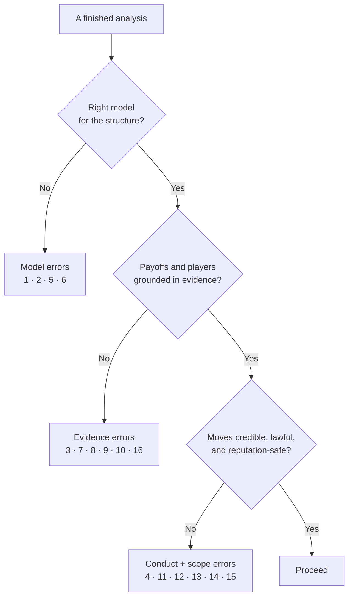

#  Anti-patterns — how game-theory analysis goes wrong

Game theory fails in predictable ways, usually by sounding more rigorous
than it is. Run this file as a check whenever an analysis feels decisive.
Each entry gives the failure's shape and the correction move. Entries 1–6
corrupt the model. Entries 7–10 corrupt the evidence. Entries 11–14 corrupt
the conduct and the scope. Entries 15–16 corrupt time: the credibility of
the next threat, and the value of the next option. Real failures usually stack two or three at
once: invented numbers (3) inside the wrong model (1), defended by a threat
nobody believes (4).

## 1. The Prisoner's Dilemma reflex

**Shape:** Every conflict gets squeezed into a two-by-two defection matrix.
Negotiations, partnerships, pricing — all become cooperate-versus-defect,
because that is the one game the analyst knows.

**Correction:** Test the three conditions before using the model: one-shot
play, no communication, and defection dominating for both sides. If any
condition fails, the situation is a different game — a repeated game, a
bargaining problem, or a coordination problem — and needs its matching
method from `solution-methods.md`.

## 2. Zero-sum by default

**Shape:** The analysis assumes the pie is fixed, so every gain for the
other side is scored as our loss. Mixed-motive situations — most real
negotiations — get fought like wars.

**Correction:** Ask the mixed-motive question first: what outcome leaves
both sides better off than no deal? Run the PARTS check in
`changing-the-game.md` before competing over shares. Bargaining over a
growing pie and fighting over a fixed one are different skills.

## 3. Invented payoff numbers

**Shape:** A matrix filled with 7.3 against 4.85, probabilities quoted to
the decimal, a "62% chance they fold." None of the numbers came from
anywhere. The precision is decoration, and it launders guesses into facts.

**Correction:** Use the provenance labels without mercy. Exact numbers only
from a source. Ranges when evidence supports a range. Ordinal ranks — Best,
Good, Poor, Worst — when it does not. If a conclusion dies when a made-up
number is removed, the conclusion was the number.

## 4. Threats that fail at execution time

**Shape:** "Accept by Friday or we walk." "Match that price and we will
undercut you forever." Big statements the maker would not rationally carry
out when Friday arrives. The other side prices the bluff correctly and
calls it.

**Correction:** Apply Selten's test at the moment of execution: does
carrying out the threat still pay, then? If not, either build a real
commitment that changes the payoff — a signed alternative, a public pledge,
a contractual trigger — or drop the threat and negotiate honestly.

## 5. One-shot advice in a repeated game

**Shape:** Squeeze the supplier, burn the partner, win the quarter. The
analysis ends at the transaction and never prices the next ten rounds, the
retaliation, or the story the market will tell about us.

**Correction:** Run Axelrod's check: will we meet this player again, and
will others hear about this round? If yes, reputation is a payoff line in
the matrix, not a footnote. Moves that win once and lose repeatedly are
losses. See `repeated-games-and-cooperation.md`.

## 6. Equilibrium treated as prophecy

**Shape:** "The Nash equilibrium is X," stated as a forecast. Forgotten:
most interesting games have several equilibria, and each one is a
conditional result inside a model the analyst chose.

**Correction:** List every equilibrium found, the assumptions each rests
on, and what selects among them — precedent, focal points, relative risk.
Present the likely outcome as a judgment with its reasoning trace, never as
a theorem about the future.

## 7. The stupid-opponent model

**Shape:** Our plan is brilliant because the other side will not notice,
will not adapt, and will keep playing last year's strategy while we change
ours. Somehow they are always one level of thinking below us.

**Correction:** Default every player to our own level of cleverness. Before
finalizing any move, write the other side's best response to it in their
own payoff terms. If the plan only works against an opponent who does not
respond, it does not work. See `behavioral-reality-check.md` for how much
strategic depth real people actually use — it cuts both ways.

## 8. Mind reading

**Shape:** "They only offered that to humiliate us." "Their CEO is
desperate." Hidden motives asserted from one ambiguous email, a rumor, or a
negotiating style. The analysis then optimizes against a fictional person.

**Correction:** Model incentives, constraints, and outside options — things
evidence can touch. A motive claim needs the same provenance label as a
payoff: measured, declared, inferred, or unknown. Unknown motives get
scenarios, not conclusions.

## 9. Missing players

**Shape:** The map has two negotiators and nobody else. Absent: the
committee that must approve their deal, the regulator who can void it, the
internal team that bears its cost, the competitor who enters next quarter.
The missing player then decides the outcome from offstage.

**Correction:** Before solving, ask three questions. Who can block this?
Who enters after the first move? Who pays for it without sitting at the
table? Add each as a player ID, or write down why none exist. The
acceptance tests in `../SKILL.md` treat an unexplained empty chair as an
unfinished analysis.

## 10. Stated goals taken at face value

**Shape:** The other side's payoff function is copied from its press
release, mission statement, or opening speech. Meanwhile its actual
behavior — what its people are paid on, what it did in the last three
deals — points somewhere else entirely.

**Correction:** Keep two columns: declared goals and revealed incentives.
Where they differ, weight revealed behavior more heavily, and say so in the
output. A player's bonus plan is usually a better payoff table than its
brochure.

## 11. Winning the move, wrecking the game

**Shape:** A tactic that takes this round — a humiliating concession
extracted, a loophole exploited, a partner cornered — and poisons every
later round: retaliation, exit, a reputation that precedes us into the next
negotiation with someone else entirely.

**Correction:** Score the move at the level of the whole game, including
rounds not yet scheduled and observers not yet at the table. If the move
only pays under the assumption that nobody remembers it, it does not pay.

## 12. Leaking your own position

**Shape:** We tell a bidder it is "running second," mention our deadline
pressure, name our walk-away price "so they understand us," or admit the
board has already decided to sell. Each disclosure feels like candor. Each
one rewrites the other side's best response against us.

**Correction:** Treat every disclosure as a move in the game, because it
is. Share process facts — deadlines, steps, criteria — freely. Share
position facts — reservation values, alternatives, internal disagreement,
standings — only when the user has approved that exact disclosure. This is
mandatory when the skill runs with `fundraising`.

## 13. Illegal game-changing

**Shape:** The "clever" fix is to agree with the other bidder on who wins,
signal a competitor to hold prices up, pay for a decision, or rig the
tender. It gets described in strategy language, which changes nothing about
what it is.

**Correction:** Hard stop. Collusion, bid rigging, bribery, deception, and
market manipulation are outside this method entirely — not aggressive
versions of it. The lawful version of changing the game is PARTS: different
players, more added value, better rules, truthful tactics, different scope.
If a proposed move needs secrecy from a regulator to work, it is not a
strategy. It is the end of the analysis.

## 14. The full model for a fifty-dollar decision

**Shape:** A nine-player map, three equilibrium refinements, and a
sensitivity table — built for a choice that is cheap, reversible, and due
within the hour. The analysis costs more than the decision can return. Worse,
it spends the analyst's credibility, so the method gets skipped later on the
large decisions where it would actually have paid.

**Correction:** Match the depth to the stakes, as the guardrails in
`../SKILL.md` require. For small or urgent calls, run the short form —
players, dominant responses, one credibility check — and stop. Reserve the
full eight steps for decisions that are expensive, hard to reverse, or
repeated often enough for a better answer to compound.

## 15. Deadline N+1

**Shape:** The fourth extension of a deadline that has already moved three
times, issued in firmer language than the third. The sender believes the
new wording restores the pressure. The receiver does the arithmetic
instead: issued four, executed zero.

**Correction:** Count before you write. Every deadline and consequence
gets a credibility count — how many were issued, how many were carried
out. If the count is weak, do not issue deadline N+1. Do the cheap,
credible thing the last deadline promised, or send a notice with no date
in it at all and act on your own clock. A threat's value is its track
record, and the only deposit into that account is an executed one. This is
entry 4 after a year of practice: the threat did not just fail the
execution test once — it failed it on schedule, repeatedly, in writing.

## 16. The snapshot BATNA

**Shape:** The outside option is written down once — "we can always walk
to the rival vendor," "savings cover four months" — and then treated as a
constant while the game runs for a quarter. Meanwhile it is quietly
growing or rotting: savings burn, the rival signs someone else, the
license that made walking away possible expires.

**Correction:** Give every material outside option a trend, not a
snapshot: rising, flat, or decaying, the rate if you know it, and who
controls it. Re-date the map when the trend matters more than the level.
A decaying outside option is a deadline the other side can read — plan as
if they have. See the outside-option canvas in `game-mapping.md`.

## Running this check

Do not read all sixteen entries on every run. Triage by structure.
Sequential games: check entries 4 and 5 first. Designed games — incentive
plans, tenders, platform rules: check 3, 9, and 13. Negotiations: check 10,
11, and 12. Enforcement and repeat-deadline cases: check 15 before drafting
anything. Any plan that leans on waiting: check 16. Any analysis that ends in one confident outcome: check 6 and 7.
Any analysis built on what the other side "really wants": check 8 and 10.
If two or more entries fire on the same analysis, the analysis is not
finished. It is a draft of the mistake. Fix the cheapest error first —
usually a missing player, an unlabeled payoff, or a threat that was never
tested — then re-run only the steps downstream of that fix. Most analyses
do not need to be rebuilt. They need one honest correction, applied where
the error actually sits, before the recommendation hardens into a decision
nobody remembers choosing.
