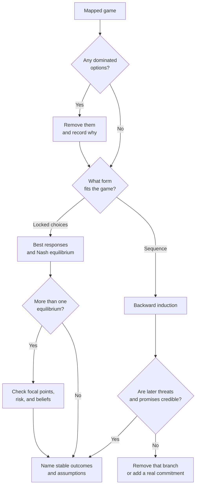

# Solution methods — solve the game as written

This file covers Step 5 of **Game Theory for Decisions**. Start with the map
from [`game-mapping.md`](./game-mapping.md). Use only the method that fits
the structure. A simple game rarely needs every tool.

A solution is a conditional statement. It says, “Under these players,
options, payoffs, information, and beliefs, this outcome is stable.” Change
one input and the answer may change.



## 1. Check dominance first

A strategy is **strictly dominant** when it gives a player a better payoff
than every other strategy, no matter what the others do. It is **weakly
dominant** when it is never worse and is better in at least one case.

A strategy is **strictly dominated** when another strategy gives a better
payoff in every case. Remove strictly dominated strategies when the payoff
map is sound. The remaining game is smaller and easier to read.

Use weak dominance with care. Deleting weakly dominated strategies can
remove an equilibrium. The result can also depend on the order of deletion.
State that the answer used weak dominance, and check whether the removed
option matters in practice.

### Miniature example

A buyer can accept standard terms or ask for a custom clause. A supplier can
accept or refuse the clause. The numbers below are ranks for each player.
Higher is better. Each cell shows “buyer rank, supplier rank.”

| Buyer \ Supplier | Accept clause | Refuse clause |
| --- | --- | --- |
| Accept standard terms | 2, 3 | 2, 3 |
| Ask for custom clause | 3, 2 | 1, 1 |

For the buyer, the custom request is not dominant. It is best if the
supplier accepts and worst if the supplier refuses. For the supplier,
standard terms lead to the same outcome either way in this simplified map.
No honest dominance claim follows. The next step is best-response analysis,
not a forced shortcut.

### Dominance warnings

- Do not delete an option until all material payoffs are in the map.
- Future reputation can turn a short-term loss into a good strategy.
- A dominated option under guessed payoffs may not be dominated in reality.
- If no player has a dominant strategy, that is a result. Move on.

## 2. Find best responses

A **best response** is a player's best strategy given the other players'
strategies. Work one player at a time. Hold the others fixed. Mark the best
payoff in each row or column. Repeat for every player.

Use this sentence pattern:

> If P2 holds price, P1's best response is to add service, because that
> outcome ranks above both a price cut and no change for P1.

Then reverse the view:

> If P1 adds service, P2's best response is to hold price, because a matching
> service offer costs more than the expected customer gain.

This two-sided check prevents a common failure. Many weak analyses find the
user's best move and assume the other player will cooperate with the plan.

## 3. Identify Nash equilibria

A strategy profile is a **Nash equilibrium** when no player can gain by
changing strategy alone. In a matrix, it is a cell where each player's choice
is a best response to the others.

Name three things with every equilibrium:

1. The strategies in the profile.
2. Why no player gains by deviating alone.
3. The map assumptions that support the payoffs.

### Coordination example

Two partners can use Standard A or Standard B. Either shared standard works.
A mismatch creates rework. Ranks are equal for both players in this simple
case.

| P1 \ P2 | Standard A | Standard B |
| --- | --- | --- |
| Standard A | 3, 3 | 1, 1 |
| Standard B | 1, 1 | 2, 2 |

Both shared outcomes are Nash equilibria. Neither player gains by switching
alone from a shared standard. Standard A pays more for both. Yet Standard B
may still occur if it is the installed precedent and each side expects the
other to stay there. That is an equilibrium-selection problem, not a lack
of equilibrium.

### What Nash equilibrium does not say

- It does not say the outcome is fair.
- It does not say the outcome uses resources well.
- It does not prove players will coordinate on it.
- It does not capture a joint deviation by a coalition.
- It does not survive a wrong payoff map.

Use [`changing-the-game.md`](./changing-the-game.md) when the equilibrium is
stable but bad. Use
[`behavioral-reality-check.md`](./behavioral-reality-check.md) when players
may not reason or behave as the model assumes.

## 4. Use backward induction for sequence

**Backward induction** starts at the final decision. Find the last player's
best action. Treat that action as known. Move back one decision point.
Repeat until the first move.

Use a game tree when order matters. Write the payoff at the end of each
branch. Do not hide a branch because it seems embarrassing or unlikely. A
branch matters when a player might choose it after seeing the earlier move.

### Entry example

P1 can enter a niche or stay out. If P1 stays out, the ranks are P1 2 and
P2 3. If P1 enters, P2 can accommodate or start a price war.

- Accommodate: P1 3, P2 2.
- Price war: P1 0, P2 1.

At the final choice, P2 compares 2 from accommodation with 1 from a price
war. P2 accommodates. P1 can foresee that reply. Entry gives P1 3, while
staying out gives 2. The backward-induction path is enter, then accommodate.

Now change one fact. Suppose a price war gives P2 rank 4 because it protects
a much larger core market. P2 would fight. P1 would foresee rank 0 and stay
out. The method did not change. The payoff did.

## 5. Test subgame perfection and credibility

A plan is **subgame perfect** when its prescribed action remains an
equilibrium choice in every smaller game that starts later in the tree.
In plain words, the plan must still make sense when each later moment
arrives.

This is the filter for empty threats and empty promises.

### Execution-time test

Ask five questions:

1. What exactly must the player do later?
2. What will it cost at that time?
3. What will it gain at that time?
4. What better action will then be available?
5. Has the player changed the payoff with a real commitment?

If the player would gain by backing down, the threat or promise is not
credible on words alone. Remove the branch that depends on it, or model the
commitment that changes the later choice.

In the entry example, suppose P2 announces a price war before P1 decides.
The announcement does not change P2's later ranks. Accommodation still pays
2 and war still pays 1. P1 should treat the announcement as cheap talk
unless P2 signs a public pricing rule, pays a cost, delegates the decision,
or takes another action that changes the later payoff. See
[`commitments-signals-and-information.md`](./commitments-signals-and-information.md).

### Limits

Backward induction can predict poorly when the last player values fairness,
spite, reputation, or a principle more than the mapped payoff. Add that
value to the payoff if evidence supports it. Do not call the player
irrational just because the first map omitted what they value.

### The cheapest-compliance test

Run this test whenever the model says the other side should settle, comply,
or concede — and they do not.

1. Price the cheapest action that would end the matter for them: the
   smallest payment, delivery, signature, or apology the situation allows.
2. Compare that cost with the size of the dispute and with what continued
   refusal costs them.
3. If compliance is trivially cheap and refusal continues, the payoff map
   is wrong. Do not solve harder. Map again.

Refusal at trivial cost means the player is protecting a payoff the first
map did not name. The usual candidates:

- **An admission.** Settling admits the claim was valid, and the admission
  is the expensive part.
- **A precedent.** Other claimants are watching. The cheap case is cheap;
  the ten cases behind it are not.
- **A missing asset.** They cannot comply because what they owe no longer
  exists or was never set aside.
- **An internal cost.** The person who can settle is not the person who
  pays for the problem. Settlement may cost them standing or their job.
- **A hidden constraint.** A contract, lender, insurer, or rule forbids the
  cheap move.

Name the candidates. State what evidence would separate them. Then rebuild
the payoff column for that player before any recommendation. A model that
cannot explain the other side's cheapest move cannot predict their next
one.

## 6. Use mixed strategies only when unpredictability has value

A **mixed strategy** chooses among actions by probability. It can be useful
when being predictable lets another player exploit the pattern. Audits,
inspections, penalty kicks, security checks, and some pricing contests have
this shape.

In a mixed-strategy Nash equilibrium, each player's mix makes the other
player indifferent among the pure strategies that the other player is
willing to mix over. The logic is indirect. Your probabilities are set so
the opponent gains no advantage from choosing one option over another.

### Small inspection example

An inspector can inspect or skip. A vendor can comply or cut a corner. If
the vendor knows inspection is certain, compliance may be cheap enough. If
inspection never occurs, cutting the corner may pay. A known random audit
rate can sit between those failures.

Do not invent the audit rate from intuition. It depends on inspection cost,
penalty, harm, compliance cost, and the gain from cutting the corner. If
those values are unknown, state the direction only. More credible penalty or
lower audit cost supports a lower needed audit rate. Higher gain from a
violation supports a higher one.

### Mixed-strategy warnings

- Do not randomize a major irreversible choice just to look unpredictable.
- Do not use a mixed strategy when one option dominates.
- Do not report an exact probability from ranked or guessed payoffs.
- A human “random” pattern is often predictable. Use a real random process
  when the strategy truly requires one.
- Consider ethics, safety, and law before using concealment or surprise.

## 7. Handle multiple equilibria

Several stable outcomes are common in coordination, standards, entry, and
trust problems. Do not hide that result by picking the equilibrium you like.

Check these selection forces:

- **Payoff:** Which equilibrium gives the players more?
- **Risk:** Which choice is safer if the other side misreads the game?
- **Precedent:** What happened in earlier rounds?
- **Salience:** Which outcome stands out because it is standard, public,
  round, equal, or tied to a clear boundary?
- **Belief:** Which outcome does each player expect the other to expect?
- **Path:** Which first move makes one equilibrium easier to reach?

A **focal point** is the outcome players converge on because it stands out.
Schelling's insight is that shared culture and context can coordinate people
when a contract or conversation cannot do all the work. A focal point is an
explanation, not a proof.

If two equilibria remain plausible, give a branch plan. State what signal
would show which branch the game is entering. Use
[`repeated-games-and-cooperation.md`](./repeated-games-and-cooperation.md)
when today's branch choice changes tomorrow's trust or retaliation.

## 8. Handle hidden information without fake certainty

A formal Bayesian solution needs player types, prior beliefs, and updated
beliefs. Most business cases do not supply reliable priors. Do not manufacture
them.

Use a lighter method when the evidence is thin:

1. Name the plausible types.
2. State what each type would likely do.
3. Name the signal that separates the types.
4. Choose a move that performs acceptably across the likely types.
5. State what new evidence would change the branch.

Move to a full Bayesian model only when base rates, test accuracy, or
historical data support the probabilities. Read
[`commitments-signals-and-information.md`](./commitments-signals-and-information.md)
for signaling and screening moves.

## 9. Run sensitivity before recommending

Test the answer against the map's weak points:

- Change the most important inferred payoff to a plausible worse value.
- Add the omitted player who can veto or implement badly.
- Extend the game by one round.
- Remove one claimed commitment.
- Reverse one belief about hidden information.
- Ask whether a coalition can deviate together.

If the recommendation flips under a plausible change, report it as fragile.
Name the check that would settle it. A conditional answer is better than a
confident answer built on sand.

## Solution report template

```text
SOLUTION
Model used:
Options removed by dominance:
Best response for each player:
Nash equilibrium or backward-induction path:
Credibility test:
Mixed strategy considered? Why or why not:
Other plausible equilibria:
Focal or selection forces:
Assumptions the solution depends on:
Sensitivity result:
Likely outcome:
Confidence: High / Medium / Low
Unknown that would change the result:
```

Confidence should follow evidence quality. A neat matrix built from unknown
payoffs earns low confidence. A short answer based on signed terms, observed
behavior, and a hard constraint may earn high confidence.

## Stop rules

Stop and revise the map when:

- A player can react, but the model treats choices as fixed.
- A later threat drives the result, but no credibility test was run.
- The answer depends on a payoff marked unknown.
- Two equilibria lead to opposite advice, and no selection evidence exists.
- The other player's best response was never calculated.
- The game repeats, but future payoffs were set to zero.

## Sources

The methods follow Nash's equilibrium concept, Selten's credibility
refinements, and the applied treatments in Yale ECON 159, Gibbons, and
Osborne and Rubinstein. Schelling supplies focal points and the strategic
role of commitment. Dixit and Nalebuff supply the plain decision frame. Full
credits are in [`sources-and-urls.md`](./sources-and-urls.md).
