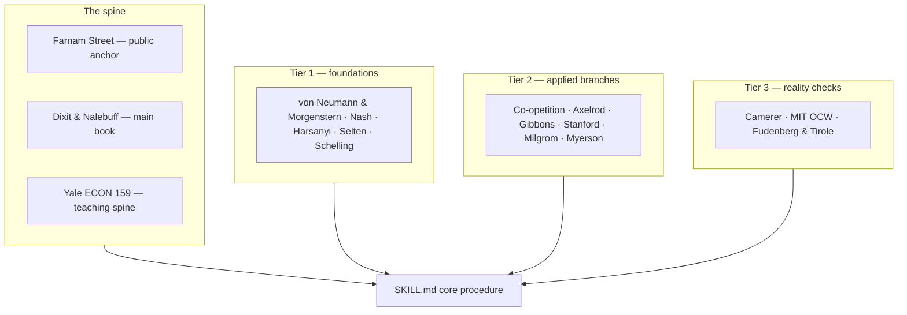

#  Sources and URLs

Full credit table for the **game-theory-for-decisions** skill (v1.0.0). Everything in this skill is **paraphrased** from the sources below.
No book chapters, lecture transcripts, or article text are stored in the
repo. Open this file when verifying an attribution or refreshing a
paraphrase.

##  The spine — anchor, book, and course

| Source | What the skill takes from it | Used in | URL / citation |
| --- | --- | --- | --- |
| Farnam Street (Shane Parrish), "Mental Model: Game Theory" | The public framing: game theory as a theory of decision making for situations where chance and your choice are not the only factors. The page itself draws on Morton D. Davis, Dixit and Nalebuff, and Michael Mauboussin. This is the skill's public anchor and the credit linked from the repo README, the role Farnam Street plays for `first-principles-thinking` | `../SKILL.md`, `../README.md` | https://fs.blog/mental-model-game-theory/ |
| Avinash K. Dixit & Barry J. Nalebuff, *Thinking Strategically* (W. W. Norton, 1991) | The main book. The operator's translation of the field: look ahead and reason backward, understand the other side's incentives, test whether threats and promises are credible, and use strategic moves — all without turning decisions into abstract mathematics | Whole skill, especially `solution-methods.md` and `commitments-signals-and-information.md` | Book — paperback ISBN 9780393310351; paraphrased. The authors' later *The Art of Strategy* (2008) is the updated synthesis |
| Ben Polak, Yale ECON 159: Game Theory (Open Yale Courses) | The teaching spine: 24 lectures in the order the skill teaches — dominance, backward induction, Nash equilibrium, commitment and credibility, asymmetric information, adverse selection, signaling, repeated games, bargaining, auctions. A public check against oversimplified summaries | `core-concepts.md`, `solution-methods.md` | https://oyc.yale.edu/economics/econ-159?qt-course=0 |

##  Tier 1 — Foundations the method must not distort

| Source | What the skill takes from it | Used in | URL / citation |
| --- | --- | --- | --- |
| John von Neumann & Oskar Morgenstern, *Theory of Games and Economic Behavior* (Princeton University Press, 1944) | The founding formal treatment: what a game is, strategies, utility, and zero-sum solution logic | `core-concepts.md` | Book — no URL; paraphrased |
| John F. Nash Jr., "Equilibrium Points in N-person Games" (PNAS, 1950); "Non-Cooperative Games" (Annals of Mathematics, 1951) | Nash equilibrium — an outcome no player can improve by changing strategy alone — and the cooperative / non-cooperative distinction | `core-concepts.md`, `solution-methods.md` | Journal articles; paraphrased |
| John C. Harsanyi, "Games with Incomplete Information Played by 'Bayesian' Players," Parts I–III (Management Science, 1967–1968) | Player types and beliefs: how to model a game when one side knows something the other does not | `core-concepts.md`, `commitments-signals-and-information.md` | Journal articles; paraphrased |
| Reinhard Selten, equilibrium-refinement work (1965 onward) | Subgame perfection and the exclusion of threats and promises nobody would carry out — the credibility test used throughout this skill | `solution-methods.md`, `anti-patterns.md` | Summarized at https://www.nobelprize.org/prizes/economic-sciences/1994/selten/facts/ |
| Thomas C. Schelling, *The Strategy of Conflict* (Harvard University Press, 1960) | The strategic-move source: mixed-motive bargaining, credible commitment, threats and promises, focal points, tacit coordination, and the power of limiting your own options | `commitments-signals-and-information.md`, `solution-methods.md` | Book — no URL; paraphrased |
| Thomas C. Schelling, *Arms and Influence* (Yale University Press, 1966) | Deterrence, compellence, and brinkmanship — pressure used as bargaining leverage. Cited with caution, for lawful and non-coercive settings only | `commitments-signals-and-information.md` | Book — no URL; paraphrased |

##  Tier 2 — Applied branches

| Source | What the skill takes from it | Used in | URL / citation |
| --- | --- | --- | --- |
| Adam M. Brandenburger & Barry J. Nalebuff, "The Right Game" (Harvard Business Review, Jul–Aug 1995); *Co-opetition* (Doubleday, 1996) | The Value Net and PARTS — Players, Added values, Rules, Tactics, Scope — the skill's whole "change the game" branch, and added value as the cap on any player's claim | `changing-the-game.md`, `worked-examples.md` | Book — ISBN 9780385479493; paraphrased |
| Robert Axelrod, *The Evolution of Cooperation* (Basic Books, 1984) | Repeated games, reciprocity, reputation, and why simple, legible strategies such as tit-for-tat sustain cooperation — the guard against one-shot advice in continuing relationships | `repeated-games-and-cooperation.md` | Book — no URL; paraphrased |
| Robert Gibbons, *Game Theory for Applied Economists* (Princeton University Press, 1992) | The clear applied-formal reference: static and dynamic games, bargaining, repeated games, signaling, auctions, incomplete information | `solution-methods.md`, `mechanisms-and-auctions.md` | Book — ISBN 9780691003955; paraphrased |
| Martin J. Osborne & Ariel Rubinstein, *A Course in Game Theory* (MIT Press, 1994) | The formal accuracy check, used when a plain-language simplification risks becoming wrong | Maintainer verification for `solution-methods.md` | Book — ISBN 9780262650403; paraphrased |
| Matthew O. Jackson, Kevin Leyton-Brown & Yoav Shoham, Stanford *Game Theory* and *Game Theory II* | Course structure for normal and extensive forms, mixed strategies, Bayesian games, coalitions, then social choice, mechanism design, and auctions | `core-concepts.md`, `mechanisms-and-auctions.md` | http://web.stanford.edu/~jacksonm/GTOC-Syllabus.html and http://web.stanford.edu/~jacksonm/GTOC-II-Syllabus.html |
| Kevin Leyton-Brown & Yoav Shoham, *Essentials of Game Theory* (Morgan & Claypool, 2008); Shoham & Leyton-Brown, *Multiagent Systems* (Cambridge University Press, 2009) | Precise short definitions, coalition concepts, and the multi-agent and computational edge cases | `core-concepts.md`, `game-mapping.md` | Books — no URL; paraphrased |
| Paul Milgrom, *Putting Auction Theory to Work* (Cambridge University Press, 2004) | The auction and mechanism-design branch: design the rules so self-interested bids produce the intended allocation, grounded in the FCC spectrum-auction record | `mechanisms-and-auctions.md`, `worked-examples.md` | Book — paperback ISBN 9780521536721; paraphrased |
| Roger B. Myerson, *Game Theory: Analysis of Conflict* (Harvard University Press, 1991) | Advanced check on bargaining, mechanism design, and equilibrium analysis. Reference only; it does not set the skill's reading level | Maintainer verification | Book — no URL; paraphrased |

##  Tier 3 — Reality checks and cross-checks

| Source | What the skill takes from it | Used in | URL / citation |
| --- | --- | --- | --- |
| Colin F. Camerer, *Behavioral Game Theory* (Russell Sage Foundation / Princeton University Press, 2003) | The main guard against the perfect-calculator assumption: experimental evidence on social preferences, reciprocity, fairness, limited steps of "I think that you think" reasoning, and learning from experience | `behavioral-reality-check.md`, `anti-patterns.md` | Book — ISBN 9780691090399; paraphrased |
| MIT OpenCourseWare 14.12, Economic Applications of Game Theory (Muhamet Yildiz) | A lecture-and-readings cross-check on the whole method: Gibbons as course text, with Fudenberg and Tirole, Osborne and Rubinstein, Dutta, Watson, Kreps, and Dixit and Skeath behind it | Maintainer cross-check | https://ocw.mit.edu/courses/14-12-economic-applications-of-game-theory-fall-2012/pages/readings |
| Drew Fudenberg & Jean Tirole, *Game Theory* (MIT Press, 1991) | The advanced formal reference, used to verify claims — never to write the public-facing procedure | Maintainer verification | Book — ISBN 9780262061414; paraphrased |

## Sources deliberately not used as the spine

- **General negotiation-advice books**, including *Getting to Yes*: sound
  negotiation practice, but not a sufficient source for game theory itself.
- **Poker and gambling books**: strong on incomplete information and mixed
  strategies inside narrow games; too narrow to govern business and life
  decisions.
- **Popular articles that stop at the Prisoner's Dilemma and Nash
  equilibrium**: they miss sequence, information, credibility, repeated
  play, and changing the rules — where decisions are usually won or lost.
- **Machiavellian and manipulation literature**: outside the skill's lawful
  and ethical scope, and a poor model for repeated games and reputation.

## Maintainer notes

- **Paraphrase policy.** Refresh a reference by re-reading the source and
  re-paraphrasing. Never paste source text into the repo.
- **Link checks.** The URLs above are the official article, course, and
  syllabus pages. Verify them at every version bump; course query strings
  (the Yale link) are part of the working address.
- **Concept-to-source rule.** Every concept in `core-concepts.md` and every
  method in `solution-methods.md` must trace to a row in these tables. If a
  claim cannot be traced, it comes out or gets its source added here first.
