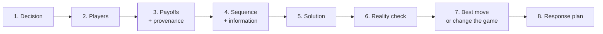

#  Worked examples

Ten complete runs of the core procedure on fictional decisions. Every
company, person, and figure below is invented for teaching. Numbers marked
*illustrative* are assumptions chosen to make the logic visible. They are
never estimates of a real case. Payoffs use a four-step ordinal scale — Best,
Good, Poor, Worst — always from the named player's seat. Evidence labels
follow the skill standard: **measured** (a record exists), **declared** (a
player said it), **inferred** (reasoned from behavior), **unknown**.

Each example follows the output standard in `../SKILL.md`: decision, player
map, payoffs, sequence and information, solution, reality check,
recommendation, response plan, and reasoning trace.

## Example 1 — Two-bidder sale process

**Decision.** A founder is selling a profitable niche software business. Two
bidders remain. Set the final-round rules, and decide what each bidder hears.
Success: best total terms signed within three weeks. Owner: the founder.

**Player map.**

| ID | Player | Objective | Main options | Outside option |
| --- | --- | --- | --- | --- |
| P1 | Seller (us) | Price plus certainty of close | Final round, serial talks, keep operating | Keep the business; it earns steady profit (**measured**: accounts) |
| P2 | Strategic acquirer | Our customer base for its platform | Bid high, bid low, walk away | Build the feature itself, slowly (**inferred** from its public roadmap) |
| P3 | Financial buyer | Cash flow at a target return | Bid to its cap, demand exclusivity | Another acquisition (**declared** in its process letter) |

**Payoffs and provenance.** P2's ceiling is probably above P3's, because
synergy value usually exceeds pure cash-flow value — **inferred**, not known.
P3 likely closes faster, with fewer conditions — **declared** timeline,
unverified. For P1: both bidders compete hard to a deadline (Best); one bids
seriously (Good); both shade and wait (Poor); both walk (Worst, but cushioned
by a real outside option).

**Sequence and information.** P1 moves first by setting the rules. Final bids
are private and simultaneous at one deadline. Each bidder knows the other
exists. Neither learns the other's price or standing. Inside each bidder sits
an unseen veto player, an investment committee. Allow time for it.

**Solution.** In serial friendly chats, each bidder's best response is to bid
cautiously and probe for the other side's offer. Every hint P1 drops anchors
the next bid. Under one shared deadline with best-and-final bids and no
standings disclosed, each bidder must bid against the *possibility* of
losing. Best responses shift upward. The deadline binds only because P1's
outside option is real: a profitable business can simply not sell.

**Reality check.** Bidders in a small industry may know each other. Identical
unusual terms in both bids are a collusion signal, not a coincidence. Pride
is also a payoff: a bidder who feels used as a stalking horse may walk even
at a winning price. Sensitivity: if the synergy inference about P2 is wrong,
P3 sets the ceiling and no process design fixes that. P2's diligence depth is
the cheapest evidence to watch.

**Recommendation.** *Best response:* one clean final round — same data, same
deadline, same terms sheet, no standings shared. *Game-changing option:*
qualify one more bidder before the final round (Players, in PARTS terms). A
third credible bidder raises both ceilings more than any clever message.
*No-go:* telling either bidder it is "behind," or inventing a third bid. The
first leaks the process. The second is deception, and if it is discovered, it
ends both bids.

**Response plan.** First move: send the identical process letter to both
bidders. If one demands early exclusivity, decline and offer faster diligence
access instead. If both final bids land low, pause, run the business, and
reopen later from strength. Wrong-model signal: both bidders suddenly ask the
same unusual question — check for a leak. Walk-away point: any price below
the value of keeping the business, set in advance from the accounts.

**Reasoning trace.**
- Final-round rules beat serial chats ← P2 and P3 best responses change when neither can learn the other's standing.
- The deadline binds ← P1's outside option is measured profit, not a bluff.
- A third bidder is the highest-value move ← both ceilings are set by fear of losing, and a new player raises it (`judgment`).
- "You are behind" is excluded ← disclosure spends P1's only information advantage and risks a pride-driven exit (`judgment`).

## Example 2 — Vendor renewal with a deadline

**Decision.** Renew a data platform in 30 days, or start migrating. The
vendor's renewal quote raises the price sharply — *illustrative:* +38%,
**declared** in the quote. The account rep says the price rises again on
Monday. Success: continuity at a sustainable price. Owner: the operations
lead.

**Player map.**

| ID | Player | Objective | Main options | Outside option |
| --- | --- | --- | --- | --- |
| P1 | Buyer (us) | Continuity at a fair price | Sign, extend, migrate | Rival platform, unproven |
| P2 | Vendor account team | A signature this quarter (**inferred** from quarter-end urgency) | Hold price, discount, extend | Losing the account at expiry |
| P3 | Internal engineering | A migration they can actually finish | Build the path, flag risks | None; they bear the cost either way |
| P4 | Rival vendor | Win the account | Offer a pilot (**declared**, untested) | Other prospects |

**Payoffs and provenance.** Migration will take six to ten weeks —
**declared** internal estimate from P3. That single fact prices every threat
in the game. P2's payoff peaks at a signed renewal before quarter-end. P1's
worst outcome is a service cutoff with no replacement running.

**Sequence and information.** Test each threat at execution time. P2's
"price rises Monday" is weak: raising the price risks the signature the rep
needs this quarter. P1's "we will switch" is not yet credible: migration
cannot beat the expiry date. P2's cutoff at expiry *is* credible: it is a
contract term (**measured**: the contract itself).

**Solution.** The deadline is P2's main asset. The buyer's strong move is to
change the sequence: request a 90-day extension at the current rate, in
writing, and start P4's pilot the same week. The extension converts a cliff
into time. The pilot converts the outside option from a claim into a fact.
Once both exist, P1's walk-away becomes credible and the price negotiation
is a different game.

**Reality check.** Account reps rotate. A verbal concession from this rep
may not survive a handover, so every term goes in writing. Internal users
are hidden players: a cheaper migration that breaks their workflows buys a
revolt. Sensitivity: if the pilot fails on technical grounds, P1's leverage
collapses. So pilot first, negotiate hard second.

**Recommendation.** *Best response:* buy the extension, run the pilot, then
negotiate from a real alternative. *Game-changing option:* unbundle unused
modules (Scope), or trade a longer term for a written cap on future increases
(Rules). *No-go:* claiming a signed rival contract that does not exist. Also
no-go: letting the contract lapse with no extension in place. The one fully
credible threat in this game belongs to P2.

**Response plan.** First move: written extension request plus pilot kickoff,
same week. If P2 refuses the extension, escalate to P2's management and state
the pilot as a fact, not a threat. If P2 offers a small discount to sign now,
hold out for the cap and term structure instead. Wrong-model signal: P2
grants the extension instantly — it may fear churn more than modeled, so
press further. Walk-away point: pilot passed, cap refused — migrate on the
extension clock.

**Reasoning trace.**
- The deadline, not the price, is P2's leverage ← P3's migration estimate makes P1's exit threat fail today.
- The extension is the pivotal move ← it changes the sequence, which changes every best response after it.
- "Price rises Monday" is discounted ← carrying it out endangers the quarterly signature P2 is paid on (`judgment`).
- A fabricated rival contract is excluded ← deception, and the bluff collapses the first time P2 asks for proof.

## Example 3 — Competitor price cut

**Decision.** Our main rival cut its headline price by 20% on Monday
(**measured**: its public pricing page). Match, hold, or respond in part?
Success: protect margin without surrendering the customer base. This game
repeats every quarter, prices are public, and customers watch.

**Player map.**

| ID | Player | Objective | Main options | Outside option |
| --- | --- | --- | --- | --- |
| P1 | Us | Margin plus share | Match, hold, targeted reply | Exit the contested segment |
| P2 | Rival | Volume and momentum | Hold the cut, deepen, restore | Return to old price quietly |
| P3 | Customers | Value for money | Switch, stay, split usage | Divided: switchers follow price, stayers follow fit (**inferred** from our churn review) |
| P4 | Future entrants | A profitable market to enter | Enter, wait | Other markets |

**Payoffs and provenance.** Ordinal, per quarter, ours listed first. Both
hold: Good / Good. We cut alone: Good for us this quarter, Poor for P2 — and
it invites a reply. We hold while P2 cuts: Poor-ish for us (we lose
switchers), acceptable for P2 (volume up, margin thin). Both cut: Worst /
Worst. Share ends roughly where it started and the margin is gone.

**Sequence and information.** The one-shot reading says cut and grab share.
The repeated reading says something else: matching every cut teaches P2 that
cuts move us, and both sides settle into the price-war cell neither wants.

**Solution.** Axelrod's logic for sustaining cooperation applies to
restraint here: be clear, proportionate, and forgiving. The stable play is
to respond in the contested segment only — a switcher-focused offer — and
leave the headline price, and the way back, intact. That makes restraint,
not the price war, the outcome both sides can settle into.

**Reality check.** The cut may be a two-week promotion, or P2 correcting its
own error. The first move is information, not margin: check the cut's terms
and duration before spending anything. Our own sales team is a hidden player
paid on volume; expect internal pressure to match, and name it in the plan.
Sensitivity: if churn data shows stayers leaving too, fit — not price — is
the problem, and this whole model is the wrong one.

**Recommendation.** *Best response:* hold the headline price; answer only in
the segment actually being contested. *Game-changing option:* change the
basis of comparison — bundle onboarding and a service guarantee so the
choice is no longer price against price (Tactics and Scope). *No-go:* a
public, deeper, across-the-board cut. It is an anchor we cannot retract and a
commitment to war. Also absolutely no-go: contacting P2 about pricing.
Coordinating prices with a competitor is illegal collusion, not strategy.

**Response plan.** First move: 48 hours of checking, then the targeted offer.
If P2 deepens its cut, extend the targeted reply and brief stayers on fit
value. If P2 restores its price, retire our offer promptly — forgiving
responses keep the good outcome available next quarter. Wrong-model signal:
switcher churn does not move at all. The cut was noise; stop responding to
it.

**Reasoning trace.**
- Holding beats matching ← the both-cut cell is Worst for us, and public prices make the game repeat.
- A segment-only reply is proportionate ← it answers P2's move where it lands and leaves the headline structure intact (Axelrod pattern).
- Checking comes before spending ← a promotion and a strategy look identical on day one (`judgment`).
- Price coordination with P2 is excluded ← it is a crime, not a game-changing move.

## Example 4 — The supplier who is also a competitor

**Decision.** Our key component supplier also sells a finished product that
competes with ours. Our lead times from them have doubled (**measured**:
order history). Renegotiate, dual-source, or confront? Success: reliable
supply without deepening dependence. Owner: the operations lead.

**Player map.**

| ID | Player | Objective | Main options | Outside option |
| --- | --- | --- | --- | --- |
| P1 | Us, device maker | Reliable supply, fair terms | Plead, threaten, dual-source, partner | Shift volume to P4 once qualified |
| P2 | Supplier-competitor | Component profit plus finished-product share | Serve us well, squeeze, delay | Drop us; we are a modest share of its component revenue (**inferred**) |
| P3 | Distributors | Stock they can sell | Push us, drop our line | Rival finished products, including P2's |
| P4 | Alternative component maker | Volume to justify tooling | Tool up for a commitment (**declared**) | Stay in its current niche |
| P5 | Software complementor | Devices its app runs on | Promote our device, stay neutral | Other hardware partners |

**Payoffs and provenance.** P2's added value to us is high today: it is the
only qualified source. Our added value to P2 is modest. That asymmetry, not
hostility, is enough to explain a squeeze. But hold the alternative open:
an industry-wide capacity shortage would look identical, and which story is
true is **unknown**. One question to two other buyers of P2 settles much
of it.

**Sequence and information.** Inside the current game, our threat to leave
fails the execution test until P4 is qualified. Complaints spend goodwill in
a repeated game where P2 holds supply. So the early moves are quiet: place a
real first order with P4, and run the technical qualification before any
hard conversation with P2.

**Solution — change the game (PARTS).** *Players:* qualify P4 for real.
*Added values:* offer P2 a multi-year volume commitment in the product line
where we do not compete. *Rules:* new supply terms with lead-time
commitments, penalties, and a price formula instead of annual haggling.
*Tactics:* let the P4 qualification become visible through normal channels —
a factual signal, never a threat speech. *Scope:* propose joint work in an
adjacent market where P2 sells no finished product.

**Reality check.** P4's quality risk is real; test before shifting volume.
If P2 improves service once dual-sourcing is credible, that is the intended
outcome, not a defeat for the plan. Sensitivity: if the delays prove to be
industry-wide capacity, the right move is shared production planning, not
leverage. The model flips on one piece of evidence, so get it early.

**Recommendation.** *Best response:* negotiate supply terms while quietly
building the alternative. *Game-changing option:* the full PARTS package
above. *No-go:* renewing single-source exclusivity, which pays P2 to keep
the asymmetry. Also no-go: a public blame campaign. It starts a war in a
repeated game where the other side holds the supply line.

**Response plan.** First move: qualify P4 and request a supply-terms meeting
with P2 in the same month. If P2's lead times recover, keep P4 at low volume
as standing insurance. If P2 raises prices sharply, accelerate the P4 ramp
and warn distributors early. Walk-away point: no renewal without a
lead-time-and-penalty clause.

**Reasoning trace.**
- Leverage follows added value, not volume of complaint ← P2 can replace us more easily than we can replace P2, today.
- Qualifying P4 comes before any ultimatum ← a threat is credible only when carrying it out is possible (Selten's test).
- The capacity explanation stays open ← the same delays fit two models, and the correction differs by model (`judgment`).
- Exclusivity renewal is excluded ← it deepens the exact asymmetry causing the problem.

## Example 5 — Sales compensation plan

**Decision.** Redesign commissions for a twelve-person sales team. The
current plan pays on signed contract value (**measured**: the plan document).
The company dashboard — fictional, but treat as **measured** inside this
scenario — shows discounts averaging 22% off list and 40% of new accounts
cancelling within six months. Success: revenue that stays. Owner: the head
of sales.

**Player map.**

| ID | Player | Objective | Main options | Outside option |
| --- | --- | --- | --- | --- |
| P1 | Company (us) | Profitable, retained revenue | Redesign pay, add approvals, exhort | Keep the plan and its results |
| P2 | Sales reps | Income per unit of effort (**inferred** from behavior under the current plan) | Sell clean, discount hard, chase easy logos | Jobs at rival firms |
| P3 | Customers | A product that fits, at a fair price | Sign, churn, downgrade | Competitors |
| P4 | Customer success team | Retention targets (**declared**) | Rescue accounts, escalate bad fits | None; they inherit every signing |

**Payoffs and provenance.** Under the current table, a rep who discounts
heavily earns the same as one who sells carefully, and finishes faster.
Churn lands on P4's numbers, not the rep's. Fit quality is invisible at
signing — a textbook moral-hazard setup: the action that matters cannot be
observed when the reward is paid.

**Sequence and information.** Signing is fast. Fit reveals itself slowly,
over the following six months. The rep moves first and knows the customer's
real fit; the company learns the truth only at cancellation or renewal —
the information arrives in the wrong order for the current pay table. The
game also repeats monthly, and every rep watches precisely what gets
rewarded.

**Solution.** The reps are not the problem. They are best-responding to the
payoff table P1 built. Monitoring and blame treat the players. The fault is
the mechanism, so redesign it: pay commission on cash collected; pay a
second tranche at day-90 retention; claw back commission on early
cancellation; step the commission rate down as the discount deepens, so a
rep spends discount like their own money; add a small team component to cut
lead-hoarding.

**Reality check.** Every new metric gets gamed at the edges — expect
end-of-quarter pull-forwards, and smooth them with monthly tranches.
Fairness perception is a payoff too: model two or three real reps' earnings
under the new plan and share the comparison before launch. Sensitivity: if
cancellation interviews show the product, not the fit, is driving churn,
compensation is the wrong lever entirely. That evidence would flip this
recommendation, so collect it first.

**Recommendation.** *Best response inside the old game:* discount-approval
thresholds — costly, gameable, second-best; use only if redesign must wait a
quarter. *Game-changing option:* the mechanism redesign above (Rules), with
signed deals grandfathered under the old terms. Changing pay retroactively
would destroy P1's credibility in the repeated game with its own employees.
*No-go:* hiring "more ethical" reps into the same payoffs, or adding secret
monitoring quotas that reps will discover and route around.

**Response plan.** First move: publish the principles and the grandfathering
promise, with draft numbers open for comment. If top reps threaten to leave,
show their modeled earnings — strong reps gain when pay follows retention.
If the model says they lose, the model is wrong; fix it before launch.
Wrong-model signal: discounting falls but signings collapse. Price, not pay,
was the binding constraint all along.

**Reasoning trace.**
- The mechanism, not the people, produces the churn ← P2's discounting is a best response to being paid on signatures.
- Retention pay fixes the timing ← it moves the reward to the moment quality becomes observable.
- Grandfathering is mandatory ← P1 plays a repeated game with P2 and its promises are its capital (`judgment`).
- Blame is excluded ← it changes no payoff, so it changes no behavior.

## Example 6 — Partnership negotiation and added value

**Decision.** Three firms can launch a joint product. Set the revenue split
and the signing order. Any two firms can launch a weaker version; all three
make the full product. Success: a split every party will still defend in a
year. Owner: our partnerships lead (P1).

**Player map.**

| ID | Player | Objective | Main options | Outside option |
| --- | --- | --- | --- | --- |
| P1 | Platform (us) | Distribution share of a launched product | Sign first, sign last, walk | Launch the two-party version with P2 |
| P2 | Data owner | Monetize a unique dataset (**inferred**: our search found no substitute) | License to us, license to a rival | License elsewhere later |
| P3 | Payments firm | Processing volume | Sign, stall, play suitors off | Two other platforms, **declared** by P3, unverified |

**Payoffs and provenance.** Use *illustrative* value units. Pie with all
three: 100. Without P1: 30. Without P2: 40. Without P3: 55. A player's
**added value** is the full pie minus the pie without them: P1 = 70,
P2 = 60, P3 = 45. No stable deal pays anyone more than their added value.
Above that cap, the other two do better by excluding them.

**Sequence and information.** Signing order changes the game. Signing P2
first — the scarcest input — converts the P3 negotiation into a choice
about joining a nearly complete product. P3's claim about other suitors is
a **declared** payoff, not a measured one, and declared payoffs do not raise
the added-value cap.

**Solution.** Equal thirds ignore the caps. P1 and P2 can each credibly ask
for more than a third; P3 cannot credibly ask for more than 45, whatever it
says. A stable split pays each player clearly more than their outside option
and clearly less than their added value, weighted toward the players the
pie can least afford to lose.

**Reality check.** Fairness is a real payoff (Camerer's experiments). A
split pushed to the edge of a cap invites slow sabotage — delayed work,
thin effort — from the squeezed party. Sensitivity: if P2's data proves
replaceable, the entire map inverts. A two-week technical test is the
evidence that decides, and it is cheap. Run it before signing anything.

**Recommendation.** *Best response:* propose a split by added value, not by
thirds, and sign P2 first on launch-contingent terms. *Game-changing
option:* qualify the rival payments firm (Players). P3's added value falls
toward the two-party remainder, and its price follows. A second option:
shrink Scope — launch in the one region where our distribution is strongest
and P3 matters least. *No-go:* announcing the partnership before terms are
signed. Public announcement creates audience costs that lock in a split
nobody would accept privately.

**Response plan.** First move: sign P2. If P3 demands parity citing its
suitor, offer terms at its added value and let the qualified alternative be
a visible fact, not a bluff. If P2 demands more than 60, do not haggle
upward — revisit Scope instead; above the cap, exclusion math stops
working. Wrong-model signal: P3 signs quickly at a low share. Its outside
option was weaker than declared. Record the lesson for the renewal.

**Reasoning trace.**
- Added value caps every claim ← a player paid above it makes exclusion profitable for the other two.
- Equal thirds are unstable ← P1 and P2 both hold caps far above a third and know it.
- Signing P2 first strengthens the P3 round ← scarcity is settled before replaceability is negotiated (`judgment`).
- The suitor claim moves nothing ← declared payoffs are not measured payoffs.

## Example 7 — Sealed-bid procurement

**Decision.** A logistics firm will buy a warehouse fit-out by sealed bid.
Site conditions are uncertain — the true cost is roughly the same for every
bidder, but each bidder estimates it differently. Success: lowest *total*
cost, including delay and rework. Owner: the procurement lead.

**Player map.**

| ID | Player | Objective | Main options | Outside option |
| --- | --- | --- | --- | --- |
| P1 | Buyer (us) | A finished warehouse, on time | Design the tender rules | Delay the project |
| P2–P5 | Four qualified contractors (one class) | Win at a profitable price | Bid honestly, shade, gamble low | Other projects |
| P6 | Our project manager | An on-time opening (**declared**) | Pressure for the lowest bid | None; inherits any failure |

**Payoffs and provenance.** In a first-price sealed bid, each bidder shades
its price above estimated cost, and shades less as the bidder count rises.
With common-value uncertainty, the winner is systematically the bidder who
estimated most optimistically — the winner's curse. An underwater winner
recovers by cutting corners or renegotiating. The cost returns to P1, with
delay added. The lowest headline bid is therefore not the lowest expected
total cost. Bid figures here stay **unknown** by design; the mechanism logic
does the work.

**Sequence and information.** P1 moves first and most powerfully: the buyer
designs the rules before any bid exists (Milgrom's mechanism-design branch).
The bids themselves are simultaneous and sealed. No bidder sees another's
price; each bids against its own cost estimate, plus its guess about the
field.

**Solution.** Publish the full site survey to every bidder — uncertainty the
buyer removes is a risk premium the buyer stops paying. Run two envelopes: technical
approach scored first, price opened only for bidders who pass. Split the
genuinely uncertain ground works into a cost-reimbursable lot, and keep
fixed-price bidding for the predictable lots. Keep the reserve price
private.

**Reality check.** Bidders in a small pool talk, and win-rotation patterns
across tenders are worth watching. Never suggest or join any arrangement
between bidders: collusion is illegal for them and prohibited for us.
Sensitivity: if the survey shows conditions are uniform and well understood,
the winner's-curse logic weakens and plain low-bid competition works fine.
The survey evidence decides which branch to run.

**Recommendation.** *Best response:* the two-envelope tender with the survey
published and the uncertain lot separated. *Game-changing option:* split
the contract into two lots so more bidders can win something — all-or-nothing
stakes increase desperate shading. *No-go:* announcing the budget ceiling.
Bids anchor to it instantly. Also no-go: springing a surprise "best and
final" round after opening bids. It teaches the local market that our
process is theater, and shading rises in every future tender — a repeated
game we keep playing.

**Response plan.** First move: issue the survey and the two-envelope rules.
If all bids cluster high, the uncertainty premium survived: add a pre-bid
site visit and a written Q&A, then re-issue. If one bid sits far below the
pack, walk that bidder through its assumptions line by line before awarding.
An error found now is cheap. Wrong-model signal: losing bidders repeatedly
say the winner "bought the job" across tenders — tighten the technical
envelope.

**Reasoning trace.**
- Rule design beats bid reading ← P1 moves first, and the bidders' best responses are created by P1's rules.
- Publishing the survey lowers expected price ← bidders charge for uncertainty they cannot remove; removing it removes the charge (Milgrom).
- The lowest bid is suspect, not celebrated ← under common values, winning is evidence of the most optimistic error.
- The budget ceiling stays private ← a declared ceiling becomes the focal point every bid lands on.

## Example 8 — Internal launch decision

**Decision.** Set the launch date for a new feature. The argument in the
building sounds like a personality conflict. It is a payoff table. Success:
a date that holds, with a working product. Owner: the product lead — about
to change under this analysis.

**Player map.**

| ID | Player | Objective (as measured) | Main options | Outside option |
| --- | --- | --- | --- | --- |
| P1 | Product team | Ship dates (**declared** OKRs) | Announce early, announce late | Slip quietly |
| P2 | Platform team | Uptime and incident counts (**declared** OKRs) | Review fast, review slowly | Escalate risk warnings |
| P3 | Sales | Promises already made to two large prospects (**measured**: call notes) | Promise more, walk back | Lose the prospects |
| P4 | Support | Ticket volume (**declared** OKRs) | Prepare, absorb | Absorb anyway; they inherit whatever ships |

**Payoffs and provenance.** Read each team's best response. P1 gains by
announcing a date early — an internal commitment device in Schelling's
sense: it forces the organization to organize. P2 protects uptime the only
way it can, with slow, quiet caution in reviews — a hidden action nobody
observes directly. P3 gains by promising early; the cost of over-promising
lands on P4. Every player is rational. The equilibrium is a late, buggy
launch followed by mutual blame.

**Sequence and information.** P1 moves first with the announcement. P2's
response is hidden. P4 learns the truth last, at launch. Any fix must change
what players are paid on, who decides, or what everyone can see — in that
order of power.

**Solution — change the game.** *Payoffs:* one shared launch scorecard —
date, 30-day incident rate, adoption — owned jointly by P1 and P2, so
neither can win by making the other lose. *Rules:* a single named launch
owner with authority to trade date against scope, replacing the informal
vetoes. *Information:* a public readiness dashboard ends hidden delay;
problems surface while they are still cheap. *Scope:* launch to 10% of
users first — a smaller game with a smaller blast radius.

**Reality check.** P2's caution may carry real information — scar tissue
from the last incident — and not just metric defense. Interview for facts
before redesigning payoffs. Status is also a payoff: a redesign that reads
as "platform was the problem" will trigger a defense no scorecard can fix.
Sensitivity: if incidents trace to one genuinely under-resourced component,
the decision is investment, not incentives.

**Recommendation.** *Best response inside the current game:* negotiate the
date bilaterally with P2 and buy slack with scope cuts — workable once,
fragile always. *Game-changing option:* the scorecard, owner, dashboard,
and staged launch above. *No-go:* adding a steering committee. More veto
players make the equilibrium worse. Also no-go: secretly pulling the date
earlier. It spends the credibility that every future internal commitment
depends on.

**Response plan.** First move: publish the shared scorecard and name the
launch owner before any new date is announced. If P1 announces a date
anyway, the owner resets it once, publicly, with readiness data — a rule
enforced once becomes a rule. If hidden delays continue, make the dashboard
review weekly and named. Wrong-model signal: the dashboard is green and
incidents still spike. The constraint was resources, not incentives; fund
the component.

**Reasoning trace.**
- The conflict is structural, not personal ← each team's move is a best response to its own declared metric.
- Exhortation changes nothing ← it changes no payoff, no decision right, and no information.
- The shared scorecard is the pivotal change ← it makes P1's win and P2's win the same event.
- The secret early date is excluded ← internal commitments run on credibility, and this spends it (`judgment`).

## Example 9 — The royalty claim nobody will pay

**Verdict.**
- Decision: How to collect two years of unpaid royalties on a licensed design library.
- Recommendation: Send one final notice today. If the date passes unpaid, file the prepared complaints the next morning — no new warning, no new deadline.
- Next action: Deliver the final notice with the full accounting attached.

**Decision.** A surface-design studio licensed its pattern library to a
home-goods manufacturer. The manufacturer stopped sending sales reports and
royalty payments two years ago. Success: the arrears paid, or a settlement
worth taking, without spending the claim's value on lawyers. Owner: the
studio's founder.

**Player map.**

| ID | Player | Objective | Main options | Outside option |
| --- | --- | --- | --- | --- |
| P1 | Studio (us) | Arrears plus future royalties | Demand, wait, file complaints | Write the claim off; license the library elsewhere |
| P2 | Manufacturer | Keep the margin it has been booking | Pay, stall, deny the reports are owed | Keep using the patterns and dare us to act |
| P3 | Manufacturer's finance lead | A clean close to the quarter (**inferred** from reply timing) | Bury the item, settle it quietly | Carry an unbooked liability |
| P4 | State regulator and industry association | A documented record | Act on a filing, file it away | No filing, no case |
| P5 | A second manufacturer, negotiating a new license with us now | A licensor who enforces | Sign, wait, discount for weak enforcement | Other design libraries |

**Payoffs and provenance.** The arrears are **measured**: the signed license
sets the royalty rate, and a retailer's published sales figures cover most
of the volume. The total is small next to P2's revenue — *illustrative:*
about what P2 spends on a single trade-show booth. For P2: paying ends the
matter (Good). Stalling has cost nothing for two years (Good, so far). A
regulator file with the contracts attached is the first outcome P2 scores
Poor.

**The cheapest-compliance test.** Price the other side's cheapest way to
comply. Here it is trivial: one wire for a sum P2 would not notice. P2
still refuses. A player who will not pay a trivial cost is not protecting
the money. The payoff model is wrong. What P2 is protecting is **unknown** —
the leading candidates are the precedent (other licensors would file the
same claim — **inferred** from two similar licenses in P2's catalog) and the
admission (paying concedes the reports were always owed). Either way,
cheaper offers and warmer letters change nothing. Only a costlier refusal
does.

**Sequence and information.** Now the credibility count, stated plainly.
Deadlines issued by P1: three — a spring date, an early-summer date, an
autumn date. Deadlines executed: zero. Each extension taught P2 that P1's
dates are weather, not commitments. P4 cannot move until a filing exists.
P5 is watching this game from the next table: the enforcement game and the
new-license negotiation draw on the same credibility account, and a fourth
soft deadline spends from both.

**Solution.** P2's best response to every past move was stall, because
stalling was free. The only move that reprices stalling is the one already
prepared: the regulator and industry-association complaints. They cost
nothing to file, they are documented, and they convert a private debt into
a record P3 must carry. A threat is credible when carrying it out is cheap
at the moment of execution. Filing is cheap. That is the whole strategy.

**Reality check.** Filing may still produce nothing from P4 — complaints
are a record, not a collection service. Price that in: the filings buy
leverage and precedent, not a guaranteed payment. Also test the bleak
branch: if P2 has quietly moved the product line to a subsidiary,
collection gets harder, and that is **unknown** today. Sensitivity: any
substantive reply from P2 — a real offer, a dispute of a specific figure —
reopens negotiation and pauses the filing clock. Silence and form letters
do not.

**Recommendation.** *Best response:* the final notice goes today, with the
accounting attached and one date in it. *Game-changing option:* file the
complaints (Rules — a referee enters the game) and let the filing, not a
letter, be the message; the new-license negotiation with P5 then runs on a
visible record of enforcement. *No-go:* a fourth deadline. Also no-go:
discounting the arrears to make payment painless — the test above shows the
money was never the obstacle.

**Response plan.** First move: deliver the notice. If the date passes with
no payment and no substantive reply, file the next morning, without a
warning message. If P2 offers part payment, take it only against a written
schedule for the rest and resumed reporting. Wrong-model signal: P2 pays in
full within days — the obstacle was internal process, not precedent. Note
it, and shorten every future deadline in this relationship.

**Reasoning trace.**
- More letters are worthless ← three deadlines issued, zero executed; P2 has priced our paper correctly.
- The refusal is diagnostic ← compliance costs P2 a trivial sum, so the protected payoff is hidden, not financial (`judgment`).
- Filing is the credible move ← it costs nothing to carry out, and it is the first move that makes stalling cost P2 anything.
- No fourth deadline ← credibility is a shared account; the P5 negotiation spends from the same balance.

## Example 10 — The studio owner's three doors

**Verdict.**
- Decision: Raise money now, sell the catalog, or cut costs and wait — with about four months of savings left.
- Recommendation: Ring-fence a floor today, price the wait to the next information event, and decide each door only after the event that reprices it.
- Next action: Move the floor into a separate account and book the landlord conversation as information gathering only.

**Decision.** The owner of a six-person animation studio is self-funding a
gap between projects. Savings cover roughly four months — *illustrative*
throughout this example. Three doors are open: raise a small investment
round now, sell the studio's completed-film catalog, or cut costs hard and
wait for work. Success: the studio alive in a year, with the owner not
wiped out. Owner: the founder.

**Player map.**

| ID | Player | Objective | Main options | Outside option |
| --- | --- | --- | --- | --- |
| P1 | Founder (us) | A living studio and a personal floor | Raise, sell catalog, cut and wait | Close the studio; take a senior job (**declared** recruiter interest) |
| P2 | Two small investors | Ownership at a price that reflects risk | Offer now, wait, walk | Other studios |
| P3 | Catalog buyer | The films, cheaply | Bid now, bid after festival news | New commissions |
| P4 | Anchor client | A renewal decision, due in eight weeks | Renew, shrink, leave | A rival studio |
| P5 | Landlord | A signed renewal | Hold terms, soften, re-let | A thin market for studio space |

**Payoffs and provenance.** The monthly gap and the savings are **measured**
from the accounts; four months of cushion is the honest count. Everything
else is a range or a rank until the calendar speaks. Watch the
outside-option trend, not the snapshot: P1's cushion — the thing that lets
P1 walk away from any bad deal — decays by roughly one month for every
month of self-funding. P2 can read a calendar too. A raise attempted in
month one is a negotiation. The same raise in month four is a rescue, and
it will be priced as one.

**Sequence and information — the information calendar.** Dated events will
change this table, in order. The landlord's renewal terms arrive in three
weeks (**declared**). A festival announces its program in six weeks; a
catalog title is shortlisted, and selection would reprice the catalog
upward (**unknown**, but dated). The anchor client decides its renewal in
eight weeks (**declared** by the client). A regional production grant
announces awards in ten weeks; the studio's application is in
(**measured**: the submission receipt). None of these events costs anything
to wait for except burn — so price the wait: six weeks of gap funding is
the cost of learning what the catalog is worth before selling it. Selling
in week one spends that information for nothing.

**Solution.** Sequence the doors by the event that reprices each. Catalog:
decide after the festival announcement. Raise: decide after the anchor
client's answer, when revenue is a fact instead of a pitch. Costs: cut now
the items that change no player's information, and hold the rest until the
calendar resolves. The landlord conversation opens early, but only as
information gathering: what would an early exit or a smaller space cost? A
question is cheap and reversible. A signature is neither.

**Reality check.** Calendars slip. If the festival delays its announcement
past the client's decision date, two repricing events land at once and the
cushion is thinner — model that branch before it arrives. Pride is a
payoff too: raising early can feel decisive while simply paying a weakness
price. Sensitivity: if the anchor client signals early that the renewal is
gone, the calendar collapses and the catalog decision moves up. That signal
is the evidence that changes the answer, so ask for it directly at the next
client meeting.

**Recommendation.** *Best response:* ring-fence the floor today — two
months of personal and payroll costs, moved to a separate account the gap
cannot draw on (all figures *illustrative*). A floor only works as a
commitment if crossing it is visibly hard. *Game-changing option:* change
the order of play — sell nothing, raise nothing, and sign nothing until
each door's repricing event has landed. The founder's patience is worth
more than any single term available today. *No-go:* signing the landlord's
long renewal this month to feel stable. It converts a flexible cost into a
fixed one exactly when flexibility is the asset. Also no-go: self-funding
past the floor on hope — each month spent lowers the price of every
remaining door.

**Response plan.** First move: move the floor money and book the landlord
call. At the festival announcement: price the catalog with the result in
hand. At the client decision: if renewed, raise only if growth — not
survival — justifies it; if lost, sell the catalog and cut to the smaller
footprint the same week. Wrong-model signal: an investor offers clean terms
now at a fair price without waiting. Take the meeting seriously — the
market may be pricing the studio better than this model does.

**Reasoning trace.**
- Waiting has a price and a value ← six weeks of burn buys the festival result, which reprices the largest asset.
- The outside option decays ← each month of self-funding shrinks the cushion that makes walking away possible, and P2 can see it.
- The floor is the pivotal move ← it stops the decay from becoming a collapse and keeps month four a negotiation, not a rescue (`judgment`).
- The landlord call is information, not commitment ← the same conversation is cheap this month and binding if it ends in a signature.

## How to use these examples

Find the example whose *structure* matches your decision — not its industry.
A renewal negotiation with a deadline behaves like Example 2 whatever is
being renewed. Then re-run the procedure with your own players, your own
evidence labels, and your own numbers. The examples teach the shape of a
complete run. They are never evidence about your case.
