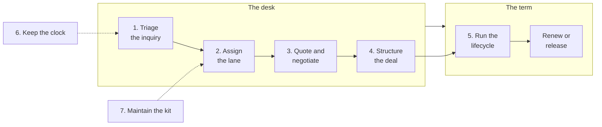

#  inbound-sponsorship (open skill)

**Your inbox already gets the sponsorship inquiries. The money is in how you sort them.** This skill turns an inbound sponsorship, advertising, paid-placement, or affiliate inquiry into a run an agent or an operator can execute and check: triage it against a bar, put it in the right pricing lane, negotiate on evidence instead of habit, close it on terms that protect the floor, and run the placement until it renews or ends.

##  What this is

An open skill that an AI agent can run, for the revenue side of a media property: the publishers, newsletters, podcasts, and channels that sponsors write to.

Most sponsorship advice teaches outbound pitching, or argues one pricing absolute — always publish your rates, or never publish your rates. This skill starts from the inbox a media property actually has, and asks:

1. Which inquiries deserve a reply at all, and which fail on fit, compliance, or money before anyone writes a word?

2. For this inquiry, who knows the bargaining zone — and who should name the first number because of it?

3. What deal shape protects the publisher when a brand wants the audience but not the risk?

4. What happens on day 200 of a 12-month placement, and who is watching it?

Three disciplines make this version different:

1.  **Two lanes, one test** — standard inventory runs on a fixed published card; custom work is scoped before any number exists. The test is who knows the bargaining zone, and the lane decides who speaks first.

2.  **Every rule carries its evidence** — studied, borrowed, or practitioner. The anchoring rules rest on a meta-analysis. The budget-bracket rule is doctrine and says so. The famous speed statistic with no source behind it is named as a myth and never taught.

3.  **The placement is a lifecycle, not a post** — term, monitoring, remedy, and renewal billed to charge itself are part of the product from the first reply, not paperwork after the sale.

##  Who it is for

| Audience | Use |
| --- | --- |
| **Publishers / newsletter operators** | Run the inbox as a revenue desk: triage rules, a rate card with a stated basis, hybrid counters, and renewals that do not depend on memory |
| **Creators / media sellers** | Price custom deals without anchoring low: scope deliverables, usage, and exclusivity first, then offer packages instead of a naked number |
| **AI agents** | Load `SKILL.md`, run one inquiry at a time, and return the five-part output — verdict, what they said, the money, the draft reply, the dated next step — with every draft held for a human approver |
| **Maintainers** | Refresh `references/` when sources change, bump `version` in `SKILL.md`, and record the change in `CHANGELOG.md` |

##  Process at a glance

##  How to use with an agent

1. **Load** [`SKILL.md`](./SKILL.md) as the skill.

2. **Bring one inquiry** (or one live placement) per run. The skill works the desk one item at a time.

3. **Pull references by step:**

| Need | Read |
| --- | --- |
| The evidence behind the rules, with citations and labels |  [`references/evidence-notes.md`](./references/evidence-notes.md) |
| Pricing tables with bases: newsletters, podcasts, video, sponsored posts |  [`references/benchmarks.md`](./references/benchmarks.md) |
| Clause language for hybrid deals, terms, and renewals |  [`references/hybrid-clauses.md`](./references/hybrid-clauses.md) |
| A complete run, graded step by step (shapes only) |  [`references/worked-example.md`](./references/worked-example.md) |

4. **Hold the guardrails.** The skill drafts; a human approver sends. Numbers and terms are never stated to a buyer before that approval, and disclosure is a product spec, never a bargaining chip.

##  Folder map

| Path | One line |
| --- | --- |
| [`SKILL.md`](./SKILL.md) | Main skill: guardrails, seven-step procedure, output contract, limits and boundaries |
| [`CHANGELOG.md`](./CHANGELOG.md) | Version history |
| [`references/README.md`](./references/README.md) | Index of the reference files |
| [`references/evidence-notes.md`](./references/evidence-notes.md) | The research behind the rules: anchoring, packages, precision, budget doctrine, speed, and the named myth |
| [`references/benchmarks.md`](./references/benchmarks.md) | Market pricing tables, every figure with its basis and source |
| [`references/hybrid-clauses.md`](./references/hybrid-clauses.md) | Fill-in clause templates: floor, guarantee boundary, test box, tracking, term and remedy, renewal, disclosure, the CPA counter |
| [`references/worked-example.md`](./references/worked-example.md) | One inbound inquiry walked through triage, lane choice, and a bracketed-range draft reply |
| [`references/build-notes.md`](./references/build-notes.md) | The four-skill pass record for this release |
| [`scripts/verify.sh`](./scripts/verify.sh) | Package checks: frontmatter, required sections, banned specifics, README layout |
| [`assets/icons/`](./assets/icons/) | Hugeicons Free SVG icons used in the documents |

##  Sources and credits

- The anchoring rules rest on Petrowsky et al., "First offers" meta-analysis, *Organizational Behavior and Human Decision Processes* (2025), with Galinsky & Mussweiler (2001) as the foundational study and Maaravi & Levy (2017) for the information-asymmetry limit.

- The package rule rests on Leonardelli, Gu, McRuer, Medvec & Galinsky (2019) on multiple equivalent simultaneous offers. The precision rule pairs Janiszewski & Uy (2008) and Mason et al. (2013) with Lee et al. (2018), "Too precise to pursue."

- The speed rules rest on the InsideSales lead-response study (Oldroyd, 2007) and Oldroyd, McElheran & Elkington, *Harvard Business Review* (2011). The "78% buy from the first responder" figure is excluded on the strength of a source audit that found no primary study behind it.

- The qualification frame adapts BANT (IBM) and MEDDIC (PTC) to a sponsorship desk, with the switch point as synthesized by Offbook. The budget-bracket form follows The Futur's bracketing method and MEDDIC Academy's critique of the naked budget question.

- Benchmarks are drawn from Inbox Collective, Revenews, SponsorCal (Paved and beehiiv data), Book a Sponsor, Libsyn Ads, Acast, Agentio, Aspire, SponsorRadar, ESBO, and BuzzStream. Each figure keeps its basis and source in [`references/benchmarks.md`](./references/benchmarks.md).

- Practitioner doctrine is credited where it is used: Justin Moore's *Sponsor Magnet* (2025) for scope-before-numbers (D.U.E.), Dealvio and AVID Media (via Everflow) for hybrid structure and the test box, RhinoRank and LinkVouch for the placement term convention.

- Content is **paraphrased**. No copyrighted book or article text is stored in this folder.

##  Contributing

- Open a PR with a better paraphrase, a newer benchmark with its basis stated, or a worked public example written as shapes only.

- Keep the folder grep-clean: no personal, company, or live-matter details inside the skill. `scripts/verify.sh` fails the build if a banned specific appears.

- When a source changes, re-read it, re-paraphrase, bump `version` in `SKILL.md`, and add a `CHANGELOG.md` entry.

##  License

MIT — see [`SKILL.md`](./SKILL.md) front matter. Third-party sources remain under their publishers' terms.

##  Version

Current skill version: see `version` in [`SKILL.md`](./SKILL.md) front matter. History: [`CHANGELOG.md`](./CHANGELOG.md).
